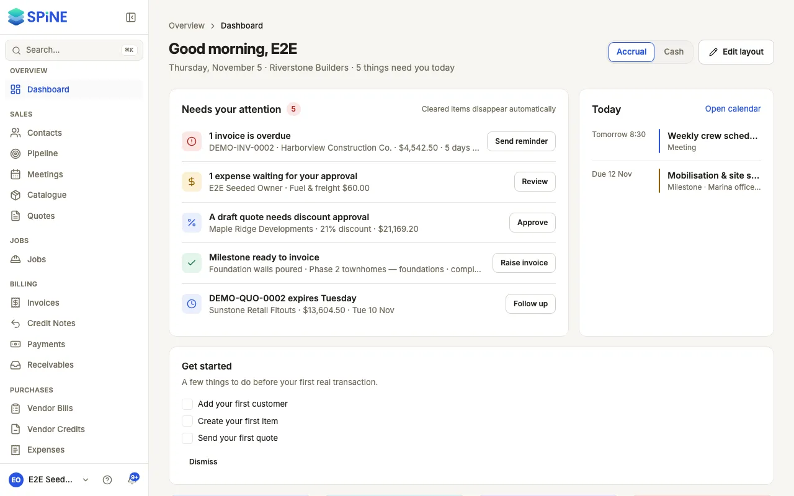
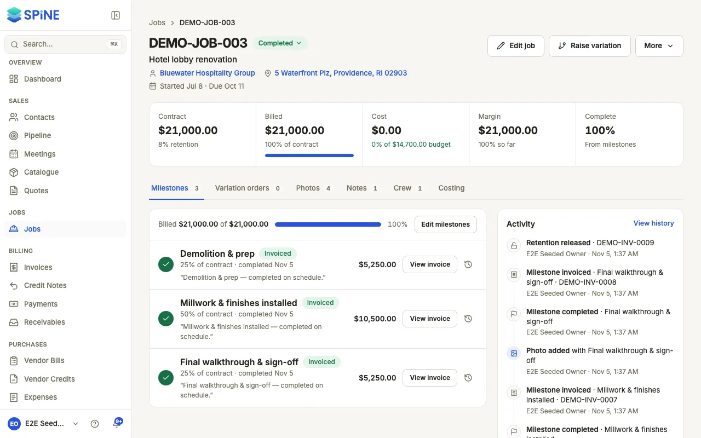
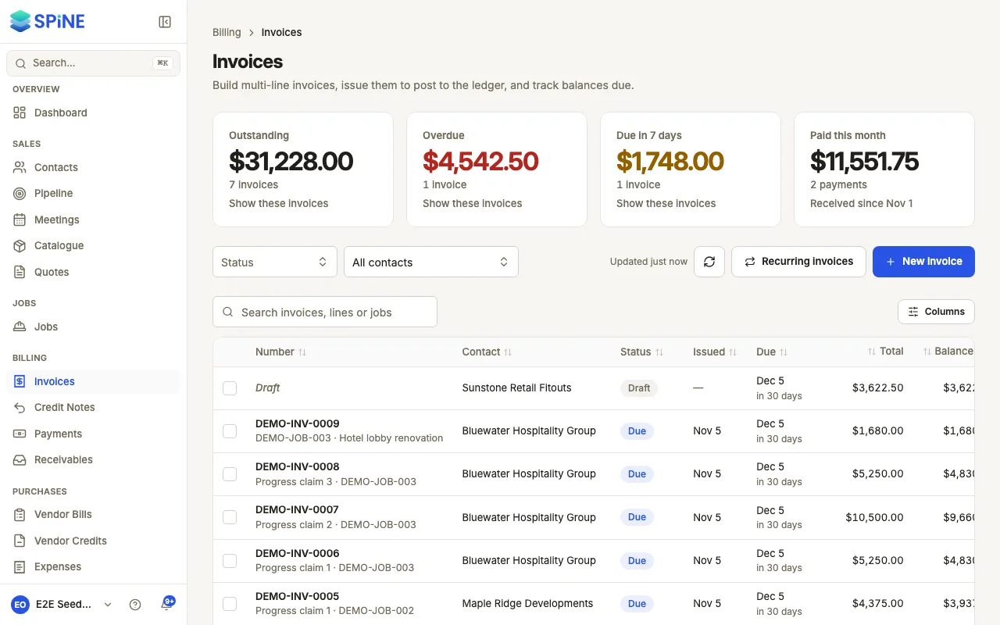
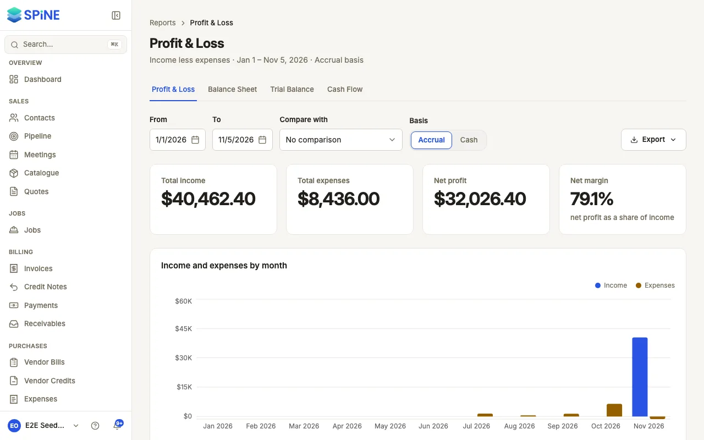

# Spine

Spine is a self-hosted business management app for small service and project
businesses — construction and interiors, fabrication, electrical/plumbing
contractors, AMC and maintenance firms, design studios. It follows the
workflow a small business actually runs on:

**enquiry → quote → job → invoice → payment → books**

Double-entry accounting is derived automatically from business events
(an invoice issued, a payment received) rather than typed in by the user —
the owner never has to think in debits and credits. See
[`docs/README.md`](docs/README.md) for the full product spec, and
[`CLAUDE.md`](CLAUDE.md) for the architecture rules that govern implementation.

## What it does

- **Sales:** contacts, a lead pipeline, meetings, a catalogue, and quotes your customers accept online.
- **Jobs:** turn an accepted quote into a job with milestones, variations, crew and costs, and invoice it as you go, retention included.
- **Billing:** invoices, credit notes, payments, reminders and statements, with tax per line (GST in India).
- **Purchases:** vendor bills, expenses with receipts and approvals, and vendor payments.
- **Books:** every document posts its own balanced entries, so the profit and loss, balance sheet, cash flow, aging and job profitability are always up to date. Exports to Tally.
- **Field app:** crews see their jobs, mark milestones done, and send photos and expenses, offline too (Android and iPhone).
- **Your server, your data:** it runs on your own machine with Docker. Nothing calls home, and backups, restores and upgrades are one command each.

## Screenshots

| | |
|---|---|
| <picture><source media="(prefers-color-scheme: dark)" srcset="apps/site/src/assets/screens/dashboard-dark.webp"></picture> | <picture><source media="(prefers-color-scheme: dark)" srcset="apps/docs/src/assets/screens/jobs-detail-dark.webp"></picture> |
| <picture><source media="(prefers-color-scheme: dark)" srcset="apps/docs/src/assets/screens/invoices-list-dark.webp"></picture> | <picture><source media="(prefers-color-scheme: dark)" srcset="apps/docs/src/assets/screens/reports-profit-and-loss-dark.webp"></picture> |

Captured from the demo business by `pnpm --filter @spine/e2e screenshots`. More in the [user guide](https://spine.h4loom.com/docs/guide/).

## Install in 5 minutes

The long version, with every setting, is the [self-hosting guide](https://spine.h4loom.com/docs/self-hosting/install/). You need a Linux or macOS machine (or Windows with WSL2) with Docker 24+ and Compose 2.20+.

**1. Download the release files.** On the [releases page](https://github.com/haribrothers/spine/releases), open the newest release and download these files into one folder: `install.sh`, `backup.sh`, `restore.sh`, `upgrade.sh`, `docker-compose.yml`, `Caddyfile` and `env.example`. You don't need the `.apk` (the field app for Android) or `docker-compose.coolify.yml`. Or, in a terminal, with the newest release's tag:

```bash
mkdir spine && cd spine
v=v1.0.0-beta.3
for f in install.sh backup.sh restore.sh upgrade.sh docker-compose.yml Caddyfile env.example; do
  curl -fsSLO "https://github.com/haribrothers/spine/releases/download/$v/$f"
done
```

**2. Run the installer** from that folder, with the address people will open Spine at:

```bash
chmod +x *.sh
./install.sh --app-url https://spine.example.com
```

Trying it on your own computer? Use `--app-url http://localhost` instead, or `http://<this computer's IP address>` to open it from other devices on your network. Spine then runs on plain HTTP, which is fine for trying it out; the field app and browser notifications need a real domain with HTTPS. Port 80 must be free.

It writes `.env` with fresh secrets, starts Spine and its database behind Caddy (which gets the HTTPS certificate), and prints the address. Open it and create the first account: that person owns the business. To try it with sample data first, set `SEED_DEMO=true` in `.env` before the first start (see [`.env.example`](.env.example)). Running on Coolify instead: [docs/self-hosting-coolify.md](docs/self-hosting-coolify.md).

## Back up and restore

```bash
./backup.sh --passphrase        # one encrypted file with the database and every attachment
./restore.sh backups/spine-backup-<date>.tar.gz.enc
```

`./backup.sh --help` shows how to run it nightly and keep a copy off the machine (`BACKUP_REMOTE`). Owners see a banner when the last backup is more than two days old.

## Update

Owners see "Spine <version> is available" when a new release is out. `./upgrade.sh` backs up, pulls the new version and restarts; the database is migrated automatically after a snapshot. See [Updating](#updating).

## Help

The user guide and the self-hosting guide are at [spine.h4loom.com/docs](https://spine.h4loom.com/docs/), and in the app (the **?** button). Found a bug or want something? [Open an issue](https://github.com/haribrothers/spine/issues/new/choose). Found a security problem? Please report it privately, as [SECURITY.md](SECURITY.md) explains.

## Status

Spine is at 1.0 beta: every module above is built and in use, and the 1.0 release is being finished (packaging, the docs site, translations). [`CHANGELOG.md`](CHANGELOG.md) lists what landed in each phase, and [`docs/progress.md`](docs/progress.md) what's open.

## Tech stack

| Layer | Choice |
|---|---|
| Web | Next.js (App Router), TypeScript |
| API | NestJS, REST + OpenAPI |
| Database | PostgreSQL 16 via Drizzle ORM |
| Styling | Tailwind CSS v4 |
| Components | `@spine/ui` — Radix UI primitives, themeable |
| Mobile | React Native via Expo |
| Auth | Better Auth |
| Jobs | pg-boss (Postgres-backed queue) |
| Files | Local disk volume by default; any S3-compatible store optional (AWS S3, R2, B2, RustFS) |
| Monorepo | Turborepo + pnpm |
| Container | Docker Compose |

Full rationale for each choice is in PRD §5.

## Repository layout

```
spine/
├─ apps/
│  ├─ api/             # NestJS — REST API, Drizzle schema & migrations
│  ├─ web/             # Next.js — the web app
│  ├─ mobile/          # Expo — the field app
│  ├─ e2e/             # Playwright end-to-end tests and the guide's screenshots
│  ├─ docs/            # Astro + Starlight — the docs at spine.h4loom.com/docs, and the /help guide in each install
│  ├─ site/            # Astro — the home page, spine.h4loom.com
│  ├─ design-system/   # @spine/ui's living docs
│  └─ showcase-native/ # @spine/ui-native's living docs
├─ packages/
│  ├─ shared/     # money, tax engine, zod schemas, shared types, the English strings (i18n)
│  ├─ ui/         # @spine/ui — Radix + Tailwind component library
│  ├─ ui-native/  # @spine/ui-native — the field app's components
│  ├─ sdk/        # typed API client
│  └─ config/     # shared eslint, tsconfig, tailwind presets
├─ docker/        # Dockerfile.api, Dockerfile.web, Caddyfile, Coolify compose
├─ docs/          # product spec (README.md → prd/, features/, design/), progress.md, qa-script.md
├─ scripts/       # install, backup, restore, upgrade, verify, release and mobile scripts
├─ docker-compose.yml       # production stack (published images, behind Caddy)
├─ docker-compose.dev.yml   # local dev infra only (Postgres, MailDev; optional RustFS)
└─ .env.example
```

## Local development setup

This is the path for contributors working on Spine itself. (If you just
want to run Spine as a self-hosted app, see [Production / self-hosting](#production--self-hosting)
below instead — that path never requires Node or pnpm on the host.)

### Prerequisites

- Node.js 22+ and pnpm 9
- [pnpm](https://pnpm.io/installation) (`corepack enable` is the easiest way to get the pinned version)
- Docker (for Postgres and MailDev — you do not need either installed locally)

### 1. Clone and install

```bash
git clone <repo-url> spine
cd spine
pnpm install
```

### 2. Start local infrastructure (Postgres + MailDev)

```bash
pnpm dev:infra:up
```

This starts two containers via `docker-compose.dev.yml`, separate from the
production stack in `docker-compose.yml`:

- **Postgres** on `localhost:5432` (user/pass/db: `spine`/`spine`/`spine`)
- **MailDev** on `localhost:1025` (SMTP) and `localhost:1080` (web UI — read quote emails here instead of a real inbox; nothing is ever actually delivered). Optional — leave `SMTP_HOST` blank in `.env` and email sending degrades gracefully (the quote still issues, the email queues for retry) if you don't need to see it locally.

The database persists in a Docker volume (`spine-dev_spine_dev_pgdata`)
across restarts. Uploaded files are stored by the local storage driver in
`apps/api/.data/files` (gitignored), so no storage container is needed. To
try the S3 driver, `COMPOSE_PROFILES=rustfs pnpm dev:infra:up` adds RustFS
on `localhost:9000` — see `.env.development.example`. Useful commands:

```bash
pnpm dev:infra:down    # stop containers, keep data
pnpm dev:infra:reset   # wipe volumes and start clean — use after a schema reset
pnpm dev:infra:logs    # tail container logs
```

### 3. Configure environment

```bash
cp .env.development.example .env
```

The development example points `DATABASE_URL` at `localhost:5432`, since
`apps/api` and `apps/web` run natively on your machine during development —
not inside Docker. (`.env.example`, by contrast, uses the Docker network
hostname `db:5432` and is for the production compose stack — see below.)

Everything besides the three required variables (`DATABASE_URL`,
`AUTH_SECRET`, `APP_URL`) is optional and degrades gracefully when left
blank — including `VAPID_PUBLIC_KEY`/`VAPID_PRIVATE_KEY`, which enable
browser push notifications (S-10.12). To test push locally, generate a
keypair and paste both values in:

```bash
npx web-push generate-vapid-keys
```

### 4. Run migrations and seed data

```bash
pnpm db:migrate:dev
pnpm db:seed:dev
```

The seed script creates a demo organisation and populates the default chart
of accounts (PRD §14.2).

### 5. Start the apps

```bash
pnpm dev
```

This runs `apps/api`, `apps/web`, and `apps/design-system` in parallel via
Turborepo, with hot-reload.

- API health check: `http://localhost:4000/health`
- Web: `http://localhost:3000`
- Design system docs (the `@spine/ui` component library's living spec — props,
  usage examples, one page per component, not Storybook): `http://localhost:3100`

To run just one of these (e.g. only the API while you work on a script),
use `pnpm --filter @spine/api dev` instead.

### 6. (Optional) Run the mobile app

`apps/mobile` (Expo) deliberately does **not** join `pnpm dev` above —
Expo's CLI is its own interactive terminal (QR code, keyboard shortcuts)
that doesn't multiplex well alongside `next dev`/`nest start --watch`'s
log output in one Turborepo pane. It has its own env file too, since Metro
reads `EXPO_PUBLIC_*` vars natively from an `.env` at the app's own root
rather than the `dotenv-cli` pattern `apps/web`/`apps/api` use:

```bash
cp apps/mobile/.env.development.example apps/mobile/.env
```

The default (`http://localhost:4000`) works as-is for the **iOS
Simulator** only, since it shares the Mac's own network stack. A physical
device or the **Android emulator** can't reach `localhost` (on-device,
that means the device itself) — see the comments in
`apps/mobile/.env.development.example` for the LAN-IP / `10.0.2.2`
alternatives. Then, with `apps/api` already running (step 5 above):

```bash
pnpm dev:mobile    # Expo Dev Tools — scan the QR code with Expo Go
pnpm dev:ios       # boots the iOS Simulator directly (needs Xcode)
pnpm dev:android   # boots an Android emulator directly (needs Android Studio)
```

### Everyday commands

Run from the repo root, applied across every package via Turborepo:

```bash
pnpm build       # build all apps/packages
pnpm lint        # eslint across the workspace
pnpm typecheck   # tsc --noEmit across the workspace
pnpm test        # unit tests (no database required)
```

Database-specific, scoped to `apps/api`:

```bash
pnpm --filter @spine/api db:generate       # generate a new migration from schema changes
pnpm --filter @spine/api db:migrate        # apply pending migrations
pnpm --filter @spine/api db:studio         # open Drizzle Studio against your dev DB
pnpm --filter @spine/api test:integration  # requires dev infra running — see below on which DB this hits
```

Schema lives in `apps/api/src/db/schema/`; after changing it, run
`db:generate` to produce a migration file in `apps/api/drizzle/`, review the
generated SQL, then `db:migrate` to apply it.

**`test:integration` runs against a separate `spine_test` database, not your
dev DB** — some integration tests (e.g. the ledger-integrity suite) `TRUNCATE`
real tables including `organization ... CASCADE` as part of their own
cleanup, which would otherwise delete every org/user/session in whatever
database is pointed at. `.env.test` (repo root, checked into git — no
secrets in it, just a DB name) overrides `DATABASE_URL` to
`spine_test` for this one script only; `apps/api/package.json`'s
`test:integration` script loads it. One-time setup, after your `db`
container is up:

```bash
docker exec spine-dev-db-1 psql -U spine -d spine -c "CREATE DATABASE spine_test;"
pnpm --filter @spine/api exec dotenv -e ../../.env.test -e ../../.env -- drizzle-kit migrate
```

Re-run the second command after any schema change to keep `spine_test`'s
schema in sync with `spine`'s.

The files run in parallel (D-239): before a run, each worker gets its own
copy of `spine_test` (`spine_test_w1` … `spine_test_w4`, made with
`CREATE DATABASE … TEMPLATE` and dropped afterwards), so no file sees
another's rows. `SPINE_TEST_WORKERS` sets how many workers (4 locally, 1 in
CI, whose two-core runner was slower with two); `SPINE_TEST_WORKERS=1` runs
one file at a time.

### Resetting your local database

If migrations get into a bad state or you want a completely clean slate:

```bash
pnpm dev:infra:reset
pnpm db:migrate:dev
pnpm db:seed:dev
```

## Production / self-hosting

The release's `docker-compose.yml` runs the published images
(`ghcr.io/haribrothers/spine-api` and `spine-web`) behind Caddy, so the host
needs only Docker. `install.sh` sets it up (see [Install in 5 minutes](#install-in-5-minutes));
from a clone it's `./scripts/install.sh`, with the same published images.

The app boots with only three required environment variables
(`DATABASE_URL`, `AUTH_SECRET`, `APP_URL`); everything else in
[`.env.example`](.env.example) is optional and degrades gracefully. The API
applies database migrations when it starts. Attachments live on the API's
`spine_files` volume (`STORAGE_DRIVER=local`); `docker compose down -v`
deletes that volume along with the database, so don't use `-v` unless you
mean it. To keep files in S3, R2 or B2 instead, set `STORAGE_DRIVER=s3` and
the `S3_*` values; add `--profile rustfs` to run a self-hosted S3 store. Use
`--profile full` to add the Cloudflare Tunnel sidecar.

### Updating

When a new version is out, Owners see "Spine <version> is available" at the
top of every page (the server checks GitHub Releases once a day and sends
nothing about your install; set `UPDATE_CHECK=off` in `.env` to turn that
off). To update, from the folder with your `.env`:

```bash
./upgrade.sh                    # to the latest release
./upgrade.sh --version 1.0.1    # to a given version
```

(In a clone of this repo it's `./scripts/upgrade.sh`, after checking out the
version's tag.)

It backs up first, pulls the new version's images and restarts. The API
takes a database snapshot, then applies the new version's migrations before
it serves anyone; if a migration fails it stops and names the snapshot to
restore. Your `.env` is kept, apart from `SPINE_VERSION`. On Coolify, see
[the Coolify guide](docs/self-hosting-coolify.md#upgrading-to-a-new-beta).
Settings › About Spine shows the version you're on.

### Upgrading an install that used MinIO

Spine now stores files on the API's own volume (`STORAGE_DRIVER=local`,
the default) instead of MinIO, and `docker-compose.yml` no longer starts
MinIO. You can either:

- **Move your files to local storage (recommended).** Keep MinIO running
  and your `S3_*` settings in `.env`, start the new version, then run
  `docker compose exec api pnpm --filter @spine/api files:migrate --from s3 --to local`.
  It copies every file into the `spine_files` volume, checks each copy
  against its checksum, and prints copied, skipped and failed counts.
  Nothing in the bucket is changed or deleted. If anything fails, it lists
  those files and exits with an error; fix the cause and run it again, and
  files already moved are skipped. When it reports no failures, set
  `STORAGE_DRIVER=local` (or remove it) and restart. You can stop MinIO
  once you've checked your attachments.
- **Keep MinIO.** Set `STORAGE_DRIVER=s3`, keep your `S3_*` settings, and
  run MinIO yourself, for example from your old compose file or as its own
  service. Spine works unchanged.

## Architecture notes worth knowing before contributing

These are enforced, not just conventions — see `CLAUDE.md` for the complete
list:

- **The ledger is derived, never authored.** Business events flow through a
  domain service → posting rule → balanced journal entry. Nobody types a
  journal entry by hand.
- **Journal entries are immutable.** In the database, not just by
  convention — Postgres triggers reject any `UPDATE`/`DELETE` on
  `journal_entries` or `journal_lines` after insert, and a deferred
  constraint trigger rejects any entry where debits ≠ credits at commit
  time. Corrections are reversing entries.
- **Money is `bigint` minor units + currency code.** Never floats.

## Contributing

Contributions are welcome: see [CONTRIBUTING.md](CONTRIBUTING.md) for how to set up, the rules every change follows, and signing off your commits (Developer Certificate of Origin). Everyone taking part follows the [Code of Conduct](CODE_OF_CONDUCT.md). How releases are made: [docs/release.md](docs/release.md).

## License

Spine is free software under the [GNU Affero General Public License v3.0 only](LICENSE) (AGPL-3.0-only), copyright (C) 2026 Hari Prasad. You can self-host it, change it and share it; if you run a modified copy as a service for others, you must offer them its source.

### Artwork

The people on the signed-out pages are [Open Peeps](https://www.openpeeps.com/) by Pablo Stanley, released under CC0.
