# Screens

Every screen in the product: 361 in total (60 added for Phases 8–9 on 2026-10-06, D-133, and 8 for the AI assistant, D-162). **Captured** screens are screenshots of the running app (demo data, Riverstone Builders); **Drawn** screens are designed on the canvas and not built yet. Names are the screen ids used in stories. Desktop is 1440×900; phone is 390×844. Drawn iOS screens show a floating tab bar with line icons for illustration only — the app uses the system tab bar with SF Symbols (US-MOB-19, D-022, D-029).

The design canvas with every drawn screen: [Spine — New screens](https://claude.ai/artifact/Arg4jSKaDS9KDyiMtUwRYY). Phase 8–9 screens are on its pages "Phase 8 · Books completeness" and "Phase 9 · Tax, documents and setup" (the AI assistant screens are in its "AI assistant" groups); they share one sidebar component (`V1Sidebar`) that adds Banking, Vendor Credits and Journals to the navigation.

## Onboarding & first run

### OnbWelcome — Welcome / load demo data or set up
**Priority:** P1 · **Phase:** 0 · **Stories:** US-ONB-01, US-ONB-02, US-ONB-09, US-ONB-18 · **Source:** Captured

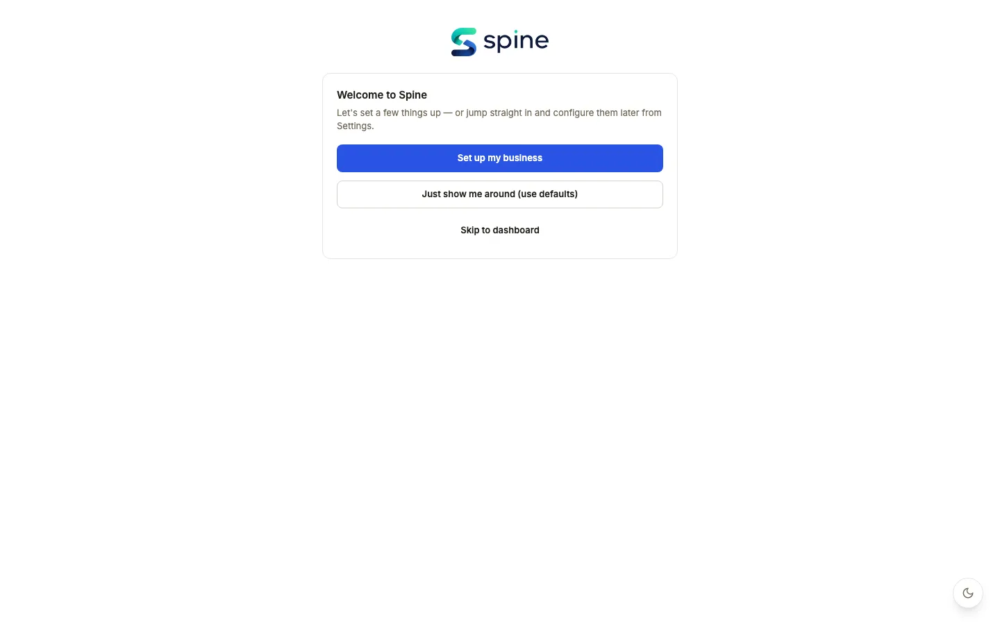

Links to: `OnbBusinessProfile`, `DemoBusinessDialog`

Since US-ONB-18, "Just show me around (use defaults)" opens `DemoBusinessDialog` instead of loading the demo straight away.

Shows: "Welcome to Spine" · "Let's set a few things up - or jump straight in and configure them later from" · "Settings." · "Set up my business" · "Just show me around (use defaults)" · "skip to dashboard"

### OnbBusinessProfile — Business profile + logo
**Priority:** P1 · **Phase:** 0 · **Stories:** US-ONB-02, US-ONB-03, US-ONB-11 · **Source:** Captured

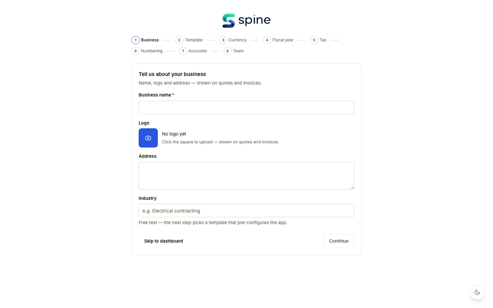

Links to: `OnbWelcome`, `OnbChartOfAccounts`

Shows: "1) Business" · "2) Template" · "3 Currency" · "Fiscal year" · "Tax -" · "6) Numbering -" · "7) Accounts" · "Team" · "Tell us about your business" · "Name, logo and address - shown on quotes and invoices." · "Business name *" · "Logo" · "No logo yet" · "Click the square to upload - shown on quotes and invoices." · "Address" · "Industry" · "e.g. Electrical contracting" · "Free text - the next step picks a template that pre-configures the app." · "Skip to dashboard" · "Continue"

### OnbIndustryTemplate — Industry template picker
**Priority:** P1 · **Phase:** 3 · **Stories:** US-ONB-04, US-ONB-13 · **Source:** Captured

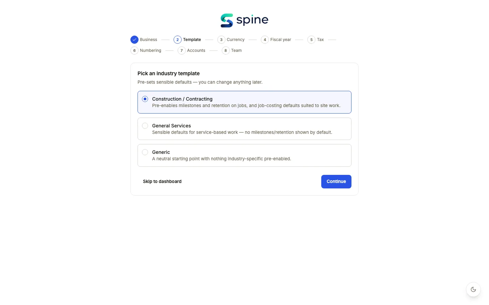

Links to: —

Shows: "Business" · "Template" · "3 Currency" · "Fiscal year" · "Tax" · "6 Numbering" · "Accounts" · "Team" · "Pick an industry template" · "Pre-sets sensible defaults — you can change anything later." · "• Construction / Contracting" · "Pre-enables milestones and retention on jobs, and job-costing defaults sulted to site work." · "General Services" · "Sensible defaults for service-based work - no milestones/retention shown by default." · "Generic" · "A neutral starting point with nothing industry-specific pre-enabled." · "Skip to dashboard" · "contihue"

### OnbCurrencyLocale — Currency & locale
**Priority:** P1 · **Phase:** 0 · **Stories:** US-ONB-05 · **Source:** Captured

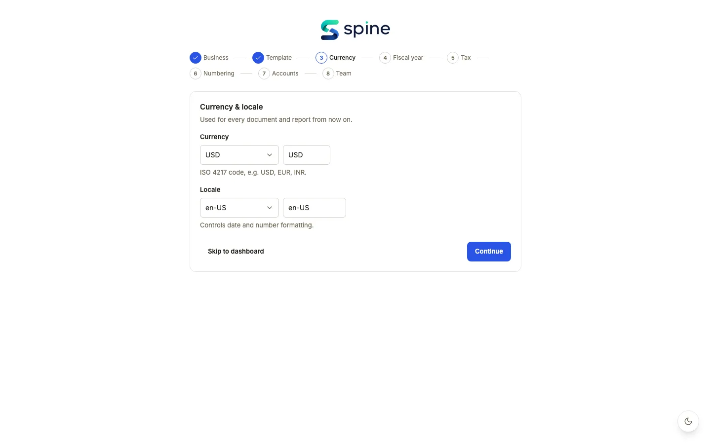

Links to: `OnbFinancialYear`

Shows: "• Business" · "~ Template" · "3) Currency" · "Fiscal year" · "Tax" · "6 Numbering" · "7) Accounts" · "Team" · "Currency & locale" · "Used for every document and report from now on." · "Currency" · "USD" · "ISO 4217 code, e.g. USD, EUR, INR." · "Locale" · "en-US" · "Controls date and number formatting." · "Skip to dashboard" · "Continue"

### OnbFinancialYear — Financial year start
**Priority:** P1 · **Phase:** 0 · **Stories:** US-ONB-05, US-OPS-21 · **Source:** Captured

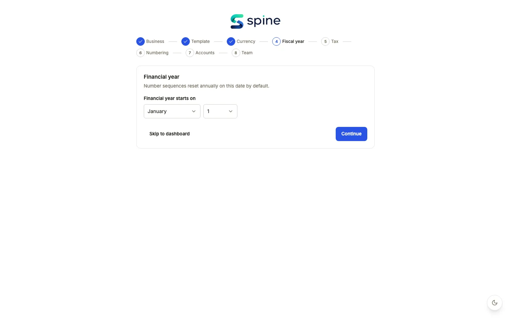

Links to: `OnbCurrencyLocale`, `OnbInviteTeam`, `QuoteBuilder`, `TeamPrivilegesExpanded`, `QuoteDetailAccepted`, `InvoiceBuilder`

Shows: "5 spine" · "• Business" · "~ Template" · "• Currency" · "Fiscal year" · "Tax" · "6 Numbering" · "7) Accounts" · "Team" · "Financial year" · "Number sequences reset annually on this date by default." · "Financial year starts on" · "January" · "Skip to dashboard" · "contihue"

### OnbTaxRate — Tax rate confirmation
**Priority:** P1 · **Phase:** 0 · **Stories:** US-ONB-06 · **Source:** Captured

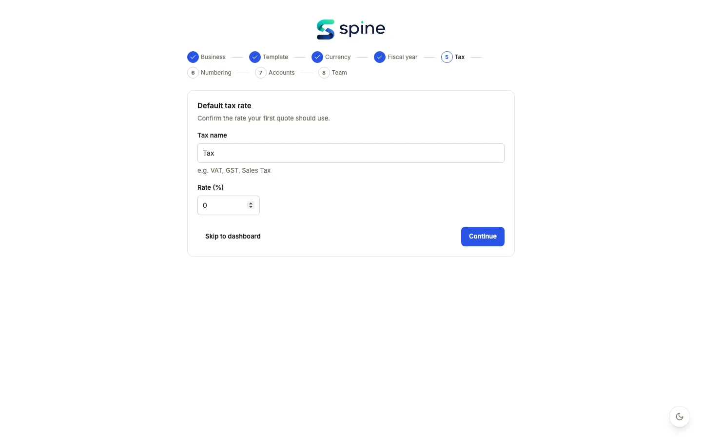

Links to: `OnbNumbering`

Shows: "5 spine" · "• Business" · "→ Template" · "Currency" · "Fiscal year" · "Tax" · "6 Numbering" · "7) Accounts" · "Team" · "Default tax rate" · "Confirm the rate your first quote should use." · "Tax name" · "e.g. VAT, GST, Sales Tax" · "Rate (%)" · "Skip to dashboard" · "(Contihue"

### OnbNumbering — Numbering prefixes
**Priority:** P1 · **Phase:** 0 · **Stories:** US-ONB-06 · **Source:** Captured

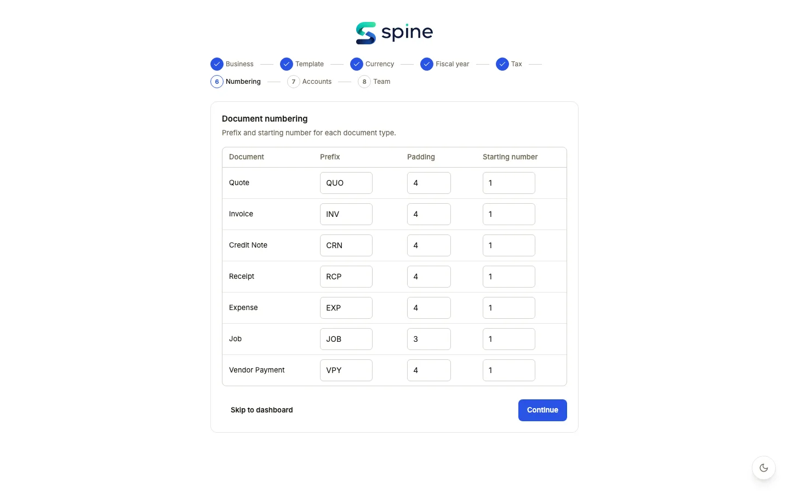

Links to: `OnbTaxRate`

Shows: "• Business" · "Template" · "Currency" · "Fiscal year" · "Tax —" · "Numbering" · "Accounts" · "Team" · "Document numbering" · "Prefix and starting number for each document type." · "Document" · "Prefix" · "Padding" · "Starting number" · "Quote" · "QUO" · "Invoice" · "INV" · "Credit Note" · "CRN" · "Receipt" · "RCP" · "Expense" · "EXP" · "Job" · "JOB" · "Vendor Payment" · "VPY" · "Skip to dashboard" · "Continue"

### OnbChartOfAccounts — Chart of accounts review
**Priority:** P1 · **Phase:** 0 · **Stories:** US-ONB-07, US-ONB-11 · **Source:** Captured

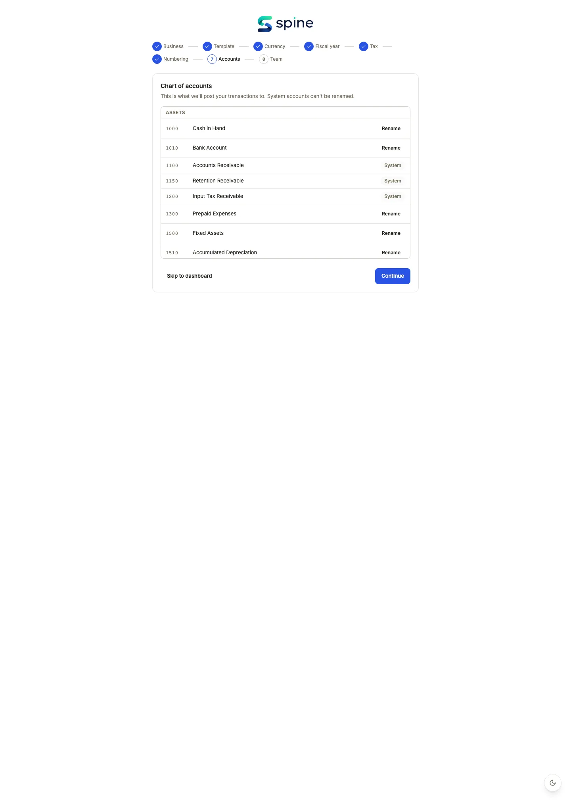

Links to: `OnbBusinessProfile`

Shows: "~ Business" · "~ Template" · "~ Currency" · "• Fiscal year" · "~ Tax" · "~ Numbering" · "7) Accounts" · "Chart of accounts" · "This Is what we'll post your transactions to. System accounts can't be renamed." · "ASSETS" · "1000" · "Cash In Hand" · "1010" · "Bank Account" · "1100" · "Accounts Receivable" · "1150" · "Retention Receivable" · "1200" · "Input Tax Receivable" · "1300" · "Prepald Expenses" · "1500" · "Fixed Assets" · "1510" · "Accumulated Depreclation" · "Skip to dashboard"

### OnbInviteTeam — Invite team
**Priority:** P1 · **Phase:** 0 · **Stories:** US-ONB-08, US-OPS-21 · **Source:** Captured

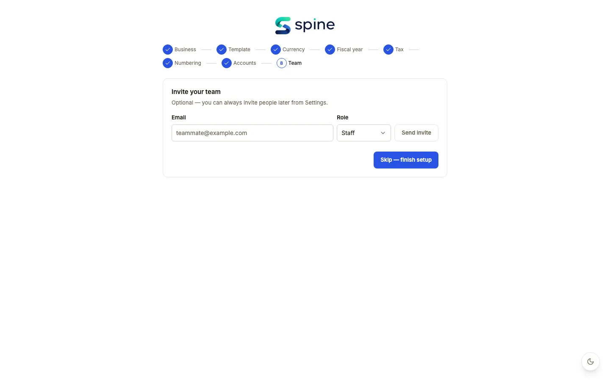

Links to: `OnbInviteTeamSent`, `OnbFinancialYear`, `QuoteBuilder`, `TeamPrivilegesExpanded`, `QuoteDetailAccepted`, `InvoiceBuilder`

Shows: "• Business" · "→ Template" · "Currency" · "Fiscal year" · "Tax" · "Numbering" · "→ Accounts" · ") Team" · "Invite your team" · "Optional - you can always invite people later from Settings." · "Email" · "Role" · "teammate@example.com" · "Staff" · "Send invite" · "Skip - finish setup"

### OnbInviteTeamSent — Invite team — invitations sent
**Priority:** P2 · **Phase:** 0 · **Stories:** US-ONB-08 · **Source:** Captured

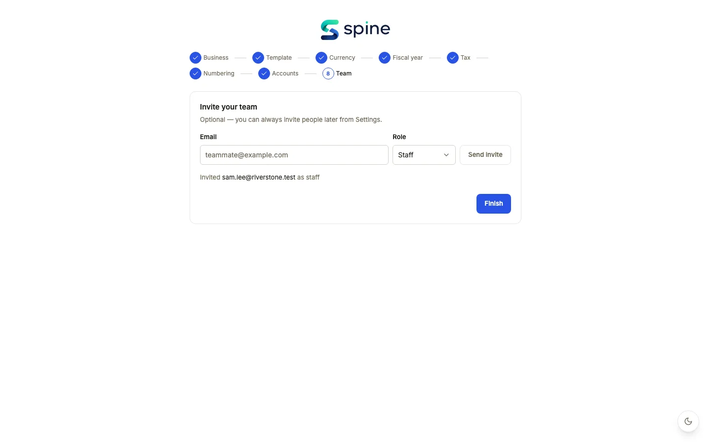

Links to: `OnbInviteTeam`

Shows: "• Business" · "→ Template" · "Currency" · "Fiscal year" · ") Tax" · "Numbering" · "→ Accounts" · ") Team" · "Invite your team" · "Optional - you can always invite people later from Settings." · "Email" · "Role" · "teammate@example.com" · "Staff" · "Send invite" · "Invited sam.lee@riverstone.test as staff" · "Finish"

### DashboardSetupChecklist — Dashboard with setup checklist (empty org)
**Priority:** P1 · **Phase:** 1 · **Stories:** US-ONB-10 · **Source:** Captured

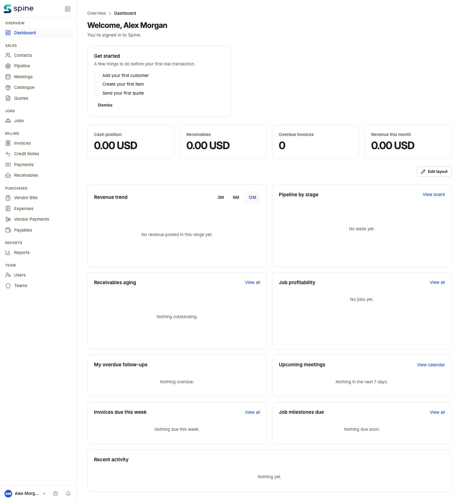

Links to: —

Shows: "Overview > Dashboard" · "Welcome, Alex Morgan" · "You're signed in to Spine." · "Get started" · "A few things to do before your first real transaction." · "Add your first customer" · "Create your first Item" · "Send your first quote" · "Dismiss" · "Cash position" · "Receivables" · "Overdue Invoices" · "Revenue this month" · "0.00 USD" · "O Edit layout" · "Revenue trend" · "3M" · "6M" · "12M" · "Pipeline by stage" · "View board" · "No leads yet." · "No revenue posted In this range yet." · "Receivables aging" · "View all" · "Job profitability" · "No lobs vet." · "Nothing outstanding" · "My overdue follow-ups" · "Upcoming meetings" · "View calendar" · "Nothing overdue." · "Nothing in the next 7 days." · "Invoices due this week" · "Job milestones due" · "Nothing due this week." · "Nothing due soon." · "Recent activity" · "Nothing yet."

### DashboardCaughtUp — Dashboard (redesign) — all caught up, setup checklist
**Priority:** P1 · **Phase:** 6 · **Stories:** US-ONB-12, US-DASH-12, US-OPS-32 · **Source:** Drawn

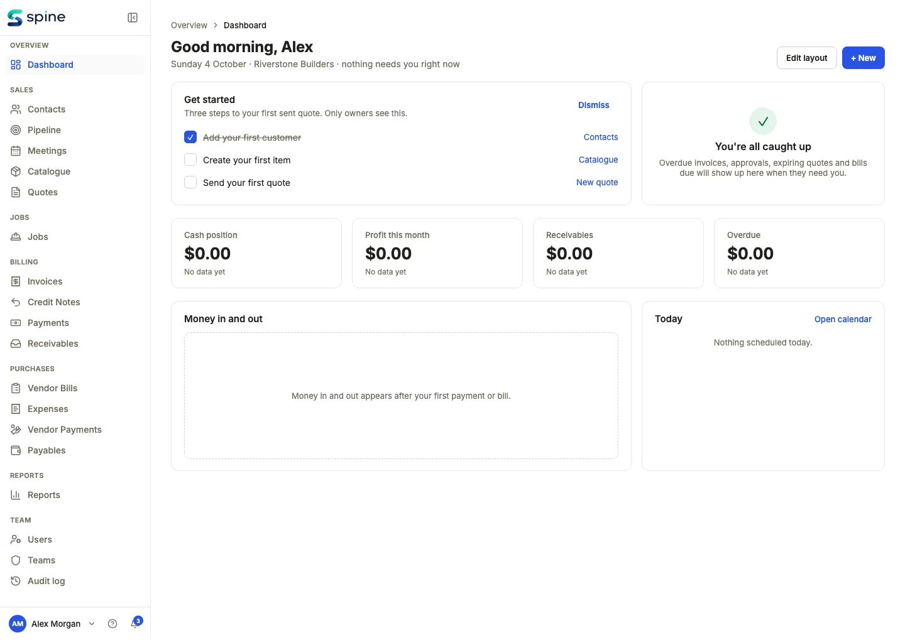

Links to: `DashboardStaffRedesign`, `DashboardOwnerRedesign`

Shows: "Overview" · "Dashboard" · "Good morning, Alex" · "Sunday 4 October · Riverstone Builders · nothing needs you right now" · "Edit layout" · "+ New" · "Get started" · "Three steps to your first sent quote. Only owners see this." · "Dismiss" · "Add your first customer" · "Contacts" · "Create your first item" · "Catalogue" · "Send your first quote" · "New quote" · "You're all caught up" · "Overdue invoices, approvals, expiring quotes and bills due will show up here when they need you." · "Cash position" · "$0.00" · "No data yet" · "Profit this month" · "Receivables" · "Overdue" · "Money in and out" · "Money in and out appears after your first payment or bill." · "Today" · "Open calendar" · "Nothing scheduled today."

### DashboardStaffRedesign — Dashboard (redesign) — staff
**Priority:** P1 · **Phase:** 6 · **Stories:** US-ONB-12, US-DASH-14, US-DASH-16, US-DASH-17, US-TEAM-18, US-OPS-32 · **Source:** Drawn

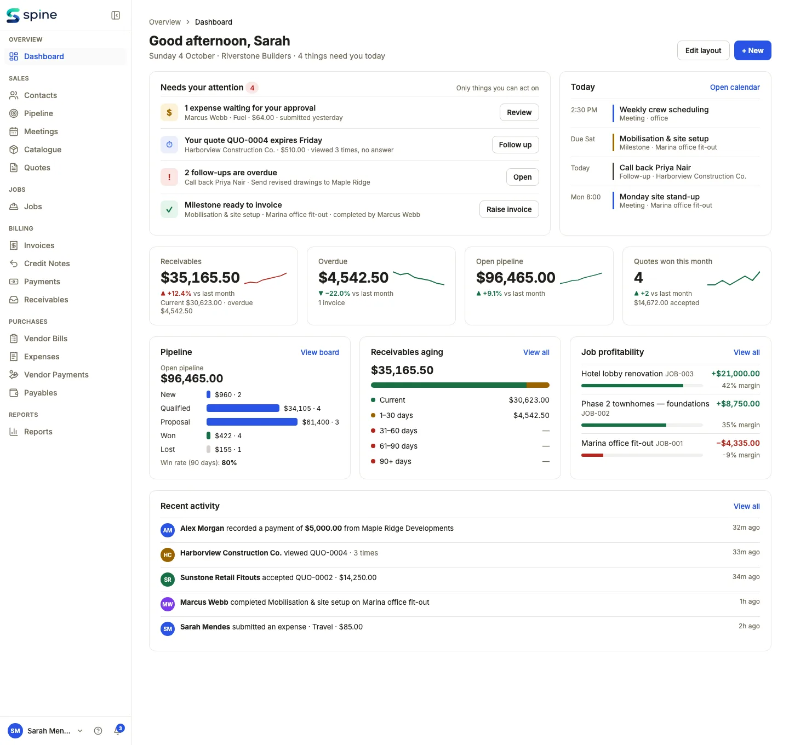

Links to: `DashboardOwnerRedesign`, `DashboardFieldRedesign`, `DashboardCaughtUp`, `NoAccess`

Shows: "Overview" · "Dashboard" · "Good afternoon, Sarah" · "Sunday 4 October · Riverstone Builders · 4 things need you today" · "Edit layout" · "+ New" · "Needs your attention" · "Only things you can act on" · "1 expense waiting for your approval" · "Marcus Webb · Fuel · $64.00 · submitted yesterday" · "Review" · "Your quote QUO-0004 expires Friday" · "Harborview Construction Co. · $510.00 · viewed 3 times, no answer" · "Follow up" · "2 follow-ups are overdue" · "Call back Priya Nair · Send revised drawings to Maple Ridge" · "Open" · "Milestone ready to invoice" · "Mobilisation & site setup · Marina office fit-out · completed by Marcus Webb" · "Raise invoice" · "Today" · "Open calendar" · "2:30 PM" · "Weekly crew scheduling" · "Meeting · office" · "Due Sat" · "Mobilisation & site setup" · "Milestone · Marina office fit-out" · "Call back Priya Nair" · "Follow-up · Harborview Construction Co." · "Mon 8:00" · "Monday site stand-up" · "Meeting · Marina office fit-out" · "Receivables" · "$35,165.50" · "▲ +12.4%" · "vs last month" · "Current $30,623.00 · overdue $4,542.50" · "Overdue" · "$4,542.50" · "▼ −22.0%" · "1 invoice" · "Open pipeline" · "$96,465.00" · "▲ +9.1%" · …

### OnbTaxCountry — Setup wizard — pick a tax country
**Priority:** P1 · **Phase:** 9 · **Stories:** US-TAX-09 · **Source:** Drawn

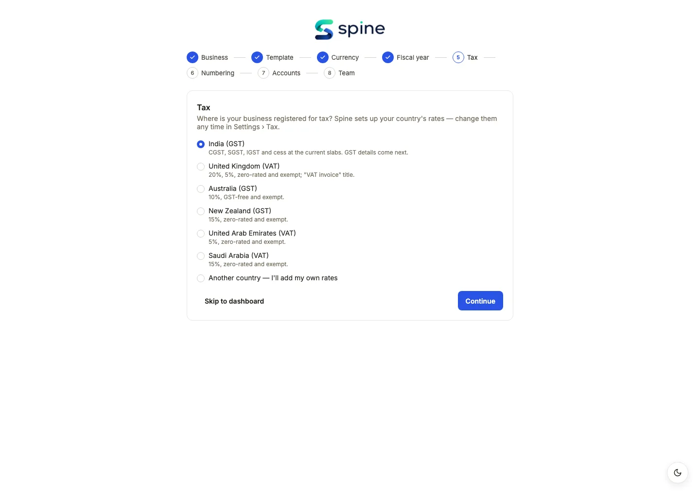

Links to: —

Shows: "Setup — tax country — Spine" · "Business" · "Template" · "Currency" · "Fiscal year" · "5" · "Tax" · "6" · "Numbering" · "7" · "Accounts" · "8" · "Team" · "Where is your business registered for tax? Spine sets up your country's rates — change them any time in Settings › Tax." · "India (GST)" · "CGST, SGST, IGST and cess at the current slabs. GST details come next." · "United Kingdom (VAT)" · "20%, 5%, zero-rated and exempt; \"VAT invoice\" title." · "Australia (GST)" · "10%, GST-free and exempt." · "New Zealand (GST)" · "15%, zero-rated and exempt." · "United Arab Emirates (VAT)" · "5%, zero-rated and exempt." · "Saudi Arabia (VAT)" · "Another country — I'll add my own rates" · "Skip to dashboard" · "Continue"

### SetupSpine — Set up Spine page
**Priority:** P1 · **Phase:** 9 · **Stories:** US-ONB-15, US-ONB-16 · **Source:** Drawn

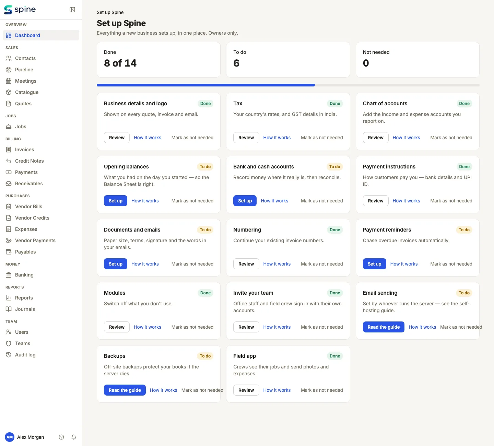

Links to: the Settings panes, `Banking`, `OpeningBalances`, `TeamUsers`

As built (D-194): Backups shows no Done/To do chip and "Spine can't check backups yet — whoever runs the server sets them up. Not counted below.", so the drawn "8 of 14" reads "8 of 13"; hidden cards move to a "Not needed" list with "Show again"; "How it works" is hidden until Phase 11; a loaded demo adds the note "Demo data is loaded — …" above the counts.

Shows: "Set up Spine — Spine" · "Set up Spine" · "Everything a new business sets up, in one place. Owners only." · "Done" · "8 of 14" · "To do" · "6" · "Not needed" · "0" · "Business details and logo" · "Shown on every quote, invoice and email." · "Review" · "How it works" · "Mark as not needed" · "Tax" · "Your country's rates, and GST details in India." · "Chart of accounts" · "Add the income and expense accounts you report on." · "Opening balances" · "What you had on the day you started — so the Balance Sheet is right." · "Set up" · "Bank and cash accounts" · "Record money where it really is, then reconcile." · "Payment instructions" · "How customers pay you — bank details and UPI ID." · "Documents and emails" · "Paper size, terms, signature and the words in your emails." · "Numbering" · "Continue your existing invoice numbers." · "Payment reminders" · "Chase overdue invoices automatically." · "Modules" · "Switch off what you don't use." · "Invite your team" · "Office staff and field crew sign in with their own accounts." · "Email sending" · "Set by whoever runs the server — see the self-hosting guide." · "Read the guide" · "Backups" · "Off-site backups protect your books if the server dies." · "Field app" · "Crews see their jobs and send photos and expenses."

## Sign-in & account

### SignUp — First-user sign-up (becomes Primary Owner)
**Priority:** P1 · **Phase:** 0 · **Stories:** US-AUTH-01, US-AUTH-05 · **Source:** Captured

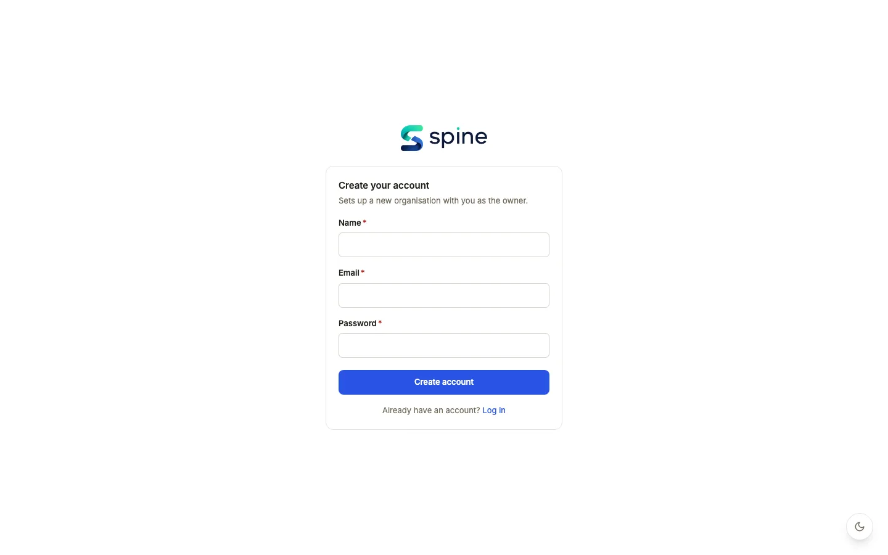

Links to: `AcceptInvite`

Shows: "Create your account" · "Sets up a new organisation with you as the owner." · "Name *" · "Email *" · "Password *" · "Create account" · "Already have an account? Log in"

### SignIn — Sign in
**Priority:** P1 · **Phase:** 0 · **Stories:** US-AUTH-02 · **Source:** Captured

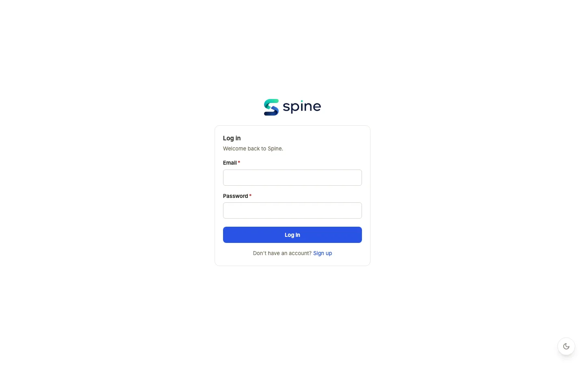

Links to: —

Shows: "Log in" · "Welcome back to Spine." · "Email*" · "Password *" · "Don't have an account? Sign up"

### AcceptInvite — Accept invitation
**Priority:** P1 · **Phase:** 0 · **Stories:** US-AUTH-04, US-AUTH-05 · **Source:** Captured

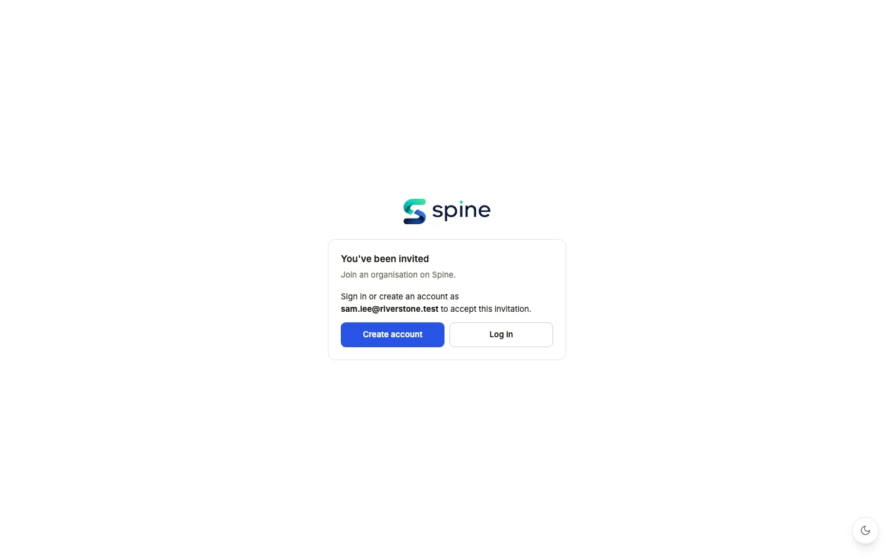

Links to: `EmailInvite`, `SignUp`

Shows: "5 spine" · "You've been invited" · "Join an organisation on Spine." · "Sign in or create an account as" · "sam.lee@riverstone.test to accept this invitation." · "Create account" · "Log in"

### EmailInvite — Invitation email
**Priority:** P2 · **Phase:** 0 · **Stories:** US-AUTH-04, US-TEAM-02, US-TEAM-15 · **Source:** Captured

Links to: `TeamUsers`, `AcceptInvite`

Shows: "Alex Morgan invited you to join Alex Morgan's Organisation as staff." · "Accept the invitation" · "If you weren't expecting this, you can ignore this email."

### ProfilePreferences — Profile & Preferences
**Priority:** P1 · **Phase:** 0 · **Stories:** US-AUTH-06, US-AUTH-07, US-NTF-09 · **Source:** Captured

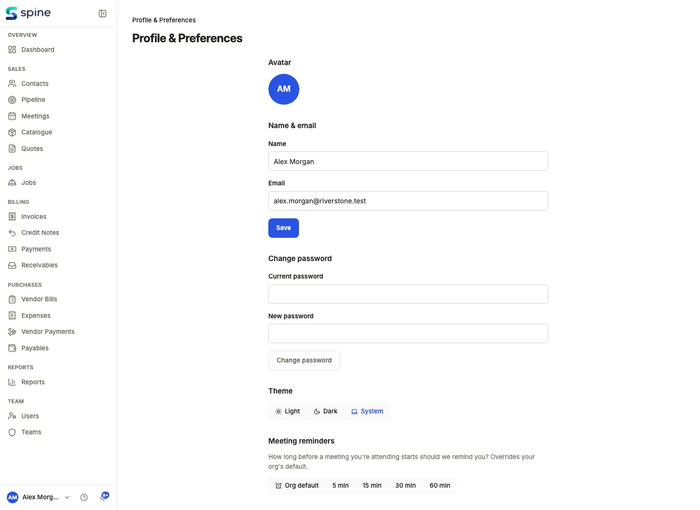

Links to: `UserMenu`, `SettingsMeetingReminders`

Shows: "5 spine" · "Profile & Preferences" · "OVERVIEW" · "98 Dashboard" · "Avatar" · "SALES" · "• Contacts" · "AM" · "Pipeline" · "Meetings" · "Name & email" · "• Catalogue" · "Name" · "Quotes" · "Alex Morgan" · "JOBS" · "• Jobs" · "Emall" · "BILLING" · "alex.morgan@riverstone.test" · "• Invoices" · "Save" · "5 Credit Notes" · "•• Payments" · "Change password" · "• Receivables" · "Current password" · "PURCHASES" · "® Vendor Bills" · "E Expenses" · "New password" · "%g Vendor Payments" · "• Payables" · "REPORTS" · "Ll! Reports" · "Theme" · "TEAM" · "o: Light" · "& Dark" · "• System" · "go Users" · "• Teams" · "Meeting reminders" · "How long before a meeting you're attending starts should we remind you? Overrides your" · "org's default." · …

### UserMenu — User menu
**Priority:** P1 · **Phase:** 0 · **Stories:** US-AUTH-03, US-AUTH-07, US-SET-01 · **Source:** Captured

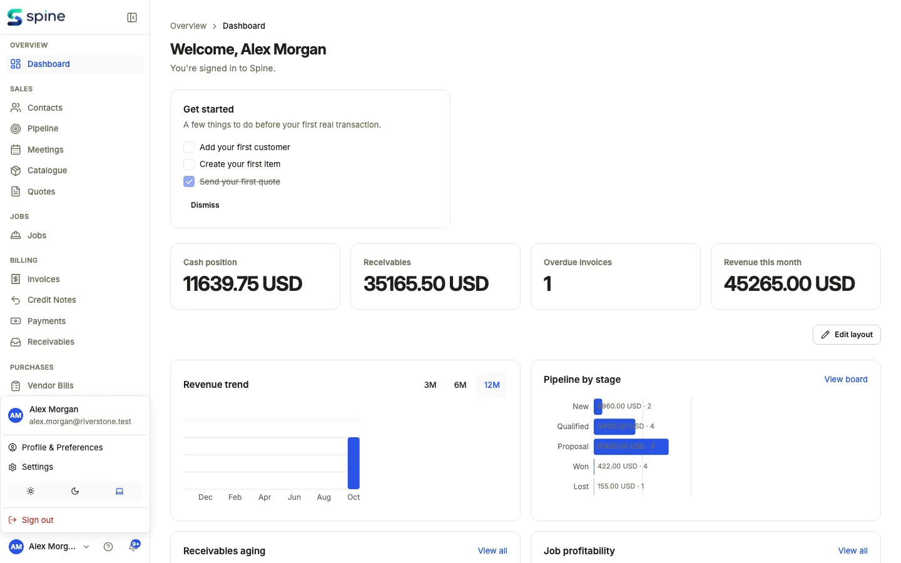

Links to: `ProfilePreferences`, `SettingsBusiness`

Shows: "Overview > Dashboard" · "Welcome, Alex Morgan" · "You're signed in to Spine." · "Get started" · "A few things to do before your first real transaction." · "Add your first customer" · "Create your first item" · "Send your first quote" · "Dismiss" · "Cash position" · "Receivables" · "Overdue invoices" · "Revenue this month" · "11639.75 USD" · "35165.50 USD" · "45265.00 USD" · "0 Edit layout" · "Pipeline by stage" · "View board" · "Revenue trend" · "3M" · "6M" · "12M" · "New @960.00 USD •2" · "Qualified 34105.00 USD • 4" · "Proposal 61400.00 USD • 3" · "Won 422.00 USD • 4" · "Lost 155.00 USD • 1" · "Dec" · "Feb" · "Apr" · "Jun" · "Aug" · "Oct" · "Receivables aging" · "View all" · "Job profitability"

### SignUpClosed — Sign-up closed
**Priority:** P2 · **Phase:** 6 · **Stories:** US-AUTH-08 · **Source:** Drawn

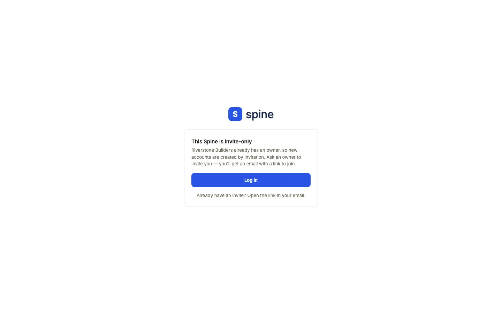

Links to: —

Shows: "This Spine is invite-only" · "Riverstone Builders already has an owner, so new accounts are created by invitation. Ask an owner to invite you — you'll get an email with a link to join." · "Log in" · "Already have an invite? Open the link in your email."

### ForgotPassword — Forgot password
**Priority:** P2 · **Phase:** 6 · **Stories:** US-AUTH-09 · **Source:** Drawn

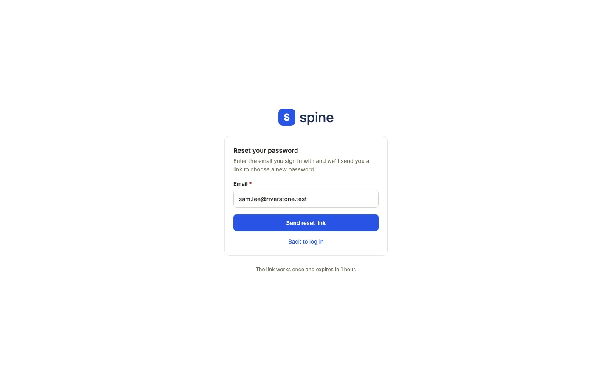

Links to: `ForgotPasswordSent`

Shows: "Reset your password" · "Enter the email you sign in with and we'll send you a link to choose a new password." · "Email" · "Send reset link" · "Back to log in" · "The link works once and expires in 1 hour."

### ForgotPasswordSent — Check your email
**Priority:** P2 · **Phase:** 6 · **Stories:** US-AUTH-09 · **Source:** Drawn

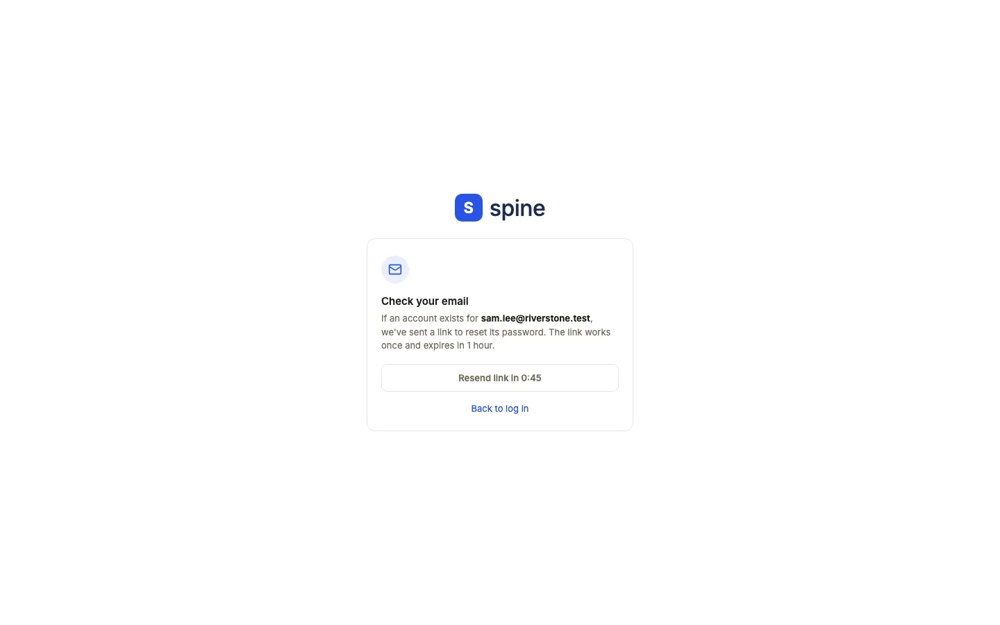

Links to: `ForgotPassword`

Shows: "Check your email" · "If an account exists for" · "sam.lee@riverstone.test" · ", we've sent a link to reset its password. The link works once and expires in 1 hour." · "Resend link in 0:45" · "Back to log in"

### ResetPassword — Choose a new password
**Priority:** P2 · **Phase:** 6 · **Stories:** US-AUTH-10 · **Source:** Drawn

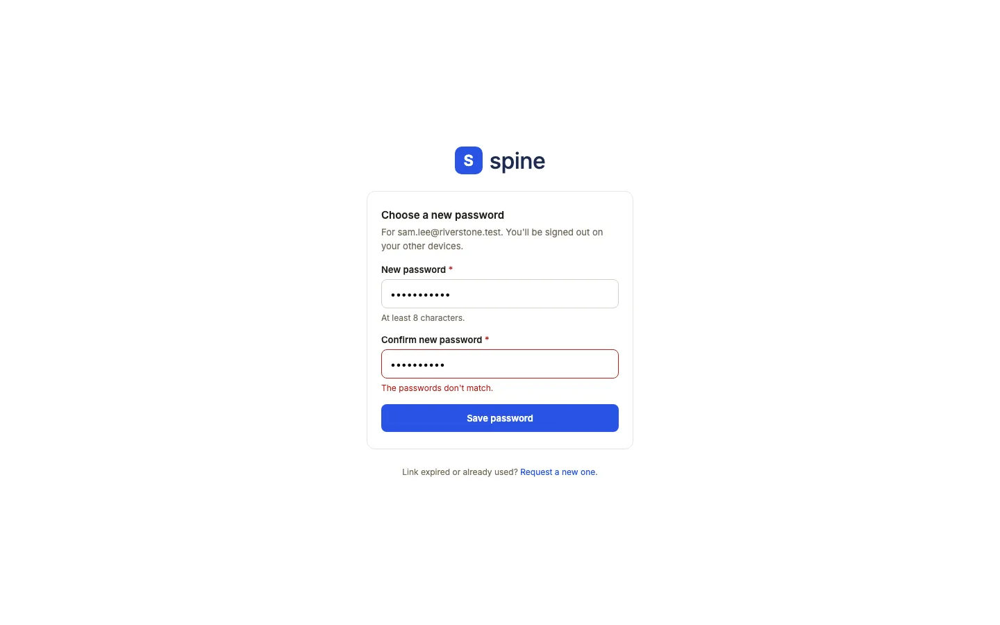

Links to: —

Shows: "Choose a new password" · "For sam.lee@riverstone.test. You'll be signed out on your other devices." · "New password" · "At least 8 characters." · "Confirm new password" · "The passwords don't match." · "Save password" · "Link expired or already used?" · "Request a new one"

### InviteInvalid — Invitation can't be used
**Priority:** P2 · **Phase:** 6 · **Stories:** US-AUTH-11 · **Source:** Drawn

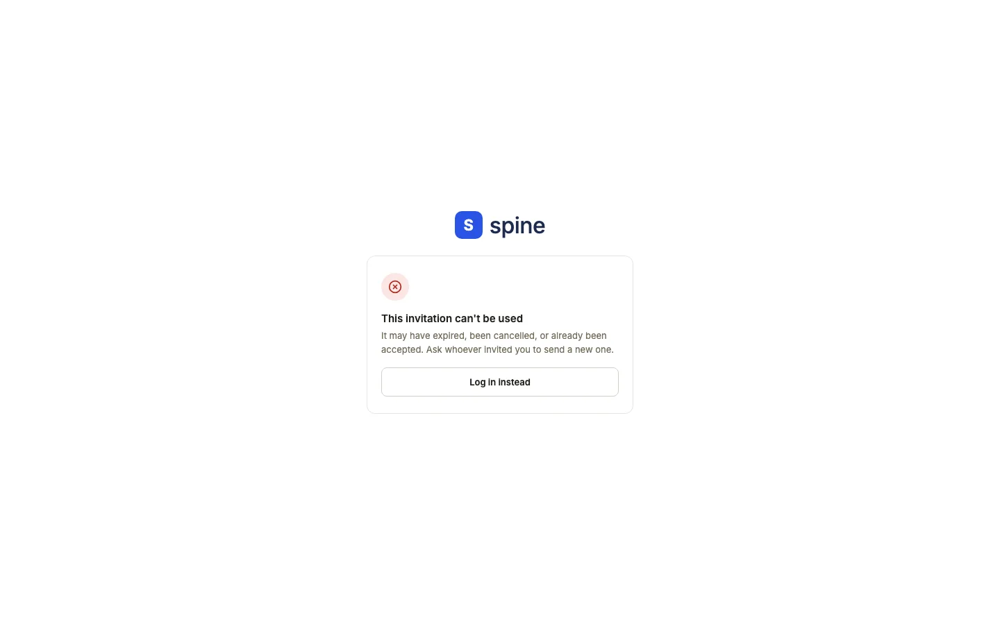

Links to: —

Shows: "This invitation can't be used" · "It may have expired, been cancelled, or already been accepted. Ask whoever invited you to send a new one." · "Log in instead"

### SessionExpired — Session expired
**Priority:** P2 · **Phase:** 6 · **Stories:** US-AUTH-12 · **Source:** Drawn

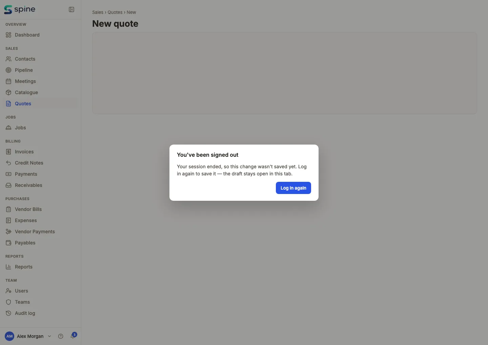

Links to: —

Shows: "Sales › Quotes › New" · "New quote" · "You've been signed out" · "Your session ended, so this change wasn't saved yet. Log in again to save it — the draft stays open in this tab." · "Log in again"

## Contacts & CRM

### ContactsList — Contacts — table view
**Priority:** P1 · **Phase:** 1 · **Stories:** US-CRM-02, US-CRM-03, US-CRM-04, US-CRM-16 · **Source:** Captured

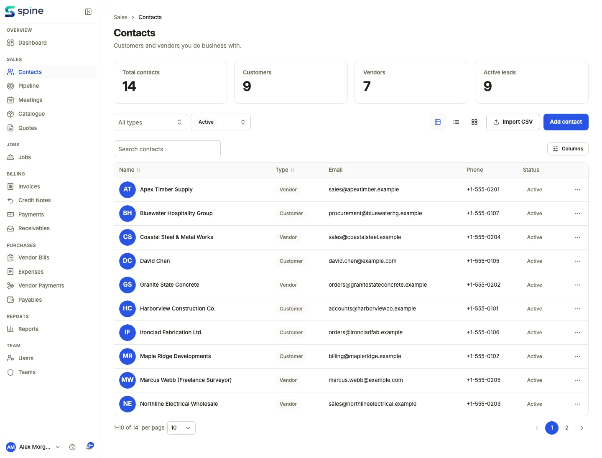

Links to: `ContactCreateDrawer`, `ContactsCards`, `ContactsEmpty`, `ContactDeleteConfirm`

Shows: "Sales › Contacts" · "OVERVIEW" · "Contacts" · "98 Dashboard" · "Customers and vendors you do business with." · "SALES" · "0) Contacts" · "Total contacts" · "Customers" · "Vendors" · "Active leads" · "Pipeline" · "14" · "Meetings" · "Catalogue" · "All types" · "Active" · "88" · "i Import CSV" · "Add contact" · "Quotes" · "JOBS" · "Search contacts" · "i Columns" · "• Jobs" · "Name t" · "Type 11" · "Email" · "Phone" · "Status" · "BILLING" · "E Invoices" · "AT" · "Apex Timber Supply" · "Vendor" · "sales@apextimber.example" · "+1-555-0201" · "• Credit Notes" · "•• Payments" · "BH" · "Bluewater Hospitality Group" · "Customer" · "procurement@bluewaterhg.example" · "+1-555-0107" · "Receivables" · …

### ContactsCards — Contacts — card view
**Priority:** P3 · **Phase:** 1 · **Stories:** US-CRM-03 · **Source:** Captured

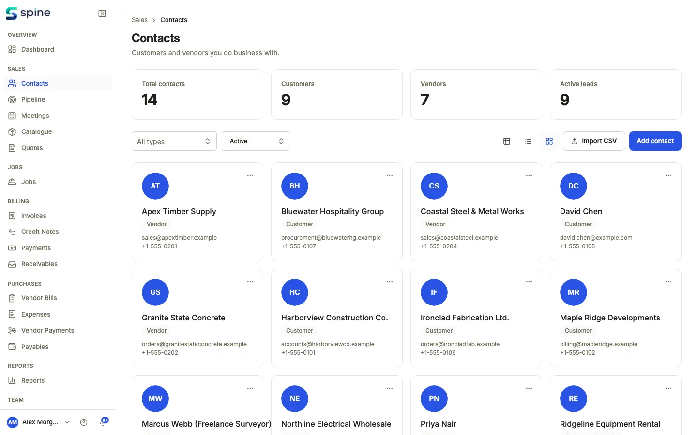

Links to: `ContactsList`, `ContactsEmpty`

Shows: "Sales › Contacts" · "Contacts" · "Customers and vendors you do business with." · "Total contacts" · "Customers" · "Vendors" · "Active leads" · "14" · "All types" · "Active" · "88" · "I Import CSV" · "Add contact" · "••." · "•.." · "AT" · "BH" · "cS" · "DC" · "Apex Timber Supply" · "Bluewater Hospitality Group" · "Coastal Steel & Metal Works" · "David Chen" · "Vendor" · "Customer" · "sales@apextimber.example" · "procurement@bluewaterhg.example" · "sales@coastalsteel.example" · "david.chen@example.com" · "+1-555-0201" · "+1-555-0107" · "+1-555-0204" · "+1-555-0105" · "..." · "GS" · "HC" · "IF" · "MR" · "Granite State Concrete" · "Harborview Construction Co." · "Ironclad Fabrication Ltd." · "Maple Ridge Developments" · "orders@granitestateconcrete.example" · "accounts@harborviewco.example" · "orders@ironcladfab.example" · …

### ContactsEmpty — Contacts — empty state
**Priority:** P1 · **Phase:** 1 · **Stories:** US-CRM-03 · **Source:** Captured

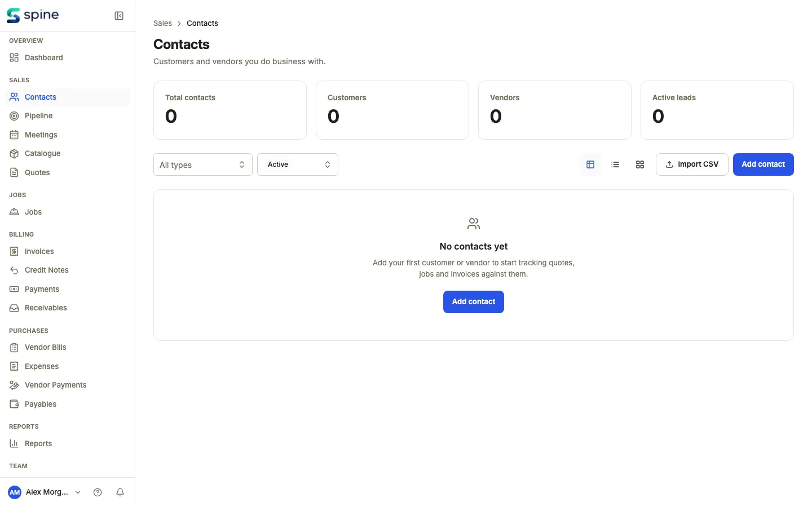

Links to: `ContactsList`, `ContactsCards`

Shows: "Sales › Contacts" · "OVERVIEW" · "Contacts" · "98 Dashboard" · "Customers and vendors you do business with." · "SALES" · "9) Contacts" · "Total contacts" · "Customers" · "Vendors" · "Active leads" · "Pipeline" · "Meetings" · "Catalogue" · "All types" · "Active" · "88" · "I Import CSV" · "Add contact" · "Quotes" · "JOBS" · "@ Jobs" · "BILLING" · "No contacts yet" · "E Invoices" · "Add your first customer or vendor to start tracking quotes," · "5 Credit Notes" · "jobs and invoices against them." · "•• Payments" · "• Receivables" · "PURCHASES" · "• Vendor Bills" · "Expenses" · "¿g Vendor Payments" · "• Payables" · "REPORTS" · "ul! Reports" · "TEAM" · "Alex Morg... v"

### ContactCreateDrawer — New contact drawer (duplicate warning)
**Priority:** P1 · **Phase:** 1 · **Stories:** US-CRM-01, US-CRM-02 · **Source:** Captured

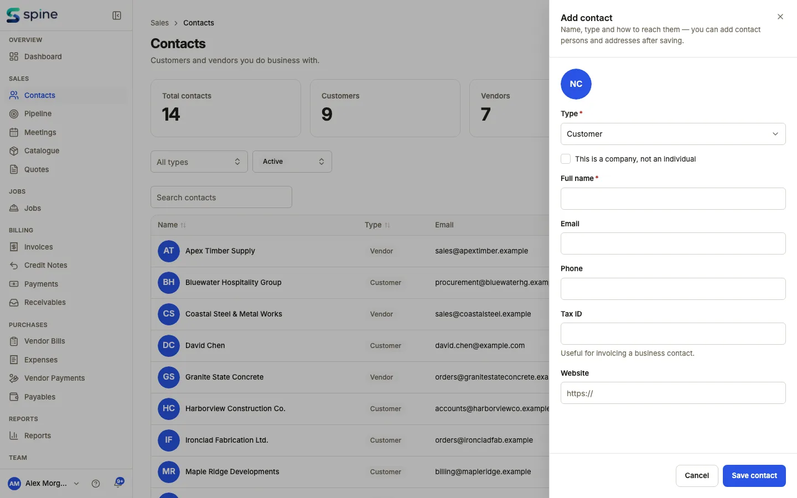

Links to: `ContactsList`

Shows: "Add contact" · "Sales > Contacts" · "Name, type and how to reach them — you can add contact" · "Contacts" · "persons and addresses after saving." · "Customers and vendors you do business with." · "NC" · "Total contacts" · "Customers" · "Vendors" · "14" · "Type *" · "Customer" · "All types" · "Active" · "This is a company, not an individual" · "Full name *" · "Search contacts" · "Name 11" · "Type t" · "Email" · "AT" · "Apex Timber Supply" · "Vendor" · "sales@apextimber.example" · "Phone" · "BH" · "Bluewater Hospitality Group" · "procurement@bluewaterhg.exam" · "CS" · "Coastal Steel & Metal Works" · "sales@coastalsteel.example" · "Tax ID" · "DC" · "David Chen" · "david.chen@example.com" · "Useful for invoicing a business contact." · "Website" · "GS" · "Granite State Concrete" · "orders@granitestateconcrete.exa" · "https://" · "HC" · "Harborview Construction Co." · "accounts@harborvlewco.example" · …

### ContactTimeline — Contact detail — Timeline tab
**Priority:** P1 · **Phase:** 1 · **Stories:** US-CRM-07 · **Source:** Captured

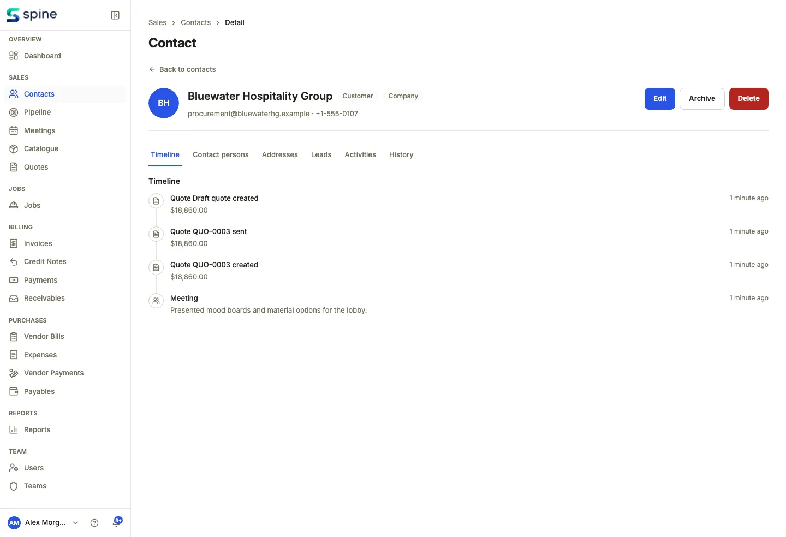

Links to: —

Shows: "Sales › Contacts › Detail" · "Contact" · "< Back to contacts" · "Bluewater Hospitality Group" · "Customer" · "Company" · "Edit" · "Archive" · "Delete" · "procurement@bluewaterhg.example • +1-555-0107" · "Timeline" · "Contact persons" · "Addresses" · "Leads" · "Activities" · "History" · "Quote Draft quote created" · "1 minute ago" · "$18,860.00" · "Quote QUO-0003 sent" · "Quote QUO-0003 created" · "Meeting" · "Presented mood boards and material options for the lobby."

### ContactPersons — Contact detail — People tab
**Priority:** P1 · **Phase:** 1 · **Stories:** US-CRM-05, US-CRM-18 · **Source:** Captured

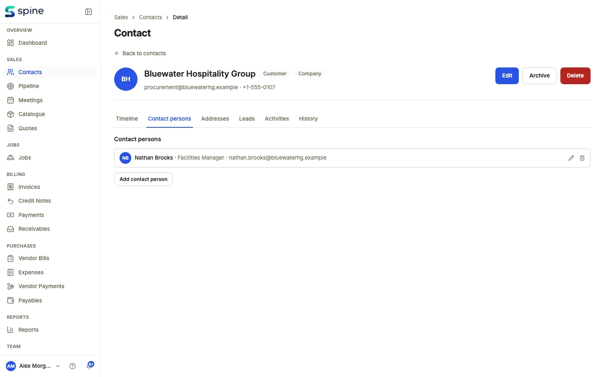

Links to: `ContactPersonDialog`

Shows: "Sales › Contacts › Detail" · "Contact" · "< Back to contacts" · "Bluewater Hospitality Group" · "Customer" · "Company" · "Edit" · "Archive" · "Delete" · "procurement@bluewaterhg.example • +1-555-0107" · "Timeline" · "Contact persons" · "Addresses" · "Leads" · "Activities" · "History" · "Nathan Brooks • Facilities Manager • nathan.brooks@bluewaterhg.example" · "0 Q" · "Add contact person"

### ContactPersonDialog — Add/edit contact person
**Priority:** P1 · **Phase:** 1 · **Stories:** US-CRM-05 · **Source:** Captured

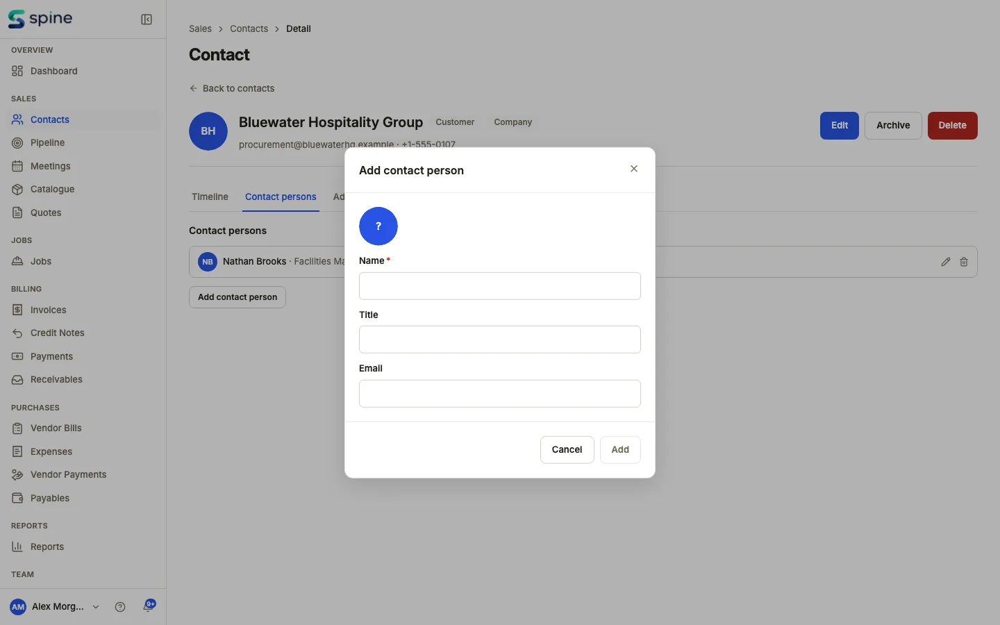

Links to: `ContactPersons`

Shows: "Sales > Contacts > Detail" · "OVERVIEW" · "Contact" · "B8 Dashboard" · "< Back to contacts" · "SALES" · "• Contacts" · "Bluewater Hospitality Group" · "Customer" · "Company" · "Edit" · "Archive" · "Delete" · "BH" · "Pipeline" · "procurement@bluewaterha.examnle • +1-555-0107" · "Meetings" · "Add contact person" · "Catalogue" · "Timeline" · "Contact persons" · "Ad" · "Quotes" · "JOBS" · "• Jobs" · "NB" · "Nathan Brooks • Facilities Ma" · "Name*" · "0 0" · "BILLING" · "S Invoices" · "Title" · "5 Credit Notes" · "•• Payments" · "Email" · "• Receivables" · "PURCHASES" · "• Vendor Bills" · "El Expenses" · "Cancel" · "Add" · "9g Vendor Payments" · "• Payables" · "REPORTS" · "Li Reports" · …

### ContactAddresses — Contact detail — Addresses tab
**Priority:** P1 · **Phase:** 1 · **Stories:** US-CRM-06 · **Source:** Captured

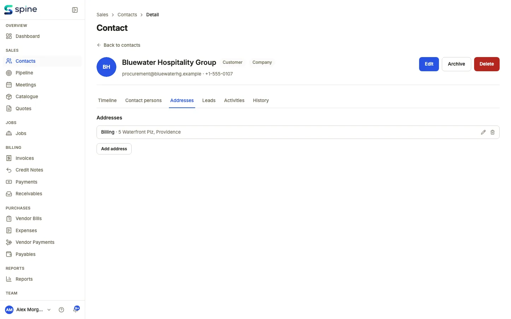

Links to: `AddressDialog`

Shows: "Sales › Contacts › Detail" · "OVERVIEW" · "Contact" · "98 Dashboard" · "< Back to contacts" · "SALES" · "° Contacts" · "Bluewater Hospitality Group" · "Customer" · "Company" · "Edit" · "Archive" · "Delete" · "Pipeline" · "procurement@bluewaterhg.example • +1-555-0107" · "Meetings" · "Catalogue" · "Timeline" · "Contact persons" · "Addresses" · "Leads" · "Activities" · "History" · "Quotes" · "JOBS" · "• Jobs" · "Billing • 5 Waterfront PIz, Providence" · "BILLING" · "Add address" · "$ Invoices" · "5 Credit Notes" · "•• Payments" · "• Receivables" · "PURCHASES" · "* Vendor Bills" · "Expenses" · "2g Vendor Payments" · "• Payables" · "REPORTS" · "ull Reports" · "TEAM" · "Alex Morg... v"

### AddressDialog — Add/edit address
**Priority:** P1 · **Phase:** 1 · **Stories:** US-CRM-06 · **Source:** Captured

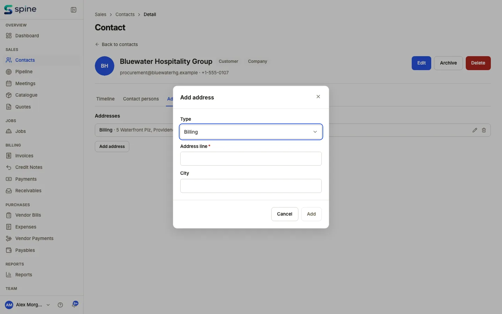

Links to: `ContactAddresses`

Shows: "Sales > Contacts > Detail" · "Contact" · "< Back to contacts" · "Bluewater Hospitality Group" · "Customer" · "Company" · "Edit" · "Archive" · "Delete" · "BH" · "procurement@bluewaterhg.example • +1-555-0107" · "Timeline" · "Contact persons" · "Ad" · "Add address" · "Addresses" · "Type" · "Billing • 5 Waterfront PIz, Provideni" · "Billing" · "0 0" · "Address line *" · "City" · "Cancel" · "Add"

### ContactActivities — Contact detail — Activities tab
**Priority:** P1 · **Phase:** 1 · **Stories:** US-CRM-08, US-CRM-09, US-CRM-17 · **Source:** Captured

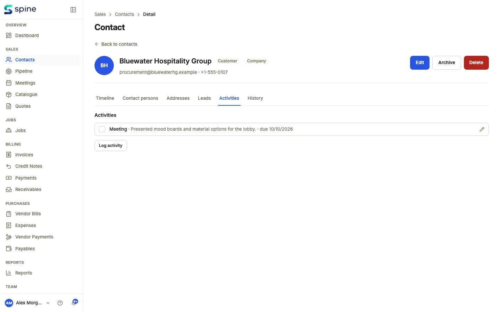

Links to: `ActivityDialog`, `LeadsBoard`

Shows: "Sales › Contacts › Detail" · "OVERVIEW" · "Contact" · "98 Dashboard" · "< Back to contacts" · "SALES" · "° Contacts" · "Bluewater Hospitality Group" · "Customer" · "Company" · "Edit" · "Archive" · "Delete" · "Pipeline" · "procurement@bluewaterhg.example • +1-555-0107" · "Meetings" · "Catalogue" · "Timeline" · "Contact persons" · "Addresses" · "Leads" · "Activities" · "History" · "Quotes" · "JOBS" · "฿ Jobs" · "Meeting • Presented mood boards and materlal options for the lobby. • due 10/10/2026" · "BILLING" · "Log activity" · "$ Invoices" · "5 Credit Notes" · "•• Payments" · "• Receivables" · "PURCHASES" · "* Vendor Bills" · "Expenses" · "2g Vendor Payments" · "• Payables" · "REPORTS" · "ul Reports" · "TEAM" · "Alex Morg... v"

### ActivityDialog — Log/edit activity
**Priority:** P1 · **Phase:** 1 · **Stories:** US-CRM-08 · **Source:** Captured

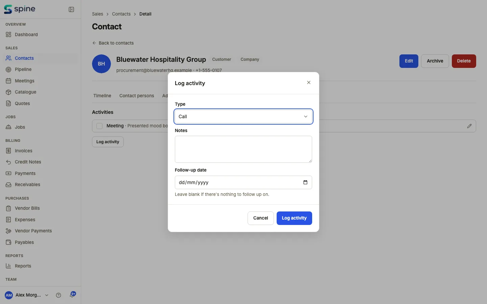

Links to: `ContactActivities`

Shows: "Sales > Contacts > Detail" · "Contact" · "< Back to contacts" · "Bluewater Hospitality Group" · "Customer" · "Company" · "Edit" · "Archive" · "Delete" · "BH" · "procurement@bluewaterha.example • +1-555-0107" · "Log activity" · "Timeline" · "Contact persons" · "Ad" · "Type" · "Activities" · "Call" · "Meeting • Presented mood bo" · "Notes" · "Follow-up date" · "dd/mm/yyyy" · "Leave blank if there's nothing to follow up on." · "Cancel"

### ContactLeads — Contact detail — Leads tab
**Priority:** P2 · **Phase:** 1 · **Stories:** US-CRM-12 · **Source:** Captured

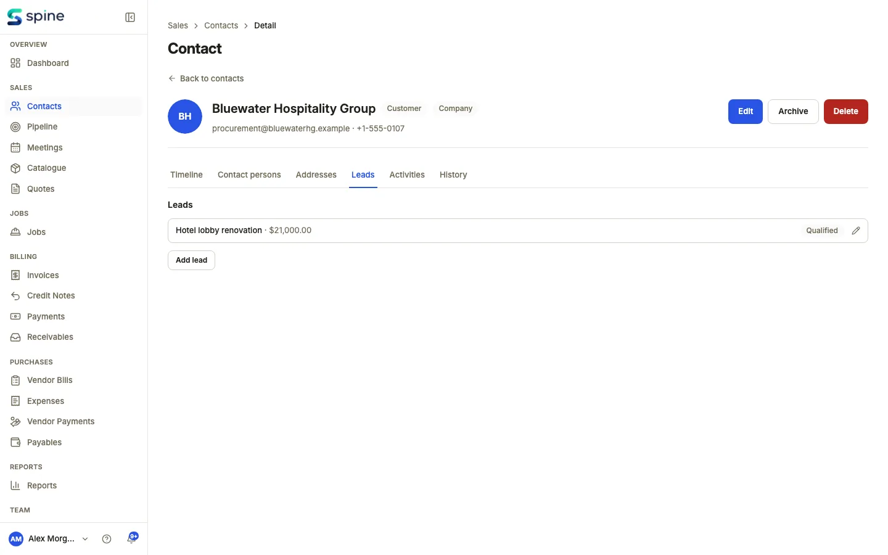

Links to: —

Shows: "Sales › Contacts › Detail" · "Contact" · "< Back to contacts" · "Bluewater Hospitality Group" · "Customer" · "Company" · "Edit" · "Archive" · "Delete" · "procurement@bluewaterhg.example • +1-555-0107" · "Timeline" · "Contact persons" · "Addresses" · "Leads" · "Activities" · "History" · "Hotel lobby renovation • $21,000.00" · "Qualified" · "Add lead"

### ContactDeleteConfirm — Delete contact (blocked → deactivate)
**Priority:** P2 · **Phase:** 1 · **Stories:** US-CRM-04 · **Source:** Captured

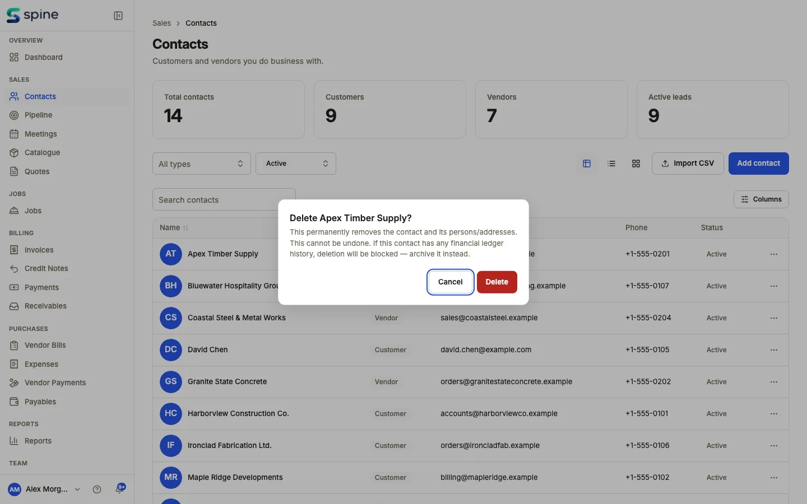

Links to: `ContactsList`

Shows: "Sales > Contacts" · "Contacts" · "Customers and vendors you do business with." · "Total contacts" · "Customers" · "Vendors" · "Active leads" · "14" · "All types" · "Active" · "88" · "I Import CSV" · "Add contact" · "Search contacts" · "# Columns" · "Delete Apex Timber Supply?" · "Name 11" · "Phone" · "Status" · "This permanently removes the contact and its persons/addresses." · "This cannot be undone. If this contact has any financial ledger" · "AT" · "Apex Timber Supply" · "history, deletion will be blocked - archive it instead." · "le" · "+1-555-0201" · "Cancel" · "Delete" · "BH" · "Bluewater Hospitality Groi" · "ig.example" · "+1-555-0107" · "CS" · "Coastal Steel & Metal Works" · "Vendor" · "sales@coastalsteel.example" · "+1-555-0204" · "••." · "DC" · "David Chen" · "Customer" · "david.chen@example.com" · "+1-555-0105" · "GS" · "Granite State Concrete" · …

### ImportContactsDialog — CSV import (map → preview → result)
**Priority:** P2 · **Phase:** 1 · **Stories:** US-CRM-14, US-CRM-15 · **Source:** Captured

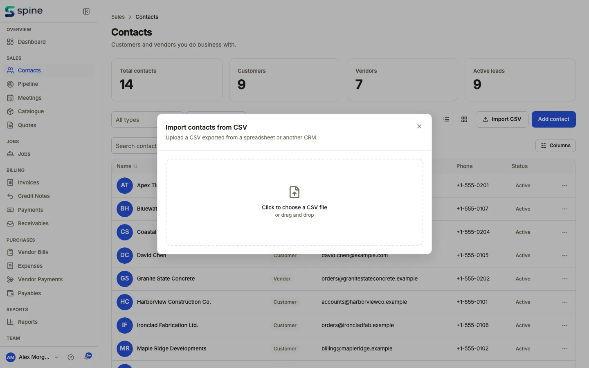

Links to: —

Shows: "Sales > Contacts" · "Contacts" · "Customers and vendors you do business with." · "Total contacts" · "Customers" · "Vendors" · "Active leads" · "14" · "All types" · "88" · "I Import CSV" · "Add contact" · "Import contacts from CSV" · "Upload a CSV exported from a spreadsheet or another CRM." · "Search contact" · "# Columns" · "Name 1L" · "Phone" · "Status" · "AT" · "Apex Til" · "+1-555-0201" · "Active" · "BH" · "Bluewat" · "Click to choose a CSV file" · "+1-555-0107" · "or drag and drop" · "CS" · "Coastal" · "+1-555-0204" · "••." · "DC" · "David Chen" · "Customer" · "aavia.cnen@exampie.com" · "+1-555-0105" · "GS" · "Granite State Concrete" · "Vendor" · "orders@granitestateconcrete.example" · "+1-555-0202" · "HC" · "Harborview Construction Co." · "accounts@harborvlewco.example" · …

### LeadsBoard — Pipeline board by stage
**Priority:** P1 · **Phase:** 1 · **Stories:** US-CRM-11, US-CRM-17, US-CRM-19 · **Source:** Captured

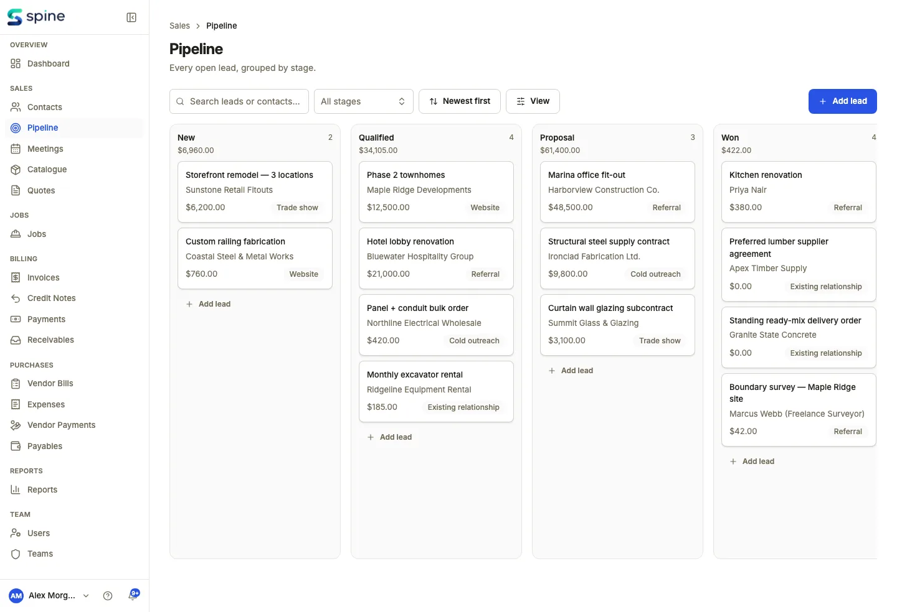

Links to: `LeadsBoardEmpty`, `ContactActivities`, `LeadStagesSettings`

Shows: "Sales › Pipeline" · "OVERVIEW" · "Pipeline" · "98 Dashboard" · "Every open lead, grouped by stage." · "SALES" · "Q Search leads or contacts..." · "All stages" · "T Newest first" · "# View" · "+ Add lead" · "•, Contacts" · "New" · "Qualified" · "Proposal" · "Won" · "Meetings" · "$6,960.00" · "$34,105.00" · "$61,400.00" · "$422.00" · "• Catalogue" · "Storefront remodel - 3 locations" · "Phase 2 townhomes" · "Marina office fit-out" · "Kitchen renovation" · "Quotes" · "Sunstone Retall Fitouts" · "Maple Ridge Developments" · "Harborview Construction Co." · "Priya Nair" · "$6,200.00" · "Trade show" · "$12,500.00" · "Website" · "$48,500.00" · "Referral" · "$380.00" · "JOBS" · "• Jobs" · "Custom railing fabrication" · "Hotel lobby renovation" · "Structural steel supply contract" · "Preferred lumber supplier" · "BILLING" · …

### LeadsBoardEmpty — Pipeline board — empty
**Priority:** P1 · **Phase:** 1 · **Stories:** US-CRM-11 · **Source:** Captured

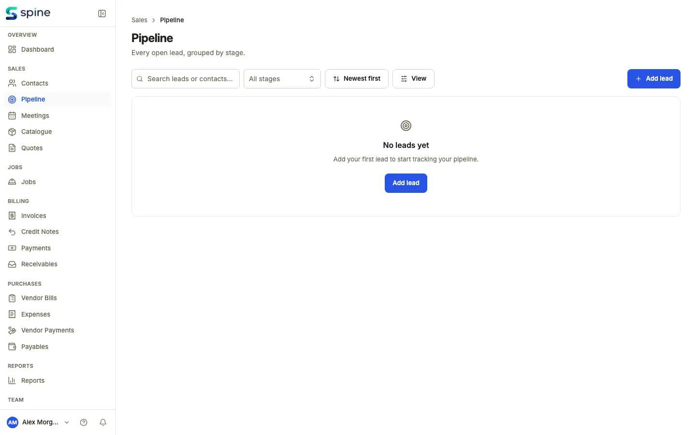

Links to: `LeadsBoard`

Shows: "Sales > Pipeline" · "Pipeline" · "Every open lead, grouped by stage." · "Q Search leads or contacts..." · "All stages" · "T Newest first" · "= View" · "Add lead" · "No leads yet" · "Add your first lead to start tracking your pipeline."

### LeadDialog — Add/edit lead
**Priority:** P1 · **Phase:** 1 · **Stories:** US-CRM-10, US-CRM-13 · **Source:** Captured

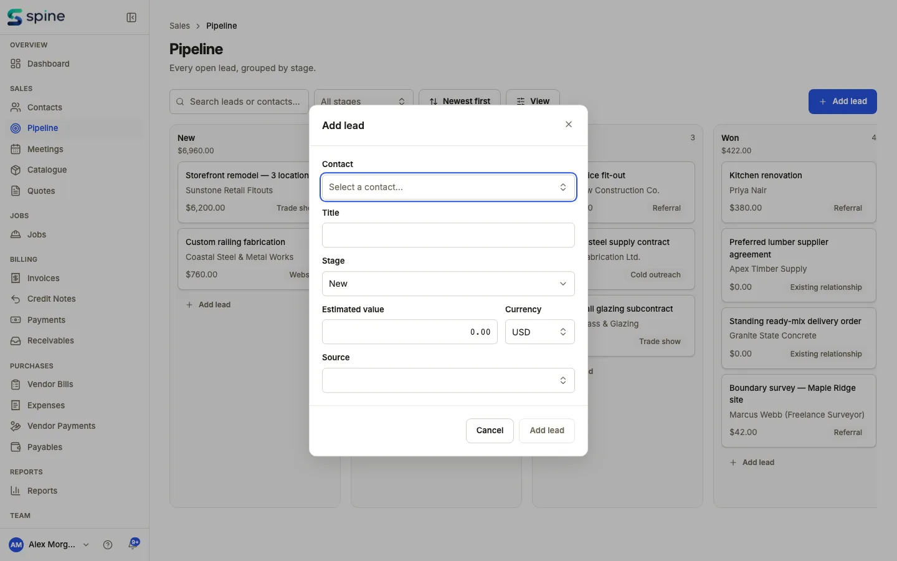

Links to: —

Shows: "Sales > Pipeline" · "Pipeline" · "Every open lead, grouped by stage." · "Q Search leads or contacts..." · "All stades" · "Tl Newest first" · "= View" · "+ Add lead" · "Add lead" · "New" · "Won" · "$6,960.00" · "$422.00" · "Contact" · "Storefront remodel - 3 location" · "ice fit-out" · "Kitchen renovation" · "Sunstone Retail Fitouts" · "Select a contact..." · "N Construction Co." · "Priya Nair" · "$6,200.00" · "Trade shi" · "Referral" · "$380.00" · "Title" · "Custom railing fabrication" · "steel supply contract" · "Preferred lumber supplier" · "Coastal Steel & Metal Works" · "abrication Ltd." · "agreement" · "Stage" · "Apex Timber Supply" · "$760.00" · "Webs" · "Cold outreach" · "$0.00" · "Existing relationship" · "Estimated value" · "Currency" · "ill glazing subcontract" · "ass & Glazing" · "Standing ready-mix delivery order" · "0.00" · …

### LeadStagesSettings — Settings, pipeline stages
**Priority:** P2 · **Phase:** 7 · **Stories:** US-CRM-19, US-CRM-20 · **Source:** Drawn

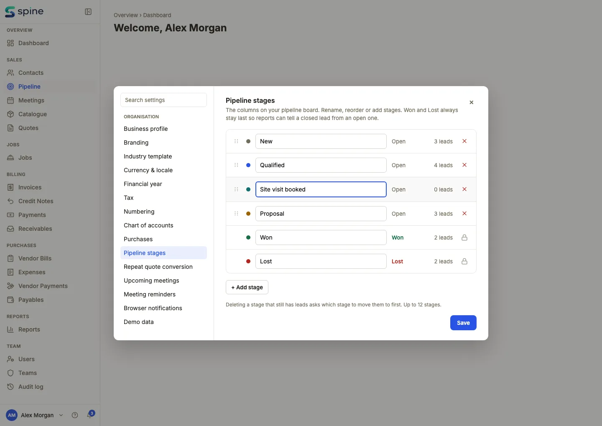

Links to: `LeadsBoard`

Shows: "Overview › Dashboard" · "Welcome, Alex Morgan" · "Search settings" · "ORGANISATION" · "Business profile" · "Branding" · "Industry template" · "Currency & locale" · "Financial year" · "Tax" · "Numbering" · "Chart of accounts" · "Purchases" · "Pipeline stages" · "Repeat quote conversion" · "Upcoming meetings" · "Meeting reminders" · "Browser notifications" · "Demo data" · "The columns on your pipeline board. Rename, reorder or add stages. Won and Lost always stay last so reports can tell a closed lead from an open one." · "⋮⋮" · "Open" · "3 leads" · "4 leads" · "0 leads" · "Won" · "2 leads" · "Lost" · "+ Add stage" · "Deleting a stage that still has leads asks which stage to move them to first. Up to 12 stages." · "Save"

### ContactGstDialog — Contact GST treatment, GSTIN and state
**Priority:** P1 · **Phase:** 9 · **Stories:** US-TAX-12 · **Source:** Drawn

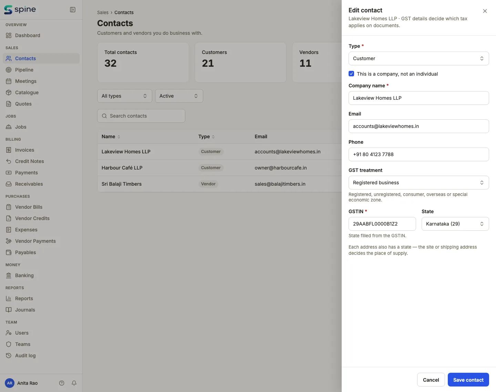

Links to: —

Shows: "Edit contact — Spine" · "Sales" · "Contacts" · "Customers and vendors you do business with." · "Total contacts" · "32" · "Customers" · "21" · "Vendors" · "11" · "Missing GSTIN" · "1" · "registered business" · "All types" · "Active" · "Import CSV" · "Add contact" · "Search contacts" · "Columns" · "Name" · "Type" · "Email" · "Phone" · "Actions" · "Lakeview Homes LLP" · "Customer" · "accounts@lakeviewhomes.in" · "+91 80 4123 7788" · "Harbour Café LLP" · "owner@harbourcafe.in" · "+91 80 4012 0045" · "Sri Balaji Timbers" · "Vendor" · "sales@balajitimbers.in" · "+91 44 2433 9001" · "Edit contact" · "Lakeview Homes LLP · GST details decide which tax applies on documents." · "*" · "This is a company, not an individual" · "Company name" · "GST treatment" · "Registered business" · "Registered, unregistered, consumer, overseas or special economic zone." · "GSTIN" · "29AABFL0000B1Z2"

## Meetings & calendar

### MeetingsWeek — Calendar — week view + mini-calendar sidebar
**Priority:** P1 · **Phase:** 1 · **Stories:** US-MTG-01, US-MTG-02, US-MTG-03 · **Source:** Captured

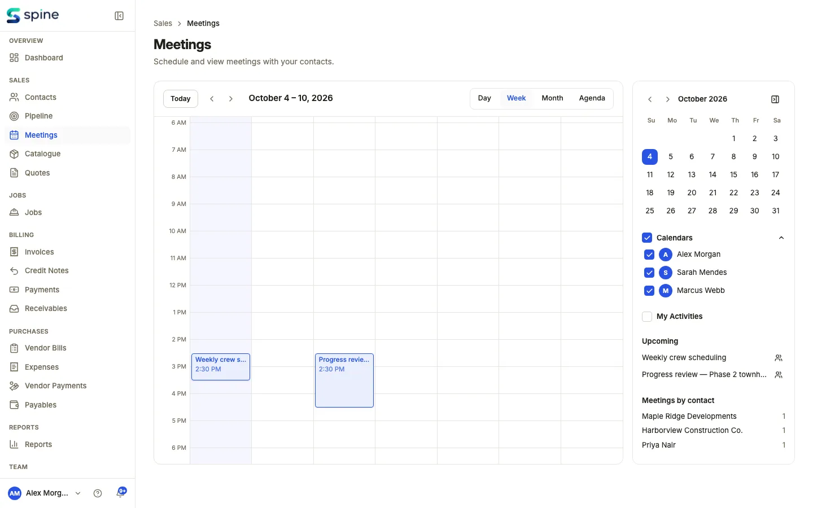

Links to: `MeetingEditorDetails`, `MeetingsMonth`, `MeetingsAgenda`, `MeetingsEmpty`

Shows: "Sales > Meetings" · "Meetings" · "Schedule and view meetings with your contacts." · "Today" · "October 4 - 10, 2026" · "Day" · "Week" · "Month" · "Agenda" · "› October 2026" · "6 AM" · "Su Mo Tu We" · "Th" · "Fr" · "Sa" · "7 AM" · "4)" · "10" · "8 AM" · "11" · "12" · "13" · "14" · "15" · "16" · "17" · "18" · "19" · "20" · "21" · "22" · "23" · "24" · "9 AM" · "25" · "26 27" · "28" · "29" · "30" · "31" · "10 AM" · "V Calendars" · "• Alex Morgan" · "11 AM" · "© Sarah Mendes" · …

### MeetingsMonth — Calendar — month view
**Priority:** P2 · **Phase:** 1 · **Stories:** US-MTG-02 · **Source:** Captured

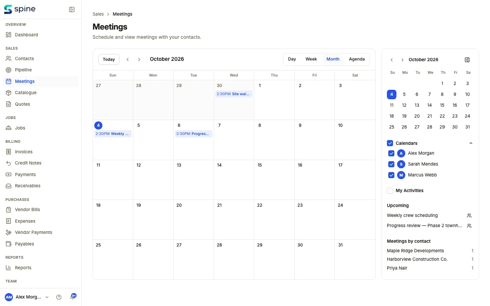

Links to: `MeetingsWeek`, `MeetingsAgenda`, `MeetingsEmpty`

Shows: "Sales > Meetings" · "Meetings" · "Schedule and view meetings with your contacts." · "Today" · "October 2026" · "Day" · "Week" · "Month" · "Agenda" · "> October 2026" · "Su Mo Tu We" · "Th" · "Fr" · "Sa" · "Sun" · "Mon" · "Tue" · "Wed" · "Thu" · "Fri" · "Sat" · "27" · "28" · "29" · "30" · "2:30PM Site wal..." · "4)" · "10" · "11" · "12" · "13" · "14" · "15" · "16" · "17" · "18" · "19" · "20" · "21" · "22" · "23" · "24" · "25" · "26 27" · "31" · …

### MeetingsAgenda — Calendar — agenda view
**Priority:** P3 · **Phase:** 1 · **Stories:** US-MTG-02 · **Source:** Captured

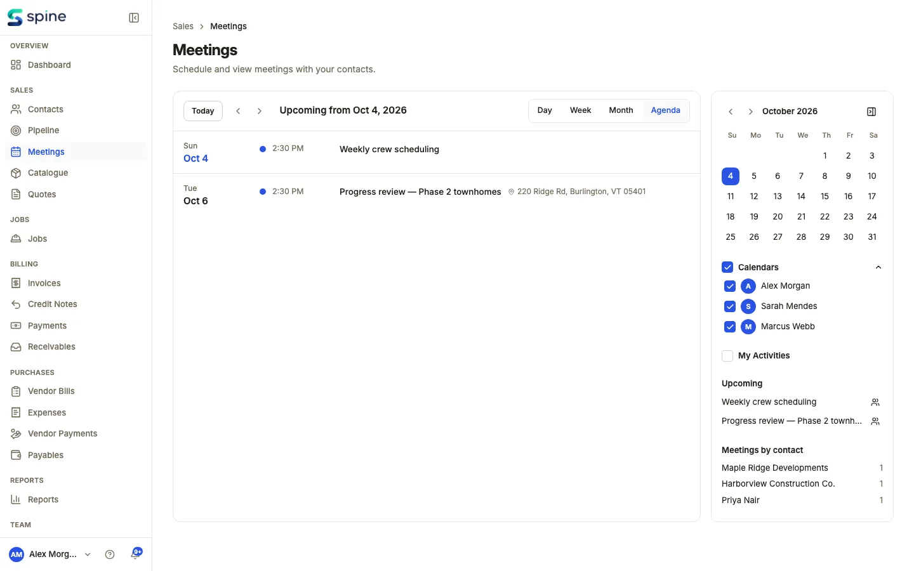

Links to: `MeetingsWeek`, `MeetingsMonth`, `MeetingsEmpty`

Shows: "Sales > Meetings" · "OVERVIEW" · "Meetings" · "98 Dashboard" · "Schedule and view meetings with your contacts." · "SALES" · "•, Contacts" · "Today" · "Upcoming from Oct 4, 2026" · "Day" · "Week" · "Month" · "Agenda" · "> October 2026" · "Pipeline" · "Su Mo Tu We" · "Th" · "Fr" · "Sa" · "Sun" · "• 2:30 PM" · "Weekly crew scheduling" · "Oct 4" · "• Catalogue" · "4)" · "10" · "Tue" · "Quotes" · "Progress review - Phase 2 townhomes ® 220 Ridge Rd, Burlington, VT 05401" · "11" · "12" · "13" · "14" · "15" · "16" · "17" · "Oct 6" · "JOBS" · "18" · "19" · "20" · "21" · "22" · "23" · "24" · …

### MeetingsEmpty — Meetings calendar — empty
**Priority:** P2 · **Phase:** 1 · **Stories:** US-MTG-02 · **Source:** Captured

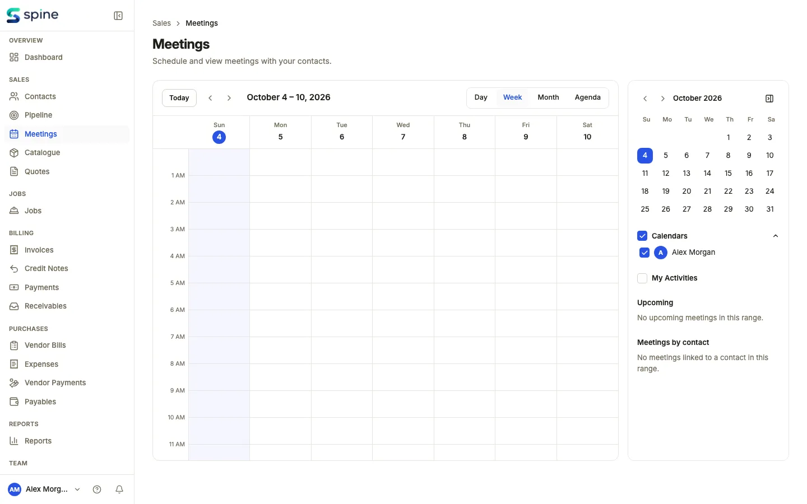

Links to: `MeetingsWeek`, `MeetingsMonth`, `MeetingsAgenda`

Shows: "Sales > Meetings" · "OVERVIEW" · "Meetings" · "98 Dashboard" · "Schedule and view meetings with your contacts." · "SALES" · "° Contacts" · "Today" · "October 4 - 10, 2026" · "Day" · "Week" · "Month" · "Agenda" · "< > October 2026" · "Pipeline" · "Su Mo Tu We" · "Th" · "Fr" · "Sa" · "Sun" · "Mon" · "Tue" · "Wed" · "Thu" · "Fri" · "Sat" · "10" · "Catalogue" · "4)" · "Quotes" · "1 AM" · "11" · "12" · "13" · "14" · "15" · "16" · "17" · "JOBS" · "18" · "19" · "20" · "21" · "22" · "23" · …

### MeetingQuickView — Event quick-view popover (RSVP)
**Priority:** P1 · **Phase:** 1 · **Stories:** US-MTG-07, US-MTG-08, US-MTG-10, US-MTG-11, US-MTG-12 · **Source:** Captured

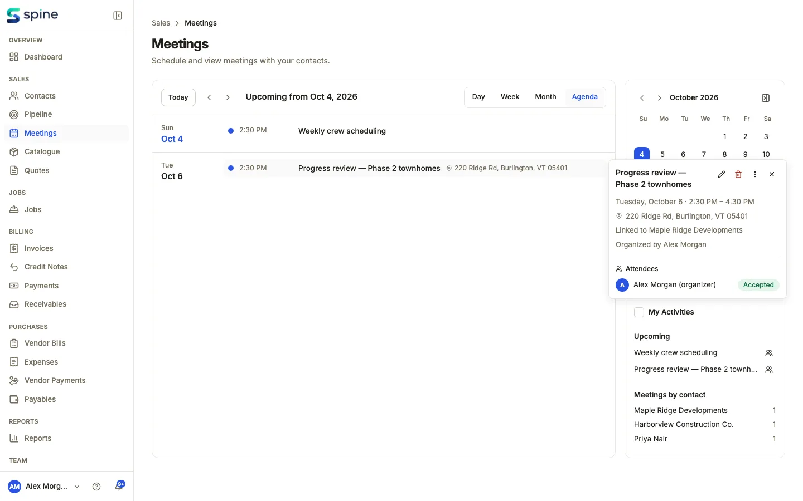

Links to: `MeetingQuickViewRecurring`, `MeetingEditorDetails`

Shows: "Sales > Meetings" · "OVERVIEW" · "Meetings" · "98 Dashboard" · "Schedule and view meetings with your contacts." · "SALES" · "•, Contacts" · "Today" · "Upcoming from Oct 4, 2026" · "Day" · "Week" · "Month" · "Agenda" · "> October 2026" · "Pipeline" · "Su" · "Mo Tu" · "We" · "Th" · "Fr" · "Sa" · "Sun" · "• 2:30 PM" · "Weekly crew scheduling" · "Oct 4" · "• Catalogue" · "5 6" · "10" · "Tue" · "Quotes" · "Progress review - Phase 2 townhomes ® 220 Ridge Rd, Burlington, VT 05401" · "Progress review —" · "Oct 6" · "Phase 2 townhomes" · "JOBS" · "Tuesday, October 6 • 2:30 PM - 4:30 PM" · "• Jobs" · "® 220 Ridge Rd, Burlington, VT 05401" · "BILLING" · "Linked to Maple Ridge Developments" · "Organized by Alex Morgan" · "$ Invoices" · "5 Credit Notes" · "2i Attendees" · "•• Payments" · …

### MeetingQuickViewRecurring — Meeting quick view — recurring
**Priority:** P2 · **Phase:** 1 · **Stories:** US-MTG-08 · **Source:** Captured

Links to: `MeetingQuickView`

Shows: "Sales > Meetings" · "OVERVIEW" · "Meetings" · "98 Dashboard" · "Schedule and view meetings with your contacts." · "SALES" · "9, Contacts" · "Today" · "Upcoming from Oct 4, 2026" · "Day" · "Week" · "Month" · "Agenda" · "> October 2026" · "Pipeline" · "Su Mo Tu We" · "Th" · "Fr" · "Sa" · "Sun" · "• 2:30 PM" · "Weekly crew scheduling" · "Oct 4" · "Catalogue" · "5 6" · "10" · "Mon" · "• 8:00 AM" · "Monday site stand-up 2" · "@ Marina office fit-out - site cabin" · "Quotes" · "Monday site stand-up" · "Oct 5" · "JOBS" · "Monday, October 5 • 8:00 AM - 8:30 AM" · "Tue" · "• Jobs" · "Progress review — Phase 2 townhomes ® 220 Ridge Rd, Burlington, VT 05401" · "= Weekly, 12 times" · "Oct 6" · "® Marina office fit-out — site cabin" · "BILLING" · "Organized by Alex Morgan" · "Monday site stand-up 2 ® Marina office fit-out - site cabin" · "[E Invoices" · …

### MeetingEditorDetails — Meeting editor — Details tab
**Priority:** P1 · **Phase:** 1 · **Stories:** US-MTG-01, US-MTG-04, US-MTG-11 · **Source:** Captured

Links to: `MeetingsWeek`, `MeetingQuickView`

Shows: "Sales > Meetings" · "Meetings" · "Edit event" · "Schedule and view meetings" · "Editing updates the entire series." · "Today" · "Upi" · "inth" · "Agenda" · "› October 2026" · "Details" · "People" · "Su Mo Tu We" · "Th" · "Fr" · "Sa" · "Sun" · "• 2:30 F" · "Oct 4" · "Title" · "Progress review - Phase 2 townhomes" · "10" · "Tue" · "05401" · "11" · "12" · "13" · "14" · "15" · "16" · "17" · "Oct 6" · "Contact" · "18" · "19" · "20" · "21" · "22" · "23" · "24" · "Maple Ridge Developments" · "25" · "26" · "27" · "28" · …

### MeetingEditorPeople — Meeting editor — People tab
**Priority:** P1 · **Phase:** 1 · **Stories:** US-MTG-05, US-MTG-06 · **Source:** Captured

Links to: —

Shows: "Sales > Meetings" · "Meetings" · "Schedule and view meetings with your contacts." · "Today" · "Upcoming from Oct 4, 2026" · "Day" · "Week" · "Month" · "Agenda" · "› October 2026" · "Edit event" · "Su Mo Tu We" · "Th" · "Fr" · "Sa" · "Sun" · "• 2:30 F" · "Editing updates the entire serles." · "Oct 4" · "10" · "Mon" · "• 8:00 A" · "Detalls" · "Oct 5" · "People" · "11" · "12" · "13" · "14" · "15" · "16" · "17" · "18" · "19" · "20" · "21" · "22" · "23" · "24" · "Tue" · "05401" · "25" · "26 27" · "28" · "29" · …

### MeetingScopeChoice — "This event" / "All events"
**Priority:** P2 · **Phase:** 1 · **Stories:** US-MTG-09, US-OPS-10 · **Source:** Captured

Links to: `MeetingDeleteConfirm`, `ExpenseBillToCustomer`

Shows: "Sales > Meetings" · "OVERVIEW" · "Meetings" · "98 Dashboard" · "Schedule and view meetings with your contacts." · "SALES" · "9 Contacts" · "Today" · "Upcoming from Oct 4, 2026" · "Day" · "Week" · "Month" · "Agenda" · "< > October 2026" · "Pipeline" · "Su Mo Tu We" · "Th" · "Fr" · "Sa" · "Sun" · "• 2:30 PM" · "Weekly crew scheduling" · "Oct 4" · "• Catalogue" · "10" · "Mon" · "• Quotes" · "• 8:00 AM" · "Monday site stand-up 2" · "@ Marina office fit-out - site cabin" · "11" · "12" · "13" · "14" · "15" · "16" · "17" · "Oct 5" · "18" · "19" · "20" · "21" · "JOBS" · "22" · "23" · …

### MeetingDeleteConfirm — Delete meeting/occurrence
**Priority:** P2 · **Phase:** 1 · **Stories:** US-MTG-09 · **Source:** Captured

Links to: `MeetingScopeChoice`

Shows: "Sales > Meetings" · "Meetings" · "Schedule and view meetings with your contacts." · "Today" · "Upcoming from Oct 4, 2026" · "Day" · "Week" · "Month" · "Agenda" · "< > October 2026" · "Su Mo Tu We" · "Th" · "Fr" · "Sa" · "Sun" · "• 2:30 PM" · "Weekly crew scheduling" · "Oct 4" · "10" · "Tue" · "Progress review - Phase 2 townhomes" · "@ 220 Ridge Rd, Burlington, VT 05401" · "11" · "12" · "13" · "14" · "15" · "16" · "17" · "Oct 6" · "18" · "19" · "20" · "21" · "22" · "23" · "24" · "25" · "26 27" · "28" · "29" · "30" · "31" · "Delete this meeting?" · "This removes it from the calendar for everyone. This cannot be" · …

## Catalogue

### CatalogList — Catalogue list
**Priority:** P1 · **Phase:** 1 · **Stories:** US-CAT-03, US-CAT-07 · **Source:** Captured

Links to: `CatalogEmpty`

Shows: "Sales › Catalogue" · "OVERVIEW" · "Catalogue" · "98 Dashboard" · "Goods and services you quote, invoice and sell." · "SALES" · "9, Contacts" · "Total items" · "Categories" · "Missing tax rate" · "Missing account mapping" · "Pipeline" · "15" · "Meetings" · "Active" · "Category" · "Min price" · "Max price" · "Add item" · "Quotes" · "JOBS" · "Search items" · "*= Columns" · "• Jobs" · "Name til" · "Category 11" · "Unit" · "Default price t" · "Tax tu" · "Status" · "BILLING" · "$ Invoices" · "Drywall installation & finishing" · "Interior" · "sq ft" · "3.50 USD" · "15%" · "• Credit Notes" · "Electrical rough-in" · "Electrical" · "room" · "450.00 USD" · "..." · "•• Payments" · "Equipment rental - mini excavator" · …

### CatalogEmpty — Catalogue — empty
**Priority:** P1 · **Phase:** 1 · **Stories:** US-CAT-03 · **Source:** Captured

Links to: `CatalogList`

Shows: "Sales › Catalogue" · "Catalogue" · "Goods and services you quote, invoice and sell." · "Total items" · "Categorles" · "Missing tax rate" · "Missing account mapping" · "Active" · "Category" · "Min price" · "Max price" · "Add item" · "No catalogue items yet" · "Add your first good or service to quote faster - default price" · "and tax rate prefill every new quote line."

### CatalogItemDrawer — Add/edit item
**Priority:** P1 · **Phase:** 1 · **Stories:** US-CAT-01, US-CAT-02 · **Source:** Captured

Links to: —

Shows: "Add item" · "Sales > Catalogue" · "Goods or services with a default price and tax rate — you can" · "Catalogue" · "override the price on a quote later." · "Goods and services you quote, invoice and sell." · "Name *" · "Total items" · "Categories" · "Missing tax rate" · "15" · "Description" · "Active" · "Category" · "Min price" · "Max price" · "Unit*" · "Search items" · "e.g. hour, sq ft, each" · "Free text, optional" · "Name TI" · "Category tL" · "Unit" · "Default p" · "Default price *" · "Currency *" · "0.00" · "USD" · "Drywall installation & finishing" · "Interior" · "sq ft" · "3.50 US" · "Default tax" · "Electrical rough-in" · "Electrical" · "room" · "450.00" · "No tax" · "Equipment rental — mini excavator" · "Equipment" · "day" · "350.00" · "Pre-fills a new quote/invoice line for this item; editable per line." · "Flooring installation (LVP)" · "6.00 US" · …

### CatalogDeleteConfirm — Delete item
**Priority:** P2 · **Phase:** 1 · **Stories:** US-CAT-04 · **Source:** Captured

Links to: —

Shows: "Sales > Catalogue" · "Catalogue" · "Goods and services you quote, invoice and sell." · "Total items" · "Categorles" · "Missing tax rate" · "Missing account mapping" · "15" · "Active" · "Category" · "Min price" · "Max price" · "Add Item" · "Search items" · "# Columns" · "Delete Drywall installation & finishing?" · "Name 1L" · "lefault price t" · "Tax tu" · "Status" · "This permanently removes the item. This cannot be undone." · "Prefer Archive If this item may be referenced by a quote or" · "Drywall installation & finishing" · "• 50 USD" · "15%" · "Invoice later." · "Electrical rough-in" · "50.00 USD" · "••." · "Cancel" · "Delete" · "Equipment rental - mini excavato." · "150.00 USD" · "Flooring installation (LVP)" · "Interior" · "sq ft" · "6.00 USD" · "..." · "Framing lumber (2x4×8)" · "Materials" · "each" · "8.50 USD" · "General labour" · "Labour" · "hour" · …

### QuoteBuilder — New/edit quote (lines, sections, inline item add)
**Priority:** P1 · **Phase:** 1 · **Stories:** US-CAT-05, US-QUO-01, US-QUO-02, US-TAX-04, US-TAX-06, US-TAX-07, US-OPS-21 · **Source:** Captured

Links to: `QuoteBuilderDraft`, `TaxRateDialog`, `OnbFinancialYear`, `OnbInviteTeam`, `TeamPrivilegesExpanded`, `QuoteDetailAccepted`

Shows: "Sales › Quotes > New" · "New quote" · "Build a multi-line quote. It saves as a draft until you send it." · "Contact *" · "Currency*" · "Valid until" · "Select a contact..." · "USD" · "Pick a date" · "Quote shows as expired after this date (S-03.11)." · "Lines" · "Item name" · "Prefill from catalogu... -" · "Description (optional)" · "Qty" · "Unit price" · "Discount %" · "Line total" · "0.00" · "Tax" · "No tax" · "Price includes tax" · "+ Add item" · "+ Add heading" · "+ Add text line" · "Notes" · "Terms & conditions" · "в І" · "в I" · "Notes for the customer..." · "Payment terms, validity, etc..." · "Visible to the customer on the quote." · "Subtotal" · "0.00 USD" · "Total" · "Cancel" · "Save as draft"

### TeamPrivilegesExpanded — Team privileges — group expanded
**Priority:** P1 · **Phase:** 0 · **Stories:** US-CAT-08, US-TEAM-11, US-OPS-21 · **Source:** Captured

Links to: `TeamPrivileges`, `OnbFinancialYear`, `OnbInviteTeam`, `QuoteBuilder`, `QuoteDetailAccepted`, `InvoiceBuilder`

Shows: "Team > Teams > Detail" · "Team" · "< Back to teams" · "SALES" · "Team name" · "General Staff" · "The default team's name can't be changed." · "Members Privileges" · "JOBS" · "What members of this team can do. A Staff member in multiple teams gets the union of everything any of their teams grant." · "› Reports & Ledger" · "BILLING" · "• Manage Contacts" · "Create/edit own contacts" · "Create new contacts, and edit ones this user created themselves. Viewing every contact in the org, Including ones created by others, needs no capabllity at all — read Is" · "always unconditional." · "El or coat dieren user created." · "Archive/delete own contacts" · "Archive, restore, or delete a contact this user created themselves." · "rchive/delete others' contact" · "rchive, restore, or delete a contact that a different user created" · "Manage contact persons" · "REPORTS" · "Add, edit, or remove a contact's people (name, title, emall, phone). Independent of edit_own/edit_others — contact persons have no creator of thelr own to spllt "own"" · "from "others" by, so this Is a single grant covering every contact's persons, not an ownership-based pair. Still requires edit access to the contact Itself." · "TEAM" · "Manage contact addresses" · "Add, edit, or remove a contact's addresses. Independent of edit_own/edit_others and of manage_persons, same "no creator to split by" reasoning. Still requires edit" · "access to the contact itself." · "› Manage Catalogue" · "› Manage Leads" · "› Manage Activities" · "• Manage Quotes" · "Create/edit own quotes" · "Create new quotes, and edit ones this user created themselves (only a draft quote can ever be edited — a sent quote Is Immutable regardless of this grant). Vlewing every CO" · "quote in the org, including ones created by others, needs no capability at all — read Is always unconditional." · "Edit others' quotes" · "Edit a draft quote that a different user created." · "Delete own quotes" · "Delete a draft quote this user created themselves (only a draft Is ever deletable)." · "Delete others' quotes" · "Delete a draft quote that a different user created." · "Send a quote" · "Issue a draft quote (allocates its number and emails it to the contact) — a one-way transition, not an edit, so It's gated separately from edit_ own/edit_others." · "Revise a quote" · …

### QuoteLinePicker — Quote line picker — bundles and save to catalogue
**Priority:** P2 · **Phase:** 7 · **Stories:** US-CAT-06, US-QUO-26 · **Source:** Drawn

Links to: —

Shows: "Quotes" · "New" · "New quote" · "Build a multi-line quote. It saves as a draft until you send it." · "Save as draft" · "Send" · "Contact" · "Harborview Construction Co." · "Valid until" · "Nov 3, 2026" · "Lines" · "Item" · "Qty" · "Unit price" · "Tax" · "Amount" · "Bathroom refit" · "$0.00" · "15%" · "BUNDLES" · "Bathroom refit — standard" · "$6,480.00" · "Adds 5 lines: demolition, plumbing rough-in, tiling, fixtures, clean-up" · "ITEMS" · "Bathroom fixtures supply" · "$1,850.00 / set" · "Use “Bathroom refit” as a one-off line" · "Also save to catalogue"

### ImportCatalogDialog — Import catalogue items from CSV
**Priority:** P2 · **Phase:** 8 · **Stories:** US-CAT-09 · **Source:** Drawn

Links to: —

Shows: "Import items — Spine" · "Sales" · "Catalogue" · "Goods and services you quote, invoice and sell." · "Total items" · "48" · "Categories" · "6" · "Missing tax rate" · "0" · "Missing HSN/SAC" · "3" · "Active" · "Category" · "Import" · "Add item" · "Search items" · "Columns" · "Name" · "Unit" · "Default price" · "Actions" · "Modular kitchen — carcass and shutters" · "Joinery" · "set" · "₹1,80,000.00" · "Installation and site supervision" · "Labour" · "day" · "₹25,000.00" · "Design consultation" · "Design" · "hour" · "₹2,500.00" · "Wardrobe — sliding, 3 door" · "each" · "₹62,000.00" · "Import catalogue items from CSV" · "Upload a CSV exported from a spreadsheet or your old software." · "items-from-old-system.csv" · "186 rows" · "Choose another file" · "*" · "Item name" · "Price"

### CatalogItemDrawerGst — Catalogue item with HSN/SAC, supply type, intra- and inter-state tax
**Priority:** P1 · **Phase:** 9 · **Stories:** US-TAX-11, US-TAX-13, US-TAX-14 · **Source:** Drawn

Links to: —

Shows: "Edit item — Spine" · "Sales" · "Catalogue" · "Goods and services you quote, invoice and sell." · "Total items" · "48" · "Categories" · "6" · "Missing tax rate" · "0" · "Missing HSN/SAC" · "3" · "Active" · "Category" · "Import" · "Add item" · "Search items" · "Columns" · "Name" · "Unit" · "Default price" · "Actions" · "Modular kitchen — carcass and shutters" · "Joinery" · "set" · "₹1,80,000.00" · "Installation and site supervision" · "Labour" · "day" · "₹25,000.00" · "Design consultation" · "Design" · "hour" · "₹2,500.00" · "Wardrobe — sliding, 3 door" · "each" · "₹62,000.00" · "Edit item" · "Goods or services with a default price and tax — you can override the price on a quote later." · "*" · "Description" · "Carcass, shutters and fittings" · "e.g. hour, sq ft, each" · "Free text, optional" · "1,80,000.00"

## Quotes

### QuotesList — Quotes list
**Priority:** P1 · **Phase:** 1 · **Stories:** US-QUO-03, US-QUO-13, US-QUO-17 · **Source:** Captured

Links to: `QuoteDetail`, `QuotesEmpty`

Shows: "Sales › Quotes" · "OVERVIEW" · "Quotes" · "98 Dashboard" · "Build multi-line quotes, revise sent quotes into new versions, and track validity." · "SALES" · "9, Contacts" · "Total quotes" · "Draft" · "Sent" · "Accepted" · "Pipeline" · "Meetings" · "Catalogue" · "Status" · "All contacts" · "• Email queue" · "New quote" · "JOBS" · "Search quotes" · "*= Columns" · "• Jobs" · "Number 11" · "Contact tu" · "Valid until ti" · "Total Ti" · "BILLING" · "5 Invoices" · "QUO-0004" · "Harborview Construction Co." · "510.00 USD" · "• Credit Notes" · "- (unsent draft)" · "Marcus Webb (Freelance Surveyor)" · "10/13/2026" · "4542.50 USD" · "•.." · "•• Payments" · "> - (unsent draft)" · "Bluewater Hospitality Group" · "V2" · "11/17/2026" · "18860.00 USD" · "..." · "• Receivables" · …

### QuotesEmpty — Quotes — empty
**Priority:** P1 · **Phase:** 1 · **Stories:** US-QUO-03 · **Source:** Captured

Links to: `QuotesList`

Shows: "Sales › Quotes" · "OVERVIEW" · "Quotes" · "98 Dashboard" · "Build multi-line quotes, revise sent quotes into new versions, and track validity." · "SALES" · "9, Contacts" · "Total quotes" · "Draft" · "Sent" · "Accepted" · "Pipeline" · "Meetings" · "Catalogue" · "Status" · "All contacts" · "• Email queue" · "New quote" · "JOBS" · "@ Jobs" · "BILLING" · "No quotes yet" · "E Invoices" · "Build a multi-line quote for a customer — save it as a draft," · "5 Credit Notes" · "then send when it's ready." · "•• Payments" · "• Receivables" · "PURCHASES" · "• Vendor Bills" · "Expenses" · "¿g Vendor Payments" · "• Payables" · "REPORTS" · "ul! Reports" · "TEAM" · "Alex Morg... v"

### QuoteBuilderDraft — Quote builder — saved draft
**Priority:** P1 · **Phase:** 1 · **Stories:** US-QUO-01 · **Source:** Captured

Links to: `QuoteBuilder`

Shows: "Sales › Quotes > Edit" · "Edit quote" · "Only a draft can be edited directly — a sent quote is revised into a new version instead." · "Contact *" · "Currency *" · "Valld until" · "Marcus Webb (Freelance Surveyor)" · "USD" · "10/13/2026" · "Quote shows as expired after this date (S-03.11)." · "Lines" · "Electrical rough-in" · "Rough wiring for a standard room." · "Qty" · "Unit price" · "Discount%" · "Line total" · "450.00" · "1552.50" · "Tax" · "Sales Tax (15%)" · "Price Includes tax" · "General labour" · "Skilled labour, billed hourly." · "Discount %" · "40" · "65.00" · "2990.00" · "• Price includes tax" · "+ Add item" · "+ Add heading" · "+ Add text line" · "Notes" · "Terms & conditions" · "B I" · "Curtain wall glazing subcontract - draft pending final measurements." · "Payment terms, validity, etc..." · "Visible to the customer on the quote." · "Subtotal" · "3950.00 USD" · "592.50 USD" · "Total" · "4542.50 USD" · "Cancel" · "Save draft"

### QuoteDetail — Quote detail — sent, events, versions
**Priority:** P1 · **Phase:** 1 · **Stories:** US-QUO-05, US-QUO-06, US-QUO-11, US-QUO-13, US-QUO-17, US-QUO-18 · **Source:** Captured

Links to: `QuotesList`, `QuotePdf`, `EmailQuote`

Shows: "Sales › Quotes › Detail" · "Quote" · "< Back to quotes" · "QUO-0004 /" · "Sent" · "Download PDF" · "Revise" · "Harborview Construction Co. • Version 1/" · "• Emailed to Harborview Construction Co. on 10/4/2026, 1:57:04 AM." · "Lines" · "Additional electrical outlets (site-requested)" · "510.00" · "6 × 85.00" · "Subtotal" · "510.00 USD" · "Discount" · "-0.00" · "Tax" · "0.00 USD" · "Total" · "Notes" · "Additional scope requested on site - see attached line items."

### QuoteDetailAccepted — Quote detail — accepted
**Priority:** P1 · **Phase:** 1 · **Stories:** US-QUO-10, US-QUO-14, US-QUO-15, US-QUO-19, US-QUO-20, US-OPS-21 · **Source:** Captured

Links to: `QuoteDetailRejected`, `JobFromQuote`, `MobQuoteAccept`, `QuoteDetailInPerson`, `OnbFinancialYear`, `OnbInviteTeam`

Shows: "Sales › Quotes › Detail" · "OVERVIEW" · "Quote" · "98 Dashboard" · "< Back to quotes" · "SALES" · "•, Contacts" · "QUO-0002 Accepted" · "Pipeline" · "Download PDF" · "Revise" · "Convert to Invoice" · "Convert to lob" · "Sunstone Retall Fitouts • Version 1 • Valid until 10/17/2026" · "Meetings" · "© Emalled to Sunstone Retall Fitouts on 10/4/2026, 1:57:00 AM." · "Catalogue" · "Quotes" · "JOBS" · "Lines" · "• Jobs" · "Site survey & assessment" · "287.50" · "BILLING" · "Initial site visit, measurements, and feasibility notes." · "1 × 250.00 • 15% tax" · "Invoices" · "Project management" · "2622.00" · "5 Credit Notes" · "On-site and remote project coordination." · "24 × 95.00 - 15% tax" · "Payments" · "Receivables" · "Window installation" · "4485.00" · "Standard vinyl window, supply and install." · "PURCHASES" · "6 × 650.00. 15% tax" · "• Vendor Bills" · "Flooring installation (LVP)" · "6210.00" · "Expenses" · "Supply and Install luxury vinyl plank." · "900 × 6.00 • 15% tax" · …

### QuoteDetailRejected — Quote detail — declined
**Priority:** P2 · **Phase:** 1 · **Stories:** US-QUO-10 · **Source:** Captured

Links to: `QuoteDetailAccepted`

Shows: "Sales › Quotes > Detail" · "Quote" · "< Back to quotes" · "QUO-0001" · "Rejected" · "Download PDF" · "Revise" · "Harborview Construction Co. • Version 1 • Valid until 11/2/2026" · "• Emailed to Harborview Construction Co. on 10/4/2026, 1:56:58 AM." · "Lines" · "Site survey & assessment" · "287.50" · "Initial site visit, measurements, and feasibility notes." · "1 × 250.00 - 15% tax" · "General labour" · "5980.00" · "Skilled labour, billed hourly." · "80 × 65.00 - 15% tax" · "Drywall installation & finishing" · "2415.00" · "Hang, tape, and finish to level 4." · "600 × 3.50 • 15% tax" · "Interior painting" · "1725.00" · "Two-coat interior paint, walls and trim." · "600 × 2.50 • 15% tax" · "Subtotal" · "9050.00 USD" · "Discount" · "-0.00" · "Tax" · "1357.50 USD" · "Total" · "10407.50 USD" · "Notes" · "Terms & conditions" · "Marina office fit-out — phase 1 scope as discussed on site." · "50% deposit on acceptance, balance on completion. Prices valid for 30 days."

### QuoteDetailApproval — Quote awaiting discount approval
**Priority:** P2 · **Phase:** 1 · **Stories:** US-QUO-12 · **Source:** Captured

Links to: —

Shows: "Sales › Quotes > Detail" · "Quote" · "< Back to quotes" · "Draft quote" · "Draft" · "Preview PDF" · "Edit" · "Delete draft" · "Maple Ridge Developments • Version 1/" · "This quote's discount is above the org's approval threshold and needs owner sign-off before it can be sent." · "Approve discount" · "Lines" · "Curtain wall glazing — level 2" · "43200.00" · "120 × 480.00 • 25% off" · "Aluminium cladding panels" · "21375.00" · "300 × 95.00 • 25% off" · "Subtotal" · "86100.00 USD" · "Discount" · "-21525.00" · "Tax" · "0.00 USD" · "Total" · "64575.00 USD" · "Notes" · "Loyalty pricing for the Phase 3 programme."

### QuoteDeleteConfirm — Delete draft quote
**Priority:** P2 · **Phase:** 1 · **Stories:** US-QUO-04 · **Source:** Captured

Links to: —

Shows: "Sales > Quotes" · "Quotes" · "Build multi-line quotes, revise sent quotes into new versions, and track validity." · "Total quotes" · "Draft" · "Sent" · "Accepted" · "Status" · "All contacts" · "• Email queue" · "New quote" · "Search quotes" · "* Columns" · "Number N" · "Delete this draft quote?" · "Valid until t" · "Total t1" · "This permanently removes the draft. This cannot be undone." · "QUO-0004" · "510.00 USD" · "Cancel" · "Delete" · "- (unsent draft)" · "10/13/2026" · "4542.50 USD" · "••." · "> - (unsent draft)" · "Bluewater Hospitality Group" · "v2" · "11/17/2026" · "18860.00 USD" · "..." · "QUO-0002" · "Sunstone Retail Fitouts" · "10/17/2026" · "13604.50 USD" · "Maple Ridge Developments" · "10/24/2026" · "21169.20 USD" · "0U 0-0001" · "Harborview Construction Co." · "11/2/2026" · "10407.50 USD" · "1-6 of 6 per page" · "10"

### QuoteConvertWarning — Already converted before
**Priority:** P2 · **Phase:** 3 · **Stories:** US-QUO-16, US-QUO-23 · **Source:** Captured

Links to: `SettingsQuoteConversion`

Shows: "Sales > Quotes > Detail" · "OVERVIEW" · "Quote" · "B8 Dashboard" · "< Back to quotes" · "SALES" · "• Contacts" · "QUO-0002 Accepted" · "Pipeline" · "Download PDF" · "Revise" · "Convert to Invoice" · "Convert to job" · "Sunstone Retail Fitouts • Version 1 - Valid until 10/17/2026" · "Meetings" · "© Emailed to Sunstone Retail Fitouts on 10/4/2026, 1:57:00 AM." · "Catalogue" · "Quotes" · "JOBS" · "Lines" · "* Jobs" · "This quote has already been converted before" · "Site survey & assessment" · "287.50" · "Initial site visit, measurements, ar" · "Existing jobs: Job for QUO-0002, Job for QUO-0002 Converting" · "BILLING" · "1 × 250.00 • 15% tax" · "again will create a SEPARATE job, in addition to the one(s) above" · "5 Invoices" · "— the amount is not split between them. Only do this if you" · "Project management" · "actually mean to bill or track this quote's work more than once." · "2622.00" · "5 Credit Notes" · "On-site and remote project coord" · "24 × 95.00 - 15% tax" · "•• Payments" · "Cancel" · "Convert to job anyway" · "• Receivables" · "Window installation" · "4485.00" · "Standard vinyl window, supply and install." · "PURCHASES" · …

### EmailQueueDialog — Email queue
**Priority:** P3 · **Phase:** 1 · **Stories:** US-QUO-07 · **Source:** Captured

Links to: —

Shows: "Sales › Quotes" · "Quotes" · "Email queue" · "Quote emalls that are queued, retrying, or still in flight." · "ccepted" · "Refreshes automatically every 10 seconds." · "© Refresh" · "• Email queue" · "New quote" · "Nothing pending" · "# Columns" · "Every recently sent quote's email has either delivered or" · "permanently failed - check the quote itself for the outcome." · "Total T1" · "510.00 USD" · "4542.50 USD" · "••." · "18860.00 USD" · "13604.50 USD" · "21169.20 USD" · "10407.50 USD"

### QuotePdf — Rendered quote PDF
**Priority:** P1 · **Phase:** 1 · **Stories:** US-QUO-05, US-INV-17, US-SET-10 · **Source:** Captured

Links to: `QuoteDetail`, `InvoicePdf`, `ReceiptPdf`, `SettingsBranding`

Shows: "Riverstone Builders" · "QUOTE" · "14 Harbour Road, Marina District" · "QUO-0004" · "PREPARED FOR" · "Harborview Construction Co." · "October 3, 2026" · "accounts @harborviewco.example" · "DESCRIPTION" · "QTY" · "UNIT PRICE" · "TAX" · "TOTAL" · "Additional electrical outlets (site-requested" · "85.00 USD" · "510.00 USD" · "Subtotal" · "Tax" · "0.00 USD" · "Total" · "Additional scope requested on site — see attached line items." · "QUO-0004 - Page 1 of 1"

### EmailQuote — Quote email to customer
**Priority:** P2 · **Phase:** 1 · **Stories:** US-QUO-06 · **Source:** Captured

Links to: `QuoteDetail`

Shows: "Hi Harborview Construction Co.," · "Riverstone Builders has sent you a quote (QUO-0004), attached as a PDF." · "View and respond to the quote online" · "This is an automated email - please reply directly to discuss the quote."

### PublicQuote — Customer quote page
**Priority:** P1 · **Phase:** 1 · **Stories:** US-QUO-08, US-QUO-09, US-QUO-22 · **Source:** Captured

Links to: `PublicQuotePhone`, `PublicQuoteResult`, `PublicQuoteDeclined`

Shows: "Riverstone Builders" · "Awaiting your response" · "QUO-0004" · "Prepared for Harborview Construction Co." · "Additional electrical outlets (site-requested)" · "510.00 USD" · "6 × 85.00" · "Subtotal" · "Tax" · "0.00 USD" · "Total" · "Notes" · "Additional scope requested on site - see attached line items." · "Your decision" · "Add an optional comment..." · "Accept quote" · "Decline"

### PublicQuotePhone — Customer quote page at phone width
**Priority:** P1 · **Phase:** 1 · **Stories:** US-QUO-08 · **Source:** Captured

Links to: `PublicQuote`

Shows: "Riverstone Builders" · "Awaiting your response" · "QUO-0004" · "Prepared for Harborview Construction Co." · "Additional electrical outlets 510.00 USD" · "(site-requested)" · "6 × 85.00" · "Subtotal" · "510.00 USD" · "Tax" · "0.00 USD" · "Total" · "Notes" · "Additional scope requested on site — see" · "attached line items." · "Your decision" · "Add an optional comment….." · "Accept quote" · "Decline"

### PublicQuoteResult — Accepted / rejected confirmation
**Priority:** P1 · **Phase:** 1 · **Stories:** US-QUO-09 · **Source:** Captured

Links to: `PublicQuote`, `PublicQuoteDeclined`

Shows: "Riverstone Builders" · "Accepted" · "QUO-0002" · "Prepared for Sunstone Retail Fitouts" · "Site survey & assessment" · "287.50 USD" · "Initial site visit, measurements, and feasibility notes" · "1 × 250.00 • 15% tax" · "Project management" · "2622.00 USD" · "n-site and remote project coordinatior" · "4 × 95.00. 15% tay" · "Window installation" · "4485.00 USD" · "Standard vinyl window, supply and Install." · "6 × 650.00. 15% tax" · "Flooring installation (LVP)" · "6210.00 USD" · "Supply and Install luxury vinyl plank." · "900 × 6.00 • 15% tax" · "Subtotal" · "11830.00 USD" · "Tax" · "1774.50 USD" · "Total" · "13604.50 USD" · "Storefront remodel - location 1 of 3, remaining locations to follow as separate quotes." · "Terms & conditions" · "Prices valid for 14 days. Scheduling subject to permit approval." · "• You accepted this quote on 10/4/2026, 2:14:14 AM."

### PublicQuoteDeclined — Customer quote page — declined
**Priority:** P1 · **Phase:** 1 · **Stories:** US-QUO-09 · **Source:** Captured

Links to: `PublicQuote`, `PublicQuoteResult`

Shows: "Riverstone Bullders" · "Declined" · "QUO-0001" · "Prepared for Harborview Construction Co." · "Site survey & assessment" · "287.50 USD" · "Initial site visit, measurements, and feasibility notes" · "1 × 250.00 - 15% tax" · "General labour" · "5980.00 USD" · "Skilled labour, billed hourly." · "80 × 65.00 • 15% tax" · "Drywall installation & finishing" · "2415.00 USD" · "Hang, tape, and finish to level 4." · "600 × 3.50 - 15% tax" · "Interior painting" · "1725.00 USD" · "Two-coat Interior paint, walls and trim." · "600 × 2.50 • 15% tax" · "Subtotal" · "9050.00 USD" · "Tax" · "1357.50 USD" · "Total" · "10407.50 USD" · "Notes" · "Marina office fit-out - phase 1 scope as discussed on site." · "Terms & conditions" · "50% deposit on acceptance, balance on completion. Prices valid for 30 days." · "• You rejected this quote on 10/4/2026, 2:15:17 AM."

### PublicQuoteUnavailable — Quote link unavailable — Riverstone Builders
**Priority:** P1 · **Phase:** 6 · **Stories:** US-QUO-21 · **Source:** Drawn

Links to: —

Shows: "[BUSINESS LOGO]" · "Riverstone Builders" · "This quote link has expired" · "The link you opened is no longer active — the quote may have been updated or replaced. Contact Riverstone Builders and they'll send you the latest version." · "14 Harbour Road, Marina District" · "[BUSINESS EMAIL]" · "[BUSINESS PHONE]" · "Sent with Spine"

### JobFromQuote — Job created from quote
**Priority:** P1 · **Phase:** 3 · **Stories:** US-QUO-15, US-JOB-02, US-JOB-22, US-JOB-23 · **Source:** Captured

Links to: `JobsList`, `QuoteDetailAccepted`, `JobEditDialog`, `MobJobDetail`

Shows: "Jobs > Detail" · "Job" · "& Back to jobs" · "Job for QUO-0002 (Active" · "Edit ob" · "Sunstone Retail Fitouts" · "Contract value" · "13604.50 USD" · "Retention" · "None" · "Start date" · "End date" · "Source quote" · "View quote" · "Notes" · "Storefront remodel - location 1 of 3, remaining locations to follow as separate quotes." · "Milestones" · "Varlation orders" · "Photos" · "Crew" · "Costing" · "Billing milestones" · "Define milestones" · "No milestones defined yet — this job will bill on its own schedule (e.g. a single final invoice) until milestones are set up."

### SettingsQuoteConversion — Settings — repeat quote conversion
**Priority:** P2 · **Phase:** 3 · **Stories:** US-QUO-16 · **Source:** Captured

Links to: `QuoteConvertWarning`

Shows: "Overview > Dashboard" · "Welcome, Alex Morgan" · "You're signed in to Spine." · "Get started" · "Q Search settings" · "Repeat quote conversion" · "Nothing stops "Convert to job" or "Convert to Invoice" from being used more than once on" · "ORGANISATION" · "the same quote - each conversion creates a full, separate job or invoice for the quote's" · "‹E Business profile" · "whole amount, not a split. Choose how the app should behave when that happens." · "* Industry template" · "Warn (recommended)" · "° Currency & locale" · "If a quote already has a job or invoice, show what already exists and ask for" · "confirmation before creating another." · "# Financial year" · "% Tax" · "evenue this month" · "Block" · "lE Numbering" · "Refuse to create a second job or invoice from the same quote. You'd need to change" · "15265.00 USD" · "this setting to override it." · "Chart of accounts" · "?. Purchases" · "Off" · "0 Edit layout" · "No check at all - convert the same quote as many times as you like, with no" · "warning." · "to Upcoming meetings" · "View board" · "@ Meeting reminders" · "Save" · "A Browser notifications" · "• Demo data" · "Won 422.00 USD • 4" · "Lost 155.00 USD • 1" · "Dec" · "Feb" · "Apr" · "Jun" · "Ang" · "Oct" · "Receivables aging" · …

### MobQuoteAccept — Sign to accept
**Priority:** P1 · **Phase:** 5 · **Stories:** US-QUO-19, US-MOB-17 · **Source:** Drawn

Links to: `MobQuotePresent`, `MobQuoteAccepted`

Shows: "Quote" · "Accept QUO-0004" · "Harborview Construction Co." · "Additional electrical outlets" · "510.00 USD" · "Your name" · "SIGN BELOW" · "Clear" · "By signing, I accept this quote for" · "on behalf of Harborview Construction Co. Spine records your signature, the time and the Riverstone Builders staff member present (Marcus Webb)." · "Accept and sign"

### QuoteActionsMenu — Quote actions menu — duplicate, save as bundle
**Priority:** P2 · **Phase:** 7 · **Stories:** US-QUO-24 · **Source:** Drawn

Links to: —

Shows: "Quotes" · "Detail" · "QUO-0004" · "Harborview Construction Co. · $510.00 · valid until Nov 3, 2026" · "Sent" · "Download PDF" · "Revise" · "More ▾" · "Lines" · "Item" · "Qty" · "Unit price" · "Amount" · "Additional electrical outlets (site-requested)" · "$85.00" · "$510.00" · "Duplicate as new draft" · "Save lines as a bundle…" · "Email again" · "View history"

### CatalogBundleDialog — Save lines as a bundle
**Priority:** P2 · **Phase:** 7 · **Stories:** US-QUO-25 · **Source:** Drawn

Links to: —

Shows: "Quotes" · "Detail" · "QUO-0004" · "Harborview Construction Co. · $510.00 · valid until Nov 3, 2026" · "Sent" · "Download PDF" · "Revise" · "More ▾" · "Lines" · "Item" · "Qty" · "Unit price" · "Amount" · "Additional electrical outlets (site-requested)" · "$85.00" · "$510.00" · "Save lines as a bundle" · "Bundles appear in the item picker on quotes and invoices and add all their lines at once. Prices are copied when you add them." · "Bundle name" · "Electrical outlets — per room" · "1 line · Additional electrical outlets × 6 · $510.00" · "Description" · "Adds the outlets, labour and testing for one room." · "Cancel" · "Save bundle"

### QuoteDetailInPerson — Quote accepted on site, with signature
**Priority:** P1 · **Phase:** 5 · **Stories:** US-QUO-20 · **Source:** Drawn

Links to: `QuoteDetailAccepted`

Shows: "Quotes" · "Detail" · "QUO-0004" · "Harborview Construction Co. · $510.00" · "Accepted" · "Convert to job" · "Convert to invoice" · "Accepted on site" · "Signed by" · "Alan Reyes" · "on Oct 4, 2026 at 11:42 AM, witnessed by" · "Marcus Webb" · "View signature full size" · "Lines" · "Item" · "Qty" · "Unit price" · "Amount" · "Additional electrical outlets (site-requested)" · "$85.00" · "$510.00"

## Jobs & milestones

### JobsList — Jobs list
**Priority:** P1 · **Phase:** 3 · **Stories:** US-JOB-01, US-JOB-22, US-JOB-23 · **Source:** Captured

Links to: `JobFromQuote`, `JobsEmpty`, `MobJobDetail`

Shows: "Jobs" · "OVERVIEW" · "98 Dashboard" · "Track work from an accepted quote through milestone billing, variation orders, and retention." · "SALES" · "D, Contacts" · "Total Jobs" · "Active" · "On hold" · "Completed" · "Pipeline" · "Meetings" · "Catalogue" · "Status" · "All contacts" · "Quotes" · "JOBS" · "Search jobs" · "*= Columns" · "Job tu" · "Contact t1" · "Contract value 11" · "Retention tu" · "BILLING" · "[Invoices" · "Hotel lobby renovation" · "Bluewater Hospitality Group" · "21000.00 USD" · "8%" · "S Credit Notes" · "Phase 2 townhomes — foundations" · "Maple Ridge Developments" · "12500.00 USD" · "10%" · "• Payments" · "Marina office fit-out" · "Harborview Construction Co." · "48500.00 USD" · "5%" · "• Receivables" · "1-3 of 3 per page" · "10" · "PURCHASES" · "• Vendor Bills" · "EJ Expenses" · …

### JobsListBilling — Jobs list with billed and budget used
**Priority:** P1 · **Phase:** 7 · **Stories:** US-JOB-25, US-JOB-27 · **Source:** Drawn

Links to: `JobCostingBudget`, `JobsEmpty`

Shows: "Jobs" · "Track work from an accepted quote through milestone billing, variation orders, and retention." · "New job" · "Total jobs 4" · "Active 3" · "On hold 1" · "Completed 0" · "Search jobs" · "All statuses" · "All contacts" · "Columns" · "Job" · "Number" · "Contact" · "Status" · "Contract value" · "Billed" · "Budget used" · "Retention" · "Warehouse slab & canopy" · "JOB-004" · "On hold" · "$86,000.00" · "25%" · "Nearing · 86%" · "Marina office fit-out" · "JOB-001" · "40%" · "78%" · "Hotel lobby renovation" · "0%" · "—" · "Phase 2 townhomes — foundations" · "70%" · "Over · 104%" · "Billed and Budget used show for people who can see job profitability. Budget used warns at 80% and flags anything over 100%."

Adds the Billed and Budget used columns to `JobsList`; members without `reports.view_job_profitability` see the list without them.

### JobsEmpty — Jobs — empty
**Priority:** P1 · **Phase:** 3 · **Stories:** US-JOB-01 · **Source:** Captured

Links to: `JobsList`

Shows: "Jobs" · "OVERVIEW" · "98 Dashboard" · "Track work from an accepted quote through milestone billing, variation orders, and retention." · "SALES" · "• Contacts" · "Total Jobs" · "Active" · "On hold" · "Completed" · "Pipeline" · "Meetings" · "• Catalogue" · "Status" · "All contacts" · "Quotes" · "JOBS" · "• Jobs" · "BILLING" · "No jobs yet" · "E Invoices" · "Jobs are created from an accepted quote — open a quote and" · "5 Credit Notes" · "use Convert to job, or send one first." · "•• Payments" · "Go to quotes" · "• Receivables" · "PURCHASES" · "• Vendor Bills" · "Expenses" · "2g Vendor Payments" · "• Payables" · "REPORTS" · "ul! Reports" · "TEAM" · "Alex Morg... v"

### JobEditDialog — Edit job
**Priority:** P1 · **Phase:** 3 · **Stories:** US-JOB-02, US-JOB-17 · **Source:** Captured

Links to: `JobFromQuote`, `JobMilestones`

Shows: "Jobs › Detail" · "Job" · "Edit job" · "< Back to jobs" · "Job name*" · "Marina office fit-out" · "Ac" · "Release retention" · "Harborview Construction Co. • 48" · "Site address" · "Contract value" · "48500.00 USD" · "48 Harbor Way, Portland, ME 04101" · "Retention" · "5%" · "Status *" · "Start date" · "9/19/2026" · "Active" · "End date" · "Pick a date" · "Milestones" · "Variation orders" · "Notes" · "Billing milestones" · "Edit milestones" · "Mobilisation & site setup" · "~ Advanced (retention)" · "9700.00 USD" · "Mark complete" · "20% of contract • Due 10/10/2026" · "Retention %" · "Framing & rough-in comple" · "19400.00 USD" · "40% of contract • Due 11/2/2026" · "Percentage of each progress invoice held back until Release" · "retention." · "Final fit-out & handover" · "40% of contract • Due 12/2/2026" · "Cancel" · "Save"

### JobEditDialogBudget — Edit job with cost budget and percent complete
**Priority:** P1 · **Phase:** 7 · **Stories:** US-JOB-24, US-JOB-28 · **Source:** Drawn

Links to: `JobCostingBudget`

Shows: "Edit job" · "Changes are saved to the job's history with your name." · "Job name *" · "Site address" · "Status *" · "Start date" · "End date" · "Retention %" · "Held back from each progress invoice until you release retention." · "Contract value" · "Changes only by applying variation orders." · "Budget and progress" · "Cost budget" · "32,000.00" · "What you expect this job to cost. Leave blank if you don't budget it." · "Percent complete" · "55" · "Your estimate of how much of the work is done." · "Notes" · "Cancel" · "Save"

Replaces `JobEditDialog` once US-JOB-24 ships.

### JobMilestones — Job detail — Milestones (retention)
**Priority:** P1 · **Phase:** 3 · **Stories:** US-JOB-03, US-JOB-06, US-JOB-07, US-JOB-17, US-JOB-18, US-JOB-20 · **Source:** Captured

Links to: `MilestonesEditor`, `InvoiceDetailProgress`, `JobEditDialog`

Shows: "Jobs > Detail" · "Job" · "< Back to jobs" · "Marina office fit-out Active" · "Edit job" · "Release retention" · "Harborview Construction Co. • 48 Harbor Way, Portland, ME 04101" · "Contract value" · "48500.00 USD" · "Retention" · "5%" · "Start date" · "9/19/2026" · "End date" · "Milestones" · "Varlation orders" · "Photos" · "Notes" · "Crew" · "Costing" · "Billing milestones" · "Edit milestones" · "Mobilisation & site setup" · "Pending" · "9700.00 USD" · "Mark complete" · "20% of contract • Due 10/10/2026" · "Framing & rough-in complete" · "19400.00 USD" · "40% of contract • Due 11/2/2026" · "Final fit-out & handover" · "40% of contract • Due 12/2/2026"

### MilestonesEditor — Milestones editor
**Priority:** P1 · **Phase:** 3 · **Stories:** US-JOB-03, US-JOB-04, US-JOB-20 · **Source:** Captured

Links to: `JobMilestones`

Shows: "Jobs > Detail" · "OVERVIEW" · "Job" · "98 Dashboard" · "< Back to jobs" · "SALES" · "• Contacts" · "Marina office fit-out" · "Active" · "Pipeline" · "Edit job" · "Release retention" · "Harborvlew Construction Co. • 48 Harbor Way, Portland, ME 04101/" · "Meetings" · "Contract value" · "48500.00 USD" · "Catalogue" · "Quotes" · "Retention" · "5%" · "JOBS" · "Start date" · "9/19/2026" · "* Jobs" · "End date" · "BILLING" · "5 Invoices" · "5 Credit Notes" · "Mllestones" · "Varlation orders" · "Photos" · "Notes" · "Crew" · "Costing" · "Payments" · "Receivables" · "Name*" · "Type" · "Percent" · "Due date" · "PURCHASES" · "Mobilisation & site setup" · "% of contrac v" · "20" · "10/10/2026" · …

### CompleteMilestoneDialog — Mark milestone complete
**Priority:** P1 · **Phase:** 3 · **Stories:** US-JOB-05 · **Source:** Captured

Links to: —

Shows: "Jobs › Detail" · "Job" · "< Back to jobs" · "Marina office fit-out" · "Act" · "Edit job" · "Release retention" · "Harborview Construction Co. • 48" · "Mark "Mobilisation & site setup" complete" · "Add completion photos and notes so office staff can raise the" · "Contract value" · "invoice." · "48500.00 USD" · "Retention" · "5%" · "Completion notes" · "Start date" · "9/19/2026" · "End date" · "Optional - site conditions, what was done, anything worth" · "recording." · "Milestones" · "Variation orders" · "Photos" · "Billing milestones" · "Edit milestones" · "Add" · "Optional - attach progress or completion photos." · "Mobilisation & site setup" · "9700.00 USD" · "Mark complete" · "20% of contract • Due 10/10/2026" · "Cancel" · "Framing & rough-in comple" · "19400.00 USD" · "40% of contract • Due 11/2/2026" · "Final fit-out & handover Pending" · "40% of contract • Due 12/2/2026"

### ReleaseRetentionConfirm — Release retention
**Priority:** P2 · **Phase:** 3 · **Stories:** US-JOB-08 · **Source:** Captured

Links to: —

Shows: "Jobs › Detail" · "Job" · "< Back to jobs" · "Phase 2 townhomes - foundations" · "Active" · "Edit job" · "Release retention" · "Maple Ridge Developments • 220 Ridge Rd, Burlington, VT 05401" · "Contract value" · "12500.00 USD" · "Retention" · "10%" · "Start date" · "8/19/2026" · "End date" · "Release retention?" · "Creates a retention-release invoice for whatever retention is still" · "outstanding across this job's issued progress invoices. If nothing" · "Is currently held back, this will be rejected." · "Milestones" · "Variation orders" · "Cancel" · "Billing milestones" · "Edit milestones" · "Excavation & footings Invoiced" · "35% of contract • Due 9/13/2026" · "4375.00 USD" · "View invoice" · ""Excavation & footings - completed on schedule."" · "Foundation walls poured" · "Invoiced" · "35% of contract • Due 10/13/2026" · ""Foundation walls poured - completed on schedule."" · "Backfill & inspection sign-off" · "Pending" · "3750.00 USD" · "Mark complete" · "30% of contract • Due 10/28/2026"

### JobVariations — Job detail — Variation orders
**Priority:** P2 · **Phase:** 3 · **Stories:** US-JOB-09, US-JOB-10 · **Source:** Captured

Links to: `RaiseVariationDialog`

Shows: "Jobs > Detail" · "OVERVIEW" · "Job" · "98 Dashboard" · "< Back to jobs" · "SALES" · "• Contacts" · "Marina office fit-out Active" · "Pipeline" · "Edit job" · "Release retention" · "Harborview Construction Co. • 48 Harbor Way, Portland, ME 04101" · "Meetings" · "Catalogue" · "Contract value" · "48500.00 USD" · "Quotes" · "Retention" · "5%" · "JOBS" · "Start date" · "9/19/2026" · "Jobs" · "End date" · "BILLING" · "$ Invoices" · "• Credit Notes" · "Milestones" · "Variation orders" · "Photos" · "Notes" · "Crew" · "Costing" · "•• Payments" · "• Receivables" · "Raise variation order" · "PURCHASES" · "QUO-0004 Sent" · "• Vendor Bills" · "510.00 USD" · "Raised 10/4/2026" · "E Expenses" · "9g Vendor Payments" · "• Payables" · "REPORTS" · …

### RaiseVariationDialog — Raise a variation order
**Priority:** P2 · **Phase:** 3 · **Stories:** US-JOB-09 · **Source:** Captured

Links to: `JobVariations`

Shows: "Jobs > Detail" · "OVERVIEW" · "Job" · "B8 Dashboard" · "< Back to lobs" · "SALES" · "Raise a variation order" · "• Contacts" · "Creates a draft quote linked to this job for Harborview Construction Co.. Send and get it accepted through the ordinary quote flow, then" · "Pipeline" · "Edit job" · "Release retention" · "apply it here to fold the change into the job's contract value." · "Meetings" · "• Catalogue" · "48500.00 USD" · "Item name" · "Prefill from catalogu..." · "Quotes" · "5%" · "JOBS" · "Description (optional)" · "9/19/2026" · "Jobs" · "Qty" · "Unit price" · "Discount %" · "Line total" · "BILLING" · "0.00" · "5 Invoices" · "Tax" · "• Credit Notes" · "No tax" · "Price includes tax" · "•• Payments" · "+ Add item" · "+ Add heading" · "+ Add text line" · "• Receivables" · "Raise variation order" · "PURCHASES" · "• Vendor Bills" · "510.00 USD" · "El Expenses" · …

### JobPhotos — Job detail — Photos
**Priority:** P2 · **Phase:** 3 · **Stories:** US-JOB-11 · **Source:** Captured

Links to: —

Shows: "Jobs > Detail" · "OVERVIEW" · "Job" · "98 Dashboard" · "< Back to jobs" · "SALES" · "9, Contacts" · "Marina office fit-out Active" · "Pipeline" · "Edit job" · "Release retention" · "Harborview Construction Co. • 48 Harbor Way, Portland, ME 04101" · "Meetings" · "Catalogue" · "Contract value" · "48500.00 USD" · "Quotes" · "Retention" · "JOBS" · "Start date" · "9/19/2026" · "Jobs" · "End date" · "BILLING" · "5 Invoices" · "• Credit Notes" · "Milestones" · "Variation orders" · "Photos" · "Notes" · "Crew" · "Costing" · "• Payments" · "• Receivables" · "@ Add photo" · "PURCHASES" · "• Vendor Bills" · "El Expenses" · "9g Vendor Payments" · "• Payables" · "REPORTS" · "L! Reports" · "TEAM" · "Site condition at kickoff." · "Site photo • 10/4/2026" · …

### JobNotes — Job detail — Notes
**Priority:** P2 · **Phase:** 3 · **Stories:** US-JOB-12 · **Source:** Captured

Links to: —

Shows: "Jobs > Detail" · "OVERVIEW" · "Job" · "98 Dashboard" · "< Back to jobs" · "SALES" · "9, Contacts" · "Marina office fit-out Active" · "Pipeline" · "Edit job" · "Release retention" · "Harborview Construction Co. • 48 Harbor Way, Portland, ME 04101/" · "Meetings" · "Catalogue" · "Contract value" · "48500.00 USD" · "Quotes" · "Retention" · "JOBS" · "Start date" · "9/19/2026" · "Jobs" · "End date" · "BILLING" · "[Invoices" · "S Credit Notes" · "Milestones" · "Varlation orders" · "Photos" · "Notes" · "Crew" · "Costing" · "• Payments" · "• Receivables" · "PURCHASES" · "Add a note about this job..." · "Add" · "• Vendor Bills" · "EJ Expenses" · "9g Vendor Payments" · "Site kicked off - 48 Harbor Way, Portland, ME 04101. Crew scheduled per the milestone plan below." · "10/4/2026, 1:56:58 AM" · "• Payables" · "REPORTS" · "L! Reports" · …

### JobCosting — Job detail — Costing
**Priority:** P1 · **Phase:** 4 · **Stories:** US-JOB-13, US-JOB-14, US-JOB-19 · **Source:** Captured

Links to: `MobJobsList`, `MobJobDetail`

Shows: "Jobs > Detail" · "OVERVIEW" · "Job" · "98 Dashboard" · "< Back to jobs" · "SALES" · "9, Contacts" · "Marina office fit-out Active" · "Pipeline" · "Edit job" · "Release retention" · "Harborview Construction Co. • 48 Harbor Way, Portland, ME 04101/" · "Meetings" · "Catalogue" · "Contract value" · "48500.00 USD" · "Quotes" · "Retention" · "5%" · "JOBS" · "Start date" · "9/19/2026" · "Jobs" · "End date" · "BILLING" · "$ Invoices" · "• Credit Notes" · "Milestones" · "Variation orders" · "Photos" · "Notes" · "Crew" · "Costing" · "• Payments" · "• Receivables" · "Job costing" · "PURCHASES" · "• Vendor Bills" · "Revenue recognised" · "0.00 USD" · "El Expenses" · "Cost" · "4335.00 USD" · "9g Vendor Payments" · "Margin" · …

### JobCostingBudget — Job detail — Costing with budget, billing and cost by category
**Priority:** P1 · **Phase:** 7 · **Stories:** US-JOB-25, US-JOB-26, US-JOB-27, US-JOB-28, US-PUR-22 · **Source:** Drawn

Links to: `JobEditDialogBudget`, `ExpensesJobFilter`, `AccountDrilldownDialog`

Shows: "Marina office fit-out" · "Active" · "JOB-001 · Harborview Construction Co. · 48 Harbor Way, Portland, ME 04101" · "Edit job" · "Release retention" · "Costing" · "Job costing" · "View bills and expenses" · "Contract value $48,500.00" · "Revenue recognised $19,400.00" · "Cost $24,800.00" · "Margin −$5,400.00" · "Margin % −27.8%" · "Budget" · "Edit budget" · "Cost budget $32,000.00" · "Spent $24,800.00" · "Remaining $7,200.00" · "78% of budget used" · "Warning at 80% · over at 100%" · "Billing" · "Billed to date $19,400.00" · "40% of contract" · "Left to bill $29,100.00" · "Billed 40%" · "Work complete 55%" · "Billing is 15 points behind the work — check for a milestone to invoice." · "Cost by category" · "From bills and approved expenses tagged to this job" · "5000 · Cost of Materials $11,200.00 45%" · "5100 · Subcontractor Costs $6,450.00 26%" · "5200 · Direct Labour $4,180.00 17%" · "5300 · Plant & Equipment Hire $1,850.00 7%" · "5400 · Fuel & Freight $720.00 3%" · "5500 · Site Overheads & Permits $400.00 2%" · "Total cost $24,800.00 100%"

Replaces `JobCosting` once US-JOB-25 ships. Gated by `reports.view_job_profitability` like the tab it replaces (US-JOB-19).

### JobCrew — Job detail — Crew
**Priority:** P2 · **Phase:** 5 · **Stories:** US-JOB-15, US-JOB-16 · **Source:** Captured

Links to: `MobJobsList`

Shows: "Jobs > Detail" · "OVERVIEW" · "Job" · "98 Dashboard" · "< Back to jobs" · "SALES" · "9, Contacts" · "Marina office fit-out Active" · "Pipeline" · "Edit job" · "Release retention" · "Harborview Construction Co. • 48 Harbor Way, Portland, ME 04101" · "Meetings" · "Catalogue" · "Contract value" · "48500.00 USD" · "Quotes" · "Retention" · "JOBS" · "Start date" · "9/19/2026" · "Jobs" · "End date" · "BILLING" · "E Invoices" · "• Credit Notes" · "Milestones" · "Varlation orders" · "Photos" · "Notes" · "Crew" · "Costing" · "•• Payments" · "• Receivables" · "Assigned users see this job on their mobile home screen." · "PURCHASES" · "• Vendor Bills" · "Add a user..." · "Assign" · "E Expenses" · "No one is assigned to this job yet." · "9g Vendor Payments" · "• Payables" · "REPORTS" · "L! Reports" · …

### InvoiceDetailProgress — Invoice detail — progress invoice with retention
**Priority:** P1 · **Phase:** 3 · **Stories:** US-JOB-06, US-JOB-07 · **Source:** Captured

Links to: `JobMilestones`

Shows: "Billing > Invoices > Detail" · "OVERVIEW" · "Invoice" · "98 Dashboard" · "< Back to invoices" · "SALES" · "•, Contacts" · "INV-0009" · "Issued" · "Pipeline" · "Download PDF" · "Record payment" · "Issue credit note" · "Email invoice" · "Void" · "Bluewater Hospitality Group" · "Meetings" · "Catalogue" · "Quotes" · "Lines" · "JOBS" · "Hotel lobby renovation - Final walkthrough & sign-off" · "5250.00" · "• Jobs" · "1 × 5250.00" · "BILLING" · "Invoices" · "Payments" · "5 Credit Notes" · "No payments recorded against this invoice yet." · "•• Payments" · "• Receivables" · "PURCHASES" · "Subtotal" · "5250.00 USD" · "• Vendor Bills" · "Discount" · "-0.00" · "Tax" · "0.00 USD" · "E Expenses" · "2g Vendor Payments" · "Total" · "• Payables" · "REPORTS" · …

### MobJobsList — Jobs
**Priority:** P1 · **Phase:** 5 · **Stories:** US-JOB-16, US-JOB-19, US-MOB-04 · **Source:** Drawn

Links to: `MobJobDetail`, `MobHome`, `MobExpensesList`, `MobProfile`

Shows: "Jobs" · "Search jobs" · "ASSIGNED TO YOU · 3" · "Marina office fit-out" · "Harborview Construction Co. · Portland" · "Milestone due Sat" · "Phase 2 townhomes — foundations" · "Maple Ridge Developments · Burlington" · "Milestone due today" · "Hotel lobby renovation" · "Bluewater Hospitality Group · [CITY]" · "All milestones complete" · "Only jobs your office has put you on the crew for. Pull down to refresh." · "Today" · "Expenses" · "Profile"

### InvoiceDetailRetention — Progress invoice with retention rows
**Priority:** P1 · **Phase:** 6 · **Stories:** US-JOB-21 · **Source:** Drawn

Links to: —

Shows: "Billing" · "Invoices" · "Detail" · "INV-0013" · "Maple Ridge Developments · Progress invoice · due Oct 18, 2026" · "Issued" · "Download PDF" · "Record payment" · "Job" · "JOB-002 · Phase 2 townhomes — foundations" · "Milestone" · "Foundation walls poured (35%)" · "Lines" · "Description" · "Amount" · "Foundation walls poured — 35% of contract value $12,500.00" · "$4,375.00" · "Subtotal" · "Tax" · "$0.00" · "Total" · "Retention held (10%)" · "−$437.50" · "Amount due" · "$3,937.50" · "Retention is held in Retention Receivable until you release it from the job. Held on this job so far: $875.00."

### InvoiceDetailProgressClaim — Progress invoice with claim number
**Priority:** P2 · **Phase:** 7 · **Stories:** US-JOB-29 · **Source:** Drawn

Links to: `InvoiceDetailRetention`

Shows: "INV-0013" · "Maple Ridge Developments · Progress claim 2 · due Oct 18, 2026" · "Issued" · "Download PDF" · "Record payment" · "Job JOB-002 · Phase 2 townhomes — foundations" · "Milestone Foundation walls poured (35%)" · "Progress claim 2 of this job" · "Retention held (10%)" · "−$437.50" · "Amount due" · "$3,937.50" · "On the PDF and email" · "Stored at issue (US-INV-17)" · "Invoice INV-0013" · "Progress claim 2 · JOB-002" · "The claim number is given when the invoice is issued; a draft shows \"Claim number is given when the invoice is issued.\"" · "A voided claim keeps its number (\"Progress claim 1 (void)\") and the next claim continues from it." · "The invoice keeps its own number from the invoice sequence."

## Invoicing & credit notes

### InvoicesList — Invoices list (overdue flags)
**Priority:** P1 · **Phase:** 2 · **Stories:** US-INV-04, US-INV-12, US-INV-13, US-OPS-21 · **Source:** Captured

Links to: `InvoiceDetail`, `InvoicesEmpty`, `OnbFinancialYear`, `OnbInviteTeam`, `QuoteBuilder`, `TeamPrivilegesExpanded`

Shows: "Billing > Invoices" · "OVERVIEW" · "Invoices" · "98 Dashboard" · "Build multi-line invoices, issue them to post to the ledger, and track balances due." · "SALES" · "9, Contacts" · "Total invoices" · "Draft" · "Issued" · "Overdue" · "Pipeline" · "11" · "Meetings" · "Catalogue" · "Status" · "All contacts" · "New invoice" · "Quotes" · "JOBS" · "Search invoices" · "*= Columns" · "• Jobs" · "Number t" · "Contact 14" · "Due date t" · "Total t1" · "Balance due TI" · "BILLING" · "INV-0010" · "Bluewater Hospitality Group" · "1680.00 USD" · "S Credit Notes" · "INV-0009" · "5250.00 USD" · "4830.00 USD" · "•.." · "• Payments" · "INV-0008" · "10500.00 USD" · "9660.00 USD" · "• Receivables" · "PURCHASES" · "INV-0007" · "• Vendor Bills" · …

### InvoicesEmpty — Invoices — empty
**Priority:** P1 · **Phase:** 2 · **Stories:** US-INV-04 · **Source:** Captured

Links to: `InvoicesList`

Shows: "Billing > Invoices" · "OVERVIEW" · "Invoices" · "98 Dashboard" · "Build multi-line invoices, issue them to post to the ledger, and track balances due." · "SALES" · "•, Contacts" · "Total invoices" · "Draft" · "Issued" · "Overdue" · "Pipeline" · "Meetings" · "Catalogue" · "Status" · "All contacts" · "New invoice" · "Quotes" · "JOBS" · "@ Jobs" · "BILLING" · "No invoices yet" · "$ Invoices" · "Bulld a multi-line invoice for a customer — save it as a draft," · "5 Credit Notes" · "then issue when it's ready." · "•• Payments" · "New Invoice" · "• Receivables" · "PURCHASES" · "* Vendor Bills" · "Expenses" · "2g Vendor Payments" · "• Payables" · "REPORTS" · "Lll Reports" · "TEAM" · "AM" · "Alex Morg... v"

### InvoiceBuilder — New/edit invoice (standard/advance)
**Priority:** P1 · **Phase:** 2 · **Stories:** US-INV-01, US-OPS-21 · **Source:** Captured

Links to: `OnbFinancialYear`, `OnbInviteTeam`, `QuoteBuilder`, `TeamPrivilegesExpanded`, `QuoteDetailAccepted`, `InvoicesList`

Shows: "Billing > Invoices > New" · "New invoice" · "Build a multi-line invoice. It saves as a draft until you issue it." · "Contact *" · "Currency*" · "Type" · "Select a contact..." · "USD" · "Standard" · "Issue date" · "Due date" · "Pick a date" · "Defaults to today If left blank when issued." · "Drives the overdue flag (S-05.9) once issued." · "Lines" · "Item name" · "Prefill from catalogu... -" · "Description (optional)" · "Qty" · "Unit price" · "Discount %" · "Line total" · "0.00" · "Tax" · "No tax" · "• Price includes tax" · "+ Add item" · "+ Add heading" · "+ Add text line" · "Notes" · "Terms & conditions" · "BIEE" · "Notes for the customer..." · "Payment terms, etc..." · "Visible to the customer on the invoice." · "Subtotal" · "0.00 USD" · "Total" · "Cancel" · "Save as draft"

### InvoiceBuilderAdvance — Invoice builder — advance invoice
**Priority:** P1 · **Phase:** 2 · **Stories:** US-INV-07 · **Source:** Captured

Links to: —

Shows: "Billing > Invoices > New" · "New invoice" · "Build a multi-line invoice. It saves as a draft until you issue it." · "Contact *" · "Currency*" · "Type" · "Select a contact..." · "USD" · "Advance" · "Issue date" · "Due date" · "Pick a date" · "Defaults to today If left blank when issued." · "Drives the overdue flag (S-05.9) once issued." · "Lines" · "Item name" · "Prefill from catalogu... -" · "Description (optional)" · "Qty" · "Unit price" · "Discount %" · "Line total" · "0.00" · "Tax" · "No tax" · "• Price includes tax" · "+ Add item" · "+ Add heading" · "+ Add text line" · "Notes" · "Terms & conditions" · "BIEE" · "Notes for the customer..." · "Payment terms, etc..." · "Visible to the customer on the invoice." · "Subtotal" · "0.00 USD" · "Total" · "Cancel" · "Save as draft"

### InvoiceDetailDraft — Invoice detail — draft
**Priority:** P1 · **Phase:** 2 · **Stories:** US-INV-02 · **Source:** Captured

Links to: —

Shows: "Billing > Invoices > Detail" · "OVERVIEW" · "Invoice" · "98 Dashboard" · "< Back to invoices" · "SALES" · "•, Contacts" · "Draft invoice" · "Draft" · "Pipeline" · "Preview PDF" · "Edit" · "Issue Invoice" · "Delete draft" · "Sunstone Retail Fitouts • Due 11/2/2026" · "Meetings" · "Catalogue" · "Quotes" · "Lines" · "JOBS" · "Window installation" · "2990.00" · "• Jobs" · "Standard vinyl window, supply and install." · "4 × 650.00 • 15% tax" · "BILLING" · "Waste disposal & site cleanup" · "632.50" · "Invoices" · "Dumpster rental and final site cleanup." · "1 × 550.00 - 15% tax" · "Credit Notes" · "•• Payments" · "• Receivables" · "Payments" · "PURCHASES" · "No payments recorded against this invoice yet." · "• Vendor Bills" · "E Expenses" · "9g Vendor Payments" · "Subtotal" · "3150.00 USD" · "Discount" · "-0.00" · "• Payables" · …

### InvoiceDetail — Invoice detail (payments, credit notes)
**Priority:** P1 · **Phase:** 2 · **Stories:** US-INV-03, US-INV-09, US-INV-11, US-INV-12, US-INV-13, US-INV-14, US-PAY-01, US-PAY-03 · **Source:** Captured

Links to: `InvoicesList`, `CreditNoteDialog`, `InvoicePdf`, `RecordPaymentDialog`

Shows: "Billing > Invoices › Detail" · "Invoice" · "< Back to invoices" · "INV-0003" · "Issued" · "Download PDF" · "Record payment" · "Issue credit note" · "Email invoice" · "Void" · "Bluewater Hospitality Group • Due 10/24/2026" · "Lines" · "Project management" · "2185.00" · "On-site and remote project coordination." · "20 × 95.00 • 15% tax" · "Payments" · "No payments recorded against this invoice yet." · "Credit notes" · "CRN-0001" · "-437.00" · "USD" · "Overbilled hours - corrected per client review." · "Subtotal" · "1900.00 USD" · "Discount" · "-0.00" · "Tax" · "285.00 USD" · "Total" · "2185.00 USD" · "Credited" · "Balance due" · "1748.00 USD" · "Notes" · "Hotel lobby renovation - deposit invoice."

### InvoiceDetailVoid — Invoice detail — void
**Priority:** P2 · **Phase:** 2 · **Stories:** US-INV-06 · **Source:** Captured

Links to: `InvoiceVoidDialog`

Shows: "Billing > Invoices › Detail" · "Invoice" · "< Back to invoices" · "INV-0004" · "Void" · "Download PDF" · "Ridgeline Equipment Rental • Due 10/18/2026" · "A Voided on 10/4/2026, 1:56:58 AM: Duplicate billing - corrected invoice raised separately." · "Lines" · "Equipment rental - mini excavator" · "2012.50" · "Daily rental rate." · "5 × 350.00 - 15% tax" · "Payments" · "No payments recorded against this invoice yet." · "Subtotal" · "1750.00 USD" · "Discount" · "-0.00" · "Tax" · "262.50 USD" · "Total" · "2012.50 USD" · "Notes" · "Duplicate billing — voided, corrected invoice raised separately."

### InvoiceVoidDialog — Void with reason
**Priority:** P1 · **Phase:** 2 · **Stories:** US-INV-06 · **Source:** Captured

Links to: `InvoiceDetailVoid`

Shows: "Billing > Invoices > Detail" · "Invoice" · "< Back to invoices" · "INV-0003" · "Issued" · "Download PDF" · "Record payment" · "Issue credit note" · "Email invoice" · "Void" · "Bluewater Hospitality Group • Due 10/24/2026" · "Lines" · "Void this invoice?" · "Project management" · "2185.00" · "Posts a reversing journal entry and marks INV-0003 as void." · "On-site and remote project coord" · "This cannot be undone." · "20 × 95.00 - 15% tax" · "Reason *" · "Why is this invoice being voided?" · "Payments" · "No payments recorded against th" · "Cancel" · "Vold Invoice" · "Credit notes" · "CRN-0001" · "-437.00" · "USD" · "Overbilled hours - corrected per client review." · "Subtotal" · "1900.00 USD" · "Discount" · "-0.00" · "Tax" · "285.00 USD" · "Total" · "2185.00 USD" · "Credited"

### InvoiceDeleteConfirm — Delete draft
**Priority:** P2 · **Phase:** 2 · **Stories:** US-INV-05 · **Source:** Captured

Links to: —

Shows: "Billing > Invoices" · "Invoices" · "Build multi-line invoices, issue them to post to the ledger, and track balances due." · "Total invoices" · "Draft" · "Issued" · "Overdue" · "Status" · "All contacts" · "New invoice" · "Search invoices" · "* Columns" · "Number N" · "Cont" · "Delete this draft invoice?" · "e date t" · "Total 11" · "Balance due ti" · "This permanently removes the draft. This cannot be undone." · "INV-0010" · "Bluev" · "1680.00 USD" · "Cancel" · "Delete" · "INV-0009" · "5250.00 USD" · "4830.00 USD" · "••." · "INV-0008" · "Bluewater Hospitality Group" · "10500.00 USD" · "9660.00 USD" · "INV-0007" · "INV-0006" · "Maple Ridge Developments" · "4375.00 USD" · "3937.50 USD" · "INV-0005" · "INV-0004" · "Ridgeline Equipment Rental" · "Void" · "10/18/2026" · "2012.50 USD" · "- (unissued draft)" · "Sunstone Retail Fitouts" · …

### CreditNoteDialog — Issue a credit note
**Priority:** P1 · **Phase:** 2 · **Stories:** US-INV-09 · **Source:** Captured

Links to: `InvoiceDetail`

Shows: "Billing > Invoices > Detail" · "Invoice" · "< Back to invoices" · "INV-0003" · "Issued" · "ecord payment" · "Issue credit note" · "Email invoice" · "Void" · "Bluewater Hospitality Group • Due" · "Issue a credit note" · "Reduces what's owed on this Invoice without editing the" · "issued document." · "Lines" · "Description *" · "Project management" · "2185.00" · "On-site and remote project coord" · "Credit note" · "20 × 95.00 - 15% tax" · "Reason" · "Optional" · "Payments" · "Shown to the customer on the credit note." · "No payments recorded against th" · "Amount *" · "0.00" · "Up to this invoice's remaining balance." · "Credit notes" · "CRN-0001" · "-437.00" · "USD" · "Overbilled hours - corrected per cl" · "Cancel" · "Subtotal" · "1900.00 USD" · "Discount" · "-0.00" · "Tax" · "285.00 USD" · "Total" · "2185.00 USD" · "Credited"

### CreditNotesList — Credit notes list
**Priority:** P2 · **Phase:** 2 · **Stories:** US-INV-10 · **Source:** Captured

Links to: `CreditNotesEmpty`, `CreditNoteDrawer`

Shows: "Billing > Credit Notes" · "Credit Notes" · "Every credit note issued across the org, correcting or refunding part of an invoice." · "Total credit notes" · "Total credited (Issued)" · "437.00 USD" · "Status" · "All contacts" · "Search credit notes" · "*= Columns" · "Number t" · "Status 11" · "Date tu" · "Contact 11" · "Invoice ti" · "Total ti" · "CRN-0001" · "Issued" · "10/4/2026" · "Bluewater Hospitality Group" · "INV-0003" · "-437.00 USD" · "1-1 of 1 per page" · "10"

### CreditNotesEmpty — Credit notes — empty
**Priority:** P2 · **Phase:** 2 · **Stories:** US-INV-10 · **Source:** Captured

Links to: `CreditNotesList`, `CreditNoteDrawer`

Shows: "Billing > Credit Notes" · "Credit Notes" · "Every credit note issued across the org, correcting or refunding part of an invoice." · "Total credit notes" · "Total credited (Issued)" · "0.00" · "Status" · "All contacts" · "No credit notes yet" · "Issue one from an invoice's own detall page when you need to" · "correct or refund part of It."

### CreditNoteDrawer — Credit note detail
**Priority:** P2 · **Phase:** 2 · **Stories:** US-INV-10 · **Source:** Captured

Links to: `CreditNotesList`, `CreditNotesEmpty`

Shows: "CRN-0001" · "Billing > Credit Notes" · "Bluewater Hospitality Group" · "Credit Notes" · "Every credit note issued across the org, correcting or refunding part of an invoice." · "Issued" · "Issued 10/4/2026" · "Reason" · "Total credit notes" · "Total credited (Issur" · "Overbilled hours — corrected per client review." · "437.00 U Lines" · "Project management" · "437.00 USD" · "Status" · "All contacts" · "Total" · "-437.00 USD" · "Search credit notes" · "View source invoice (INV-0003)" · "Number N" · "Status tu" · "Date 1t" · "Contact N" · "10/4/2026" · "1-1 of 1 per page" · "10" · "Close"

### InvoicePdf — Rendered invoice PDF
**Priority:** P1 · **Phase:** 2 · **Stories:** US-INV-11, US-INV-17 · **Source:** Captured

Links to: `InvoiceDetail`, `QuotePdf`, `ReceiptPdf`

Shows: "Riverstone Builders" · "INVOICE" · "14 Harbour Road, Marina District" · "INV-0003" · "BILLED TO" · "DATE ISSUED" · "Bluewater Hospitality Group" · "October 3, 2026" · "procurement@bluewaterhg.example" · "DUE DATE" · "October 24, 2026/" · "DESCRIPTION" · "QTY" · "UNIT PRICE" · "TAX" · "TOTAL" · "Prolect manademenl" · "20" · "95.00 USD" · "15%" · "2185.00 USD" · "On-site and remote project coordination." · "Subtotal" · "1900.00 USD" · "Tax" · "285.00 USD" · "Total" · "Credited" · "-437.00 USD/" · "Balance due" · "1748.00 USD" · "Hotel lobby renovation — deposit invoice." · "NV-0003 - Page 1 of 1"

### ApplyCreditDialog — Apply credit
**Priority:** P2 · **Phase:** 2 · **Stories:** US-INV-08 · **Source:** Captured

Links to: —

Shows: "RCP-0003" · "Billing > Payments" · "Maple Ridge Developments" · "Payments" · "Method" · "Apply credit" · "Bank transfer" · "RCP-0003 has 5000.00 USD sitting as unallocated customer credit. Apply it against one or more outstanding invoices." · "Amount" · "5000.00 USD" · "Allocation" · "Remaining credit: 5000.00 USD/" · "Unallocated" · "No invoice selected yet." · "Apply to another invoice..." · "ce — held entirely as unallocated" · "Cancel" · "Download PDF" · "Email receipt" · "Delete payment" · "Close"

### SettingsBusiness — Settings — business profile
**Priority:** P1 · **Phase:** 0 · **Stories:** US-SET-01, US-SET-03, US-OPS-21 · **Source:** Captured

Links to: `UserMenu`, `OnbFinancialYear`, `OnbInviteTeam`, `QuoteBuilder`, `TeamPrivilegesExpanded`, `QuoteDetailAccepted`

Shows: "Overview > Dashboard" · "Welcome, Alex Morgan" · "You're signed in to Spine." · "Search settings" · "Business profile" · "Name, logo and address — shown on quotes and invoices." · "ORGANISATION" · "Business name*" · "dEb Business profile" · "* Industry template" · "Riverstone Builders" · "O Currency & locale" · "Logo" · "# Financial year" · "No logo yet" · "Click the square to upload - shown on quotes and invoices." · "evenue this month" · "E Numbering" · "Address" · "15265.00 USD" · "© Chart of accounts" · "14 Harbour Road, Marina District" · "Purchases" · "• Repeat quote conversion" · "0 Edit layout" · "to Upcoming meetings" · "Industry" · "@ Meeting reminders" · "Facades and interiors contracting" · "View board" · "A Browser notifications" · "Free text - the next step picks a template that pre-configures the app." · "E Demo data" · "Save" · "Lost 155.00 USD • 1" · "Dec" · "Feb" · "Apr" · "Jun" · "Ang" · "Oct" · "Receivables aging" · "View all" · "Job profitability"

### SettingsReminders — Settings — automatic reminders
**Priority:** P1 · **Phase:** 7 · **Stories:** US-INV-18 · **Source:** Drawn

Links to: —

Shows: "Good afternoon, Alex" · "Sunday 4 October · Riverstone Builders" · "Settings" · "Search settings" · "Business profile" · "Industry template" · "Currency & locale" · "Financial year" · "Tax" · "Numbering" · "Chart of accounts" · "Payment instructions" · "Automatic reminders" · "Repeat quote conversion" · "Upcoming meetings" · "Meeting reminders" · "Branding" · "Data export" · "Demo data" · "Spine emails customers about unpaid invoices on a schedule, so you don't have to chase." · "Send reminders automatically" · "Off by default. Applies to every issued invoice with a balance due." · "Schedule" · "3 days before the due date" · "On the due date" · "7 days after the due date" · "14 days after the due date" · "Every 14 days after that, up to 3 more times" · "Send at" · "9:00 AM (organisation time)" · "Each reminder uses the branded reminder email. Customers are never sent more than one reminder a day, and nothing is sent once an invoice is paid, voided or credited in full. You can turn reminders off for one customer on their contact page." · "Save" · "Preview email"

### EmailReminder — Payment reminder email
**Priority:** P1 · **Phase:** 7 · **Stories:** US-INV-19 · **Source:** Drawn

Links to: —

Shows: "Subject:" · "Reminder: invoice INV-0011 is 7 days overdue" · "RB" · "Riverstone Builders" · "Invoice INV-0011 is overdue" · "Hi Daniel," · "This is a friendly reminder that invoice INV-0011 was due on September 22. If you've already paid, thank you — please ignore this email." · "Invoice" · "INV-0011" · "Due date" · "Sep 22, 2026" · "Balance due" · "$4,542.50" · "View invoice" · "How to pay" · "Bank transfer to Riverstone Builders LLC · First Coastal Bank · Account 0042 1188 0193. Please use the invoice number as the reference." · "You're getting this because Riverstone Builders uses Spine to send invoices." · "Riverstone Builders · 12 Quarry Lane, Portland, ME 04101 · accounts@riverstone.example"

### RecurringInvoiceDialog — New recurring invoice
**Priority:** P2 · **Phase:** 7 · **Stories:** US-INV-20 · **Source:** Drawn

Links to: —

Shows: "Invoices" · "Recurring" · "Recurring invoices" · "Invoices Spine creates for you on a schedule — for maintenance contracts and retainers." · "+ New recurring invoice" · "Name" · "Customer" · "Repeats" · "Next invoice" · "Amount" · "Status" · "When it runs" · "Monthly maintenance — Hotel lobby" · "Bluewater Hospitality Group" · "Monthly · 1st" · "Nov 1, 2026" · "$1,250.00" · "Active" · "Issue and email" · "Quarterly HVAC service" · "Sunstone Retail Fitouts" · "Every 3 months · 15th" · "Jan 15, 2027" · "$2,400.00" · "Create draft" · "Site security retainer" · "Maple Ridge Developments" · "Monthly · last day" · "$800.00" · "Paused" · "Each run uses today's catalogue snapshot of the template's lines. Runs happen at 6:00 AM organisation time; a missed run (server off) catches up once when Spine starts." · "New recurring invoice" · "Spine creates this invoice automatically. You can pause or stop it at any time." · "Monthly" · "On" · "1st of the month" · "Starts" · "Ends" · "Never" · "Payment due" · "14 days after issue" · "Issue the invoice and email it to the customer" · "Create a draft for me to review" · "Lines: Monthly maintenance visit × 1 · $1,250.00 + tax" · "Edit lines" · …

### RecurringInvoicesList — Recurring invoices
**Priority:** P2 · **Phase:** 7 · **Stories:** US-INV-21, US-INV-22 · **Source:** Drawn

Links to: —

Shows: "Invoices" · "Recurring" · "Recurring invoices" · "Invoices Spine creates for you on a schedule — for maintenance contracts and retainers." · "+ New recurring invoice" · "Name" · "Customer" · "Repeats" · "Next invoice" · "Amount" · "Status" · "When it runs" · "Monthly maintenance — Hotel lobby" · "Bluewater Hospitality Group" · "Monthly · 1st" · "Nov 1, 2026" · "$1,250.00" · "Active" · "Issue and email" · "Quarterly HVAC service" · "Sunstone Retail Fitouts" · "Every 3 months · 15th" · "Jan 15, 2027" · "$2,400.00" · "Create draft" · "Site security retainer" · "Maple Ridge Developments" · "Monthly · last day" · "$800.00" · "Paused" · "Each run uses today's catalogue snapshot of the template's lines. Runs happen at 6:00 AM organisation time; a missed run (server off) catches up once when Spine starts."

### InvoicesBulkSelect — Invoices — bulk actions
**Priority:** P2 · **Phase:** 6 · **Stories:** US-INV-23, US-INV-24, US-OPS-24 · **Source:** Drawn

Links to: `InvoicePdfPaymentInstructions`, `DashboardOwnerRedesign`

Shows: "Invoices" · "Every invoice you've raised, newest first." · "Recurring invoices" · "+ New invoice" · "Search invoices" · "All statuses" · "All contacts" · "3 selected" · "· $15,062.50 outstanding" · "Send reminders (3)" · "Download PDFs" · "Clear" · "Number" · "Contact" · "Status" · "Due date" · "Total" · "Balance due" · "INV-0012" · "Bluewater Hospitality Group" · "Issued" · "Oct 24, 2026" · "$2,185.00" · "$1,748.00" · "INV-0011" · "Maple Ridge Developments" · "Overdue" · "Sep 22, 2026" · "$4,542.50" · "INV-0010" · "Harborview Construction Co." · "Sep 28, 2026" · "$9,700.00" · "INV-0009" · "Sunstone Retail Fitouts" · "Paid" · "Sep 30, 2026" · "$14,250.00" · "INV-0008" · "Priya Nair" · "Sep 15, 2026" · "$1,320.00" · "$820.00" · "INV-0007" · "Void" · …

### InvoicePdfPaymentInstructions — Invoice PDF with payment instructions
**Priority:** P2 · **Phase:** 6 · **Stories:** US-INV-15, US-OPS-24 · **Source:** Drawn

Links to: `InvoicesBulkSelect`, `DashboardOwnerRedesign`

Shows: "RB" · "Riverstone Builders" · "12 Quarry Lane, Portland, ME 04101" · "INVOICE" · "INV-0012 · issued Oct 4, 2026 · due Oct 24, 2026" · "Bill to" · "Bluewater Hospitality Group" · "90 Bay Street, Portland, ME 04101" · "Balance due" · "$2,185.00" · "Description" · "Qty" · "Unit price" · "Tax" · "Amount" · "Project management" · "On-site and remote project coordination." · "20" · "$95.00" · "15%" · "$1,900.00" · "Subtotal" · "Tax (15%)" · "$285.00" · "Amount due" · "How to pay" · "Bank transfer to Riverstone Builders LLC" · "Bank: First Coastal Bank · Account 0042 1188 0193 · Routing 211 274 450" · "Please use the invoice number as the reference." · "Cheques payable to Riverstone Builders LLC."

### SettingsPaymentInstructions — Settings — payment instructions
**Priority:** P2 · **Phase:** 6 · **Stories:** US-INV-16 · **Source:** Drawn

Links to: —

Shows: "Good afternoon, Alex" · "Sunday 4 October · Riverstone Builders" · "Settings" · "Search settings" · "Business profile" · "Industry template" · "Currency & locale" · "Financial year" · "Tax" · "Numbering" · "Chart of accounts" · "Payment instructions" · "Automatic reminders" · "Repeat quote conversion" · "Upcoming meetings" · "Meeting reminders" · "Branding" · "Data export" · "Demo data" · "Printed under the totals on every invoice and in invoice emails, so customers know how to pay." · "How customers can pay" · "Bank transfer to Riverstone Builders LLC Bank: First Coastal Bank · Account 0042 1188 0193 · Routing 211 274 450 Please use the invoice number as the reference. Cheques payable to Riverstone Builders LLC." · "Up to 600 characters. Leave empty to hide the block." · "Issued invoices keep the instructions they were issued with — changing this only affects invoices issued from now on." · "Save"

### InvoiceBuilderGst — Invoice builder with place of supply, HSN/SAC and supply type
**Priority:** P1 · **Phase:** 9 · **Stories:** US-TAX-11, US-TAX-13, US-TAX-14 · **Source:** Drawn

Links to: —

Shows: "New invoice — Spine" · "Billing" · "Invoices" · "New" · "New invoice" · "Build a multi-line invoice. It saves as a draft until you issue it." · "Contact" · "*" · "Lakeview Homes LLP" · "Registered business · GSTIN 29AABFL0000B1Z2" · "Currency" · "INR" · "Type" · "Standard" · "Issue date" · "5 Oct 2026" · "Defaults to today if left blank when issued." · "Due date" · "20 Oct 2026" · "Drives the overdue flag once issued." · "Place of supply" · "Tamil Nadu (33)" · "From the site address · inter-state, so items use their IGST rate." · "The place of supply changed to Tamil Nadu (33): 2 lines switched to IGST; 1 line you changed by hand keeps its tax — check it." · "Lines" · "Modular kitchen — carcass and shutters" · "Prefill from catalogue…" · "Carcass, shutters and fittings as per drawing K-04" · "Qty" · "1" · "Unit price" · "1,80,000.00" · "Discount %" · "0" · "Line total" · "2,12,400.00" · "HSN/SAC" · "9403" · "Supply type" · "Taxable" · "Tax" · "IGST 18%" · "Price includes tax" · "Installation and site supervision" · "Installation, levelling and handover"

### InvoicePdfGst — GST tax invoice PDF with HSN, CGST/SGST, UPI QR and signature
**Priority:** P1 · **Phase:** 9 · **Stories:** US-INV-26, US-SET-20, US-TAX-15 · **Source:** Drawn

Links to: —

Shows: "Tax Invoice PDF — Spine" · "KI" · "Kaveri Interiors Pvt Ltd" · "14 Residency Road, Bengaluru 560025 · GSTIN 29AAACK0000A1Z5" · "TAX INVOICE" · "INV-0142 · Issued 5 Oct 2026 · due 20 Oct 2026" · "Bill to" · "Lakeview Homes LLP" · "8 Indiranagar 2nd Stage, Bengaluru 560038" · "GSTIN 29AABFL0000B1Z2" · "Place of supply" · "Karnataka (29)" · "Intra-state supply" · "Balance due" · "₹2,41,900.00" · "Description" · "HSN/SAC" · "Qty" · "Unit price" · "Taxable value" · "CGST 9%" · "SGST 9%" · "Amount" · "Modular kitchen — carcass and shutters" · "Carcass, shutters and fittings" · "9403" · "1" · "₹1,80,000.00" · "₹16,200.00" · "₹2,12,400.00" · "Installation and site supervision" · "Installation, levelling and handover" · "995472" · "₹25,000.00" · "₹2,250.00" · "₹29,500.00" · "₹2,05,000.00" · "₹18,450.00" · "Amount due" · "Amount in words:" · "Rupees Two Lakh Forty-One Thousand Nine Hundred Only" · "CGST" · "SGST" · "Total tax" · "₹32,400.00"

## Payments & receivables

### PaymentsList — Payments list
**Priority:** P1 · **Phase:** 2 · **Stories:** US-PAY-04, US-PAY-12 · **Source:** Captured

Links to: `PaymentDrawer`, `PaymentsEmpty`

Shows: "Billing > Payments" · "OVERVIEW" · "Payments" · "98 Dashboard" · "Record payments against invoices, or hold unallocated credit for a customer." · "SALES" · "9, Contacts" · "Total payments" · "Unallocated credit" · "Pipeline" · "5000.00 USD" · "Meetings" · "• Catalogue" · "All contacts" · "Record payment" · "B Quotes" · "JOBS" · "Search payments" · "*= Columns" · "• Jobs" · "Number tt" · "Date tu" · "Contact tu" · "Method" · "Amount t" · "Unallocated T" · "BILLING" · "[Invoices" · "RCP-0001" · "10/3/2026" · "Priya Nair" · "Bank transfer" · "7009.25 USD" · "Fully allocated" · "S Credit Notes" · "RCP-0002" · "Harborview Construction Co." · "4542.50 USD" · "RCP-0003" · "Maple Ridge Developments" · "• Receivables" · "1-3 of 3 per page" · "10" · "PURCHASES" · "• Vendor Bills" · …

### PaymentsEmpty — Payments — empty
**Priority:** P1 · **Phase:** 2 · **Stories:** US-PAY-04 · **Source:** Captured

Links to: `PaymentsList`, `PaymentDrawer`

Shows: "Billing > Payments" · "OVERVIEW" · "Payments" · "98 Dashboard" · "Record payments against invoices, or hold unallocated credit for a customer." · "SALES" · "•, Contacts" · "Total payments" · "Unallocated credit" · "Pipeline" · "0.00" · "Meetings" · "• Catalogue" · "All contacts" · "Record payment" · "Quotes" · "JOBS" · "• Jobs" · "BILLING" · "No payments recorded yet" · "$ Invoices" · "Record a payment against one or more invoices, or hold it as" · "5 Credit Notes" · "unallocated customer credit." · "•• Payments" · "• Receivables" · "PURCHASES" · "* Vendor Bills" · "Expenses" · "2g Vendor Payments" · "• Payables" · "REPORTS" · "Lll Reports" · "TEAM" · "AM" · "Alex Morg... v"

### NewPaymentDialog — Record a payment (allocate, oldest-first)
**Priority:** P1 · **Phase:** 2 · **Stories:** US-PAY-02, US-PAY-05, US-PAY-13 · **Source:** Captured

Links to: `PaymentDrawerCredit`, `RecordPaymentDialog`

Shows: "Billing > Payments" · "OVERVIEW" · "Payments" · "98 Dashboard" · "Record payments against invoices, or hold unallocated credit for a customer." · "SALES" · "•, Contacts" · "Record a payment" · "Pick a contact, then allocate the payment across their outstanding Invoices, or leave any part unallocated as customer credit (S-06.4)." · "Pipeline" · "Meetings" · "Contact *" · "Date *" · "• Catalogue" · "Select a contact..." · "10/4/2026" · "Record payment" · "Quotes" · "Method*" · "Reference" · "JOBS" · "15 Columns" · "Bank transfer" · "Optional" · "_ Jobs" · "Cheque number, transaction ID, etc." · "Unallocated TI" · "BILLING" · "Amount *" · "S Invoices" · "Fully allocated" · "5 Credit Notes" · "0.00" · "•• Payments" · "• Receivables" · "PURCHASES" · "• Vendor Bills" · "E Expenses" · "2 Vendor Payments" · "• Payables" · "REPORTS" · "ill Reports" · "Cancel" · "TEAM" · "2o Users" · …

### RecordPaymentDialog — Record payment from an invoice
**Priority:** P1 · **Phase:** 2 · **Stories:** US-PAY-01, US-PAY-13 · **Source:** Captured

Links to: `InvoiceDetail`, `NewPaymentDialog`, `PaymentDrawerCredit`

Shows: "Billing > Invoices > Detail" · "OVERVIEW" · "Invoice" · "B8 Dashboard" · "Record a payment" · "SALES" · "From Bluewater Hospitality Group. Allocate it across outstanding invoices, or leave any part unallocated as customer credit (S-06.4)." · "° Contacts" · "Pipeline" · "Email invoice" · "Void" · "Date *" · "Method *" · "Meetings" · "10/4/2026" · "Bank transfer" · "Catalogue" · "Reference" · "Amount *" · "• Quotes" · "Optional" · "1748.00" · "JOBS" · "2185.00" · "Cheque number, transaction ID, etc." · "* Jobs" · "Allocation" · "Unallocated: 0.00 USD" · "BILLING" · "Invoices" · "INV-0003" · "Balance 1748.00" · "Remove" · "5 Credit Notes" · "Allocate to another invoice..." · "•• Payments" · "• Receivables" · "PURCHASES" · "• Vendor Bills" · "= Expenses" · "-437.00" · "USD" · "9g Vendor Payments" · "• Payables" · "REPORTS" · …

### PaymentDrawer — Payment detail
**Priority:** P2 · **Phase:** 2 · **Stories:** US-PAY-04, US-PAY-07, US-PAY-11, US-PAY-12 · **Source:** Captured

Links to: `PaymentsList`, `PaymentsEmpty`, `ReceiptPdf`, `EmailReceipt`

Shows: "RCP-0001" · "Billing > Payments" · "Priya Nair" · "Payments" · "Record payments against invoices, or hold unallocated credit for a customer." · "Date" · "Method" · "10/3/2026" · "Bank transfer" · "Reference" · "Amount" · "Total payments" · "Unallocated credit" · "7009.25 USD" · "5000.00 USD" · "Allocated" · "Unallocated" · "0.00 USD" · "Allocated to" · "All contacts" · "INV-0001" · "Search payments" · "Number tt" · "Date 11" · "Contact tu" · "RCP-0002" · "Harborview Construction Co." · "RCP-0003" · "Maple Ridge Developments" · "1-3 of 3 per page" · "10" · "Download PDF" · "Email receipt" · "Close"

### PaymentDrawerCredit — Payment drawer — customer credit
**Priority:** P2 · **Phase:** 2 · **Stories:** US-PAY-05, US-PAY-13 · **Source:** Captured

Links to: `NewPaymentDialog`, `RecordPaymentDialog`

Shows: "RCP-0003" · "Billing > Payments" · "Maple Ridge Developments" · "Payments" · "Record payments against invoices, or hold unallocated credit for a customer." · "Date" · "Method" · "10/3/2026" · "Bank transfer" · "Reference" · "Amount" · "Total payments" · "Unallocated credit" · "ADV-MR-0915" · "5000.00 USD" · "Allocated" · "Unallocated" · "0.00 USD" · "Allocated to" · "All contacts" · "Not allocated to any invoice — held entirely as unallocated" · "customer credit (S-06.4)." · "Search payments" · "Number tt" · "Date 11" · "Contact tu" · "RCP-0001" · "Priya Nair" · "RCP-0002" · "Harborview Construction Co." · "1-3 of 3 per page" · "10" · "Download PDF" · "Email receipt" · "Apply credit" · "Delete payment" · "Close"

### PaymentDeleteConfirm — Delete payment confirmation
**Priority:** P2 · **Phase:** 2 · **Stories:** US-PAY-06 · **Source:** Captured

Links to: —

Shows: "RCP-0003" · "Billing > Payments" · "Maple Ridge Developments" · "Payments" · "Record payments against invoices, or hold unallocated credit for a customer." · "Date" · "Method" · "10/3/2026" · "Bank transfer" · "Reference" · "Amount" · "Total payments" · "Unallocated credit" · "ADV-MR-0915" · "5000.00 USD" · "Allocated" · "Unallocated" · "0.00 USD" · "Allocated to" · "All contacts" · "Not allocated to any invoice — held entirely as unallocated" · "customer credit (S-06.4)." · "Search payments" · "Delete this payment?" · "Number 11" · "Date 11" · "This posts a reversing journal entry and permanently removes" · "RCP-0001" · "RCP-0003. This cannot be undone." · "ifer" · "RCP-0002" · "Cancel" · "Delete" · "fer" · "1-3 of 3 per page" · "10" · "Download PDF" · "Email receipt" · "Apply credit" · "Delete payment" · "Close"

### ReceiptPdf — Rendered receipt PDF
**Priority:** P2 · **Phase:** 2 · **Stories:** US-INV-17, US-PAY-07 · **Source:** Captured

Links to: `QuotePdf`, `InvoicePdf`, `PaymentDrawer`, `EmailReceipt`

Shows: "Riverstone Builders" · "RECEIPT" · "14 Harbour Road, Marina District" · "RCP-0001 (" · "RECEIVED FROM" · "LASNCEVCU" · "Priya Nair" · "October 3, 2026." · "priya.nair@example.com" · "METHOD" · "RKIEZRSIR" · "APPLIED TO" · "AMOUNT" · "INV-0001/" · "7009.25 USD" · "Amount received" · "ACP-0001 - Page 1 of 1"

### EmailReceipt — Receipt email to customer
**Priority:** P2 · **Phase:** 2 · **Stories:** US-PAY-07 · **Source:** Captured

Links to: `ReceiptPdf`, `PaymentDrawer`

Shows: "Hi Priya Nair," · "Riverstone Builders has received your payment of 7009.25 USD (RCP-0001)." · "7009.25 USD was applied to your invoice." · "This is an automated confirmation - please reply directly with any questions."

### EmailPaymentReceivedOwner — Payment received email to the office
**Priority:** P3 · **Phase:** 2 · **Stories:** US-PAY-08 · **Source:** Captured

Links to: —

Shows: "Prıya Nalr pald 7009.25 USD (RCP-0001)•"

### Receivables — Receivables + AR aging
**Priority:** P1 · **Phase:** 2 · **Stories:** US-PAY-09, US-PAY-10 · **Source:** Captured

Links to: `ReceivablesEmpty`

Shows: "Billing > Receivables" · "Receivables" · "Outstanding invoice balances, bucketed by how overdue they are." · "Current" · "1-30 days" · "31-60 days" · "61-90 days" · "90+ days" · "30623.00" · "4542.50" · "USD" · "Total outstanding" · "35165.50 USD" · "Search receivables" · "* Columns" · "Invoice tu" · "Contact t" · "Due date t" · "Aging N" · "Balance due T" · "INV-0002" · "Harborview Construction Co." · "9/28/2026" · "4542.50 USD" · "INV-0005" · "Maple Ridge Developments" · "3937.50 USD" · "INV-0006" · "INV-0007" · "Bluewater Hospitality Group" · "4830.00 USD" · "INV-0008" · "9660.00 USD" · "INV-0009" · "INV-0010" · "1680.00 USD" · "INV-0003" · "10/24/2026" · "1748.00 USD" · "1-8 of 8 per page" · "10"

### ReceivablesEmpty — Receivables — empty
**Priority:** P1 · **Phase:** 2 · **Stories:** US-PAY-09 · **Source:** Captured

Links to: `Receivables`

Shows: "Billing > Receivables" · "Receivables" · "Outstanding invoice balances, bucketed by how overdue they are." · "Current" · "1-30 days" · "31-60 days" · "61-90 days" · "90+ days" · "Total outstanding" · "Nothing outstanding" · "Every issued invoice has been paid in full."

### ContactStatementDialog — Send a customer statement
**Priority:** P2 · **Phase:** 7 · **Stories:** US-PAY-14 · **Source:** Drawn

Links to: —

Shows: "Contacts" · "Detail" · "Maple Ridge Developments" · "Customer · Daniel Ortiz · Burlington, VT" · "Send statement" · "Edit contact" · "Invoice" · "Issued" · "Due" · "Total" · "Balance due" · "INV-0011" · "Aug 23, 2026" · "Sep 22, 2026" · "$4,542.50" · "INV-0006" · "Aug 1, 2026" · "Aug 31, 2026" · "$8,750.00" · "Send a statement" · "A statement lists every invoice, payment and credit for this customer in the period, with the balance due." · "Period" · "Last 90 days" · "Show" · "Open invoices only" · "Opening balance (Jul 6)" · "$0.00" · "Invoiced" · "$13,292.50" · "Paid and credited" · "To" · "daniel.ortiz@mapleridge.example" · "Message" · "Hi Daniel, please find your statement attached. Let us know if anything doesn't match your records." · "Download PDF" · "Cancel"

### StatementPdf — Customer statement PDF
**Priority:** P2 · **Phase:** 7 · **Stories:** US-PAY-15 · **Source:** Drawn

Links to: —

Shows: "RB" · "Riverstone Builders" · "12 Quarry Lane, Portland, ME 04101" · "STATEMENT" · "Jul 6 – Oct 4, 2026" · "Statement for" · "Maple Ridge Developments" · "220 Ridge Rd, Burlington, VT 05401" · "Balance due" · "$4,542.50" · "Date" · "Reference" · "Type" · "Charges" · "Payments" · "Balance" · "Opening balance" · "$0.00" · "Aug 1" · "INV-0006" · "Invoice" · "$8,750.00" · "Aug 23" · "INV-0011" · "$13,292.50" · "Sep 2" · "RCP-0004" · "Payment" · "Current" · "1–30 days" · "31–60 days" · "61–90 days" · "90+ days" · "How to pay" · "Bank transfer to Riverstone Builders LLC · First Coastal Bank · Account 0042 1188 0193 · Routing 211 274 450. Please use the invoice number as the reference."

### CreditNoteDialogExcess — Credit note larger than the invoice's balance
**Priority:** P1 · **Phase:** 8 · **Stories:** US-PAY-16 · **Source:** Drawn

Links to: `CustomerRefundDialog`

Shows: "Credit note — Spine" · "Billing" · "Invoices" · "Detail" · "Invoice" · "Back to invoices" · "INV-0009" · "Paid" · "Sunstone Retail Fitouts · Due Oct 24, 2026" · "Record payment" · "Issue credit note" · "Email invoice" · "Void" · "Lines" · "Kitchen and bathroom fit-out — stage 2" · "1 × $4,175.00 · Sales Tax 8.875%" · "$4,542.50" · "Payments" · "No payments recorded against this invoice yet." · "Subtotal" · "$4,175.00" · "Tax" · "$367.50" · "Total" · "$12,400.00" · "Balance due" · "Issue a credit note" · "Reduces what's owed on this invoice without editing the issued document." · "Description" · "*" · "Joinery package removed from scope" · "Reason" · "Removed after payment at the customer's request" · "Shown to the customer on the credit note." · "Amount" · "3,484.00" · "Can be more than the remaining balance — the extra becomes credit for the customer." · "$0.00 reduces what's owed on INV-0009; $3,484.00 becomes credit for Sunstone Retail Fitouts. Use it on another invoice or refund it." · "Cancel"

### CustomerRefundDialog — Refund a customer's credit
**Priority:** P1 · **Phase:** 8 · **Stories:** US-PAY-17 · **Source:** Drawn

Links to: —

Shows: "Refund — Spine" · "Billing" · "Payments" · "Record payments against invoices, or hold unallocated credit for a customer." · "Total payments" · "18" · "Unallocated credit" · "$5,600.00" · "All contacts" · "Record payment" · "Search payments" · "Columns" · "Number" · "Date" · "Contact" · "Method" · "Amount" · "Unallocated" · "RCT-0018" · "Oct 2, 2026" · "Maple Ridge Developments" · "Bank transfer" · "$4,542.50" · "Fully allocated" · "RCT-0016" · "Sep 26, 2026" · "Sunstone Retail Fitouts" · "$12,400.00" · "Refund Sunstone Retail Fitouts" · "Credit available: $3,484.00 from credit note CN-0004." · "*" · "Oct 5, 2026" · "Reference" · "Refund CN-0004" · "3,484.00" · "Up to the customer's credit." · "Paid from" · "First Coastal — Operating" · "Send refund confirmation" · "Emails \"We've refunded $3,484.00\" to accounts@sunstoneretail.com." · "Cancel" · "Refund $3,484.00"

## Purchases & expenses

### VendorBillsList — Vendor bills
**Priority:** P1 · **Phase:** 4 · **Stories:** US-PUR-03, US-PUR-17, US-PUR-18 · **Source:** Captured

Links to: `ExpensesList`, `VendorBillsEmpty`

Shows: "Purchases › Vendor Bills" · "OVERVIEW" · "Vendor Bills" · "98 Dashboard" · "Record what you owe a vendor. Save as a draft, then record it to post to the ledger." · "SALES" · "9, Contacts" · "Total bills" · "Draft" · "Recorded" · "Overdue" · "Pipeline" · "Meetings" · "Catalogue" · "Status" · "All vendors" · "New vendor bill" · "• Quotes" · "JOBS" · "Search vendor bills" · "*= Columns" · "• Jobs" · "Bill number tt" · "Vendor t" · "Due date tu" · "Total t1" · "Balance due Ti" · "BILLING" · "[Invoices" · "NEW-1190" · "Northline Electrical Wholesale" · "Void" · "9/13/2026" · "1350.00 USD" · "..." · "S Credit Notes" · "CSM-5502" · "Coastal Steel & Metal Works" · "10/30/2026" · "3360.00 USD" · "•.." · "• Payments" · "GSC-8834" · "Granite State Concrete" · "9/28/2026" · …

### VendorBillsEmpty — Vendor bills — empty
**Priority:** P1 · **Phase:** 4 · **Stories:** US-PUR-03 · **Source:** Captured

Links to: `VendorBillsList`

Shows: "Purchases › Vendor Bills" · "OVERVIEW" · "Vendor Bills" · "98 Dashboard" · "Record what you owe a vendor. Save as a draft, then record it to post to the ledger." · "SALES" · "9, Contacts" · "Total bills" · "Draft" · "Recorded" · "Overdue" · "Pipeline" · "Meetings" · "Catalogue" · "Status" · "All vendors" · "New vendor bill" · "Quotes" · "JOBS" · "• Jobs" · "BILLING" · "No vendor bills yet" · "5 Invoices" · "Record a bill from a vendor — save it as a draft, then record it" · "5 Credit Notes" · "when it's ready to post to the ledger." · "•• Payments" · "• Receivables" · "PURCHASES" · "• Vendor Bills" · "Expenses" · "¿g Vendor Payments" · "• Payables" · "REPORTS" · "ull Reports" · "TEAM" · "AM" · "Alex Morg... v"

### VendorBillBuilder — Vendor bill builder
**Priority:** P1 · **Phase:** 4 · **Stories:** US-PUR-01 · **Source:** Captured

Links to: `VendorBillDetailDraft`

Shows: "Purchases › Vendor Bills > New" · "New vendor bill" · "Record what you owe a vendor. It saves as a draft until you record it." · "Vendor*" · "Bill number*" · "Job" · "Select a vendor..." · "e.g. INV-1042" · "No job" · "The vendor's own number — not system-generated." · "Optional — flows Into job costing once recorded." · "Currency*" · "Date*" · "Due date" · "USD" · "10/4/2026" · "Pick a date" · "Lines" · "Item name" · "Prefill from catalogu... -" · "Description (optional)" · "Qty" · "Unit price" · "Line total" · "0.00" · "Expense/COGS account" · "Tax" · "Select an account..." · "No tax" · "Price includes tax" · "+ Add line" · "Notes" · "Internal notes.." · "Subtotal" · "0.00 USD" · "Total" · "Cancel" · "Save as draft"

### VendorBillDetailDraft — Vendor bill detail — draft
**Priority:** P1 · **Phase:** 4 · **Stories:** US-PUR-01 · **Source:** Captured

Links to: `VendorBillBuilder`

Shows: "Purchases › Vendor Bills › Detail" · "Vendor bill" · "< Back to vendor bills" · "CSM-5502 Draft" · "Edit" · "Record" · "Delete draft" · "Coastal Steel & Metal Works • Due 10/30/2026" · "Lines" · "Structural steel beams" · "3360.00" · "80 × 42.00" · "Vendor Payments" · "No payments recorded against this bill yet." · "Subtotal" · "3360.00 USD" · "Tax" · "0.00 USD" · "Total"

### VendorBillDetail — Vendor bill detail — recorded
**Priority:** P1 · **Phase:** 4 · **Stories:** US-PUR-02 · **Source:** Captured

Links to: —

Shows: "Purchases › Vendor Bills › Detail" · "OVERVIEW" · "Vendor bill" · "98 Dashboard" · "< Back to vendor bills" · "SALES" · "9, Contacts" · "GSC-8834 Recorded" · "Pipeline" · "Record payment" · "Void" · "Granite State Concrete • Due 9/28/2026" · "Meetings" · "Catalogue" · "• Quotes" · "Lines" · "JOBS" · "Ready-mix concrete pour" · "2160.00" · "• Jobs" · "12 × 180.00" · "BILLING" · "5 Invoices" · "Vendor Payments" · "• Credit Notes" · "No payments recorded against this bill yet." · "•• Payments" · "• Receivables" · "PURCHASES" · "Subtotal" · "2160.00 USD" · "• Vendor Bills" · "Tax" · "0.00 USD" · "Expenses" · "Total" · "2g Vendor Payments" · "• Payables" · "REPORTS" · "Lll Reports" · "TEAM" · "90 Users" · "• Teams" · "AM" · "Alex Morg... v"

### VendorBillVoidDialog — Void vendor bill
**Priority:** P1 · **Phase:** 4 · **Stories:** US-PUR-04 · **Source:** Captured

Links to: —

Shows: "Purchases › Vendor Bills > Detail" · "Vendor bill" · "< Back to vendor bills" · "GSC-8834 Recorded" · "Record payment" · "Void" · "Granite State Concrete • Due 9/28/2026" · "Lines" · "Void this vendor bill?" · "Ready-mix concrete pour" · "2160.00" · "Posts a reversing journal entry and marks GSC-8834 as void." · "12 x 180.00" · "This cannot be undone." · "Reason *" · "Vendor Payments" · "Why is this vendor bill being voided?" · "No payments recorded against th" · "Cancel" · "Vold bill" · "Subtotal" · "2160.00 USD" · "Tax" · "0.00 USD" · "Total"

### VendorPaymentsList — Vendor payments
**Priority:** P1 · **Phase:** 4 · **Stories:** US-PUR-06 · **Source:** Captured

Links to: `VendorPaymentsEmpty`, `VendorPaymentDrawer`

Shows: "Purchases › Vendor Payments" · "OVERVIEW" · "Vendor Payments" · "98 Dashboard" · "Record a payment to a vendor, fully allocated across their recorded bills." · "SALES" · "9, Contacts" · "Total payments" · "Total paid" · "Pipeline" · "4250.00 USD" · "Meetings" · "Catalogue" · "All vendors" · "Record payment" · "Quotes" · "JOBS" · "Search vendor payments" · "*= Columns" · "• Jobs" · "Number N" · "Date tu" · "Vendor t" · "Method" · "Amount t1" · "BILLING" · "5 Invoices" · "VPY-0001" · "10/3/2026" · "Apex Timber Supply" · "Bank transfer" · "5 Credit Notes" · "1-1 of 1 per page" · "10" · "•• Payments" · "• Receivables" · "PURCHASES" · "• Vendor Bills" · "Expenses" · "2 Vendor Payments" · "• Payables" · "REPORTS" · "L Reports" · "TEAM" · "Alex Morg... v"

### VendorPaymentsEmpty — Vendor payments — empty
**Priority:** P2 · **Phase:** 4 · **Stories:** US-PUR-06 · **Source:** Captured

Links to: `VendorPaymentsList`, `VendorPaymentDrawer`

Shows: "Purchases › Vendor Payments" · "Vendor Payments" · "Record a payment to a vendor, fully allocated across their recorded bills." · "Total payments" · "Total pald" · "0.00" · "All vendors" · "Record payment" · "No vendor payments recorded yet" · "Record a payment against one or more of a vendor's recorded"

### NewVendorPaymentDialog — New vendor payment
**Priority:** P1 · **Phase:** 4 · **Stories:** US-PUR-05 · **Source:** Captured

Links to: —

Shows: "Purchases > Vendor Payments" · "OVERVIEW" · "Vendor Payments" · "B8 Dashboard" · "Record a payment to a vendor, fully allocated across their recorded bills." · "SALES" · "• Contacts" · "Record a vendor payment" · "Pick a vendor, then allocate the full payment across their recorded bills - unlike a customer payment, this must be fully allocated" · "Pipeline" · "before It can be saved." · "Meetings" · "• Catalogue" · "Vendor *" · "Date *" · "Record payment" · "• Quotes" · "Select a vendor..." · "10/4/2026" · "JOBS" · "Method *" · "Reference" · "# Columns" · "_ Jobs" · "Bank transfer" · "Optional" · "Amount t" · "BILLING" · "Cheque number, transaction ID, etc." · "5 Invoices" · "4250.00 USD" · "Amount *" · "5 Credit Notes" · "0.00" · "•• Payments" · "• Receivables" · "PURCHASES" · "• Vendor Bills" · "El Expenses" · "2 Vendor Payments" · "• Payables" · "REPORTS" · "ill Reports" · "Cancel" · "TEAM" · …

### VendorPaymentDrawer — Vendor payment drawer
**Priority:** P2 · **Phase:** 4 · **Stories:** US-PUR-06 · **Source:** Captured

Links to: `VendorPaymentsList`, `VendorPaymentsEmpty`

Shows: "VPY-0001" · "Purchases › Vendor Payments" · "Apex Timber Supply" · "Vendor Payments" · "Record a payment to a vendor, fully allocated across their recorded bills." · "Date" · "Method" · "10/3/2026" · "Bank transfer" · "Reference" · "Amount" · "Total payments" · "Total pald" · "4250.00 USD" · "4250.00" · "Allocated to" · "AT-20441" · "All vendors" · "Search vendor payments" · "Number N" · "Date tu" · "Vendor 1" · "Metl" · "Banl" · "1-1 of 1 per page" · "10" · "Close"

### ExpensesList — Expenses
**Priority:** P1 · **Phase:** 4 · **Stories:** US-PUR-07, US-PUR-17, US-PUR-18 · **Source:** Captured

Links to: `VendorBillsList`, `ExpenseDialog`, `ExpensesEmpty`

Shows: "Purchases › Expenses" · "OVERVIEW" · "Expenses" · "98 Dashboard" · "Submit an expense for approval. Categories are managed from Settings → Purchases." · "SALES" · "9, Contacts" · "Total expenses" · "Submitted" · "Approved" · "Rejected" · "Pipeline" · "Meetings" · "Catalogue" · "Status" · "My expenses only" · "Submit expense" · "• Quotes" · "JOBS" · "Search expenses" · "*= Columns" · "• Jobs" · "Date tu" · "Category T" · "Job Tu" · "Amount 11" · "Submitted by t" · "BILLING" · "E Invoices" · "9/25/2026" · "Site Meals" · "120.00 USD" · "Alex Morgan" · "..." · "S Credit Notes" · "10/1/2026" · "Fuel & Vehicle" · "60.00 USD" · "••." · "• Payments" · "9/13/2026" · "Tools & Small Equipment" · "150.00 USD" · "• Receivables" · "9/21/2026" · …

### ExpensesJobFilter — Expenses filtered by job
**Priority:** P2 · **Phase:** 7 · **Stories:** US-PUR-22 · **Source:** Drawn

Links to: `JobCostingBudget`, `VendorBillsList`

Shows: "Expenses" · "Expenses" · "Categories" · "Total expenses 4" · "Submitted 1" · "Approved 3" · "Rejected 0" · "Search expenses" · "All statuses" · "Job: JOB-001 · Marina office fit-out" · "Clear job filter" · "My expenses only" · "Columns" · "Showing expenses on JOB-001 · Marina office fit-out." · "See vendor bills on this job" · "Open the job's costing" · "Date" · "Category" · "Job" · "Amount" · "Submitted by" · "Status" · "5 Oct 2026 · Site labour · JOB-001 · $3,940.00 · Marcus Webb · Submitted" · "Fuel & freight $60.00" · "Materials $192.00" · "Plant & equipment hire $450.00" · "Total on this job $4,642.00"

`VendorBillsList` gets the same job filter (`?jobId=`); no separate screen is drawn for it.

### ExpensesEmpty — Expenses — empty
**Priority:** P1 · **Phase:** 4 · **Stories:** US-PUR-07 · **Source:** Captured

Links to: `ExpenseDialog`, `ExpensesList`

Shows: "Purchases > Expenses" · "OVERVIEW" · "Expenses" · "98 Dashboard" · "Submit an expense for approval. Categories are managed from Settings → Purchases." · "SALES" · "9, Contacts" · "Total expenses" · "Submitted" · "Approved" · "Rejected" · "Pipeline" · "Meetings" · "Catalogue" · "Status" · "My expenses only" · "Submit expense" · "Quotes" · "JOBS" · "• Jobs" · "BILLING" · "No expenses yet" · "$ Invoices" · "Submit an expense — categories are managed from Settings" · "5 Credit Notes" · "→ Purchases." · "•• Payments" · "• Receivables" · "PURCHASES" · "* Vendor Bills" · "° Vendor Payments" · "• Payables" · "REPORTS" · "ulI Reports" · "TEAM" · "AM" · "Alex Morg... v"

### ExpenseDialog — New expense
**Priority:** P1 · **Phase:** 4 · **Stories:** US-PUR-07, US-PUR-19 · **Source:** Captured

Links to: `ExpensesList`, `ExpensesEmpty`, `ExpenseCategoryDialog`, `ExpenseCategories`

Shows: "Purchases › Expenses" · "Expenses" · "Submit an expense for approval. Categories are managed from Settings → Purchases." · "Submit an expense" · "ejected" · "A submitted expense doesn't post to the ledger until an owner or staff member approves it." · "Category *" · "Job" · "Select a category..." · "No job" · "Submit expense" · "Optional — flows into job costing once approved." · "Date *" · "Currency *" · "= Columns" · "10/4/2026" · "USD" · "Submitted by t" · "Amount*" · "Tax rate" · "Alex Morgan" · "0.00" · "No tax" · "••." · "Tax amount" · "Paid by*" · "Company" · "Included in the amount above, not added on top." · "Description" · "What was this for?" · "Receipt" · "Upload receipt" · "Cancel" · "Save expense"

### ExpenseDialogLabour — New expense — headcount × day rate
**Priority:** P1 · **Phase:** 7 · **Stories:** US-PUR-23 · **Source:** Drawn

Links to: `ExpensesList`, `ExpenseDrawerSubmitted`

Shows: "Submit an expense" · "A submitted expense doesn't post to the ledger until an owner or staff member approves it." · "Enter as" · "Amount" · "Headcount × day rate" · "Category *" · "Site labour" · "Preselected: posts to 5200 Direct Labour." · "Job *" · "JOB-001 · Marina office fit-out" · "Labour is always for a job." · "Date *" · "Currency" · "USD" · "Trade" · "Workers" · "Day rate" · "Total" · "Mason 4 320.00 $1,280.00" · "Carpenter 3 300.00 $900.00" · "Labourer 8 220.00 $1,760.00" · "+ Add trade" · "Total for the day · 15 workers" · "$3,940.00" · "Only headcounts and day rates are recorded — no names, attendance or hours." · "Tax rate" · "No tax" · "Paid by *" · "Company" · "Description" · "Receipt" · "Upload a muster sheet or receipt" · "Optional · JPEG, PNG, HEIC or PDF up to 10 MB." · "Cancel" · "Submit expense"

The "Amount" side of the switch is today's `ExpenseDialog`.

### ExpenseDrawerSubmitted — Expense drawer — submitted
**Priority:** P1 · **Phase:** 4 · **Stories:** US-PUR-08, US-PUR-10 · **Source:** Captured

Links to: `ExpenseApproveConfirm`, `EmailExpenseApproved`

Shows: "Expense Submitted" · "Purchases > Expenses" · "Fuel & Vehicle" · "OVERVIEW" · "Expenses" · "98 Dashboard" · "Submit an expense for approval. Categories are managed from Settings → Purchases." · "Date" · "Category" · "10/1/2026" · "SALES" · "Amount" · "Tax" · "9 Contacts" · "Total expenses" · "Submitted" · "Approved" · "60.00 USD" · "0.00 USD" · "Pipeline" · "Paid by" · "Billable" · "Meetings" · "Employee (reimbursable)" · "No" · "• Catalogue" · "Description" · "Status" · "My expenses only" · "• Quotes" · "Fuel — no receipt attached" · "JOBS" · "Receipt" · "Search expenses" · "• Jobs" · "No receipt attached." · "Date t" · "Category t" · "Job tu" · "Amount t1" · "Stat" · "BILLING" · "[ Invoices" · "10/3/2026" · "Tools & Small Equipment" · …

### ExpenseApproveConfirm — Approve expense confirmation
**Priority:** P1 · **Phase:** 4 · **Stories:** US-PUR-08, US-PUR-20 · **Source:** Captured

Links to: `ExpenseDrawerSubmitted`, `EmailExpenseApproved`, `ExpenseDrawerOwn`

Shows: "Expense Submitted" · "Purchases > Expenses" · "Fuel & Vehicle" · "Expenses" · "Submit an expense for approval. Categories are managed from Settings → Purchases." · "Date" · "Category" · "10/1/2026" · "Total expenses" · "Submitted" · "Amount" · "Tax" · "Approved" · "60.00 USD" · "0.00 USD" · "Paid by" · "Billable" · "Employee (reimbursable)" · "No" · "Description" · "Status" · "My expenses only" · "Fuel - no receipt attached" · "Receipt" · "Search expenses" · "No receipt attached." · "Approve this expense?" · "Date i1" · "Category 11" · "Stat" · "This posts the expense to the ledger. This cannot be undone." · "10/3/2026" · "Tools & Small E" · "Ap" · "Optional comment" · "9/25/2026" · "Site Meals" · "Re" · "Cancel" · "Approve" · "Su" · "9/13/2026" · "Tools & Small Equipment" · "150.00 USD" · "9/21/2026" · …

### ExpenseRejectDialog — Reject expense
**Priority:** P1 · **Phase:** 4 · **Stories:** US-PUR-09 · **Source:** Captured

Links to: —

Shows: "Expense Submitted" · "Purchases > Expenses" · "Fuel & Vehicle" · "Expenses" · "Submit an expense for approval. Categories are managed from Settings → Purchases." · "Date" · "Category" · "10/1/2026" · "Total expenses" · "Submitted" · "Amount" · "Tax" · "Approved" · "60.00 USD" · "0.00 USD" · "Paid by" · "Billable" · "Employee (reimbursable)" · "No" · "Description" · "Status" · "My expenses only" · "Fuel - no receipt attached" · "Receipt" · "Search expenses" · "No receipt attached." · "Reject this expense?" · "Date i1" · "Category +" · "Stat" · "It will never post to the ledger. A comment is required." · "10/3/2026" · "Tools & Small E" · "Ap" · "Why is this being rejected?" · "9/25/2026" · "Site Meals" · "Re" · "Cancel" · "Reject" · "Su" · "9/13/2026" · "Tools & Small Equipment" · "150.00 USD" · "9/21/2026" · …

### ExpenseDrawerApproved — Expense drawer — approved
**Priority:** P2 · **Phase:** 4 · **Stories:** US-PUR-11, US-PUR-12 · **Source:** Captured

Links to: `ExpenseBillToCustomer`

Shows: "EXP-0003 Approved" · "Purchases › Expenses" · "Tools & Small Equipment" · "OVERVIEW" · "Expenses" · "98 Dashboard" · "Submit an expense for approval. Categories are managed from Settings → Purchases." · "Date" · "Category" · "9/13/2026" · "SALES" · "9 Contacts" · "Total expenses" · "Submitted" · "Amount" · "Tax" · "Approved" · "150.00 USD" · "0.00 USD" · "Pipeline" · "Paid by" · "Billable" · "Meetings" · "Company" · "No" · "• Catalogue" · "Description" · "Status" · "My expenses only" · "• Quotes" · "Replacement power tools" · "JOBS" · "Receipt" · "Search expenses" · "• Jobs" · "No receipt attached." · "Date t" · "Category 1" · "Job tu" · "Amount ti" · "BILLING" · "[ Invoices" · "9/25/2026" · "Site Meals" · "120.00 USD" · …

### ExpenseBillToCustomer — Bill expense to customer
**Priority:** P2 · **Phase:** 4 · **Stories:** US-PUR-11, US-OPS-10 · **Source:** Captured

Links to: `ExpenseDrawerApproved`, `MeetingScopeChoice`

Shows: "EXP-0004 Approved" · "Purchases › Expenses" · "Tools & Small Equipment" · "Expenses" · "Submit an expense for approval. Categories are managed from Settings → Purchases." · "Date" · "Category" · "10/3/2026" · "Amount" · "Tax" · "Total expenses" · "Submitted" · "Approved" · "385.00 USD" · "0.00 USD" · "Paid by" · "Billable" · "Employee (reimbursable)" · "Yes" · "Description" · "Status" · "My expenses only" · "Replacement glazing beads — client-requested change" · "Receipt" · "Search expenses" · "No receipt attached." · "Bill this expense to the customer?" · "Date i1" · "Category 11" · "Stat" · "This creates a new draft invoice for the job's customer, for the" · "Review comment" · "expense's full amount, and marks it billed. You'll be taken to the" · "OK - bill to client" · "Tools & Small E" · "new invoice to review and send it." · "Ap" · "9/25/2026" · "Site Meals" · "Re" · "Cancel" · "Create Invoice" · "10/1/2026" · "Fuel & Vehicle" · "Su" · …

### EmailExpenseApproved — Expense approved email
**Priority:** P3 · **Phase:** 1 · **Stories:** US-PUR-08, US-NTF-07, US-NTF-11 · **Source:** Captured

Links to: `EmailMilestoneCompleted`, `ExpenseDrawerSubmitted`, `ExpenseApproveConfirm`

Shows: "Expense" · "BXP-0001 (FueL" · "& Vehicle, 85.00 USD) was approved."

### Payables — Payables + AP aging
**Priority:** P1 · **Phase:** 4 · **Stories:** US-PUR-13, US-PUR-14 · **Source:** Captured

Links to: `PayablesEmpty`

Shows: "Purchases › Payables" · "Payables" · "Outstanding vendor bill balances, bucketed by how overdue they are." · "Current" · "1-30 days" · "31-60 days" · "61-90 days" · "90+ days" · "2160.00" · "USD" · "Total outstanding" · "2160.00 USD" · "Search payables" · "* Columns" · "Bill T" · "Vendor t" · "Due date T" · "Aging 1" · "Balance due T" · "GSC-8834" · "Granite State Concrete" · "9/28/2026" · "1-1 of 1 per page" · "10"

### PayablesEmpty — Payables — empty
**Priority:** P1 · **Phase:** 4 · **Stories:** US-PUR-13 · **Source:** Captured

Links to: `Payables`

Shows: "Purchases › Payables" · "Payables" · "Outstanding vendor bill balances, bucketed by how overdue they are." · "Current" · "1-30 days" · "31-60 days" · "61-90 days" · "90+ days" · "Total outstanding" · "Nothing outstanding" · "Every recorded vendor bill has been paid in full."

### SettingsPurchases — Settings — expense categories
**Priority:** P2 · **Phase:** 4 · **Stories:** US-PUR-15, US-PUR-16 · **Source:** Captured

Links to: `ExpenseCategoryDialog`

Shows: "Overview > Dashboard" · "Welcome, Alex Morgan" · "You're signed in to Spine." · "Get started" · "Q Search settings" · "Purchases" · "Expense categories used when a team member submits an expense from the mobile app or" · "ORGANISATION" · "web. Each category can map to a default posting account." · "‹E Business profile" · "EXPENSE CATEGORIES" · "+ Add category" · "* Industry template" · "° Currency & locale" · "Fuel & Vehicle" · "•.." · "6300 - Travel & Vehicle" · "• Financial year" · "Site Meals" · "% Tax" · "evenue this month" · "No default account" · "lE Numbering" · "15265.00 USD" · "Tools & Small Equipment" · "••." · "Chart of accounts" · "• Purchases" · "0 Edit layout" · "• Repeat quote conversion" · "to Upcoming meetings" · "View board" · "@ Meeting reminders" · "A Browser notifications" · "• Demo data" · "Won 422.00 USD • 4" · "Lost 155.00 USD • 1" · "Dec" · "Feb" · "Apr" · "Jun" · "Aug" · "Oct" · "Receivables aging" · "View all" · …

### ExpenseCategoryDialog — Add expense category
**Priority:** P2 · **Phase:** 4 · **Stories:** US-PUR-15, US-PUR-19 · **Source:** Captured

Links to: `SettingsPurchases`, `ExpenseDialog`, `ExpenseCategories`

Shows: "Overview > Dashboard" · "Welcome, Alex Morgan" · "Q Search settings" · "Purchases" · "'xpense categories used when a team member submits an expense from the mobile app or" · "ORGANISATION" · "web. Each category can map to a default posting account" · "El Business profile" · "EXPENSE CATEGORIES" · "+ Add category" · "* Industry template" · "O, Currency & locale" · "Fuel & Vehicle" · "6300 - Travel & Vehicle" · "Financial year" · "% Tax" · "•.." · "Add category" · "# Numbering" · "Name" · "..." · "• Chart of accounts" · "e.g. Fuel" · "evenue this month" · "!? Purchases" · "Default posting account" · "15265.00 USD" · "• Repeat quote conversion" · "None" · "to Upcoming meetings" · "@ Meeting reminders" · "0 Edit layout" · "Cancel" · "Save" · "A Browser notifications" · "E Demo data" · "View board" · "Receivables aging" · "View all" · "Job profitability"

### ExpensesBulkSelect — Expenses — bulk approve
**Priority:** P2 · **Phase:** 7 · **Stories:** US-PUR-21 · **Source:** Drawn

Links to: —

Shows: "Expenses" · "Submit an expense for approval. Categories are managed from Expenses › Categories." · "+ Submit expense" · "Categories" · "2 selected" · "· $256.00" · "Approve (2)" · "Reject…" · "Clear" · "Date" · "Submitted by" · "Category" · "Job" · "Amount" · "Status" · "Oct 2, 2026" · "Marcus Webb" · "Fuel" · "Marina office fit-out" · "$64.00" · "Submitted" · "Oct 1, 2026" · "Materials" · "Phase 2 townhomes" · "$192.00" · "Sep 30, 2026" · "Sarah Mendes" · "Travel" · "$85.00" · "Sep 28, 2026" · "Alex Morgan" · "Tools" · "$310.00" · "Approved" · "Your own expenses can't be selected for approval — someone else approves them."

### ExpenseCategories — Expenses — categories tab
**Priority:** P2 · **Phase:** 6 · **Stories:** US-PUR-19 · **Source:** Drawn

Links to: `ExpenseDialog`, `ExpenseCategoryDialog`

Shows: "Expenses" · "Submit an expense for approval. Categories are managed from Expenses › Categories." · "+ Add category" · "Categories" · "Name" · "Posting account" · "Used by" · "Status" · "Fuel" · "6300 · Travel & Vehicle" · "14 expenses" · "Active" · "Materials" · "5000 · Cost of Materials" · "22 expenses" · "Tools" · "6900 · Other Expenses" · "3 expenses" · "Travel" · "9 expenses" · "Meals" · "0 expenses" · "Archived" · "Archived categories disappear from the expense form; old expenses keep them. A category no expense uses can be deleted."

### ExpenseCategoriesConstruction — Expense categories seeded by the Construction template
**Priority:** P1 · **Phase:** 7 · **Stories:** US-ONB-13 · **Source:** Drawn

Links to: `ExpenseCategories`, `ExpenseCategoryDialog`

Shows: "Expenses" · "Categories" · "+ Add category" · "Set up by the Construction / Contracting template: 5 new categories and accounts 5300 Plant & Equipment Hire, 5400 Fuel & Freight and 5500 Site Overheads & Permits. Kept your existing category “Materials”. These are ordinary categories — rename, remap or archive them like any other." · "Materials 5000 · Cost of Materials" · "Subcontractors 5100 · Subcontractor Costs" · "Site labour 5200 · Direct Labour" · "Plant & equipment hire 5300 · Plant & Equipment Hire" · "Fuel & freight 5400 · Fuel & Freight" · "Site overheads & permits 5500 · Site Overheads & Permits" · "Travel 6300 · Travel & Vehicle" · "Active"

The note shows once, after the template is applied. `OnbIndustryTemplate`'s Construction card adds "Sets up cost categories for materials, labour, subcontractors, plant hire, fuel and freight, and site overheads."

### ExpenseDrawerOwn — Expense drawer — your own expense
**Priority:** P1 · **Phase:** 6 · **Stories:** US-PUR-20 · **Source:** Drawn

Links to: `ExpenseApproveConfirm`

Shows: "Expenses" · "Submit an expense for approval. Categories are managed from Expenses › Categories." · "+ Submit expense" · "Categories" · "Date" · "Submitted by" · "Category" · "Job" · "Amount" · "Status" · "Oct 2, 2026" · "Marcus Webb" · "Fuel" · "Marina office fit-out" · "$64.00" · "Submitted" · "Oct 1, 2026" · "Materials" · "Phase 2 townhomes" · "$192.00" · "Sep 30, 2026" · "Sarah Mendes" · "Travel" · "$85.00" · "Sep 28, 2026" · "Alex Morgan" · "Tools" · "$310.00" · "Approved" · "Expense · Travel" · "Sarah Mendes (you)" · "Paid by" · "Personal card" · "Description" · "Mileage to Burlington site visit" · "Receipt photo" · "Someone else needs to approve your own expense." · "Delete expense" · "Edit"

### VendorCreditsList — Vendor credits list
**Priority:** P1 · **Phase:** 8 · **Stories:** US-PUR-24 · **Source:** Drawn

Links to: `VendorCreditBuilder`, `VendorCreditDetail`

Shows: "Vendor credits — Spine" · "Purchases" · "Vendor Credits" · "Credit notes from vendors — for returns, overcharges and discounts after the bill." · "Total credits" · "4" · "Draft" · "1" · "Open" · "$412.00 to use" · "Used" · "Status" · "All vendors" · "New vendor credit" · "Search vendor credits" · "Columns" · "Number" · "Vendor's number" · "Vendor" · "Date" · "Amount" · "Balance" · "Actions" · "VCR-0003" · "CN-4471" · "Coastal Timber Supply" · "Oct 3, 2026" · "$412.00" · "VCR-0002" · "RTN-0912" · "Portland Electrical Wholesale" · "Sep 18, 2026" · "$96.40" · "$0.00" · "VCR-0001" · "CR-77" · "Harbor Plant Hire" · "Void" · "Aug 30, 2026" · "$250.00" · "— (unrecorded draft)" · "CN-4502" · "Oct 5, 2026" · "$58.00" · "1–4 of 4"

### VendorCreditBuilder — New vendor credit
**Priority:** P1 · **Phase:** 8 · **Stories:** US-PUR-24 · **Source:** Drawn

Links to: —

Shows: "New vendor credit — Spine" · "Purchases" · "Vendor Credits" · "New" · "New vendor credit" · "Record a vendor's credit note. It saves as a draft until you record it." · "Vendor" · "*" · "Coastal Timber Supply" · "Vendor's credit note number" · "CN-4471" · "The vendor's own number — Spine gives it a VCR number when recorded." · "Against bill" · "Bill 88213 · Sep 28, 2026" · "Optional — copy its lines, then edit them down." · "Currency" · "USD" · "Date" · "Oct 3, 2026" · "Job" · "J-0012 · Harbour Lofts fit-out" · "Lowers this job's cost once recorded." · "Lines" · "Returned: treated pine 90×45" · "Treated pine 90×45" · "20 lengths returned unused from site" · "Qty" · "20" · "Unit price" · "18.92" · "Discount %" · "0" · "Line total" · "378.40" · "Expense/COGS account" · "5000 · Cost of Materials" · "Tax" · "Sales Tax 8.875%" · "Price includes tax" · "Add line" · "Notes" · "Internal notes…" · "Subtotal" · "$378.40" · "$33.60"

### VendorCreditDetail — Vendor credit detail, with void
**Priority:** P1 · **Phase:** 8 · **Stories:** US-PUR-27 · **Source:** Drawn

Links to: `ApplyVendorCreditDialog`, `VendorRefundDialog`

Shows: "Vendor credit — Spine" · "Purchases" · "Vendor Credits" · "Detail" · "Vendor credit" · "Back to vendor credits" · "VCR-0003" · "Open" · "Coastal Timber Supply · their CN-4471 · Oct 3, 2026" · "Apply to bills" · "Record refund" · "Void" · "Lines" · "Returned: treated pine 90×45" · "20 × $18.92 · 5000 Cost of Materials · Sales Tax 8.875% · J-0012" · "$378.40" · "Applied to bills" · "Not applied to any bill yet." · "Refunds" · "No refunds recorded." · "Subtotal" · "Tax" · "$33.60" · "Total credit" · "$412.00" · "Applied" · "$0.00" · "Refunded" · "Balance" · "Void VCR-0003?" · "A reversing entry posts. Give a reason so the history explains it." · "Reason" · "*" · "Entered twice — duplicate of VCR-0002" · "Cancel" · "Void credit"

### ApplyVendorCreditDialog — Apply a vendor credit to open bills
**Priority:** P1 · **Phase:** 8 · **Stories:** US-PUR-25 · **Source:** Drawn

Links to: —

Shows: "Apply vendor credit — Spine" · "Purchases" · "Vendor Credits" · "Detail" · "Vendor credit" · "Back to vendor credits" · "VCR-0003" · "Open" · "Coastal Timber Supply · their CN-4471 · Oct 3, 2026" · "Apply to bills" · "Record refund" · "Void" · "Lines" · "Returned: treated pine 90×45" · "20 × $18.92 · 5000 Cost of Materials · Sales Tax 8.875% · J-0012" · "$378.40" · "Applied to bills" · "Not applied to any bill yet." · "Refunds" · "No refunds recorded." · "Subtotal" · "Tax" · "$33.60" · "Total credit" · "$412.00" · "Applied" · "$0.00" · "Refunded" · "Balance" · "Apply VCR-0003 to bills" · "Coastal Timber Supply · credit balance $412.00. Oldest bills are filled first." · "Bill" · "Date" · "Due" · "Amount to apply" · "88213" · "Sep 28, 2026" · "Oct 28, 2026" · "$2,160.00" · "412.00" · "88240" · "Oct 2, 2026" · "Nov 1, 2026" · "$865.30" · "0.00"

### VendorRefundDialog — Record a refund received from a vendor
**Priority:** P1 · **Phase:** 8 · **Stories:** US-PUR-26 · **Source:** Drawn

Links to: —

Shows: "Vendor refund — Spine" · "Purchases" · "Vendor Credits" · "Detail" · "Vendor credit" · "Back to vendor credits" · "VCR-0003" · "Open" · "Coastal Timber Supply · their CN-4471 · Oct 3, 2026" · "Apply to bills" · "Record refund" · "Void" · "Lines" · "Returned: treated pine 90×45" · "20 × $18.92 · 5000 Cost of Materials · Sales Tax 8.875% · J-0012" · "$378.40" · "Applied to bills" · "Not applied to any bill yet." · "Refunds" · "No refunds recorded." · "Subtotal" · "Tax" · "$33.60" · "Total credit" · "$412.00" · "Applied" · "$0.00" · "Refunded" · "Balance" · "Record refund from Coastal Timber Supply" · "VCR-0003 · balance $412.00" · "Date" · "*" · "Oct 6, 2026" · "Method" · "Bank transfer" · "Reference" · "CTS refund 4471" · "Amount" · "412.00" · "Up to the credit's balance." · "Paid into" · "First Coastal — Operating" · "Cancel"

### RecurringBillsList — Recurring bills list
**Priority:** P2 · **Phase:** 8 · **Stories:** US-PUR-29, US-PUR-30, US-PUR-31 · **Source:** Drawn

Links to: `RecurringBillDialog`

Shows: "Recurring bills — Spine" · "Purchases" · "Vendor Bills" · "Recurring" · "Recurring bills" · "Bills Spine enters for you on a schedule — rent, subscriptions, retainers." · "Schedules" · "4" · "Active" · "2" · "Paused" · "1" · "Due in the next 30 days" · "$2,449.00" · "2 bills" · "Status" · "All vendors" · "New recurring bill" · "Search recurring bills" · "Columns" · "Name" · "Vendor" · "Repeats" · "Next bill" · "Amount" · "When it runs" · "Actions" · "Yard rent" · "Harbor Properties LLC" · "Monthly · 1st" · "Nov 1, 2026" · "$2,400.00" · "Record the bill" · "Accounting software" · "LedgerCloud Inc." · "Monthly · 15th" · "Oct 15, 2026" · "$49.00" · "Plant insurance" · "Northeast Mutual" · "Yearly · Jan 10" · "$3,860.00" · "Save as a draft" · "Skip hire — Harbour Lofts" · "Portland Waste Co."

### RecurringBillDialog — New recurring bill
**Priority:** P2 · **Phase:** 8 · **Stories:** US-PUR-29 · **Source:** Drawn

Links to: —

Shows: "New recurring bill — Spine" · "Purchases" · "Vendor Bills" · "Recurring" · "Recurring bills" · "Bills Spine enters for you on a schedule — rent, subscriptions, retainers." · "Schedules" · "4" · "Active" · "2" · "Paused" · "1" · "Due in the next 30 days" · "$2,449.00" · "2 bills" · "Status" · "All vendors" · "New recurring bill" · "Search recurring bills" · "Columns" · "Name" · "Vendor" · "Repeats" · "Next bill" · "Amount" · "When it runs" · "Actions" · "Yard rent" · "Harbor Properties LLC" · "Monthly · 1st" · "Nov 1, 2026" · "$2,400.00" · "Record the bill" · "Accounting software" · "LedgerCloud Inc." · "Monthly · 15th" · "Oct 15, 2026" · "$49.00" · "Plant insurance" · "Northeast Mutual" · "Yearly · Jan 10" · "$3,860.00" · "Save as a draft" · "Skip hire — Harbour Lofts" · "Portland Waste Co."

## Tax

### SettingsTax — Tax rates & groups
**Priority:** P1 · **Phase:** 4 · **Stories:** US-TAX-01, US-TAX-02, US-TAX-05 · **Source:** Captured

Links to: `TaxRateDialog`

Shows: "Overview > Dashboard" · "OVERVIEW" · "Q Search settings" · "98 Dashboard" · "Tax" · "Named tax rates, combined into groups for split taxes (e.g. CGST + SGST). A quote, invoice," · "ORGANISATION" · "SALES" · "or catalogue Item picks one rate or one group per line." · "‹Eh Business profile" · "° Contacts" · "* Industry template" · "Pipeline" · "Prices include tax by default" · "New quote/Invoice lines default to tax-Inclusive pricing. Each line can stlll override" · "O, Currency & locale" · "Meetings" · "this." · "• Financlal year" · "Catalogue" · "% Tax" · "• Quotes" · "TAX RATES" · "+ Add rate" · "I Numbering" · "JOBS" · "Sales Tax" · "• Chart of accounts" · "15%" · "* Jobs" · "• Purchases" · "State Surcharge" · "..." · "BILLING" · "2.5% • compound" · "evenue this month" · "• Repeat quote conversion" · "$ Invoices" · "15265.00 USD" · "fo Upcoming meetings" · "5 Credit Notes" · "TAX GROUPS" · "+ Add group" · "@ Meeting reminders" · "1• Payments" · …

### TaxRateDialog — Add tax rate
**Priority:** P1 · **Phase:** 4 · **Stories:** US-TAX-01, US-TAX-07 · **Source:** Captured

Links to: `SettingsTax`, `QuoteBuilder`

Shows: "Overview > Dashboard" · "Welcome, Alex Morgan" · "Q Search settings" · "Tax" · "Named tax rates, combined into groups for split taxes (e.g. CGST + SGST). A quote, invoice," · "ORGANISATION" · "or catalogue item picks one rate or one group per line." · "El Business profile" · "* Industry template" · "Prices include tax by default" · "New quote/invoice lines default to tax-inclusive pricing. Each line can still override" · "O, Currency & locale" · "this." · "Financial year" · "Add tax rate" · "% ax" · "+ Add rate" · "Name" · "# Numbering" · "•.." · "e.g. GST" · "• Chart of accounts" · "evenue this month" · "Purchases" · "Rate (%)" · "15265.00 USD" · "• Repeat quote conversion" · "to Upcoming meetings" · "Compound - tax this rate on top of prior rates already" · "+ Add group" · "@ Meeting reminders" · "applied to the line, not just the base amount." · "• Edit layout" · "..." · "A Browser notifications" · "Cancel" · "Save" · "E Demo data" · "View board" · "TAA SUIIMART" · "Tax collected from customers vs. tax pald to vendors, for fling." · "From" · "To" · "1/1/2026 G" · "10/4/2026 ฿" · …

### TaxGroupDialog — Add tax group
**Priority:** P1 · **Phase:** 4 · **Stories:** US-TAX-03 · **Source:** Captured

Links to: —

Shows: "Overview > Dashboard" · "Welcome, Alex Morgan" · "Q Search settings" · "Tax" · "Named tax rates, combined into groups for split taxes (e.g. CGST + SGST). A quote, invoice," · "ORGANISATION" · "or catalogue item picks one rate or one group per line." · "El Business profile" · "* Industry template" · "Prices include tax by default" · "New quote/invoice lines default to tax-inclusive pricing. Each line can still override" · "O, Currency & locale" · "Financial year" · "% Tax" · "+ Add rate" · "Add tax group" · "# Numbering" · "Name" · "•.." · "• Chart of accounts" · "e.g. CGST + SGST" · "evenue this month" · "Purchases" · "Rates" · "15265.00 USD" · "• Repeat quote conversion" · "to Upcoming meetings" · "Select rates..." · "+ Add group" · "@ Meeting reminders" · "• Edit layout" · "Cancel" · "Save" · "..." · "A Browser notifications" · "E Demo data" · "View board" · "TAX SUMMARY" · "Tax collected from customers vs. tax paid to vendors, for filing." · "From" · "To" · "1/1/2026 B" · "10/4/2026 0" · "Refresh" · "Collected" · …

### TaxPaymentDialog — Record paying tax and using input tax
**Priority:** P1 · **Phase:** 8 · **Stories:** US-TAX-08 · **Source:** Drawn

Links to: —

Shows: "Tax payment — Spine" · "Reports" · "Tax Summary" · "Jul 1 – Sep 30, 2026" · "From" · "Jul 1, 2026" · "To" · "Sep 30, 2026" · "Refresh" · "Record tax payment" · "Export" · "Tax collected" · "$4,019.40" · "Input tax" · "$1,212.75" · "Net payable" · "$2,806.65" · "Paid to the tax authority" · "$0.00" · "nothing recorded yet" · "July – September 2026" · "Input tax available" · "Period" · "*" · "Date" · "Oct 20, 2026" · "Input tax used" · "1,212.75" · "You have $1,212.75 to use." · "Amount paid" · "2,806.65" · "Paid from" · "First Coastal — Tax reserve" · "Reference" · "Q3 sales tax return" · "Posts Dr Output Tax Payable $4,019.40 / Cr Input Tax Receivable $1,212.75 / Cr First Coastal — Tax reserve $2,806.65." · "Record a tax refund instead" · "Cancel" · "Record payment"

### SettingsTaxCountry — Settings › Tax — country preset and defaults
**Priority:** P1 · **Phase:** 9 · **Stories:** US-TAX-09 · **Source:** Drawn

Links to: —

Shows: "Settings — Tax — Spine" · "Overview" · "Dashboard" · "Good afternoon, Anita" · "Cash position" · "Profit this month" · "Receivables" · "Overdue" · "Search settings" · "ORGANISATION" · "Business profile" · "Industry template" · "Currency & locale" · "Financial year" · "Tax" · "GST" · "Numbering" · "Chart of accounts" · "Opening balances" · "Payment instructions" · "Documents" · "Emails" · "Automatic reminders" · "Modules" · "Repeat quote conversion" · "Upcoming meetings" · "Meeting reminders" · "Branding" · "Data export" · "Demo data" · "Named tax rates, combined into groups for split taxes (e.g. CGST + SGST). A quote, invoice, or catalogue item picks one rate or one group per line." · "Prices include tax by default" · "New quote/invoice lines default to tax-inclusive pricing. Each line can still override this." · "Country" · "India (GST)" · "Changing country adds that country's rates. Existing rates are never changed or deleted." · "Added 24 rates. Your existing rates are unchanged — archive the ones you no longer use." · "Tax rates" · "Add rate" · "CGST 9%" · "9% · CGST" · "SGST 9%" · "9% · SGST" · "IGST 18%" · "18% · IGST"

### TaxRateDialogType — Tax rate with a tax type
**Priority:** P1 · **Phase:** 9 · **Stories:** US-TAX-10 · **Source:** Drawn

Links to: —

Shows: "Settings — Tax — Spine" · "Overview" · "Dashboard" · "Good afternoon, Anita" · "Cash position" · "Profit this month" · "Receivables" · "Overdue" · "Search settings" · "ORGANISATION" · "Business profile" · "Industry template" · "Currency & locale" · "Financial year" · "Tax" · "GST" · "Numbering" · "Chart of accounts" · "Opening balances" · "Payment instructions" · "Documents" · "Emails" · "Automatic reminders" · "Modules" · "Repeat quote conversion" · "Upcoming meetings" · "Meeting reminders" · "Branding" · "Data export" · "Demo data" · "Named tax rates, combined into groups for split taxes (e.g. CGST + SGST). A quote, invoice, or catalogue item picks one rate or one group per line." · "Prices include tax by default" · "New quote/invoice lines default to tax-inclusive pricing. Each line can still override this." · "Country" · "India (GST)" · "Changing country adds that country's rates. Existing rates are never changed or deleted." · "Added 24 rates. Your existing rates are unchanged — archive the ones you no longer use." · "Tax rates" · "Add rate" · "CGST 9%" · "9% · CGST" · "SGST 9%" · "9% · SGST" · "IGST 18%" · "18% · IGST"

### SettingsTaxGst — Settings › GST registration
**Priority:** P1 · **Phase:** 9 · **Stories:** US-TAX-12 · **Source:** Drawn

Links to: —

Shows: "Settings — GST — Spine" · "Overview" · "Dashboard" · "Good afternoon, Anita" · "Cash position" · "Profit this month" · "Receivables" · "Overdue" · "Search settings" · "ORGANISATION" · "Business profile" · "Industry template" · "Currency & locale" · "Financial year" · "Tax" · "GST" · "Numbering" · "Chart of accounts" · "Opening balances" · "Payment instructions" · "Documents" · "Emails" · "Automatic reminders" · "Modules" · "Repeat quote conversion" · "Upcoming meetings" · "Meeting reminders" · "Branding" · "Data export" · "Demo data" · "Your GST registration. Spine uses your state to pick intra- or inter-state tax." · "GSTIN" · "*" · "29AAACK0000A1Z5" · "State" · "Karnataka (29)" · "Legal name" · "Kaveri Interiors Private Limited" · "Trade name" · "Kaveri Interiors" · "Registered on" · "1 Jul 2017" · "Return period" · "Monthly" · "Check"

### Gstr1Export — GSTR-1 export with checks
**Priority:** P1 · **Phase:** 9 · **Stories:** US-TAX-16, US-TAX-17 · **Source:** Drawn

Links to: —

Shows: "GSTR-1 — Spine" · "Reports" · "Tax" · "GSTR-1" · "September 2026 · GSTIN 29AAACK0000A1Z5" · "Filing" · "Monthly" · "Period" · "September 2026" · "Refresh" · "Download Excel" · "Download JSON" · "Documents" · "35" · "INV-0120 – INV-0147, 2 credit notes" · "Taxable value" · "₹21,59,900.00" · "₹3,74,282.00" · "equals the Tax Summary" · "Problems" · "2" · "fix before uploading" · "Fix these before you upload" · "2 problems" · "Registered customer with no GSTIN — Harbour Café LLP" · "Open contact" · "2 lines with no HSN/SAC — INV-0131" · "Open invoice" · "Table" · "B2B — registered customers" · "18" · "₹14,82,400.00" · "₹2,66,832.00" · "B2CL — large unregistered inter-state" · "1" · "₹2,40,000.00" · "₹43,200.00" · "B2CS — other unregistered" · "9" · "₹1,12,500.00" · "₹13,850.00" · "CDNR — credit notes, registered" · "−₹30,000.00" · "−₹5,400.00" · "Exports"

## Accounting & reports

### ReportsPL — Profit & Loss
**Priority:** P1 · **Phase:** 4 · **Stories:** US-RPT-01, US-RPT-04 · **Source:** Captured

Links to: `ReportsEmpty`

Shows: "Reports" · "OVERVIEW" · "98 Dashboard" · "Profit & Loss, Balance Sheet, and job profitability, derived from the ledger." · "SALES" · "Profit & Loss" · "Balance Sheet Job Profitability" · "9, Contacts" · "Pipeline" · "From" · "To" · "Meetings" · "1/1/2026 ฿" · "10/4/2026 ฿" · "Refresh" · "• Catalogue" · "Export CSV" · "@ Quotes" · "INCOME" · "JOBS" · "4100 - Sales — Services" · "45265.00 USD" · "• Jobs" · "Total income" · "BILLING" · "EXPENSES" · "5 Invoices" · "6300 — Travel & Vehicle" · "85.00 USD" · "S Credit Notes" · "6900 — Other Expenses" · "6602.00 USD" · "•• Payments" · "Total expenses" · "6687.00 USD" · "• Receivables" · "Net profit" · "38578.00 USD" · "PURCHASES" · "• Vendor Bills" · "Expenses" · "¿g Vendor Payments" · "• Payables" · "REPORTS" · "Ll Reports" · …

### ReportsEmpty — Reports — no data yet
**Priority:** P2 · **Phase:** 4 · **Stories:** US-RPT-01 · **Source:** Captured

Links to: `ReportsPL`

Shows: "Reports" · "OVERVIEW" · "98 Dashboard" · "Profit & Loss, Balance Sheet, and job profitability, derived from the ledger." · "SALES" · "Profit & Loss" · "Balance Sheet Job Profitability" · "D, Contacts" · "Pipeline" · "From" · "To" · "Meetings" · "1/1/2026 €" · "10/4/2026 ฿" · "Refresh" · "• Catalogue" · "Export CSV" · "• Quotes" · "INCOME" · "JOBS" · "No income posted In this range." · "• Jobs" · "Total income" · "0.00 USD" · "BILLING" · "EXPENSES" · "[E Invoices" · "No expenses posted in this range." · "S Credit Notes" · "Total expenses" · "• Payments" · "Net profit" · "• Receivables" · "PURCHASES" · "• Vendor Bills" · "EJ Expenses" · "¿g Vendor Payments" · "• Payables" · "REPORTS" · "L Reports" · "TEAM" · "Alex Morg... v"

### ReportsBalanceSheet — Balance Sheet
**Priority:** P1 · **Phase:** 4 · **Stories:** US-RPT-02 · **Source:** Captured

Links to: —

Shows: "Reports" · "OVERVIEW" · "98 Dashboard" · "Profit & Loss, Balance Sheet, and job profitability, derived from the ledger." · "SALES" · "Profit & Loss" · "Balance Sheet" · "Job Profitability" · "•, Contacts" · "Pipeline" · "As of" · "Meetings" · "10/4/20266" · "Refresh" · "• Catalogue" · "Export CSV" · "B Quotes" · "ASSETS" · "JOBS" · "1010 - Bank Account" · "12024.75 USD" · "• Jobs" · "1100 - Accounts Receivable" · "35165.50 USD" · "BILLING" · "1150 - Retention Receivable" · "875.00 USD" · "Total assets" · "48065.25 USD" · "• Credit Notes" · "LIABILITIES" · "• Payments" · "2000 - Accounts Payable" · "2160.00 USD" · "• Receivables" · "2100 - Output Tax Payable" · "2327.25 USD" · "2200 - Customer Advances" · "5000.00 USD" · "PURCHASES" · "Total liabilities" · "9487.25 USD" · "• Vendor Bills" · "EQUITY" · "EJ Expenses" · …

### ReportsJobProfitability — Job profitability
**Priority:** P1 · **Phase:** 4 · **Stories:** US-RPT-05, US-RPT-06 · **Source:** Captured

Links to: —

Shows: "Reports" · "OVERVIEW" · "98 Dashboard" · "Profit & Loss, Balance Sheet, and job profitability, derived from the ledger." · "SALES" · "Profit & Loss" · "Balance Sheet" · "Job Profitability" · "D, Contacts" · "Pipeline" · "Export CSV" · "Meetings" · "• Catalogue" · "Job" · "Status" · "Contract value" · "Revenue" · "Cost" · "Margin" · "Margin %" · "B Quotes" · "Hotel lobby renovation" · "active" · "21000.00" · "0.00" · "100₴" · "JOBS" · "Phase 2 townhomes - foundations" · "12500.00" · "8750.00" · "• Jobs" · "Job for QUO-0002" · "13604.50" · "BILLING" · "[E Invoices" · "Marina office fit-out" · "48500.00" · "4335.00" · "-4335.00" · "• Credit Notes" · "•• Payments" · "• Receivables" · "PURCHASES" · "• Vendor Bills" · "• Expenses" · …

### ReportsJobProfitabilityChart — Job profitability with contract, billed and cost chart
**Priority:** P1 · **Phase:** 7 · **Stories:** US-RPT-15 · **Source:** Drawn

Links to: `ReportsJobProfitability`, `JobCostingBudget`

Shows: "Reports" · "Profit & Loss" · "Balance Sheet" · "Trial Balance" · "Tax Summary" · "Job Profitability" · "Active and on hold" · "Export CSV" · "Contract, billed and cost by job" · "Contract value" · "Billed to date" · "Cost" · "Cost budget" · "$90k" · "$60k" · "$30k" · "$0k" · "Marina office fit-out" · "Contract value $48,500.00" · "Billed to date $19,400.00 · 40%" · "Cost $24,800.00" · "Budget $32,000.00 · 78% used" · "Margin −$5,400.00" · "Job" · "Status" · "Billed %" · "Budget used" · "Revenue" · "Margin" · "Margin %" · "Warehouse slab & canopy · on hold · $86,000.00 · $21,500.00 · 25% · Nearing · 86%" · "Phase 2 townhomes — foundations · 70% · Over · 104% · $770.00 · 8.8%"

Replaces `ReportsJobProfitability` once US-RPT-15 ships.

### AccountDrilldownDialog — Drill-down to documents
**Priority:** P1 · **Phase:** 4 · **Stories:** US-RPT-03, US-RPT-11 · **Source:** Captured

Links to: —

Shows: "Reports" · "1100 - Accounts Receivable" · "Profit & Loss, Balance Sheet," · "Profit & Loss" · "Balance Shee" · "Invoice INV-0001 issued" · "Dr 7009.25 USD" · "10/3/2026" · "As of" · "Payment RCP-0001 received" · "Cr 7009.25 USD" · "10/4/2026 6" · "Refresh" · "Invoice INV-0002 issued" · "Dr 9085.00 USD" · "ASSETS" · "Payment RCP-0002 received" · "1010 - Bank Account" · "Cr 4542.50 USD" · "12024.75 USD" · "1100 — Accounts Receivable" · "35165.50 USD" · "Invoice INV-0003 issued" · "Dr 2185.00 USD" · "1150 - Retention Receivable" · "875.00 USD" · "Total assets" · "48065.25 USD" · "Invoice INV-0004 issued" · "Dr 2012.50 USD" · "LIABILITIES" · "2000 - Accounts Payable" · "Invoice INV-0004 voided: Duplicate billing - corrected" · "2160.00 USD" · "Cr 2012.50" · "invoice raised separately." · "2100 - Output Tax Payable" · "USD" · "2327.25 USD" · "2200 - Customer Advances" · "5000.00 USD" · "Invoice IN 005 issued" · "Dr 3937.50 USD" · "Total liabilities" · "9487.25 USD" · …

### SettingsAccounts — Settings — chart of accounts
**Priority:** P2 · **Phase:** 4 · **Stories:** US-RPT-07, US-RPT-08, US-RPT-09, US-SET-14 · **Source:** Captured

Links to: `AddAccountDialog`, `SettingsTemplate`

Shows: "Overview > Dashboard" · "OVERVIEW" · "g8 Dashboard" · "Q Search settings" · "Chart of accounts" · "Add account" · "SALES" · "ORGANISATION" · "System accounts can't be renamed." · "E Business profile" · "ASSETS" · "* Industry template" · "1000" · "Cash in Hand" · "Rename" · "° Currency & locale" · "• Financial year" · "1010" · "Bank Account" · "% Tax" · "1100" · "Accounts Receivable" · "System" · "IE Numbering" · "JOBS" · "1150" · "Retention Receivable" · "• Chart of accounts" · "1200" · "Input Tax Receivable" · "(Purchases" · "BILLING" · "1300" · "Prepald Expenses" · "evenue this month" · "© Repeat quote conversion" · "15265.00 USD" · "tô Upcoming meetings" · "1500" · "Fixed Assets" · "'O Meeting reminders" · "1510" · "Accumulated Depreciation" · "A Browser notifications" · "0 Edit layout" · …

### AddAccountDialog — Add account
**Priority:** P2 · **Phase:** 4 · **Stories:** US-RPT-09 · **Source:** Captured

Links to: `SettingsAccounts`

Shows: "Overview > Dashboard" · "Welcome, Alex Morgan" · "Q Search settings" · "Chart of accounts" · "Add account" · "System accounts can't be renamed." · "ORGANISATION" · "El Business profile" · "ASSETS" · "* Industry template" · "1000" · "Cash in Hand" · "Rename" · "O, Currency & locale" · "Financial year" · "% Tax" · "System" · "Code" · "* Numbering" · "e.g. 6950" · "• Chart of accounts" · "Name" · "evenue this month" · "Purchases" · "e.g. Software Subscriptions" · "15265.00 USD" · "• Repeat quote conversion" · "to Upcoming meetings" · "Type" · "@ Meeting reminders" · "Expense" · "• Edit layout" · "A Browser notifications" · "Cancel" · "E Demo data" · "Continue" · "View board" · "PERIOD CLOSE" · "Close a period so nobody can post a new journal entry dated inside it — filed figures stay" · "flled." · "Start" · "End" · "10/1/20260" · "10/31/2026" · "Add period" · …

### TeamPrivileges — Team privileges
**Priority:** P1 · **Phase:** 0 · **Stories:** US-RPT-10, US-TEAM-11, US-TEAM-13 · **Source:** Captured

Links to: `TeamPrivilegesExpanded`

Shows: "Team > Teams > Detail" · "OVERVIEW" · "Team" · "98 Dashboard" · "< Back to teams" · "SALES" · "* Contacts" · "Team name" · "Pipeline" · "General Staff" · "Meetings" · "The default team's name can't be changed." · "Catalogue" · "Members" · "• Quotes" · "Privileges" · "JOBS" · "What members of this team can do. A Staff member In multiple teams gets the unlon of everything any of their teams grant." · "• Jobs" · "› Reports & Ledger" · "BILLING" · "› Manage Contacts" · "• Invoices" · "S Credit Notes" · "› Manage Catalogue" · "• Payments" · "0 9" · "› Manage Leads" · "• Receivables" · "› Manage Activities" · "PURCHASES" · "• Vendor Bills" · "› Manage Quotes" · "Expenses" · "› Manage Invoices" · "9g Vendor Payments" · "› Manage Payments" · "• Payables" · "REPORTS" · "› Manage Credit Notes" · "L! Reports" · "› Manage Expenses" · "TEAM" · "› Manage Expense Categories" · "20 Users" · …

### ReportsTrialBalance — Trial Balance
**Priority:** P2 · **Phase:** 6 · **Stories:** US-RPT-13 · **Source:** Drawn

Links to: —

Shows: "Reports" · "Profit & Loss, Balance Sheet, Trial Balance and job profitability, derived from the ledger." · "Profit & Loss" · "Balance Sheet" · "Trial Balance" · "Tax Summary" · "Job Profitability" · "As of" · "Refresh" · "Export CSV" · "Hide accounts with no balance" · "Balanced — total debits equal total credits." · "Code" · "Account" · "Debit" · "Credit" · "1010" · "Bank Account" · "12,024.75" · "1100" · "Accounts Receivable" · "35,165.50" · "1150" · "Retention Receivable" · "2,100.00" · "2000" · "Accounts Payable" · "2,160.00" · "2100" · "Output Tax Payable" · "2,327.25" · "2200" · "Customer Advances" · "5,000.00" · "4100" · "Sales — Services" · "45,265.00" · "5000" · "Cost of Materials" · "5200" · "Direct Labour" · "3,025.00" · "6300" · "Travel & Vehicle" · "85.00" · …

### ReportsTaxSummary — Tax summary
**Priority:** P1 · **Phase:** 6 · **Stories:** US-RPT-14 · **Source:** Drawn

Links to: —

Shows: "Reports" · "Profit & Loss, Balance Sheet, Trial Balance, Tax Summary and job profitability, derived from the ledger." · "Profit & Loss" · "Balance Sheet" · "Trial Balance" · "Tax Summary" · "Job Profitability" · "From" · "To" · "Refresh" · "Export CSV" · "Tax collected" · "2,327.25 USD" · "On issued invoices, after credit notes" · "Tax paid" · "0.00 USD" · "On recorded vendor bills and approved expenses" · "Net payable" · "Collected minus paid" · "Collected by rate" · "Taxable amount" · "Tax" · "Sales Tax (15%)" · "15,895.00" · "2,384.25" · "Adjustments from credit notes and voided invoices" · "−380.00" · "−57.00" · "Total collected" · "15,515.00 USD" · "Spine produces the numbers for your return; it doesn't file it. Only owners can see this report."

### DashboardOwner — Owner dashboard
**Priority:** P1 · **Phase:** 4 · **Stories:** US-RPT-12, US-DASH-01, US-DASH-03, US-DASH-04, US-DASH-05, US-DASH-06, US-DASH-07, US-DASH-08 · **Source:** Captured

Links to: `DashboardStaff`, `DashboardField`, `SettingsUpcomingMeetings`

Shows: "Overview › Dashboard" · "Welcome, Alex Morgan" · "You're signed in to Spine." · "Get started" · "A few things to do before your first real transaction." · "Add your first customer" · "Create your first item" · "] Send your first quote" · "Dismiss" · "Cash position" · "Receivables" · "Overdue Invoices" · "Revenue this month" · "12024.75 USD" · "35165.50 USD" · "45265.00 USD" · "@ Edit layout" · "Revenue trend" · "3M" · "6M" · "12M" · "Pipeline by stage" · "View board" · "New @960.00 USD. 2" · "Qualified 34105,00 USD -4" · "Proposal (61400.00 USD-3" · "Won 422.00 USD • 4" · "Lost 155.00 USD • 1" · "Dec" · "Feb" · "Apr" · "Jun" · "Aug" · "Oct" · "Receivables aging" · "View all" · "Job profitability" · "TOP PERFORMERS" · "• Current" · "30623.00 USD" · "Hotel lobby renovation" · "21000.00 USD" · "• 1-30 days" · "4542.50 USD" · "35165.50 USD'" · …

### OpeningBalances — Opening balances — cutover date and account balances
**Priority:** P1 · **Phase:** 8 · **Stories:** US-RPT-16 · **Source:** Drawn

Links to: `OpeningBalancesDocuments`, `OpeningBalancesReview`

Shows: "Opening balances — Spine" · "Settings" · "Opening balances" · "Bring in what your business had on the day you start using Spine. Your old software's trial balance on that date has every figure you need." · "Account balances" · "Customer invoices" · "Customer credit" · "Vendor bills" · "Vendor credits" · "Review" · "Cutover date" · "Jul 1, 2026" · "balances as of Jun 30, 2026" · "Debits" · "80,170.20" · "Credits" · "73,455.50" · "Opening Balance Adjustments" · "6,714.70" · "your old books don't balance yet" · "Draft — not locked" · "Import trial balance" · "Save balances" · "Code" · "Account" · "Debit" · "Credit" · "1000" · "Cash in Hand" · "350.00" · "1010" · "First Coastal — Operating" · "21,480.20" · "1100" · "Accounts Receivable" · "From opening invoices · 18,240.00" · "1150" · "Retention Receivable" · "From opening invoices · 4,100.00" · "1500" · "Fixed Assets" · "36,000.00" · "1510" · "Accumulated Depreciation" · "9,600.00"

### OpeningBalancesDocuments — Opening balances — unpaid invoices, bills and credits
**Priority:** P1 · **Phase:** 8 · **Stories:** US-RPT-17, US-RPT-18 · **Source:** Drawn

Links to: —

Shows: "Opening balances — Spine" · "Settings" · "Opening balances" · "Bring in what your business had on the day you start using Spine." · "Account balances" · "Customer invoices" · "Customer credit" · "Vendor bills" · "Vendor credits" · "Review" · "Opening invoices" · "3" · "Amount due" · "$18,240.00" · "Retention held" · "$4,100.00" · "on 2 jobs" · "Customers not matched" · "2" · "from the last import" · "All customers" · "Import from CSV" · "Add invoice" · "Search opening invoices" · "Columns" · "Invoice number" · "Customer" · "Invoice date" · "Due date" · "Job" · "Actions" · "RB-2291" · "Maple Ridge Developments" · "May 28, 2026" · "Jun 27, 2026" · "$8,750.00" · "RB-2304" · "Bluewater Hospitality Group" · "Jun 12, 2026" · "Jul 12, 2026" · "$6,040.00" · "$2,600.00" · "J-0007 · Hotel lobby refurb" · "RB-2310" · "Sunstone Retail Fitouts"

### OpeningBalancesReview — Opening balances — check and lock
**Priority:** P1 · **Phase:** 8 · **Stories:** US-RPT-19 · **Source:** Drawn

Links to: —

Shows: "Opening balances — Spine" · "Settings" · "Opening balances" · "Check the trial balance on the day before your cutover date, then lock it." · "Account balances" · "Customer invoices" · "Customer credit" · "Vendor bills" · "Vendor credits" · "Review" · "Opening invoices" · "$18,240.00" · "3 invoices · $4,100.00 retention" · "Opening bills" · "$6,915.40" · "5 bills" · "$600.00" · "1 customer" · "Opening Balance Adjustments" · "$0.00" · "nothing left to explain" · "Trial balance on Jun 30, 2026" · "Lock opening balances" · "Code" · "Account" · "Debit" · "Credit" · "1010" · "First Coastal — Operating" · "21,480.20" · "1100" · "Accounts Receivable" · "18,240.00" · "1150" · "Retention Receivable" · "4,100.00" · "1500" · "Fixed Assets" · "36,000.00" · "1510" · "Accumulated Depreciation" · "9,600.00" · "2000" · "Accounts Payable" · "6,915.40"

### ManualJournalsList — Journals list
**Priority:** P2 · **Phase:** 8 · **Stories:** US-RPT-22 · **Source:** Drawn

Links to: `ManualJournalDialog`, `ManualJournalDetail`

Shows: "Journals — Spine" · "Reports" · "Journals" · "Adjustments posted by hand. Most businesses only need one for year-end adjustments." · "Total journals" · "3" · "Posted" · "2" · "Reversed" · "1" · "Posted this year" · "$5,870.00" · "Status" · "Jan 1, 2026" · "Dec 31, 2026" · "New journal" · "Search journals" · "Columns" · "Number" · "Date" · "Reason" · "Total" · "Posted by" · "Actions" · "JNL-0005" · "Sep 30, 2026" · "Depreciation for September" · "$1,050.00" · "Alex Morgan" · "JNL-0004" · "$650.00" · "JNL-0003" · "Jun 30, 2026" · "Year-end accruals (from accountant)" · "$4,820.00" · "1–3 of 3" · "per page" · "10" · "Members with \"View ledger / journals\" can read journals; only owners post or reverse them."

### ManualJournalDialog — New adjusting journal
**Priority:** P1 · **Phase:** 8 · **Stories:** US-RPT-20 · **Source:** Drawn

Links to: —

Shows: "New journal — Spine" · "Reports" · "Journals" · "Adjustments posted by hand. Most businesses only need one for year-end adjustments." · "Total journals" · "3" · "Posted" · "2" · "Reversed" · "1" · "Posted this year" · "$5,870.00" · "Status" · "Jan 1, 2026" · "Dec 31, 2026" · "New journal" · "Search journals" · "Columns" · "Number" · "Date" · "Reason" · "Total" · "Posted by" · "Actions" · "JNL-0005" · "Sep 30, 2026" · "Depreciation for September" · "$1,050.00" · "Alex Morgan" · "JNL-0004" · "$650.00" · "JNL-0003" · "Jun 30, 2026" · "Year-end accruals (from accountant)" · "$4,820.00" · "1–3 of 3" · "per page" · "10" · "Members with \"View ledger / journals\" can read journals; only owners post or reverse them." · "For adjustments no document covers. Journals are never edited — a mistake is reversed." · "*" · "Depreciation and audit accrual for September" · "Account" · "Description" · "Debit"

### ManualJournalDetail — Journal detail with reverse
**Priority:** P1 · **Phase:** 8 · **Stories:** US-RPT-21 · **Source:** Drawn

Links to: —

Shows: "Journal — Spine" · "Reports" · "Journals" · "Detail" · "Journal" · "Back to journals" · "JNL-0004" · "Reversed" · "Sep 30, 2026 · Depreciation for September · posted by Alex Morgan" · "Copy to new journal" · "Reverse" · "Lines" · "Account" · "Description" · "Debit" · "Credit" · "Job" · "6500 · Depreciation" · "Plant — September" · "650.00" · "1500 · Fixed Assets" · "Totals" · "Reversal" · "Reversed on Oct 3, 2026 by Alex Morgan" · "Wrong account: should have been 1510." · "View reversing entry" · "Reverse JNL-0004" · "A reversing entry mirrors every line. The journal stays in the history as Reversed." · "Reversal date" · "*" · "Oct 3, 2026" · "Reason" · "Wrong account: should have been 1510" · "Cancel" · "Reverse journal"

### ReportsCenter — Reports centre
**Priority:** P1 · **Phase:** 8 · **Stories:** US-RPT-23 · **Source:** Drawn

Links to: `ReportsGeneralLedger`, `ReportsDayBook`, `ReportsCashFlow`, `ReportsPLCompare`

Shows: "Reports — Spine" · "Reports" · "Every report you can open, derived from the ledger." · "Search reports" · "Favourites" · "★ Profit & Loss" · "★ Balance Sheet" · "★ Receivables" · "★ Tax Summary" · "Business overview" · "Profit & Loss" · "★" · "Balance Sheet" · "Cash Flow" · "☆" · "Trial Balance" · "Sales" · "Sales by customer" · "Sales by item" · "Receivables" · "Payments received" · "Credit notes and refunds" · "Purchases" · "Payables" · "Expenses by category" · "Purchases by vendor" · "Payments made" · "Vendor credits" · "Tax" · "Tax Summary" · "GSTR-1 (India GST only)" · "Jobs" · "Job profitability" · "Accountant" · "General ledger" · "Day book" · "Journals" · "Export to Tally"

### ReportsGeneralLedger — General ledger
**Priority:** P1 · **Phase:** 8 · **Stories:** US-RPT-24 · **Source:** Drawn

Links to: —

Shows: "General ledger — Spine" · "Reports" · "General ledger" · "Every account's opening balance, entries and closing balance." · "From" · "Jul 1, 2026" · "To" · "Sep 30, 2026" · "Accounts" · "All accounts with activity" · "Hide accounts with no activity" · "Refresh" · "Export" · "1010 — First Coastal — Operating" · "Opening balance 28,511.90 Dr" · "Date" · "Source" · "Contact · description" · "Job" · "Debit" · "Credit" · "Balance" · "Sep 22" · "Expense EXP-0031" · "Marcus Webb · Fuel" · "J-0012" · "64.00" · "28,447.90 Dr" · "Sep 25" · "Money in" · "Alex Morgan · Owner's capital" · "10,000.00" · "38,447.90 Dr" · "Sep 26" · "Payment RCT-0016" · "Sunstone Retail Fitouts" · "12,400.00" · "50,847.90 Dr" · "Closing balance" · "45,829.90 Dr" · "4100 — Sales — Services" · "Opening balance 31,240.00 Cr" · "Sep 12" · "Invoice INV-0009" · "J-0009"

### ReportsDayBook — Day book
**Priority:** P1 · **Phase:** 8 · **Stories:** US-RPT-25 · **Source:** Drawn

Links to: —

Shows: "Day book — Spine" · "Reports" · "Day book" · "Every journal entry in date order." · "From" · "Oct 1, 2026" · "To" · "Oct 2, 2026" · "Source" · "All sources" · "Refresh" · "Export" · "Search entries" · "Columns" · "Date" · "Contact · narration" · "Account" · "Debit" · "Credit" · "Vendor payment VP-0009" · "Coastal Timber Supply · Bill 88213" · "2000 · Accounts Payable" · "2,160.00" · "1010 · First Coastal — Operating" · "Invoice INV-0014" · "Bluewater Hospitality Group" · "1100 · Accounts Receivable" · "6,532.50" · "4100 · Sales — Services" · "6,000.00" · "2100 · Output Tax Payable" · "532.50" · "Payment RCT-0018" · "Maple Ridge Developments" · "4,542.50" · "Totals" · "13,235.00" · "Entries 1–3 of 3" · "per page" · "10"

### ReportsCashFlow — Cash flow statement
**Priority:** P1 · **Phase:** 8 · **Stories:** US-RPT-26 · **Source:** Drawn

Links to: —

Shows: "Cash Flow — Spine" · "Reports" · "Cash Flow" · "Where cash came from and where it went." · "From" · "Jul 1, 2026" · "To" · "Sep 30, 2026" · "Refresh" · "Export" · "Cash at start" · "$21,830.20" · "Net change" · "$14,041.55" · "▲ in the period" · "Cash at end" · "$35,871.75" · "Operating activities" · "Net profit" · "14,212.80" · "Increase in receivables and retention" · "−9,315.50" · "Increase in payables" · "2,050.00" · "Tax collected less paid" · "1,394.25" · "Customer advances received" · "5,000.00" · "Net cash from operating activities" · "13,341.55" · "Investing activities" · "Equipment bought" · "−4,800.00" · "Net cash from investing activities" · "Financing activities" · "Owner's capital" · "10,000.00" · "Owner's drawings" · "−3,000.00" · "Loan repayments" · "−1,500.00" · "Net cash from financing activities" · "5,500.00" · "Cash at end equals the total of your bank and cash accounts on Sep 30, 2026. Card accounts are liabilities, not cash."

### ReportsPLCompare — Profit & Loss compared with the previous period
**Priority:** P1 · **Phase:** 8 · **Stories:** US-RPT-27 · **Source:** Drawn

Links to: —

Shows: "Profit & Loss — Spine" · "Reports" · "Profit & Loss" · "Jul 1 – Sep 30, 2026 compared with Apr 1 – Jun 30, 2026 · Accrual basis" · "From" · "Jul 1, 2026" · "To" · "Sep 30, 2026" · "Compare with" · "Previous period" · "Basis" · "Accrual" · "Cash" · "Refresh" · "Export" · "Total income" · "$45,265.00" · "▲ 11.6% vs previous period" · "Total expenses" · "$30,505.00" · "▲ 9.6% vs previous period" · "Net profit" · "$14,760.00" · "▲ 15.6% vs previous period" · "Account" · "Jul – Sep 2026" · "Apr – Jun 2026" · "Change" · "Change %" · "4100 · Sales — Services" · "42,179.53" · "36,120.00" · "▲ 6,059.53" · "▲ 16.8%" · "4000 · Sales — Goods" · "3,085.47" · "4,410.00" · "▼ 1,324.53" · "▼ 30.0%" · "5000 · Cost of Materials" · "12,380.00" · "10,912.40" · "▲ 1,467.60" · "▲ 13.4%" · "5200 · Direct Labour"

### ReportsPLCashBasis — Profit & Loss on a cash basis
**Priority:** P1 · **Phase:** 8 · **Stories:** US-RPT-35 · **Source:** Drawn

Links to: —

Shows: "Profit & Loss — Spine" · "Reports" · "Profit & Loss" · "Jul 1 – Sep 30, 2026 · Cash basis" · "From" · "Jul 1, 2026" · "To" · "Sep 30, 2026" · "Compare with" · "None" · "Basis" · "Accrual" · "Cash" · "Refresh" · "Export" · "Cash received (income)" · "$33,945.20" · "paid by customers in the range" · "Cash paid (expenses)" · "$27,287.40" · "paid to vendors and staff" · "Net profit (cash basis)" · "$6,657.80" · "accrual basis: $14,760.00" · "Account" · "Cash basis" · "4100 · Sales — Services" · "31,805.20" · "4000 · Sales — Goods" · "2,140.00" · "5000 · Cost of Materials" · "10,212.40" · "5200 · Direct Labour" · "9,875.00" · "6000 · Rent" · "7,200.00" · "6,657.80" · "Payments on invoices from before Jul 1, 2026 aren't counted — that income was in your old books." · "Income counts what customers paid in the range and costs what was paid, split across accounts in proportion to each invoice's or bill's lines. The Balance Sheet, Trial Balance and Tax Summary stay on the accrual basis."

### ReportsSalesByCustomer — Sales by customer and by item
**Priority:** P1 · **Phase:** 8 · **Stories:** US-RPT-28 · **Source:** Drawn

Links to: —

Shows: "Sales by customer — Spine" · "Reports" · "Sales by customer" · "Net of credit notes · Jul 1 – Sep 30, 2026" · "Sales by item" · "From" · "Jul 1, 2026" · "To" · "Sep 30, 2026" · "Refresh" · "Export" · "Customers" · "4" · "Invoices" · "12" · "Sales before tax" · "$45,265.00" · "Total with tax" · "$49,282.28" · "Search customers" · "Columns" · "Customer" · "Tax" · "Total" · "% of sales" · "Sunstone Retail Fitouts" · "$19,834.00" · "$1,760.27" · "$21,594.27" · "43.8%" · "Bluewater Hospitality Group" · "3" · "$12,600.00" · "$1,118.25" · "$13,718.25" · "27.8%" · "Maple Ridge Developments" · "$8,331.00" · "$739.38" · "$9,070.38" · "18.4%" · "Harbour View Strata" · "2" · "$4,500.00" · "$399.38"

### ReportsExpensesByCategory — Expenses by category and purchases by vendor
**Priority:** P1 · **Phase:** 8 · **Stories:** US-RPT-29 · **Source:** Drawn

Links to: —

Shows: "Expenses by category — Spine" · "Reports" · "Expenses by category" · "From bills, expenses, journals and money out · Jul 1 – Sep 30, 2026" · "Purchases by vendor" · "From" · "Jul 1, 2026" · "To" · "Sep 30, 2026" · "Refresh" · "Export" · "Total expenses" · "$31,545.40" · "Categories" · "6" · "Largest" · "Cost of Materials" · "$12,380.00 · 39%" · "Category" · "Share" · "Amount" · "% of total" · "5000 · Cost of Materials" · "$12,380.00" · "39%" · "5200 · Direct Labour" · "$9,875.00" · "31%" · "6000 · Rent" · "$7,200.00" · "23%" · "6500 · Depreciation" · "$1,050.00" · "3%" · "6300 · Travel & Vehicle" · "$812.40" · "6900 · Other Expenses" · "$228.00" · "1%" · "Total" · "100%"

### ReportsPaymentsRegister — Payments received and made
**Priority:** P2 · **Phase:** 8 · **Stories:** US-RPT-30 · **Source:** Drawn

Links to: —

Shows: "Payments received — Spine" · "Reports" · "Payments received" · "Jul 1 – Sep 30, 2026" · "Payments made" · "From" · "Jul 1, 2026" · "To" · "Sep 30, 2026" · "Account" · "All accounts" · "Refresh" · "Export" · "Payments" · "3" · "Received" · "$26,150.00" · "Held as credit" · "$5,000.00" · "1 payment" · "Search payments" · "Columns" · "Number" · "Date" · "Customer" · "Method" · "Amount" · "Allocated to" · "RCT-0016" · "Sep 26, 2026" · "Sunstone Retail Fitouts" · "Bank transfer" · "First Coastal — Operating" · "$12,400.00" · "INV-0009" · "RCT-0014" · "Sep 2, 2026" · "Maple Ridge Developments" · "$8,750.00" · "RB-2291 (opening)" · "RCT-0011" · "Aug 14, 2026" · "Bluewater Hospitality Group" · "Cheque" · "1–3 of 3"

### ReportsCreditsRegister — Credit notes, refunds and vendor credits
**Priority:** P2 · **Phase:** 8 · **Stories:** US-RPT-31 · **Source:** Drawn

Links to: —

Shows: "Credit notes and refunds — Spine" · "Reports" · "Credit notes and refunds" · "Jul 1 – Sep 30, 2026" · "Vendor credits" · "From" · "Jul 1, 2026" · "To" · "Sep 30, 2026" · "Refresh" · "Export" · "Credited" · "$5,173.94" · "3 credit notes" · "Applied" · "$1,089.94" · "Refunded" · "$3,484.00" · "1 refund" · "Still held" · "$600.00" · "1 customer" · "Search credit notes" · "Columns" · "Number" · "Date" · "Customer" · "Invoice" · "Amount" · "CN-0004" · "Sep 29, 2026" · "Sunstone Retail Fitouts" · "INV-0009" · "$0.00" · "CN-0003" · "Sep 19, 2026" · "Maple Ridge Developments" · "INV-0006" · "$489.94" · "CN-0002" · "Aug 3, 2026" · "Harbour View Strata" · "INV-0004" · "$1,200.00" · "1–3 of 3"

### ReportExportMenu — Report export menu — CSV, Excel, PDF, print
**Priority:** P1 · **Phase:** 8 · **Stories:** US-RPT-32, US-RPT-34 · **Source:** Drawn

Links to: —

Shows: "Export — Spine" · "Reports" · "Trial Balance" · "As of Sep 30, 2026" · "As of" · "Sep 30, 2026" · "Hide accounts with no balance" · "Refresh" · "Export" · "Balanced — total debits equal total credits." · "Code" · "Account" · "Debit" · "Credit" · "1010" · "First Coastal — Operating" · "45,829.90" · "1100" · "Accounts Receivable" · "35,165.50" · "1150" · "Retention Receivable" · "2,100.00" · "2000" · "Accounts Payable" · "2,160.00" · "2100" · "Output Tax Payable" · "2,327.25" · "Total" · "83,095.40" · "CSV" · "Excel (.xlsx)" · "PDF" · "Print" · "Exports carry exactly what's on screen — filters and comparison columns included. Excel files have real numbers, bold headings and a frozen first row."

### ReportPdf — Report as a PDF
**Priority:** P1 · **Phase:** 8 · **Stories:** US-RPT-33 · **Source:** Drawn

Links to: —

Shows: "Profit & Loss PDF — Spine" · "RB" · "Riverstone Builders" · "12 Quarry Lane, Portland, ME 04101" · "Profit & Loss" · "Jul 1 – Sep 30, 2026 · Accrual basis" · "Income" · "4100 Sales — Services" · "42,179.53" · "4000 Sales — Goods" · "3,085.47" · "Total income" · "45,265.00" · "Expenses" · "5000 Cost of Materials" · "12,380.00" · "5200 Direct Labour" · "9,875.00" · "6000 Rent" · "7,200.00" · "6500 Depreciation" · "1,050.00" · "Total expenses" · "30,505.00" · "Net profit" · "14,760.00" · "Prepared Oct 5, 2026 · Amounts in USD" · "Page 1 of 1"

### ReportsTaxSummaryByType — Tax Summary by rate, tax type and supply class
**Priority:** P1 · **Phase:** 9 · **Stories:** US-RPT-37 · **Source:** Drawn

Links to: —

Shows: "Tax Summary — Spine" · "Reports" · "Tax Summary" · "Jul 1 – Sep 30, 2026" · "From" · "Jul 1, 2026" · "To" · "Sep 30, 2026" · "Refresh" · "Record tax payment" · "Export" · "Tax collected" · "₹7,52,140.00" · "Input tax" · "₹2,18,660.00" · "Net payable" · "₹5,33,480.00" · "Paid to the tax authority" · "₹3,61,200.00" · "still to pay ₹1,72,280.00" · "Tax type" · "Collected" · "Paid" · "Net" · "CGST" · "₹2,91,070.00" · "₹96,330.00" · "₹1,94,740.00" · "SGST" · "IGST" · "₹1,70,000.00" · "₹26,000.00" · "₹1,44,000.00" · "Cess" · "₹0.00" · "Total" · "Collected by rate" · "Taxable" · "Tax" · "GST 18%" · "₹32,34,000.00" · "₹5,82,140.00" · "IGST 18%" · "₹9,44,444.00" · "Paid by rate"

### ReportsTallyExport — Export to Tally
**Priority:** P1 · **Phase:** 9 · **Stories:** US-RPT-38 · **Source:** Drawn

Links to: `TallyGroupMapping`

Shows: "Export to Tally — Spine" · "Reports" · "Export to Tally" · "A file your accountant imports into TallyPrime or Tally.ERP 9." · "From" · "1 Apr 2026" · "To" · "30 Sep 2026" · "Refresh" · "Account mapping" · "Export" · "Ledgers" · "64" · "Vouchers" · "1,218" · "Accounts on default groups" · "3" · "review the mapping" · "Spine document" · "Tally voucher type" · "Count" · "Invoices" · "Sales" · "412" · "Vendor bills" · "Purchase" · "286" · "Customer payments" · "Receipt" · "301" · "Vendor payments and refunds" · "Payment" · "174" · "Transfers" · "Contra" · "12" · "Journals and opening balances" · "Journal" · "9" · "Credit notes" · "Credit Note" · "14" · "Vendor credits" · "Debit Note" · "10"

### TallyGroupMapping — Tally account mapping
**Priority:** P2 · **Phase:** 9 · **Stories:** US-RPT-39 · **Source:** Drawn

Links to: —

Shows: "Account mapping — Spine" · "Reports" · "Export to Tally" · "Account mapping" · "Choose the Tally group each account lands in." · "All account types" · "Save mapping" · "Search accounts" · "Columns" · "Code" · "Account" · "Spine type" · "Tally group" · "1000" · "Cash in Hand" · "Asset" · "Cash-in-Hand" · "1010" · "HDFC Current" · "Bank Accounts" · "1200" · "Input Tax Receivable" · "Duties & Taxes" · "1500" · "Fixed Assets" · "2100" · "Output Tax Payable" · "Liability" · "2500" · "Loans Payable" · "Loans (Liability)" · "3000" · "Owner's Capital" · "Equity" · "Capital Account" · "4100" · "Sales — Services" · "Income" · "Sales Accounts" · "5000" · "Cost of Materials" · "Expense" · "Direct Expenses" · "6000" · "Rent"

## Dashboard

### DashboardStaff — Staff dashboard
**Priority:** P1 · **Phase:** 4 · **Stories:** US-DASH-02, US-DASH-04, US-DASH-07 · **Source:** Captured

Links to: `DashboardField`, `DashboardOwner`

Shows: "Overview > Dashboard" · "Welcome, Sarah Mendes" · "You're signed in to Spine." · "Get started" · "A few things to do before your first real transaction." · "Add your first customer" · "Create your first item" · "Send your first quote" · "Dismiss" · "Cash position" · "Receivables" · "Overdue invoices" · "Revenue this month" · "12024.75 USD" · "35165.50 USD" · "45265.00 USD" · "• Edit layout" · "Pipeline by stage" · "View board" · "Receivables aging" · "View all" · "New @960.00USD. 2" · "• Current" · "30623.00 USD" · "Qualified 34105,00 USD• 4" · "• 1-30 days" · "4542.50 USD" · "Proposal i" · "31400.00 USD • 3" · "• 31-60 days" · "Won 422.00 USD • 4" · "• 61-90 days" · "• 90+ days" · "Lost" · "155.00 USD • 1" · "Job profitability" · "My overdue follow-ups" · "TOP PERFORMERS" · "Hotel lobby renovation" · "21000.00 USD" · "Nothing overdue." · "Phase 2 townhomes - foundations" · "8750.00 USD" · "Job for QUO-0002" · "0.00 USD" · …

### DashboardField — Field dashboard (web)
**Priority:** P2 · **Phase:** 4 · **Stories:** US-DASH-02, US-DASH-04, US-DASH-06, US-DASH-09 · **Source:** Captured

Links to: `DashboardStaff`, `DashboardOwner`

Shows: "Overview › Dashboard" · "Welcome, Marcus Webb" · "You're signed in to Spine." · "@ Edit layout" · "My overdue follow-ups" · "Upcoming meetings" · "View calendar" · "Nothing overdue." · "Nothing in the next 7 days." · "Job milestones due" · "View all" · "Mobilisation & site setup" · "Due in 6d" · "Marina office fit-out" · "Recent activity" · "Quote QUO-0001 was viewed" · "33m ago" · "Quote QUO-0002 was accepted" · "35m ago" · "Quote QUO-0002 was viewed" · "39m ago" · "Quote QUO-0004 was viewed"

### DashboardEditLayout — Edit layout mode
**Priority:** P3 · **Phase:** 4 · **Stories:** US-DASH-10, US-DASH-11 · **Source:** Captured

Links to: —

Shows: "Overview › Dashboard" · "Welcome, Alex Morgan" · "You're signed in to Spine." · "Get started" · "A few things to do before your first real transaction." · "Add your first customer" · "Create your first item" · "] Send your first quote" · "Dismiss" · "Cash position" · "Receivables" · "Overdue Invoices" · "Revenue this month" · "12024.75 USD" · "35165.50 USD" · "45265.00 USD" · "• Done" · "Revenue trend ®" · "Pipeline by stage" · "Pipeline by stage O#" · "Revenue trend" · "3IVI" · "I2M" · "New 9960.00 USD•2" · "Qualified 34105,00 USD -4" · "Proposal" · "(01400.00 USD.3" · "Won 422.00 USD • 4" · "Lost 155.00 USD • 1" · "Dec" · "Feb" · "Apr" · "Jun" · "Aug" · "Oct" · "Receivables aging" · "Receivables aging • #" · "Job profitability" · "Job profitability #" · "TOP PERFORMERS" · "• Current" · "30623.00 USD" · "Hotel lobby renovation" · "21000.00 USD" · "• 1-30 days" · …

### SettingsUpcomingMeetings — Settings — upcoming meetings scope
**Priority:** P2 · **Phase:** 4 · **Stories:** US-DASH-05 · **Source:** Captured

Links to: `DashboardOwner`

Shows: "Overview > Dashboard" · "Welcome, Alex Morgan" · "You're signed in to Spine." · "Get started" · "Q Search settings" · "Upcoming meetings" · "Choose what the dashboard's "Upcoming meetings" widget shows." · "ORGANISATION" · "‹E Business profile" · "Only my meetings" · "Each person's dashboard shows only the meetings they organize." · "* Industry template" · "° Currency & locale" · "Every org meeting" · "• Financial year" · "Everyone's dashboard shows every meeting in the org, not just their own - useful" · "for a small team that plans as one calendar." · "% Tax" · "evenue this month" · "lE Numbering" · "Field users always see only their own meetings, regardless of this setting." · "15265.00 USD" · "Chart of accounts" · "Save" · "?. Purchases" · "0 Edit layout" · "• Repeat quote conversion" · "to Upcoming meetings" · "View board" · "@ Meeting reminders" · "A Browser notifications" · "• Demo data" · "Won 422.00 USD • 4" · "Lost 155.00 USD • 1" · "Dec" · "Feb" · "Apr" · "Jun" · "Ang" · "Oct" · "Receivables aging" · "View all" · "Job profitability"

### DashboardOwnerRedesign — Dashboard (redesign) — owner
**Priority:** P1 · **Phase:** 6 · **Stories:** US-DASH-12, US-DASH-13, US-DASH-14, US-DASH-15, US-DASH-16, US-DASH-19, US-OPS-24, US-OPS-32 · **Source:** Drawn

Links to: `DashboardStaffRedesign`, `DashboardCaughtUp`, `DashboardFieldRedesign`, `InvoicePdfPaymentInstructions`, `InvoicesBulkSelect`

Shows: "Overview" · "Dashboard" · "Good afternoon, Alex" · "Sunday 4 October · Riverstone Builders · 6 things need you today" · "Edit layout" · "+ New" · "Needs your attention" · "Cleared items disappear automatically" · "1 invoice is overdue" · "INV-0002 · Maple Ridge Developments · $4,542.50 · 12 days late" · "Send reminder" · "2 expenses waiting for your approval" · "Sarah Mendes · Travel $85.00 · Materials $192.00" · "Review" · "QUO-0006 needs discount approval" · "Bluewater Hospitality Group · 25% discount · $12,800.00" · "Approve" · "Milestone ready to invoice" · "Mobilisation & site setup · Marina office fit-out · completed by Marcus Webb" · "Raise invoice" · "2 quotes expire this week" · "QUO-0004 Harborview Construction Co. · $510.00 · Fri 9 Oct, and 1 more" · "Follow up" · "Vendor bill due in 3 days" · "Ace Timber Supply · BILL-2231 · $2,160.00 · due Wed 7 Oct" · "Pay bill" · "Today" · "Open calendar" · "2:30 PM" · "Weekly crew scheduling" · "Meeting · office" · "Due Sat" · "Mobilisation & site setup" · "Milestone · Marina office fit-out" · "Call back Priya Nair" · "Follow-up · Harborview Construction Co." · "Mon 8:00" · "Monday site stand-up" · "Meeting · Marina office fit-out" · "Cash position" · "$12,024.75" · "▲ +8.2%" · "vs last month" · "Profit this month" · "$20,665.00" · …

### DashboardOwnerConstruction — Dashboard (redesign) — owner, Construction template
**Priority:** P1 · **Phase:** 7 · **Stories:** US-DASH-20, US-JOB-25, US-OPS-32 · **Source:** Drawn

Links to: `DashboardOwnerRedesign`, `JobCostingBudget`, `ReportsJobProfitabilityChart`

Shows: "Good afternoon, Alex" · "Sunday 4 October · Riverstone Builders · 7 things need you today" · "Needs your attention 7" · "1 job is over budget" · "JOB-002 · Phase 2 townhomes — foundations · $280.00 over a $7,700.00 budget" · "Review" · "Retention held" · "View jobs" · "$2,920.00" · "on 3 jobs · in Retention Receivable until released" · "JOB-004 · Warehouse slab & canopy $1,075.00 Release" · "JOB-001 · Marina office fit-out $970.00 Release" · "JOB-002 · Phase 2 townhomes — foundations $875.00 Release" · "Jobs in progress" · "Job profitability" · "Job" · "Billed of contract" · "Budget used" · "Marina office fit-out JOB-001 · $48,500.00 40% billed 78%" · "Hotel lobby renovation 0% billed No budget" · "Phase 2 townhomes — foundations 70% billed Over · 104%"

Everything else is `DashboardOwnerRedesign` unchanged. The two cards show by default only with the Construction template (US-DASH-20).

### DashboardFieldRedesign — Dashboard (redesign) — field, trimmed sidebar
**Priority:** P1 · **Phase:** 6 · **Stories:** US-DASH-16, US-DASH-18, US-TEAM-18, US-OPS-32 · **Source:** Drawn

Links to: `DashboardStaffRedesign`, `DashboardOwnerRedesign`, `NoAccess`

Shows: "Overview" · "Dashboard" · "Good morning, Marcus" · "Sunday 4 October · 2 jobs on your list · 2 things need you" · "Edit layout" · "Needs your attention" · "Only things you can act on" · "Milestone due Saturday" · "Mobilisation & site setup · Marina office fit-out" · "Mark complete" · "Your expense was rejected" · "Fuel · $64.00 · “Receipt is unreadable — please retake the photo.” — Sarah Mendes" · "Fix and resubmit" · "Today" · "Open calendar" · "2:30 PM" · "Weekly crew scheduling" · "Meeting · office" · "Due Sat" · "Mobilisation & site setup" · "Milestone · Marina office fit-out" · "Call back Priya Nair" · "Follow-up · Harborview Construction Co." · "Mon 8:00" · "Monday site stand-up" · "Meeting · Marina office fit-out" · "My jobs" · "All my jobs" · "Marina office fit-out" · "JOB-001" · "Directions" · "Harborview Construction Co. · 48 Harbor Way, Portland, ME 04101" · "Next: Mobilisation & site setup · due Sat" · "Phase 2 townhomes — foundations" · "JOB-002" · "Maple Ridge Developments · 220 Ridge Rd, Burlington, VT 05401" · "Next: Backfill & inspection sign-off · due today" · "My expenses" · "Submit expense" · "Materials" · "Thu 1 Oct" · "$192.00" · "Approved" · "Fuel" · "Wed 30 Sep" · …

### DashboardOwnerBooks — Dashboard — books cards (accounts, payables, top expenses, ready to bill, tax) and cash basis
**Priority:** P1 · **Phase:** 8 · **Stories:** US-DASH-21, US-DASH-22, US-DASH-23, US-DASH-24, US-DASH-25, US-DASH-26 · **Source:** Drawn

Links to: —

Shows: "Dashboard — Spine" · "Overview" · "Dashboard" · "Good afternoon, Alex" · "Monday 5 October · Riverstone Builders · 3 things need you today" · "Accrual" · "Cash" · "New" · "Cash position" · "$58,124.40" · "▲ 12% vs last month" · "Profit this month" · "$4,920.00" · "cash basis · ▲ 6% vs last month" · "Receivables" · "$35,165.50" · "current $26,415.50 · overdue $8,750.00" · "Overdue" · "$8,750.00" · "2 invoices" · "Accounts" · "Banking" · "First Coastal — Operating" · "Reconciled to Sep 30" · "$48,212.40" · "First Coastal — Tax reserve" · "$9,500.00" · "Cash in Hand" · "Not reconciled" · "$412.00" · "Business Visa" · "Reconciled to Sep 25" · "$1,284.60 owed" · "Payables" · "Current" · "$5,836.79" · "$1,078.61" · "Total" · "$6,915.40" · "Bills due in the next 7 days" · "3 · $2,449.00" · "Oldest overdue" · "GSC-8834 · 7 days" · "Top expenses · this quarter" · "Expenses by category"

## Notifications

### NotificationDrawer — Notifications panel
**Priority:** P1 · **Phase:** 1 · **Stories:** US-NTF-01, US-NTF-02, US-NTF-03, US-NTF-06 · **Source:** Captured

Links to: `NotificationDrawerEmpty`, `EmailMeetingInvite`

Shows: "Notifications" · "Overview > Dashboard" · "Recent activity across the org." · "Welcome, Alex Morgan" · "You're signed in to Spine." · "• Maple Ridge Developments paid 5000.00 USD." · "10/4/2026, 2:16:18 AM" · "Get started" · "• Harborview Construction Co. rejected quote QUO-" · "0001." · "A few things to do before your first real transaction." · "10/4/2026, 2:15:17 AM" · "Add your first customer" · "• Sunstone Retail Fitouts accepted quote QUO-0002." · "Create your first item" · "10/4/2026, 2:14:14 AM" · "Send your first quote" · "• Sunstone Retail Fitouts viewed quote QUO-0002." · "Dismiss" · "• Harborview Construction Co. viewed quote QUO-" · "Cash position" · "Receivables" · "Overdue invoices" · "10/4/2026, 2:09:56 AM" · "12024.75 USD" · "35165.50 USD" · "0004." · "10/4/2026, 2:09:51 AM" · "• Expense approved - Tools & Small Equipment," · "150.00 USD" · "10/4/2026, 1:56:59 AM" · "Pipeline by stage" · "Revenue trend" · "3M" · "6M" · "12M" · "• Expense approved — Site Meals, 42.00 USD" · "New 6960.00 USD • 2" · "Qualified" · "34105.00 USD - 4" · "• Expense approved - Fuel & Vehicle, 85.00 USD" · "Proposal" · "61400.00 USD • 3" · "10/4/2026, 1:56:58 AM" · "Won/ 422.00 USD • 4" · …

### NotificationDrawerEmpty — Notifications panel — empty
**Priority:** P1 · **Phase:** 1 · **Stories:** US-NTF-01 · **Source:** Captured

Links to: `NotificationDrawer`

Shows: "Notifications" · "Overview > Dashboard" · "Recent activity across the org." · "Welcome, Alex Morgan" · "You're signed in to Spine." · "Get started" · "No notifications yet" · "A few things to do before your first real transaction." · "You'll see updates here as they happen." · "Add your first customer" · "Create your first item" · "Send your first quote" · "Dismiss" · "Cash position" · "Receivables" · "Overdue invoices" · "0.00 USD" · "Pipeline by stage" · "Revenue trend" · "3M" · "6M" · "12M" · "No revenue posted in this range yet." · "Receivables aging" · "View all" · "Job profitability"

### SettingsPush — Browser notifications
**Priority:** P2 · **Phase:** 1 · **Stories:** US-NTF-04, US-NTF-05 · **Source:** Captured

Links to: —

Shows: "Overview > Dashboard" · "Welcome, Alex Morgan" · "You're signed in to Spine." · "Get started" · "Q Search settings" · "Browser notifications" · "Get a native notification on this device when something needs your attention - even If Spine" · "ORGANISATION" · "Isn't the tab you're looking at. Additive to the in-app notification panel and email; turning this" · "‹E Business profile" · "off doesn't affect either." · "* Industry template" · "Browser notifications aren't configured on this Spine instance. Ask your self-hoster to" · "° Currency & locale" · "set a VAPID keypair." · "• Financial year" · "% Tax" · "evenue this month" · "lE Numbering" · "15265.00 USD" · "Chart of accounts" · "?. Purchases" · "0 Edit layout" · "• Repeat quote conversion" · "to Upcoming meetings" · "View board" · "@ Meeting reminders" · "Demo data" · "Won 422.00 USD • 4" · "Lost" · "155.00 USD • 1" · "Dec" · "Feb" · "Apr" · "Jun" · "Aug" · "Oct" · "Receivables aging" · "View all" · "Job profitability"

### SettingsMeetingReminders — Settings — meeting reminders
**Priority:** P2 · **Phase:** 1 · **Stories:** US-NTF-08, US-NTF-09 · **Source:** Captured

Links to: `ProfilePreferences`

Shows: "Overview > Dashboard" · "Welcome, Alex Morgan" · "You're signed in to Spine." · "Get started" · "Q Search settings" · "Meeting reminders" · "Default lead time for the "meeting starting soon" notification, before someone has set their" · "ORGANISATION" · "own override." · "‹E Business profile" · "5 minutes before" · "* Industry template" · "° Currency & locale" · "15 minutes before" · "• Financial year" · "% Tax" · "evenue this month" · "30 minutes before" · "lE Numbering" · "15265.00 USD" · "Chart of accounts" · "60 minutes before" · "?. Purchases" · "Any user can override this for themselves from their Profile & Preferences page." · "0 Edit layout" · "• Repeat quote conversion" · "Save" · "to Upcoming meetings" · "View board" · "@ Meeting reminders" · "A Browser notifications" · "• Demo data" · "Won 422.00 USD • 4" · "Lost 155.00 USD • 1" · "Dec" · "Feb" · "Apr" · "Jun" · "Aug" · "Oct" · "Receivables aging" · "View all" · "Job profitability"

### EmailMeetingInvite — Meeting invitation email
**Priority:** P2 · **Phase:** 1 · **Stories:** US-NTF-06 · **Source:** Captured

Links to: `NotificationDrawer`

Shows: "Ýo ve en țo" · ""Monday site stand-up"."

### EmailMilestoneCompleted — Milestone completed email
**Priority:** P3 · **Phase:** 1 · **Stories:** US-NTF-07, US-NTF-11 · **Source:** Captured

Links to: `EmailExpenseApproved`

Shows: "Milestone" · ""Excavation & footings" on job" · ""Phase 2 townhomes - foundations"" · "was marked completed."

### EmailBrandedQuote — Quote email, branded layout
**Priority:** P2 · **Phase:** 6 · **Stories:** US-NTF-10 · **Source:** Drawn

Links to: —

Shows: "From:" · "Riverstone Builders <quotes@riverstone.example>" · "Subject:" · "Riverstone Builders sent you a quote (QUO-0004)" · "[LOGO]" · "Riverstone Builders" · "Your quote is ready" · "Hi Alan," · "Here's our quote for the additional electrical outlets requested on site. You can read it, accept it or decline it online — no account needed." · "Quote" · "QUO-0004" · "Total" · "510.00 USD" · "Valid until" · "17 Oct 2026" · "View quote" · "The quote is also attached as a PDF. Questions? Reply to this email." · "Riverstone Builders · 14 Harbour Road, Marina District · Licence [LICENCE NUMBER]" · "One shared layout for every email Spine sends — quotes, invoices, receipts, reminders, invites and notifications — using the logo, document colour and footer from Settings › Branding."

### AppShellPhone — Dashboard at phone width
**Priority:** P1 · **Phase:** 8 · **Stories:** US-OPS-14, US-OPS-15 · **Source:** Drawn

Links to: `AppShellPhoneNav`

Shows: "AM" · "Overview › Dashboard" · "Welcome, Alex Morgan" · "Cash position" · "12,024.75 USD" · "Receivables" · "35,165.50 USD" · "Overdue invoices" · "Revenue this month" · "45,265.00 USD" · "Upcoming meetings" · "View calendar" · "Monday site stand-up" · "Mon, Oct 5, 8:00 AM" · "Progress review — Phase 2 townhomes" · "Tue, Oct 6, 2:30 PM" · "Receivables aging" · "View all" · "Current 30,623.00 · 1–30 days 4,542.50" · "Tables scroll sideways in their own box at this width; charts stack one per row."

### EmailDailyDigest — Daily digest email
**Priority:** P2 · **Phase:** 7 · **Stories:** US-NTF-13 · **Source:** Drawn

Links to: —

Shows: "Subject:" · "Your Spine day: 6 things need you · Sun 4 Oct" · "RB" · "Riverstone Builders" · "Good morning, Alex" · "Here's what needs you at Riverstone Builders today." · "Overdue invoices" · "1 · $4,542.50" · "Expenses waiting for approval" · "2 · $277.00" · "Discounts to approve" · "Milestones ready to invoice" · "Quotes expiring this week" · "Bills due in the next 3 days" · "1 · $2,160.00" · "Today" · "2:30 PM · Weekly crew scheduling" · "Due Sat · Mobilisation & site setup (Marina office fit-out)" · "Yesterday" · "$5,000.00 received · 1 quote accepted ($14,250.00) · 3 quotes viewed" · "Open dashboard" · "You get this daily digest because you're an owner of Riverstone Builders. Turn it off or change the time in Profile › Notifications." · "Riverstone Builders · 12 Quarry Lane, Portland, ME 04101 · accounts@riverstone.example"

### ProfileNotifications — Profile — notifications
**Priority:** P2 · **Phase:** 6 · **Stories:** US-NTF-12, US-NTF-14 · **Source:** Drawn

Links to: —

Shows: "Account" · "Profile & Preferences" · "Your personal account settings. Only you can change these." · "Profile" · "Password" · "Appearance" · "Notifications" · "Browser notifications" · "Not enabled on this device" · "Turn this on to receive push notifications on this device." · "Turn on" · "Daily digest" · "Email me a summary each morning" · "What needs you today and what happened yesterday. Sent only on days with something to report." · "Send at" · "7:00 AM" · "Days" · "Monday to Friday" · "Meeting reminders" · "Remind me" · "Org default (15 minutes)"

## Users, teams & permissions

### TeamUsers — Users & pending invites
**Priority:** P1 · **Phase:** 0 · **Stories:** US-TEAM-01, US-TEAM-02, US-TEAM-03, US-TEAM-05, US-TEAM-14, US-TEAM-15, US-TEAM-17 · **Source:** Captured

Links to: `EmailInvite`

Shows: "Team > Users" · "OVERVIEW" · "Users" · "98 Dashboard" · "Everyone with access to this organisation." · "SALES" · "9, Contacts" · "Pipeline" · "Alex Morgan" · "Primary Owner" · "AM" · "Owner" · "Deactivate" · "•.." · "Meetings" · "alex.morgan@riverstone.test" · "Catalogue" · "Sarah Mendes" · "SM" · "Staff" · "••." · "Quotes" · "sarah.mendes.demo@example.com" · "JOBS" · "Marcus Webb" · "MW" · "Field" · "..." · "• Jobs" · "marcus.webb.demo@example.com" · "BILLING" · "Pending invites" · "$ Invoices" · "Invited but haven't joined yet." · "• Credit Notes" · "sam.lee@riverstone.test Pending" · "• Payments" · "Resend" · "Cancel" · "Invited as Staff" · "• Receivables" · "Invite a teammate" · "PURCHASES" · "They'll receive an email invite to join this organisation." · "• Vendor Bills" · …

### UserActionsMenu — User row actions menu
**Priority:** P2 · **Phase:** 0 · **Stories:** US-TEAM-06 · **Source:** Captured

Links to: —

Shows: "Team > Users" · "OVERVIEW" · "Users" · "98 Dashboard" · "Everyone with access to this organisation." · "SALES" · "•, Contacts" · "Pipeline" · "Alex Morgan" · "Primary Owner" · "AM" · "Owner" · "Deactivate" · "Meetings" · "alex.morgan@riverstone.test" · "Catalogue" · "Sarah Mendes" · "SM" · "Staff" · "..." · "Quotes" · "sarah.mendes.demo@example.com" · "Promote to Owner" · "JOBS" · "Marcus Webb" · "MW" · "Fiela" · "Deacuvate" · "•••" · "• Jobs" · "marcus.webb.demo@example.com" · "BILLING" · "Pending invites" · "[E Invoices" · "Invited but haven't joined yet." · "S Credit Notes" · "sam.lee@riverstone.test Pending" · "• Payments" · "Resend" · "Cancel" · "Invited as Staff" · "• Receivables" · "Invite a teammate" · "PURCHASES" · "They'll receive an emall invite to join this organisation." · …

### DemoteOwnerConfirm — Demote owner confirmation
**Priority:** P2 · **Phase:** 0 · **Stories:** US-TEAM-07 · **Source:** Captured

Links to: —

Shows: "Team > Users" · "Users" · "Everyone with access to this organisation." · "Alex Morgan" · "Primary Owner" · "AM" · "Owner" · "Deactivate" · "••." · "alex.morgan@riverstone.test" · "Sarah Mendes" · "SM" · "•••" · "sarah.mendes.demo@example.com" · "Marcus Webb" · "MW" · "Field" · "marcus.webb.demo@exam" · "Demote Sarah Mendes to Staff?" · "They'll lose Owner-level access immediately. They keep whatever" · "Team memberships they already have - If they have none, they'll" · "Pending invites" · "have no Staff-tier access until you assign them a Team from the" · "Invited but haven't joined yet." · "Teams page." · "sam.lee@riverstone.test" · "Pendin!" · "Cancel" · "Demote" · "Resend" · "Invited as Staff" · "Invite a teammate" · "They'll receive an email invite to join this organisation." · "Email" · "Role" · "teammate@example.com" · "Staff" · "Send invite"

### DeactivateUserConfirm — Deactivate user confirmation
**Priority:** P2 · **Phase:** 0 · **Stories:** US-TEAM-04 · **Source:** Captured

Links to: —

Shows: "Team > Users" · "Users" · "Everyone with access to this organisation." · "Alex Morgan" · "Primary Owner" · "AM" · "Owner" · "Deactivate" · "••." · "alex.morgan@riverstone.test" · "Sarah Mendes" · "SM" · "•••" · "sarah.mendes.demo@example.com" · "Marcus Webb" · "MW" · "Field" · "marcus.webb.demo@exam" · "Deactivate Sarah Mendes?" · "They'll immediately lose access to this organisation. Their existing" · "ecords (journal lines, audit entries, job history) are kept and are" · "Pending invites" · "not reassigned or deleted. You can reactivate them later from this" · "Invited but haven't joined yet." · "same list." · "sam.lee@riverstone.test" · "Pendin!" · "Cancel" · "Resend" · "Invited as Staff" · "Invite a teammate" · "They'll receive an email invite to join this organisation." · "Email" · "Role" · "teammate@example.com" · "Staff" · "Send invite"

### TransferPrimaryOwnerDialog — Transfer primary ownership
**Priority:** P2 · **Phase:** 0 · **Stories:** US-TEAM-08 · **Source:** Captured

Links to: —

Shows: "Team > Users" · "Users" · "Everyone with access to this organisation." · "Alex Morgan" · "Primary Owner" · "AM" · "Owner" · "Deactivate" · "••." · "alex.morgan@riverstone.test" · "Sarah Mendes" · "SM" · "•••" · "sarah.mendes.demo@exan" · "Transfer primary ownership" · "Marcus Webb" · "The Primary Owner is this instance's super-admin and can't" · "MW" · "Field" · "marcus.webb.demo@exam" · "be demoted or removed by anyone else. Transferring hands" · "that status to another Owner - you'll become a regular" · "Owner afterward, demotable by others going forward." · "Pending invites" · "Invited but haven't joined yet." · "Select an owner" · "sam.lee@riverstone.test" · "Pendin" · "Resend" · "Cancel" · "Invited as Staff" · "Transfer" · "Invite a teammate" · "Email" · "Role" · "teammate@example.com" · "Staff" · "Send invite"

### TeamTeams — Teams
**Priority:** P1 · **Phase:** 0 · **Stories:** US-TEAM-09, US-TEAM-12 · **Source:** Captured

Links to: `CreateTeamDialog`

Shows: "Team > Teams" · "OVERVIEW" · "Teams" · "98 Dashboard" · "Group Staff members and configure what each group can do." · "SALES" · "Create team" · "• Contacts" · "Pipeline" · "Team tu" · "1 Members" · "Meetings" · "General Staff" · "Default" · "Delete" · "• Catalogue" · "Quotes" · "JOBS" · "• Jobs" · "BILLING" · "$ Invoices" · "5 Credit Notes" · "•• Payments" · "• Receivables" · "PURCHASES" · "• Vendor Bills" · "• Expenses" · "® Vendor Payments" · "• Payables" · "REPORTS" · "Ll Reports" · "TEAM" · "AM" · "Alex Morg.. v"

### CreateTeamDialog — Create Team
**Priority:** P1 · **Phase:** 0 · **Stories:** US-TEAM-09 · **Source:** Captured

Links to: `TeamTeams`

Shows: "Team > Teams" · "Teams" · "Group Staff members and configure what each group can do." · "Create team" · "Team ti" · "1 Members" · "General Staff" · "Default" · "Delete" · "Team name" · "e.g. Site Crew A" · "Cancel" · "Create"

### TeamMembers — Team members
**Priority:** P1 · **Phase:** 0 · **Stories:** US-TEAM-10 · **Source:** Captured

Links to: —

Shows: "Team > Teams > Detail" · "OVERVIEW" · "Team" · "98 Dashboard" · "< Back to teams" · "SALES" · "•, Contacts" · "Team name" · "Pipeline" · "General Staff" · "Meetings" · "The default team's name can't be changed." · "• Catalogue" · "Members" · "Privileges" · "• Quotes" · "JOBS" · "Add a staff member" · "• Jobs" · "Every Staff member is already on this team" · "Add" · "BILLING" · "Members of this team." · "5 Invoices" · "No members yet — add one above." · "5 Credit Notes" · "•• Payments" · "• Receivables" · "PURCHASES" · "• Vendor Bills" · "• Expenses" · "2g Vendor Payments" · "• Payables" · "REPORTS" · "Ll Reports" · "TEAM" · "Alex Morg... v"

### PromoteOwnerConfirm — Make owner confirmation
**Priority:** P2 · **Phase:** 6 · **Stories:** US-TEAM-16 · **Source:** Drawn

Links to: —

Shows: "Team › Users" · "Users" · "Everyone with access to this organisation." · "AM" · "Alex Morgan" · "Primary Owner" · "alex.morgan@riverstone.test" · "Owner" · "SM" · "Sarah Mendes" · "sarah.mendes@riverstone.test" · "Staff" · "Deactivate" · "MW" · "Marcus Webb" · "marcus.webb@riverstone.test" · "Field" · "Make Sarah Mendes an owner?" · "Owners have full access to everything in Riverstone Builders — every record and report, plus Users, Teams and Settings. Team permissions no longer apply to Sarah. Any owner can change her back to Staff later." · "Cancel" · "Make owner"

### TeamPrivilegesBooks — Team privileges — accountant access, banking, refunds, vendor credits
**Priority:** P1 · **Phase:** 8 · **Stories:** US-BANK-12, US-PAY-18, US-PUR-28, US-RPT-36 · **Source:** Drawn

Links to: —

Shows: "Team privileges — Spine" · "Team" · "Teams" · "Detail" · "Back to teams" · "Team name" · "Bookkeeping" · "Members" · "Privileges" · "What members of this team can do. A Staff member in multiple teams gets the union of everything any of their teams grant." · "Reports & Ledger" · "View financial statements" · "Read P&L, Balance Sheet, Trial Balance, Cash Flow, Tax Summary, sales and purchase analysis, and download GSTR-1 and Tally exports. Read-only: posting journals, opening balances and Settings stay with owners." · "View ledger / journals" · "Read the general ledger, day book, account drill-downs and the list of manual journals." · "View receivables" · "See who owes what and for how long." · "View payables" · "See what's owed to vendors and when." · "Banking" · "View bank balances and registers" · "See each bank, cash and card account's balance and what moved through it. Payment forms still list account names without this." · "Record transfers and other money in or out" · "Move money between accounts and record owner contributions, loans, interest and bank charges." · "Reconcile accounts" · "Import statements, match lines, finish and undo reconciliations. Turning this on also grants viewing balances." · "Manage Contacts" · "Manage Quotes" · "Manage Invoices" · "Manage Payments" · "Refund customers" · "Pay back a customer's credit or overpayment from a money account. Sends money out, so it's granted separately from recording payments." · "Manage Vendor Bills" · "Manage Vendor Credits" · "Record vendor credits" · "Record a draft vendor credit so it posts and reduces what's owed." · "Apply and refund vendor credits" · "Apply a credit to the vendor's bills, or record money the vendor paid back." · "Void vendor credits" · "Void a credit with nothing applied or refunded." · "Manage Expenses" · "Manage Jobs" · "AI assistant" · "Use AI features" · "Read bills and receipts, draft emails and quote lines, and get bank suggestions — whichever features the owner has switched on. AI only sees what this person can open. Shown only while AI is on."

## Settings & administration

### SettingsSearch — Settings — search
**Priority:** P3 · **Phase:** 0 · **Stories:** US-SET-02 · **Source:** Captured

Links to: —

Shows: "Overview > Dashboard" · "Welcome, Alex Morgan" · "You're signed in to Spine." · "Q meet" · "Business profile" · "Name, logo and address — shown on quotes and invoices." · "ORGANISATION" · "Business name*" · "to Upcoming meetings" · "• Meeting reminders" · "Riverstone Builders" · "Logo" · "No logo yet" · "Click the square to upload - shown on quotes and invoices." · "evenue this month" · "Address" · "15265.00 USD" · "14 Harbour Road, Marina District" · "0 Edit layout" · "Industry" · "Facades and interiors contracting" · "View board" · "Free text - the next step picks a template that pre-configures the app." · "Save" · "Lost 155.00 USD • 1" · "Dec" · "Feb" · "Apr" · "Jun" · "Aug" · "Oct" · "Receivables aging" · "View all" · "Job profitability"

### SettingsTemplate — Settings — industry template
**Priority:** P2 · **Phase:** 0 · **Stories:** US-SET-04, US-SET-14 · **Source:** Captured

Links to: `SettingsCurrency`, `SettingsFiscalYear`, `SettingsAccounts`

Shows: "Overview > Dashboard" · "Welcome, Alex Morgan" · "You're signed in to Spine." · "Get started" · "• Search settings" · "Industry template" · "Pre-sets sensible defaults — you can change anything here at any time." · "ORGANISATION" · "dEb Business profile" · "Construction / Contracting" · "Pre-enables milestones and retention on jobs, and job-costing defaults suited to site" · "* Industry template" · "work." · "® Currency & locale" · "• Financial year" · "General Services" · "Sensible defaults for service-based work — no milestones/retention shown by" · "% Tax" · "evenue this month" · "default." · "lE Numbering" · "15265.00 USD" · "Chart of accounts" · "Generic" · "A neutral starting point with nothing industry-specific pre-enabled." · "! Purchases" · "0 Edit layout" · "• Repeat quote conversion" · "Continue" · "to Upcoming meetings" · "View board" · "@ Meeting reminders" · "A Browser notifications" · "E Demo data" · "Won 422.00 USD • 4" · "Lost 155.00 USD • 1" · "Dec" · "Feb" · "Apr" · "Jun" · "Ang" · "Oct" · "Receivables aging" · "View all" · "Job profitability"

### SettingsCurrency — Settings — currency and locale
**Priority:** P2 · **Phase:** 0 · **Stories:** US-SET-04 · **Source:** Captured

Links to: `SettingsTemplate`, `SettingsFiscalYear`

Shows: "Overview > Dashboard" · "Welcome, Alex Morgan" · "You're signed in to Spine." · "Get started" · "• Search settings" · "Currency & locale" · "Used for every document and report." · "ORGANISATION" · "Currency" · "dEb Business profile" · "USD" · "* Industry template" · "O Currency & locale" · "ISO 4217 code, e.g. USD, EUR, INR." · "• Financial year" · "Locale" · "% Tax" · "en-us" · "evenue this month" · "IE Numbering" · "Controls date and number formatting." · "15265.00 USD" · "Chart of accounts" · "Save" · "! Purchases" · "0 Edit layout" · "• Repeat quote conversion" · "to Upcoming meetings" · "View board" · "@ Meeting reminders" · "A Browser notifications" · "E Demo data" · "Won 422.00 USD • 4" · "Lost 155.00 USD • 1" · "Dec" · "Feb" · "Apr" · "Jun" · "Ang" · "Oct" · "Receivables aging" · "View all" · "Job profitability"

### SettingsFiscalYear — Settings — financial year
**Priority:** P2 · **Phase:** 0 · **Stories:** US-SET-04, US-OPS-21 · **Source:** Captured

Links to: `SettingsTemplate`, `SettingsCurrency`, `OnbFinancialYear`, `OnbInviteTeam`, `QuoteBuilder`, `TeamPrivilegesExpanded`

Shows: "Overview > Dashboard" · "Welcome, Alex Morgan" · "You're signed in to Spine." · "Get started" · "• Search settings" · "Financial year" · "Number sequences reset annually on this date by default." · "ORGANISATION" · "Financial year starts on" · "dEb Business profile" · "# Industry template" · "January" · "® Currency & locale" · "Save" · "% Tax" · "evenue this month" · "IE Numbering" · "15265.00 USD" · "Chart of accounts" · "! Purchases" · "0 Edit layout" · "© Repeat quote conversion" · "to Upcoming meetings" · "View board" · "@ Meeting reminders" · "A Browser notifications" · "E Demo data" · "Won 422.00 USD • 4" · "Lost" · "155.00 USD • 1" · "Dec" · "Feb" · "Apr" · "Jun" · "Aug" · "Oct" · "Receivables aging" · "View all" · "Job profitability"

### SettingsNumbering — Settings — document numbering
**Priority:** P2 · **Phase:** 0 · **Stories:** US-SET-05 · **Source:** Captured

Links to: —

Shows: "Overview > Dashboard" · "Welcome, Alex Morgan" · "You're signed in to Spine." · "Q Search settings" · "Document numbering" · "Prefix and starting number for each document type." · "ORGANISATION" · "dEb" · "Business profile" · "Document" · "Prefix" · "Padding" · "Starting number" · "* Industry template" · "Quote" · "QUO" · "® Currency & locale" · "• Financial year" · "Invoice" · "INV" · "11" · "% Tax" · "Credit Note" · "IE Numbering" · "CRN" · "evenue this month" · "• Chart of accounts" · "Receipt" · "RCP" · "15265.00 USD" · "?. Purchases" · "• Repeat quote conversion" · "Expense" · "EXP" · "/ Edit layout" · "to Upcoming meetings" · "Q Meeting reminders" · "Job" · "JOB" · "A Browser notifications" · "View board" · "Vendor Payment" · "VPY" · "• Demo data" · "Save" · …

### SettingsDemoData — Settings — demo data
**Priority:** P2 · **Phase:** 8 · **Stories:** US-SET-08, US-ONB-17, US-ONB-18 · **Source:** Captured

Links to: `DeleteDemoDataConfirm`, `DemoBusinessDialog`

Since US-ONB-18: with no demo loaded, the pane has "Load demo data" (opens `DemoBusinessDialog`); with one loaded, it names it ("Tarang Interiors · India (GST) · Interior design & fit-out"). After a deletion that kept a contact, it says "Kept 1 demo contact that your own records use." (US-ONB-17).

### DemoBusinessDialog — Explore a demo business
**Priority:** P1 · **Phase:** 9 · **Stories:** US-ONB-18 · **Source:** Built (not captured yet)

Links to: `OnbWelcome`, `SettingsDemoData`

Shows: "Explore a demo business" · "A sample business with six months of quotes, invoices, payments, bills and expenses. Delete it any time in Settings › Data — your own records stay." · Country (seven, e.g. "India (GST)"; fixed with "Demo data uses your business's country: …" once the business has records of its own, otherwise "Your tax country, currency and industry template change to the demo's. You can change them back in Settings.") · Industry (five) with "You'll see <business name>." · "Cancel" · "Load demo business"

Shows: "Overview > Dashboard" · "Welcome, Alex Morgan" · "You're signed in to Spine." · "Get started" · "Q Search settings" · "Demo data" · "Sample contacts, catalogue items, quotes, invoices, and payments loaded from onboarding," · "ORGANISATION" · "for evaluating Spine before entering real data." · "‹E Business profile" · "Demo data is loaded" · "* Industry template" · "Removing it only deletes demo records — your real data is" · "Delete all demo data" · "° Currency & locale" · "never touched." · "• Financial year" · "% Tax" · "evenue this month" · "lE Numbering" · "15265.00 USD" · "Chart of accounts" · "?. Purchases" · "0 Edit layout" · "• Repeat quote conversion" · "to Upcoming meetings" · "View board" · "@ Meeting reminders" · "A Browser notifications" · "• Demo data" · "Won 422.00 USD • 4" · "Lost 155.00 USD • 1" · "Dec" · "Feb" · "Apr" · "Jun" · "Aug" · "Oct" · "Receivables aging" · "View all" · "Job profitability"

### DeleteDemoDataConfirm — Delete demo data confirmation
**Priority:** P2 · **Phase:** 8 · **Stories:** US-SET-08 · **Source:** Captured

Links to: `SettingsDemoData`

Shows: "Overview > Dashboard" · "Welcome, Alex Morgan" · "Q Search settings" · "Demo data" · "Sample contacts, catalogue items, quotes, invoices, and payments loaded from onboarding," · "ORGANISATION" · "for evaluating Spine before entering real data." · "El Business profile" · "* Industry template" · "Demo data is loaded" · "Removing it only deletes demo records — your real data is" · "Delete all demo data" · "O, Currency & locale" · "never touched." · "Financial year" · "% Tax" · "# Numbering" · "• Chart of accounts" · "Delete all demo data?" · "This permanently deletes every sample contact, catalogue item," · "evenue this month" · "Purchases" · "quote, invoice, and payment loaded during onboarding. This" · "cannot be undone." · "15265.00 USD" · "• Repeat quote conversion" · "to Upcoming meetings" · "Cancel" · "Delete demo data" · "@ Meeting reminders" · "0 Edit layout" · "A Browser notifications" · "View board" · "Receivables aging" · "View all" · "Job profitability"

### HistoryDialog — Per-record history
**Priority:** P2 · **Phase:** 0 · **Stories:** US-SET-06, US-SET-07 · **Source:** Captured

Links to: `ContactHistory`

Shows: "Billing > Invoices > Detail" · "Invoice" · "< Back to invoices" · "INV-0010" · "Issued" · "Download PDF" · "Record payment" · "Issue credit note" · "Email invoice" · "Void" · "Bluewater Hospitality Group" · "Lines" · "Retention release - Hotel lobby renovation" · "1680.00" · "1 × 1680.00" · "History" · "Payments" · "Alex Morgan issued this invoice: status" · "about 6 hours ago" · "empty issued" · "No payments recorded against th" · "Subtotal" · "1680.00 USD" · "Discount" · "-0.00" · "Tax" · "0.00 USD" · "Total" · "Notes" · "Retention release for Hotel lobby renovation"

### ContactHistory — Contact record history
**Priority:** P2 · **Phase:** 0 · **Stories:** US-SET-06, US-SET-13 · **Source:** Captured

Links to: `HistoryDialog`

Shows: "Sales › Contacts › Detail" · "Contact" · "< Back to contacts" · "Bluewater Hospitality Group" · "Customer" · "Company" · "Edit" · "Archive" · "Delete" · "procurement@bluewaterhg.example • +1-555-0107" · "Timeline" · "Contact persons" · "Addresses" · "Leads" · "Activities" · "History" · "Alex Morgan issued undefined: status draft → issued" · "credit note" · "2 minutes ago" · "Alex Morgan added undefined: totalAmount empty → 43700" · "Alex Morgan issued undefined: status empty → issued" · "invoice" · "Alex Morgan Issued undefined: status draft → Issued" · "Alex Morgan milestone_invoiced undefined: status completed → invoiced, invoicedinvoiceld empty → 898e95dd-0866-4245-a160-3ca2d41cfbb6" · "milestone" · "Alex Morgan added undefined: status empty → draft, milestoneld empty → 9aeee958-f685-4da9-b3a6-ta71d859afe9" · "Alex Morgan milestone_completed undefined: status pending → completed" · "Alex Morgan milestone_invoiced undefined: status completed → invoiced, invoicedinvoiceld empty → 99cacd61-c32f-442d-bb70-c516baa93537" · "Alex Morgan added undefined: status empty → draft, milestoneld empty → d71dfab2-602f-4343-b24a-Oc5dca89effo"

### SettingsBranding — Settings, branding
**Priority:** P3 · **Phase:** 7 · **Stories:** US-SET-09, US-SET-10 · **Source:** Drawn

Links to: `QuotePdf`

Shows: "Overview › Dashboard" · "Welcome, Alex Morgan" · "Search settings" · "ORGANISATION" · "Business profile" · "Branding" · "Industry template" · "Currency & locale" · "Financial year" · "Tax" · "Numbering" · "Chart of accounts" · "Purchases" · "Pipeline stages" · "Demo data" · "Pick a theme for everyone in Riverstone Builders and the colour your quotes, invoices and receipts use. Your logo is set in Business profile." · "App theme" · "Spine Blue" · "Default" · "Harbour Teal" · "Preset" · "Plum" · "Graphite" · "Each person still chooses light or dark mode in their own Profile & Preferences." · "Document colour" · "✓ Readable on white (6.0:1, passes AA)" · "Document footer" · "Riverstone Builders · Licence [LICENCE NUMBER] · Payment due within 21 days. Thank you for your business." · "Preview" · "Riverstone Builders" · "INVOICE" · "Total" · "2,185.00 USD" · "Riverstone Builders · Licence [LICENCE NUMBER] · Payment due within 21 days." · "Reset to Spine defaults" · "Save"

### OrgAuditLog — Audit log
**Priority:** P3 · **Phase:** 7 · **Stories:** US-SET-11, US-SET-12 · **Source:** Drawn

Links to: —

Shows: "Team › Audit log" · "Audit log" · "Every change to records in Riverstone Builders, newest first. Only owners can see this page." · "From" · "To" · "Person" · "Everyone" · "Record type" · "All types" · "Action" · "All actions" · "Export CSV" · "When" · "Who" · "Record" · "Details" · "Today, 10:42 AM" · "Marcus Webb" · "Accepted in person" · "Quote QUO-0004" · "Signed by Alan Reyes" · "Today, 10:15 AM" · "Completed" · "Milestone · Backfill & inspection sign-off" · "Phase 2 townhomes — foundations" · "Today, 9:58 AM" · "Alex Morgan" · "Issued" · "Invoice INV-0011" · "2,185.00 USD to Bluewater Hospitality Group" · "Today, 9:40 AM" · "Sarah Mendes" · "Approved" · "Expense EXP-0004" · "385.00 USD · “OK — bill to client”" · "Yesterday, 4:12 PM" · "Voided" · "Invoice INV-0004" · "Reason: “Duplicate of INV-0003”" · "Yesterday, 3:05 PM" · "Role changed" · "User · Sarah Mendes" · "Owner → Staff" · "Yesterday, 11:20 AM" · "Edited" · …

### SettingsDataExport — Settings — data export
**Priority:** P2 · **Phase:** 7 · **Stories:** US-SET-15, US-SET-16 · **Source:** Drawn

Links to: —

Shows: "Good afternoon, Alex" · "Sunday 4 October · Riverstone Builders" · "Settings" · "Search settings" · "Business profile" · "Industry template" · "Currency & locale" · "Financial year" · "Tax" · "Numbering" · "Chart of accounts" · "Payment instructions" · "Automatic reminders" · "Repeat quote conversion" · "Upcoming meetings" · "Meeting reminders" · "Branding" · "Data export" · "Demo data" · "Download everything in your Spine as one file. Your data is yours — use this to keep your own copy or move to another system." · "Records as CSV" · "One CSV per table: contacts, quotes, invoices, payments, jobs, bills, expenses, journal entries and more." · "Records as JSON" · "The same data as JSON, for importing into other software." · "Files" · "Receipts, photos, signatures, logos and issued PDFs, in their original format." · "Last export:" · "Sep 30, 2026 by Alex Morgan · 48.2 MB ·" · "Download again" · "(link expires in 7 days)" · "Large exports are prepared in the background. We'll email you when the file is ready." · "Prepare export"

### SettingsModules — Settings › Modules
**Priority:** P1 · **Phase:** 9 · **Stories:** US-ONB-14, US-SET-23, US-SET-24, US-SET-25 · **Source:** Drawn

Links to: `ModuleOffConfirm`

Shows: "Settings — Modules — Spine" · "Overview" · "Dashboard" · "Good afternoon, Alex" · "Cash position" · "Profit this month" · "Receivables" · "Overdue" · "Search settings" · "ORGANISATION" · "Business profile" · "Industry template" · "Currency & locale" · "Financial year" · "Tax" · "GST" · "Numbering" · "Chart of accounts" · "Opening balances" · "Payment instructions" · "Documents" · "Emails" · "Automatic reminders" · "Modules" · "AI assistant" · "Repeat quote conversion" · "Upcoming meetings" · "Meeting reminders" · "Branding" · "Data export" · "Demo data" · "Switch off what your business doesn't use. Everyone sees a simpler Spine; nothing is deleted." · "Leads & meetings" · "Pipeline board, lead stages, the meetings calendar and their dashboard widgets." · "Jobs & field" · "Jobs, milestones, retention, variation orders, job costing, crew and the field app." · "Approvals" · "Expense approval and quote discount approval. Off: expenses post when submitted and discounts need no approval." · "Recurring documents" · "Recurring invoices and recurring bills. Switched off Oct 1, 2026 — schedules are paused." · "Off. Switch it on and connect a provider in Settings › AI assistant." · "Set up AI" · "Contacts, quotes, invoices, payments, purchases, banking, tax and reports are always on." · "Save"

### ModuleOffConfirm — Confirm switching a module off
**Priority:** P1 · **Phase:** 9 · **Stories:** US-SET-23 · **Source:** Drawn

Links to: —

Shows: "Settings — Modules — Spine" · "Overview" · "Dashboard" · "Good afternoon, Alex" · "Cash position" · "Profit this month" · "Receivables" · "Overdue" · "Search settings" · "ORGANISATION" · "Business profile" · "Industry template" · "Currency & locale" · "Financial year" · "Tax" · "GST" · "Numbering" · "Chart of accounts" · "Opening balances" · "Payment instructions" · "Documents" · "Emails" · "Automatic reminders" · "Modules" · "AI assistant" · "Repeat quote conversion" · "Upcoming meetings" · "Meeting reminders" · "Branding" · "Data export" · "Demo data" · "Switch off what your business doesn't use. Everyone sees a simpler Spine; nothing is deleted." · "Leads & meetings" · "Pipeline board, lead stages, the meetings calendar and their dashboard widgets." · "Jobs & field" · "Jobs, milestones, retention, variation orders, job costing, crew and the field app." · "Approvals" · "Expense approval and quote discount approval. Off: expenses post when submitted and discounts need no approval." · "Recurring documents" · "Recurring invoices and recurring bills. Switched off Oct 1, 2026 — schedules are paused." · "Off. Switch it on and connect a provider in Settings › AI assistant." · "Set up AI" · "Contacts, quotes, invoices, payments, purchases, banking, tax and reports are always on." · "Save" · "Switch off Jobs & field?" · "Jobs, milestones, retention, variation orders, job costing and the field app disappear for everyone — with their dashboard cards, search results and notifications." · "Nothing is deleted. Switch it back on any time and everything is where you left it." · "2 people use the field app. Change their role or deactivate them first." · "Cancel" · "Switch off"

### SettingsPaymentInstructionsUpi — Settings › Payment instructions with UPI
**Priority:** P1 · **Phase:** 9 · **Stories:** US-INV-25 · **Source:** Drawn

Links to: —

Shows: "Settings — Payment instructions — Spine" · "Overview" · "Dashboard" · "Good afternoon, Anita" · "Cash position" · "Profit this month" · "Receivables" · "Overdue" · "Search settings" · "ORGANISATION" · "Business profile" · "Industry template" · "Currency & locale" · "Financial year" · "Tax" · "GST" · "Numbering" · "Chart of accounts" · "Opening balances" · "Payment instructions" · "Documents" · "Emails" · "Automatic reminders" · "Modules" · "Repeat quote conversion" · "Upcoming meetings" · "Meeting reminders" · "Branding" · "Data export" · "Demo data" · "Printed under the totals on every invoice and in invoice emails, so customers know how to pay." · "How customers can pay" · "Bank transfer to Kaveri Interiors Pvt Ltd HDFC Bank · A/c 50200012345678 · IFSC HDFC0001234 Please use the invoice number as the reference." · "Up to 600 characters. Leave empty to hide the block." · "UPI" · "UPI ID" · "kaveriinteriors@okhdfc" · "Payee name" · "Kaveri Interiors Pvt Ltd" · "Show a UPI QR code on invoices" · "Each issued invoice gets a QR code for its balance due. Payments still need recording — or find them when you reconcile." · "Issued invoices keep the instructions and QR code they were issued with." · "Save"

### SettingsDocumentLayout — Settings › Documents — layout options with preview
**Priority:** P1 · **Phase:** 9 · **Stories:** US-SET-17, US-SET-18, US-SET-19 · **Source:** Drawn

Links to: —

Shows: "Settings — Documents — Spine" · "Overview" · "Dashboard" · "Good afternoon, Alex" · "Cash position" · "Profit this month" · "Receivables" · "Overdue" · "Search settings" · "ORGANISATION" · "Business profile" · "Industry template" · "Currency & locale" · "Financial year" · "Tax" · "GST" · "Numbering" · "Chart of accounts" · "Opening balances" · "Payment instructions" · "Documents" · "Emails" · "Automatic reminders" · "Modules" · "Repeat quote conversion" · "Upcoming meetings" · "Meeting reminders" · "Branding" · "Data export" · "Demo data" · "Choose what each document shows. The preview updates as you change options." · "Quotes" · "Invoices" · "Credit notes" · "Receipts" · "Statements" · "Paper size" · "A4" · "Title" · "Tax Invoice" · "Columns" · "Quantity and unit" · "Discount" · "HSN/SAC" · "Tax per line"

### SettingsEmailTemplates — Settings › Emails — edit customer email text
**Priority:** P1 · **Phase:** 9 · **Stories:** US-SET-21, US-SET-22 · **Source:** Drawn

Links to: —

Shows: "Settings — Emails — Spine" · "Overview" · "Dashboard" · "Good afternoon, Alex" · "Cash position" · "Profit this month" · "Receivables" · "Overdue" · "Search settings" · "ORGANISATION" · "Business profile" · "Industry template" · "Currency & locale" · "Financial year" · "Tax" · "GST" · "Numbering" · "Chart of accounts" · "Opening balances" · "Payment instructions" · "Documents" · "Emails" · "Automatic reminders" · "Modules" · "Repeat quote conversion" · "Upcoming meetings" · "Meeting reminders" · "Branding" · "Data export" · "Demo data" · "Your own words in the emails customers get. The branded layout around them stays the same." · "Quote" · "Invoice" · "Payment reminder" · "Receipt" · "Credit note" · "Statement" · "Subject" · "Invoice {document_number} from {business_name}" · "Message" · "Hi {customer_name}, Your invoice {document_number} for {amount} is attached. It's due on {due_date}. Thanks for choosing us, {business_name}" · "Insert" · "{customer_name}" · "{document_number}" · "{amount}"

## Mobile field companion

### MobSignIn — Sign in
**Priority:** P1 · **Phase:** 5 · **Stories:** US-MOB-01 · **Source:** Drawn

Links to: `MobHome`

Shows: "Sign in to Spine" · "Use the email your office invited you with." · "Server" · "Email" · "Password" · "The server address is the link you open Spine with on a computer." · "Sign in" · "You stay signed in on this phone until you sign out." · "Forgot password?"

### MobSignInAndroid — Sign in — Spine Android
**Priority:** P1 · **Phase:** 5 · **Stories:** US-MOB-01 · **Source:** Drawn

Links to: `MobHomeAndroid`

Shows: "Sign in to Spine" · "Use the email your office invited you with." · "Server" · "Email" · "Password" · "The server address is the link you open Spine with on a computer." · "Forgot password?" · "Sign in" · "You stay signed in on this phone until you sign out."

### MobHome — Today
**Priority:** P1 · **Phase:** 5 · **Stories:** US-MOB-03, US-MOB-19 · **Source:** Drawn

Links to: `MobSyncQueue`, `MobJobDetail`, `MobPhotoCapture`, `MobExpenseNew`, `MobJobsList`, `MobExpensesList`, `MobProfile`

Shows: "All synced" · "MONDAY 5 OCTOBER" · "Today" · "Monday site stand-up" · "8:00 AM · Marina office fit-out — site cabin" · "YOUR JOBS TODAY · 2" · "Marina office fit-out" · "Harborview Construction Co." · "48 Harbor Way, Portland, ME 04101" · "Due Sat" · "Next: Mobilisation & site setup" · "Call Alan Reyes" · "Directions" · "Phase 2 townhomes — foundations" · "Maple Ridge Developments" · "220 Ridge Rd, Burlington, VT 05401" · "Due today" · "Next: Backfill & inspection sign-off" · "Add photos" · "Log expense" · "Jobs" · "Expenses" · "Profile"

### MobHomeAndroid — Today — Spine Android
**Priority:** P1 · **Phase:** 5 · **Stories:** US-MOB-03, US-MOB-19, US-MOB-20 · **Source:** Drawn

Links to: `MobSyncQueueAndroid`, `MobJobDetailAndroid`, `MobPhotoCaptureAndroid`, `MobJobsListAndroid`, `MobExpensesListAndroid`, `MobProfileAndroid`

Shows: "All synced" · "Monday 5 October" · "Today" · "Monday site stand-up" · "8:00 AM · Marina office fit-out — site cabin" · "Your jobs today" · "Marina office fit-out" · "Harborview Construction Co. · 48 Harbor Way, Portland, ME 04101" · "Due Sat" · "Next: Mobilisation & site setup" · "Directions" · "Call Alan" · "Phase 2 townhomes — foundations" · "Maple Ridge Developments · 220 Ridge Rd, Burlington, VT 05401" · "Due today" · "Next: Backfill & inspection sign-off" · "Call Sarah" · "Add photos" · "Jobs" · "Expenses" · "Profile"

### MobHomeOffline — Today, offline
**Priority:** P1 · **Phase:** 5 · **Stories:** US-MOB-07 · **Source:** Drawn

Links to: `MobSyncQueue`, `MobJobDetail`, `MobPhotoCapture`, `MobExpenseNew`, `MobHome`, `MobJobsList`, `MobExpensesList`, `MobProfile`

Shows: "3 waiting to sync" · "MONDAY 5 OCTOBER" · "Today" · "You're offline" · "Photos, expenses and milestone updates are saved on this phone and sync when you're back online. Showing jobs as of 7:42 AM." · "YOUR JOBS TODAY · 2" · "Marina office fit-out" · "Harborview Construction Co." · "48 Harbor Way, Portland, ME 04101" · "2 photos waiting" · "Mobilisation & site setup" · "Phase 2 townhomes — foundations" · "Maple Ridge Developments" · "220 Ridge Rd, Burlington, VT 05401" · "Completion waiting" · "Backfill & inspection sign-off" · "Add photos" · "Log expense" · "Jobs" · "Expenses" · "Profile"

### MobHomeOfflineAndroid — Today, offline — Spine Android
**Priority:** P1 · **Phase:** 5 · **Stories:** US-MOB-07 · **Source:** Drawn

Links to: `MobSyncQueueAndroid`, `MobJobDetailAndroid`, `MobPhotoCaptureAndroid`, `MobHomeAndroid`, `MobJobsListAndroid`, `MobExpensesListAndroid`, `MobProfileAndroid`

Shows: "3 waiting to sync" · "Monday 5 October" · "Today" · "You're offline" · "Photos, expenses and milestone updates are saved on this phone and sync when you're back online. Showing jobs as of 7:42 AM." · "Your jobs today" · "Marina office fit-out" · "Harborview Construction Co. · 48 Harbor Way, Portland" · "2 photos waiting" · "Phase 2 townhomes — foundations" · "Maple Ridge Developments · 220 Ridge Rd, Burlington" · "Completion waiting" · "Backfill & inspection sign-off" · "Add photos" · "Jobs" · "Expenses" · "Profile"

### MobJobsListAndroid — Jobs — Spine Android
**Priority:** P1 · **Phase:** 5 · **Stories:** US-MOB-04 · **Source:** Drawn

Links to: `MobJobDetailAndroid`, `MobHomeAndroid`, `MobExpensesListAndroid`, `MobProfileAndroid`

Shows: "Jobs" · "Search jobs" · "Assigned to you · 3" · "Marina office fit-out" · "Harborview Construction Co. · Portland" · "Milestone due Sat" · "Phase 2 townhomes — foundations" · "Maple Ridge Developments · Burlington" · "Milestone due today" · "Hotel lobby renovation" · "Bluewater Hospitality Group · [CITY]" · "All milestones complete" · "Only jobs your office has put you on the crew for. Pull down to refresh." · "Today" · "Expenses" · "Profile"

### MobJobsEmpty — Jobs, none assigned
**Priority:** P2 · **Phase:** 5 · **Stories:** US-MOB-04 · **Source:** Drawn

Links to: `MobHome`, `MobJobsList`, `MobExpensesList`, `MobProfile`

Shows: "Jobs" · "No jobs assigned to you yet" · "When your office adds you to a job's crew, it shows up here with its address and contact." · "Check again" · "Today" · "Expenses" · "Profile"

### MobJobsEmptyAndroid — Jobs, none assigned — Spine Android
**Priority:** P2 · **Phase:** 5 · **Stories:** US-MOB-04 · **Source:** Drawn

Links to: `MobHomeAndroid`, `MobJobsListAndroid`, `MobExpensesListAndroid`, `MobProfileAndroid`

Shows: "Jobs" · "No jobs assigned to you yet" · "When your office adds you to a job's crew, it shows up here with its address and contact." · "Check again" · "Today" · "Expenses" · "Profile"

### MobJobDetail — Job detail
**Priority:** P1 · **Phase:** 5 · **Stories:** US-JOB-19, US-JOB-22, US-MOB-05, US-MOB-06 · **Source:** Drawn

Links to: `MobJobsList`, `MobMilestoneComplete`, `MobPhotoCapture`, `MobQuotePresent`, `MobHome`, `MobExpensesList`, `MobProfile`

Shows: "Jobs" · "Active" · "Marina office fit-out" · "Harborview Construction Co. · [JOB NUMBER]" · "48 Harbor Way, Portland, ME 04101" · "Directions" · "AR" · "Alan Reyes" · "Procurement Manager" · "MILESTONES" · "Mobilisation & site setup" · "Due Sat 10 Oct" · "Mark complete" · "Framing & rough-in complete" · "Due Tue 3 Nov" · "Pending" · "Final fit-out & handover" · "Due Fri 11 Dec" · "PHOTOS · 12" · "See all" · "QUOTES TO PRESENT" · "QUO-0004 · Additional electrical outlets" · "Waiting for the customer" · "Present" · "Today" · "Expenses" · "Profile"

### MobJobDetailAndroid — Job detail — Spine Android
**Priority:** P1 · **Phase:** 5 · **Stories:** US-MOB-05 · **Source:** Drawn

Links to: `MobJobsListAndroid`, `MobMilestoneCompleteAndroid`, `MobQuotePresentAndroid`, `MobPhotoCaptureAndroid`, `MobHomeAndroid`, `MobExpensesListAndroid`, `MobProfileAndroid`

Shows: "Marina office fit-out" · "Harborview Construction Co. · [JOB NUMBER]" · "Active" · "48 Harbor Way, Portland, ME 04101" · "AR" · "Alan Reyes" · "Procurement Manager" · "Milestones" · "Mobilisation & site setup" · "Due Sat 10 Oct" · "Mark complete" · "Framing & rough-in complete" · "Due Tue 3 Nov" · "Pending" · "Final fit-out & handover" · "Due Fri 11 Dec" · "Photos · 12" · "See all" · "QUO-0004 · Additional electrical outlets" · "Waiting for the customer" · "Present" · "Today" · "Jobs" · "Expenses" · "Profile"

### MobMilestoneComplete — Mark milestone complete
**Priority:** P1 · **Phase:** 5 · **Stories:** US-MOB-15 · **Source:** Drawn

Links to: `MobJobDetail`, `MobPhotoCapture`

Shows: "‹ Jobs" · "Marina office fit-out" · "Cancel" · "Mark complete" · "Mobilisation & site setup" · "Marina office fit-out · due Sat 10 Oct" · "PHOTOS OF THE FINISHED WORK" · "NOTE FOR THE OFFICE (OPTIONAL)" · "Site cabin, fencing and temporary power in place." · "Your office is told straight away so they can bill this stage. No signal? It's saved and sent when you're back online."

### MobMilestoneCompleteAndroid — Mark milestone complete — Spine Android
**Priority:** P1 · **Phase:** 5 · **Stories:** US-MOB-15 · **Source:** Drawn

Links to: `MobPhotoCaptureAndroid`, `MobJobDetailAndroid`

Shows: "← Marina office fit-out" · "Mark complete?" · "Mobilisation & site setup" · "Marina office fit-out · due Sat 10 Oct" · "Photos of the finished work" · "Add" · "Note for the office (optional)" · "Site cabin, fencing and temporary power in place." · "Your office is told straight away so they can bill this stage. No signal? It's saved and sent when you're back online." · "Cancel" · "Mark complete"

### MobCameraPermission — Camera access
**Priority:** P2 · **Phase:** 5 · **Stories:** US-MOB-14 · **Source:** Drawn

Links to: `MobJobDetail`, `MobPhotoCapture`

Shows: "Allow camera access" · "Spine uses the camera for site photos and receipt pictures. Photos go only to your company's Spine server — never anywhere else." · "Progress photos tagged to the job" · "Receipts attached to your expenses" · "Works with no signal — uploads later" · "Continue" · "Not now" · "Said no before? Turn it on in Settings › Spine › Camera."

### MobCameraPermissionAndroid — Camera access — Spine Android
**Priority:** P2 · **Phase:** 5 · **Stories:** US-MOB-14 · **Source:** Drawn

Links to: `MobJobDetailAndroid`, `MobPhotoCaptureAndroid`

Shows: "Allow camera access" · "Spine uses the camera for site photos and receipt pictures. Photos go only to your company's Spine server — never anywhere else." · "Progress photos tagged to the job" · "Receipts attached to your expenses" · "Works with no signal — uploads later" · "Said no before? Turn it on in Settings › Apps › Spine › Permissions." · "Not now" · "Continue"

### MobPhotoCapture — Take site photos
**Priority:** P1 · **Phase:** 5 · **Stories:** US-MOB-11 · **Source:** Drawn

Links to: `MobJobDetail`, `MobPhotoReview`

Shows: "Marina office fit-out" · "[LIVE CAMERA VIEW]" · "2 taken · saved on this phone" · "Done"

### MobPhotoCaptureAndroid — Take site photos — Spine Android
**Priority:** P1 · **Phase:** 5 · **Stories:** US-MOB-11 · **Source:** Drawn

Links to: `MobJobDetailAndroid`, `MobPhotoReviewAndroid`

Shows: "Marina office fit-out" · "[LIVE CAMERA VIEW]" · "2 taken · saved on this phone" · "Done"

### MobPhotoReview — Review photos
**Priority:** P1 · **Phase:** 5 · **Stories:** US-MOB-11 · **Source:** Drawn

Links to: `MobPhotoCapture`, `MobJobDetail`

Shows: "Retake" · "2 photos" · "[PHOTO 1 OF 2]" · "Caption" · "Job" · "Marina office fit-out" · "Milestone" · "Mobilisation & site setup ›" · "Photos upload in the background. You can keep working — check progress from the sync pill on Today." · "Save 2 photos"

### MobPhotoReviewAndroid — Review photos — Spine Android
**Priority:** P1 · **Phase:** 5 · **Stories:** US-MOB-11 · **Source:** Drawn

Links to: `MobPhotoCaptureAndroid`, `MobJobDetailAndroid`

Shows: "2 photos" · "Save" · "[PHOTO 1 OF 2]" · "Caption" · "Job" · "Marina office fit-out" · "Milestone" · "Mobilisation & site setup" · "Photos upload in the background. You can keep working — check progress from the sync chip on Today."

### MobExpensesList — My expenses
**Priority:** P1 · **Phase:** 5 · **Stories:** US-MOB-12 · **Source:** Drawn

Links to: `MobExpenseNew`, `MobSyncQueue`, `MobHome`, `MobJobsList`, `MobProfile`

Shows: "Expenses" · "WAITING TO SYNC" · "Fuel & Vehicle" · "Today · Marina office fit-out" · "64.20 USD" · "Waiting to sync" · "SUBMITTED BY YOU" · "1 Oct · Waiting for review" · "85.00 USD" · "Submitted" · "Site Meals" · "27 Sep · Marina office fit-out" · "42.00 USD" · "Approved" · "25 Sep · “No receipt attached”" · "38.50 USD" · "Rejected" · "Tools & Small Equipment" · "13 Sep" · "150.00 USD" · "Today" · "Jobs" · "Profile"

### MobExpensesListAndroid — My expenses — Spine Android
**Priority:** P1 · **Phase:** 5 · **Stories:** US-MOB-12 · **Source:** Drawn

Links to: `MobSyncQueueAndroid`, `MobExpenseNewAndroid`, `MobHomeAndroid`, `MobJobsListAndroid`, `MobProfileAndroid`

Shows: "Expenses" · "Waiting to sync" · "Fuel & Vehicle" · "Today · waiting to sync" · "64.20 USD" · "Submitted by you" · "1 Oct · Submitted" · "85.00 USD" · "Site Meals" · "27 Sep · Approved" · "42.00 USD" · "Rejected · “No receipt attached”" · "38.50 USD" · "Tools & Small Equipment" · "13 Sep · Approved" · "150.00 USD" · "Log expense" · "Today" · "Jobs" · "Profile"

### MobExpenseNew — New expense
**Priority:** P1 · **Phase:** 5 · **Stories:** US-MOB-13 · **Source:** Drawn

Links to: `MobExpensesList`, `MobReceiptCapture`

Shows: "Cancel" · "New expense" · "Submit" · "Amount (USD)" · "Category" · "Fuel & Vehicle ›" · "Job" · "Marina office fit-out ›" · "Date" · "5 Oct 2026" · "Paid by" · "Me — pay me back" · "Company" · "Description" · "RECEIPT" · "[RECEIPT]" · "Retake receipt" · "Your office approves it before it's paid back. No signal? It's saved and sent later."

### MobExpenseNewAndroid — New expense — Spine Android
**Priority:** P1 · **Phase:** 5 · **Stories:** US-MOB-13 · **Source:** Drawn

Links to: `MobExpensesListAndroid`, `MobReceiptCaptureAndroid`

Shows: "New expense" · "Submit" · "Amount (USD)" · "Category" · "Fuel & Vehicle" · "Job" · "Marina office fit-out" · "Date" · "Paid by" · "Me — pay me back" · "Company" · "Description" · "[RECEIPT]" · "Retake receipt" · "Your office approves it before it's paid back. Works offline."

### MobReceiptCapture — Photograph receipt
**Priority:** P1 · **Phase:** 5 · **Stories:** US-MOB-13 · **Source:** Drawn

Links to: `MobExpenseNew`

Shows: "Cancel" · "Receipt" · "[LIVE CAMERA VIEW]" · "Fit the whole receipt inside the frame"

### MobReceiptCaptureAndroid — Photograph receipt — Spine Android
**Priority:** P1 · **Phase:** 5 · **Stories:** US-MOB-13 · **Source:** Drawn

Links to: `MobExpenseNewAndroid`

Shows: "Receipt" · "[LIVE CAMERA VIEW]" · "Fit the whole receipt inside the frame"

### MobQuotePresent — Present quote
**Priority:** P1 · **Phase:** 5 · **Stories:** US-MOB-16 · **Source:** Drawn

Links to: `MobJobDetail`, `MobQuoteAccept`

Shows: "Done" · "Hand the phone to your customer" · "Riverstone Builders" · "14 Harbour Road, Marina District" · "QUOTE" · "QUO-0004" · "Prepared for" · "Harborview Construction Co." · "Valid until 17 Oct 2026" · "Additional electrical outlets (site-requested)" · "6 × 85.00 USD" · "510.00 USD" · "Subtotal" · "Tax" · "0.00 USD" · "Total" · "Notes" · "Additional scope requested on site — see attached line items." · "Decline" · "Accept quote"

### MobQuotePresentAndroid — Present quote — Spine Android
**Priority:** P1 · **Phase:** 5 · **Stories:** US-MOB-16 · **Source:** Drawn

Links to: `MobJobDetailAndroid`, `MobQuoteAcceptAndroid`

Shows: "QUO-0004" · "Hand the phone to your customer" · "Riverstone Builders" · "14 Harbour Road, Marina District" · "Prepared for" · "Harborview Construction Co." · "Valid until 17 Oct 2026" · "Additional electrical outlets (site-requested)" · "6 × 85.00 USD" · "510.00 USD" · "Subtotal" · "Tax" · "0.00 USD" · "Total" · "Notes" · "Additional scope requested on site — see attached line items." · "Decline" · "Accept quote"

### MobQuoteAcceptAndroid — Sign to accept — Spine Android
**Priority:** P1 · **Phase:** 5 · **Stories:** US-MOB-17 · **Source:** Drawn

Links to: `MobQuotePresentAndroid`, `MobQuoteAcceptedAndroid`

Shows: "Accept QUO-0004" · "Harborview Construction Co." · "Additional electrical outlets" · "510.00 USD" · "Your name" · "Sign below" · "Clear" · "By signing, I accept this quote for" · "on behalf of Harborview Construction Co. Spine records your signature, the time and the Riverstone Builders staff member present (Marcus Webb)." · "Accept and sign"

### MobQuoteAccepted — Quote accepted
**Priority:** P1 · **Phase:** 5 · **Stories:** US-MOB-17 · **Source:** Drawn

Links to: `MobJobDetail`

Shows: "Quote accepted" · "QUO-0004 · 510.00 USD" · "Signed by Alan Reyes at 10:42 AM. Riverstone Builders' office has been told and the quote is now locked." · "Customer" · "Harborview Construction Co." · "Witnessed by" · "Marcus Webb" · "Method" · "In person, on this phone" · "Back to job"

### MobQuoteAcceptedAndroid — Quote accepted — Spine Android
**Priority:** P1 · **Phase:** 5 · **Stories:** US-MOB-17 · **Source:** Drawn

Links to: `MobJobDetailAndroid`

Shows: "Quote accepted" · "QUO-0004 · 510.00 USD" · "Signed by Alan Reyes at 10:42 AM. Riverstone Builders' office has been told and the quote is now locked." · "Customer" · "Harborview Construction Co." · "Witnessed by" · "Marcus Webb" · "Method" · "In person, on this phone" · "Back to job"

### MobQuoteNeedsConnection — Quote needs a connection
**Priority:** P2 · **Phase:** 5 · **Stories:** US-MOB-18 · **Source:** Drawn

Links to: `MobJobDetail`

Shows: "Job" · "Quotes need a connection" · "Accepting a quote locks the price, so it has to reach your office straight away. Move somewhere with signal or Wi-Fi, then try again." · "Photos, expenses and milestone updates still work offline." · "Try again" · "Back to job"

### MobQuoteNeedsConnectionAndroid — Quote needs a connection — Spine Android
**Priority:** P2 · **Phase:** 5 · **Stories:** US-MOB-18 · **Source:** Drawn

Links to: `MobJobDetailAndroid`

Shows: "Quotes need a connection" · "Accepting a quote locks the price, so it has to reach your office straight away. Move somewhere with signal or Wi-Fi, then try again. Photos, expenses and milestone updates still work offline." · "Back to job" · "Try again"

### MobSyncQueue — Sync queue
**Priority:** P1 · **Phase:** 5 · **Stories:** US-MOB-08, US-MOB-09 · **Source:** Drawn

Links to: `MobHome`

Shows: "Today" · "Sync" · "4 items waiting" · "You're offline · sends automatically when you reconnect" · "WAITING" · "2 site photos" · "Marina office fit-out · 9:58 AM" · "Waiting" · "Milestone complete" · "Backfill & inspection sign-off · 10:15 AM" · "Expense · Fuel & Vehicle 64.20 USD" · "Didn't send: the receipt photo is over 10 MB" · "Fix" · "SENT TODAY" · "Expense · Site Meals 18.40 USD" · "Sent 7:40 AM" · "Sent" · "Everything stays on this phone until your office has it. Sending twice never creates duplicates." · "Try sending now"

### MobSyncQueueAndroid — Sync queue — Spine Android
**Priority:** P1 · **Phase:** 5 · **Stories:** US-MOB-08, US-MOB-09 · **Source:** Drawn

Links to: `MobHomeAndroid`

Shows: "Sync" · "4 items waiting" · "You're offline · sends automatically when you reconnect" · "Waiting" · "2 site photos" · "Marina office fit-out · 9:58 AM" · "Milestone complete" · "Backfill & inspection sign-off · 10:15 AM" · "Expense · Fuel & Vehicle 64.20 USD" · "Didn't send: the receipt photo is over 10 MB" · "Fix" · "Sent today" · "Expense · Site Meals 18.40 USD" · "Sent 7:40 AM" · "Sent" · "Everything stays on this phone until your office has it. Sending twice never creates duplicates." · "Try sending now"

### MobProfile — Profile
**Priority:** P2 · **Phase:** 5 · **Stories:** US-MOB-02, US-MOB-06 · **Source:** Drawn

Links to: `MobSyncQueue`, `MobSignIn`, `MobHome`, `MobJobsList`, `MobExpensesList`

Shows: "Profile" · "MW" · "Marcus Webb" · "Field · Riverstone Builders" · "Email" · "marcus.webb@riverstone.example" · "Server" · "spine.riverstone.example" · "Appearance" · "System ›" · "Sync" · "All sent ›" · "Field accounts don't show invoices, payments or reports. Ask your office if you need something changed on your account." · "Sign out" · "Spine [VERSION] ([BUILD])" · "Today" · "Jobs" · "Expenses"

### MobProfileAndroid — Profile — Spine Android
**Priority:** P2 · **Phase:** 5 · **Stories:** US-MOB-02 · **Source:** Drawn

Links to: `MobSyncQueueAndroid`, `MobSignInAndroid`, `MobHomeAndroid`, `MobJobsListAndroid`, `MobExpensesListAndroid`

Shows: "Profile" · "MW" · "Marcus Webb" · "Field · Riverstone Builders" · "Email" · "marcus.webb@riverstone.example" · "Server" · "spine.riverstone.example" · "Theme" · "System default" · "Sync" · "All sent" · "Field accounts don't show invoices, payments or reports. Ask your office if you need something changed on your account." · "Sign out" · "Spine [VERSION] ([BUILD])" · "Today" · "Jobs" · "Expenses"

### MobError — Couldn't load jobs
**Priority:** P2 · **Phase:** 5 · **Stories:** US-MOB-10 · **Source:** Drawn

Links to: `MobHomeOffline`, `MobHome`, `MobJobsList`, `MobExpensesList`, `MobProfile`

Shows: "MONDAY 5 OCTOBER" · "Today" · "Couldn't load your jobs" · "The Spine server didn't answer. You're online, so it may be restarting — try again in a minute." · "Try again" · "Show jobs saved at 7:42 AM" · "Jobs" · "Expenses" · "Profile"

### MobErrorAndroid — Couldn't load jobs — Spine Android
**Priority:** P2 · **Phase:** 5 · **Stories:** US-MOB-10 · **Source:** Drawn

Links to: `MobHomeOfflineAndroid`, `MobHomeAndroid`, `MobJobsListAndroid`, `MobExpensesListAndroid`, `MobProfileAndroid`

Shows: "Monday 5 October" · "Today" · "Couldn't load your jobs" · "The Spine server didn't answer. You're online, so it may be restarting — try again in a minute." · "Try again" · "Show jobs saved at 7:42 AM" · "Jobs" · "Expenses" · "Profile"

### MobSignOutConfirm — Sign out with unsent items (iOS)
**Priority:** P1 · **Phase:** 5 · **Stories:** US-MOB-02 · **Source:** Drawn

Links to: `MobSyncQueue`, `MobSignIn`, `MobHome`, `MobJobsList`, `MobExpensesList`, `MobProfile`

Shows: "Profile" · "MW" · "Marcus Webb" · "Field · Riverstone Builders" · "Email" · "marcus.webb@riverstone.example" · "Server" · "spine.riverstone.example" · "Appearance" · "System ›" · "Sync" · "All sent ›" · "Field accounts don't show invoices, payments or reports. Ask your office if you need something changed on your account." · "Sign out" · "Spine [VERSION] ([BUILD])" · "Today" · "Jobs" · "Expenses" · "3 items haven't reached your office yet. Sign out anyway?" · "2 site photos and 1 expense are still waiting to sync. Signing out deletes them from this phone." · "Send them first" · "Sign out anyway" · "Cancel"

### MobSignOutConfirmAndroid — Sign out with unsent items (Android)
**Priority:** P1 · **Phase:** 5 · **Stories:** US-MOB-02 · **Source:** Drawn

Links to: `MobSyncQueueAndroid`, `MobSignInAndroid`, `MobHomeAndroid`, `MobJobsListAndroid`, `MobExpensesListAndroid`, `MobProfileAndroid`

Shows: "Profile" · "MW" · "Marcus Webb" · "Field · Riverstone Builders" · "Email" · "marcus.webb@riverstone.example" · "Server" · "spine.riverstone.example" · "Theme" · "System default" · "Sync" · "All sent" · "Field accounts don't show invoices, payments or reports. Ask your office if you need something changed on your account." · "Sign out" · "Spine [VERSION] ([BUILD])" · "Today" · "Jobs" · "Expenses" · "Sign out anyway?" · "3 items haven't reached your office yet — 2 site photos and 1 expense. Signing out deletes them from this phone." · "Cancel" · "Send first"

### MobJobPhotos — Job photo gallery (iOS)
**Priority:** P2 · **Phase:** 5 · **Stories:** US-MOB-05 · **Source:** Drawn

Links to: `MobJobDetail`, `MobPhotoCapture`, `MobHome`, `MobJobsList`, `MobExpensesList`, `MobProfile`

Shows: "Job" · "Add photos" · "Photos · 12" · "Marina office fit-out · JOB-001" · "Today" · "Waiting" · "Fri 2 Oct" · "Tue 29 Sep" · "Tap a photo to see it full size with who took it and when. "Waiting" photos send when you're back online." · "Jobs" · "Expenses" · "Profile"

### MobJobPhotosAndroid — Job photo gallery (Android)
**Priority:** P2 · **Phase:** 5 · **Stories:** US-MOB-05 · **Source:** Drawn

Links to: `MobJobDetailAndroid`, `MobPhotoCaptureAndroid`, `MobHomeAndroid`, `MobJobsListAndroid`, `MobExpensesListAndroid`, `MobProfileAndroid`

Shows: "Photos · 12" · "Marina office fit-out · JOB-001" · "Today" · "Waiting" · "Fri 2 Oct" · "Tue 29 Sep" · "＋ Add photos" · "Jobs" · "Expenses" · "Profile"

### MobQuoteDecline — Decline a quote on site (iOS)
**Priority:** P2 · **Phase:** 5 · **Stories:** US-MOB-16 · **Source:** Drawn

Links to: `MobQuotePresent`

Shows: "QUOTE QUO-0004" · "$510.00" · "Cancel" · "Decline quote" · "Harborview Construction Co. is declining QUO-0004 for $510.00. Riverstone Builders' office is told straight away." · "Reason (optional)" · "Going with a cheaper option for now." · "Needs a connection — declining can't be saved offline."

### MobQuoteDeclineAndroid — Decline a quote on site (Android)
**Priority:** P2 · **Phase:** 5 · **Stories:** US-MOB-16 · **Source:** Drawn

Links to: `MobQuotePresentAndroid`

Shows: "QUOTE QUO-0004" · "$510.00" · "Decline quote?" · "Harborview Construction Co. is declining QUO-0004 for $510.00. Riverstone Builders' office is told straight away." · "Reason (optional)" · "Going with a cheaper option for now." · "Cancel" · "Decline quote"

### MobUpdateRequired — Update required (iOS)
**Priority:** P2 · **Phase:** 5 · **Stories:** US-MOB-10 · **Source:** Drawn

Links to: `MobError`, `MobErrorAndroid`, `MobUpdateRequiredAndroid`

Shows: "Update Spine to keep going" · "Your company's Spine server needs a newer version of this app. It only takes a minute." · "3 items waiting to send are kept on this phone and sent after you update." · "Open App Store"

### MobUpdateRequiredAndroid — Update required (Android)
**Priority:** P2 · **Phase:** 5 · **Stories:** US-MOB-10 · **Source:** Drawn

Links to: `MobError`, `MobErrorAndroid`, `MobUpdateRequired`

Shows: "Update Spine to keep going" · "Your company's Spine server needs a newer version of this app. It only takes a minute." · "3 items waiting to send are kept on this phone and sent after you update." · "Open Google Play"

### MobSyncFix — Fix a failed sync item (iOS)
**Priority:** P1 · **Phase:** 5 · **Stories:** US-MOB-09 · **Source:** Drawn

Links to: `MobSyncQueue`, `MobReceiptCapture`

Shows: "Sync" · "Fix expense" · "Didn't send: the receipt photo is over 10 MB." · "Retake it or choose a smaller one, then send again." · "Category" · "Materials" · "Amount" · "$192.00" · "Job" · "Phase 2 townhomes" · "Receipt photo" · "14.2 MB — too large" · "Retake photo" · "Choose a different photo" · "Remove photo" · "Send again" · "Delete this expense"

### MobSyncFixAndroid — Fix a failed sync item (Android)
**Priority:** P1 · **Phase:** 5 · **Stories:** US-MOB-09 · **Source:** Drawn

Links to: `MobSyncQueueAndroid`, `MobReceiptCaptureAndroid`

Shows: "Fix expense" · "Didn't send: the receipt photo is over 10 MB." · "Retake it or choose a smaller one, then send again." · "Category" · "Materials" · "Amount" · "$192.00" · "Job" · "Phase 2 townhomes" · "Receipt photo" · "14.2 MB — too large" · "Retake photo" · "Choose another" · "Remove photo" · "Delete expense" · "Send again"

### MobHomeDark — Today (iOS), dark mode
**Priority:** P1 · **Phase:** 5 · **Stories:** US-MOB-19 · **Source:** Drawn

Links to: `MobSyncQueue`, `MobJobDetail`, `MobPhotoCapture`, `MobExpenseNew`, `MobHome`, `MobJobsList`, `MobExpensesList`, `MobProfile`

Shows: "All synced" · "MONDAY 5 OCTOBER" · "Today" · "Monday site stand-up" · "8:00 AM · Marina office fit-out — site cabin" · "YOUR JOBS TODAY · 2" · "Marina office fit-out" · "Harborview Construction Co." · "48 Harbor Way, Portland, ME 04101" · "Due Sat" · "Next: Mobilisation & site setup" · "Call Alan Reyes" · "Directions" · "Phase 2 townhomes — foundations" · "Maple Ridge Developments" · "220 Ridge Rd, Burlington, VT 05401" · "Due today" · "Next: Backfill & inspection sign-off" · "Add photos" · "Log expense" · "Jobs" · "Expenses" · "Profile"

### MobJobDetailDark — Job detail (iOS), dark mode
**Priority:** P1 · **Phase:** 5 · **Stories:** US-MOB-19 · **Source:** Drawn

Links to: `MobJobsList`, `MobMilestoneComplete`, `MobPhotoCapture`, `MobQuotePresent`, `MobHome`, `MobExpensesList`, `MobProfile`

Shows: "Jobs" · "Active" · "Marina office fit-out" · "Harborview Construction Co. · [JOB NUMBER]" · "48 Harbor Way, Portland, ME 04101" · "Directions" · "AR" · "Alan Reyes" · "Procurement Manager" · "MILESTONES" · "Mobilisation & site setup" · "Due Sat 10 Oct" · "Mark complete" · "Framing & rough-in complete" · "Due Tue 3 Nov" · "Pending" · "Final fit-out & handover" · "Due Fri 11 Dec" · "PHOTOS · 12" · "See all" · "QUOTES TO PRESENT" · "QUO-0004 · Additional electrical outlets" · "Waiting for the customer" · "Present" · "Today" · "Expenses" · "Profile"

### MobHomeAndroidDark — Today (Android), dark mode
**Priority:** P1 · **Phase:** 5 · **Stories:** US-MOB-20 · **Source:** Drawn

Links to: `MobSyncQueueAndroid`, `MobJobDetailAndroid`, `MobPhotoCaptureAndroid`, `MobHomeAndroid`, `MobJobsListAndroid`, `MobExpensesListAndroid`, `MobProfileAndroid`

Shows: "All synced" · "Monday 5 October" · "Today" · "Monday site stand-up" · "8:00 AM · Marina office fit-out — site cabin" · "Your jobs today" · "Marina office fit-out" · "Harborview Construction Co. · 48 Harbor Way, Portland, ME 04101" · "Due Sat" · "Next: Mobilisation & site setup" · "Directions" · "Call Alan" · "Phase 2 townhomes — foundations" · "Maple Ridge Developments · 220 Ridge Rd, Burlington, VT 05401" · "Due today" · "Next: Backfill & inspection sign-off" · "Call Sarah" · "Add photos" · "Jobs" · "Expenses" · "Profile"

### MobJobDetailAndroidDark — Job detail (Android), dark mode
**Priority:** P1 · **Phase:** 5 · **Stories:** US-MOB-20 · **Source:** Drawn

Links to: `MobJobsListAndroid`, `MobMilestoneCompleteAndroid`, `MobQuotePresentAndroid`, `MobPhotoCaptureAndroid`, `MobHomeAndroid`, `MobExpensesListAndroid`, `MobProfileAndroid`

Shows: "Marina office fit-out" · "Harborview Construction Co. · [JOB NUMBER]" · "Active" · "48 Harbor Way, Portland, ME 04101" · "AR" · "Alan Reyes" · "Procurement Manager" · "Milestones" · "Mobilisation & site setup" · "Due Sat 10 Oct" · "Mark complete" · "Framing & rough-in complete" · "Due Tue 3 Nov" · "Pending" · "Final fit-out & handover" · "Due Fri 11 Dec" · "Photos · 12" · "See all" · "QUO-0004 · Additional electrical outlets" · "Waiting for the customer" · "Present" · "Today" · "Jobs" · "Expenses" · "Profile"

## Self-hosting & system states

### UpgradeNotice — Update available
**Priority:** P3 · **Phase:** 6 · **Stories:** US-OPS-06, US-OPS-31 · **Source:** Drawn

Links to: —

Shows: "Spine [NEW VERSION] is available." · "You're on [CURRENT VERSION]. Updating runs database migrations automatically and takes a backup first." · "What's new" · "How to update" · "Overview › Dashboard" · "Welcome, Alex Morgan" · "You're signed in to Spine." · "Cash position" · "12,024.75 USD" · "Receivables" · "35,165.50 USD" · "Overdue invoices" · "Revenue this month" · "45,265.00 USD" · "The banner shows to owners only. Staff and Field never see it."

### NotFound — Page not found
**Priority:** P2 · **Phase:** 8 · **Stories:** US-OPS-11 · **Source:** Drawn

Links to: —

Shows: "404" · "We can't find that page" · "The link may be wrong, or the record may have been deleted. Financial documents are never deleted — if you followed a link to an invoice, check its number in Invoices." · "Go to dashboard" · "Go back"

### NoAccess — No access
**Priority:** P2 · **Phase:** 6 · **Stories:** US-TEAM-18, US-OPS-12 · **Source:** Drawn

Links to: `DashboardStaffRedesign`, `DashboardFieldRedesign`

Shows: "You don't have access to Profit & Loss" · "Your account can't open this page. If you need it for your work, ask an owner — Alex Morgan — to change your team's permissions." · "Go to dashboard"

### ServerError — Something went wrong
**Priority:** P2 · **Phase:** 8 · **Stories:** US-OPS-13 · **Source:** Drawn

Links to: —

Shows: "Something went wrong on our side" · "Spine couldn't finish loading this page. Nothing you entered was lost — anything you saved is still saved. Try again in a minute; if it keeps happening, send the error reference below to the person who runs your Spine server." · "Error reference: [REQUEST ID]" · "Try again" · "Go to dashboard"

### AppShellPhoneNav — Navigation at phone width
**Priority:** P1 · **Phase:** 8 · **Stories:** US-OPS-14 · **Source:** Drawn

Links to: `AppShellPhone`

Shows: "Welcome, Alex Morgan" · "Overview" · "Dashboard" · "Sales" · "Contacts" · "Pipeline" · "Meetings" · "Catalogue" · "Quotes" · "Jobs" · "Billing" · "Invoices" · "Credit Notes" · "Payments" · "Receivables" · "Purchases" · "Vendor Bills" · "Expenses" · "Vendor Payments" · "Payables" · "Reports" · "Team" · "Users" · "Teams" · "Audit log" · "AM" · "Alex Morgan"

### SearchPalette — Global search (Cmd/Ctrl+K)
**Priority:** P1 · **Phase:** 7 · **Stories:** US-OPS-22, US-OPS-23 · **Source:** Drawn

Links to: —

Shows: "Good afternoon, Alex" · "Sunday 4 October · Riverstone Builders" · "harbor" · "Esc" · "CONTACTS" · "Harborview Construction Co." · "Customer · Priya Nair · Portland, ME" · "Contact" · "QUOTES" · "QUO-0004 · Additional electrical outlets" · "Harborview Construction Co. · $510.00" · "Sent" · "QUO-0001 · Marina office fit-out" · "Harborview Construction Co. · $48,500.00" · "Accepted" · "JOBS" · "JOB-001 · Marina office fit-out" · "48 Harbor Way, Portland, ME 04101" · "Active" · "INVOICES" · "INV-0010" · "Harborview Construction Co. · $9,700.00 due" · "Overdue" · "↑↓ to move" · "Enter to open" · "Searches contacts, quotes, invoices, jobs, bills and expenses"

### DashboardOwnerRedesignDark — Dashboard (redesign) — owner, dark mode
**Priority:** P1 · **Phase:** 6 · **Stories:** US-OPS-25, US-OPS-26 · **Source:** Drawn

Links to: `SearchPaletteDark`, `InvoicesBulkSelectDark`, `SettingsRemindersDark`

Shows: "Overview" · "Dashboard" · "Good afternoon, Alex" · "Sunday 4 October · Riverstone Builders · 6 things need you today" · "Edit layout" · "+ New" · "Needs your attention" · "Cleared items disappear automatically" · "1 invoice is overdue" · "INV-0002 · Maple Ridge Developments · $4,542.50 · 12 days late" · "Send reminder" · "2 expenses waiting for your approval" · "Sarah Mendes · Travel $85.00 · Materials $192.00" · "Review" · "QUO-0006 needs discount approval" · "Bluewater Hospitality Group · 25% discount · $12,800.00" · "Approve" · "Milestone ready to invoice" · "Mobilisation & site setup · Marina office fit-out · completed by Marcus Webb" · "Raise invoice" · "2 quotes expire this week" · "QUO-0004 Harborview Construction Co. · $510.00 · Fri 9 Oct, and 1 more" · "Follow up" · "Vendor bill due in 3 days" · "Ace Timber Supply · BILL-2231 · $2,160.00 · due Wed 7 Oct" · "Pay bill" · "Today" · "Open calendar" · "2:30 PM" · "Weekly crew scheduling" · "Meeting · office" · "Due Sat" · "Mobilisation & site setup" · "Milestone · Marina office fit-out" · "Call back Priya Nair" · "Follow-up · Harborview Construction Co." · "Mon 8:00" · "Monday site stand-up" · "Meeting · Marina office fit-out" · "Cash position" · "$12,024.75" · "▲ +8.2%" · "vs last month" · "Profit this month" · "$20,665.00" · …

### InvoicesBulkSelectDark — Invoices — bulk actions, dark mode
**Priority:** P1 · **Phase:** 7 · **Stories:** US-OPS-26 · **Source:** Drawn

Links to: `DashboardOwnerRedesignDark`, `SearchPaletteDark`, `SettingsRemindersDark`

Shows: "Invoices" · "Every invoice you've raised, newest first." · "Recurring invoices" · "+ New invoice" · "Search invoices" · "All statuses" · "All contacts" · "3 selected" · "· $15,062.50 outstanding" · "Send reminders (3)" · "Download PDFs" · "Clear" · "Number" · "Contact" · "Status" · "Due date" · "Total" · "Balance due" · "INV-0012" · "Bluewater Hospitality Group" · "Issued" · "Oct 24, 2026" · "$2,185.00" · "$1,748.00" · "INV-0011" · "Maple Ridge Developments" · "Overdue" · "Sep 22, 2026" · "$4,542.50" · "INV-0010" · "Harborview Construction Co." · "Sep 28, 2026" · "$9,700.00" · "INV-0009" · "Sunstone Retail Fitouts" · "Paid" · "Sep 30, 2026" · "$14,250.00" · "INV-0008" · "Priya Nair" · "Sep 15, 2026" · "$1,320.00" · "$820.00" · "INV-0007" · "Void" · …

### SettingsRemindersDark — Settings — automatic reminders, dark mode
**Priority:** P1 · **Phase:** 7 · **Stories:** US-OPS-26 · **Source:** Drawn

Links to: `DashboardOwnerRedesignDark`, `SearchPaletteDark`, `InvoicesBulkSelectDark`

Shows: "Good afternoon, Alex" · "Sunday 4 October · Riverstone Builders" · "Settings" · "Search settings" · "Business profile" · "Industry template" · "Currency & locale" · "Financial year" · "Tax" · "Numbering" · "Chart of accounts" · "Payment instructions" · "Automatic reminders" · "Repeat quote conversion" · "Upcoming meetings" · "Meeting reminders" · "Branding" · "Data export" · "Demo data" · "Spine emails customers about unpaid invoices on a schedule, so you don't have to chase." · "Send reminders automatically" · "Off by default. Applies to every issued invoice with a balance due." · "Schedule" · "3 days before the due date" · "On the due date" · "7 days after the due date" · "14 days after the due date" · "Every 14 days after that, up to 3 more times" · "Send at" · "9:00 AM (organisation time)" · "Each reminder uses the branded reminder email. Customers are never sent more than one reminder a day, and nothing is sent once an invoice is paid, voided or credited in full. You can turn reminders off for one customer on their contact page." · "Save" · "Preview email"

### SearchPaletteDark — Global search, dark mode
**Priority:** P1 · **Phase:** 6 · **Stories:** US-OPS-25, US-OPS-26 · **Source:** Drawn

Links to: `DashboardOwnerRedesignDark`, `InvoicesBulkSelectDark`, `SettingsRemindersDark`

Shows: "Good afternoon, Alex" · "Sunday 4 October · Riverstone Builders" · "harbor" · "Esc" · "CONTACTS" · "Harborview Construction Co." · "Customer · Priya Nair · Portland, ME" · "Contact" · "QUOTES" · "QUO-0004 · Additional electrical outlets" · "Harborview Construction Co. · $510.00" · "Sent" · "QUO-0001 · Marina office fit-out" · "Harborview Construction Co. · $48,500.00" · "Accepted" · "JOBS" · "JOB-001 · Marina office fit-out" · "48 Harbor Way, Portland, ME 04101" · "Active" · "INVOICES" · "INV-0010" · "Harborview Construction Co. · $9,700.00 due" · "Overdue" · "↑↓ to move" · "Enter to open" · "Searches contacts, quotes, invoices, jobs, bills and expenses"

### VendorBillAttachments — Attachments on a vendor bill
**Priority:** P1 · **Phase:** 8 · **Stories:** US-OPS-33, US-OPS-34, US-OPS-35 · **Source:** Drawn

Links to: —

Shows: "Vendor bill — Spine" · "Purchases" · "Vendor Bills" · "Detail" · "Vendor bill" · "Back to vendor bills" · "88213" · "Paid" · "Coastal Timber Supply · Due 10/28/2026" · "Void" · "Lines" · "Treated pine 90×45 — 120 lengths" · "120 × $16.55 · Sales Tax 8.875% · J-0012" · "$2,160.00" · "Vendor Payments" · "VP-0009 · Oct 1, 2026 · First Coastal — Operating" · "$1,748.00" · "Credits applied" · "VCR-0003 · their CN-4471" · "$412.00" · "Attachments" · "Add files" · "PDF" · "coastal-timber-88213.pdf" · "184 KB · added by Sarah Chen · Sep 28" · "Download" · "Remove" · "JPG" · "delivery-docket-site.jpg" · "1.2 MB · added by Marcus Webb · Sep 27" · "Drop files here or" · "add files" · "· PDF, JPEG, PNG, WebP or HEIC, up to 10 MB each, 10 per record" · "Subtotal" · "$1,984.00" · "Tax" · "$176.00" · "Total" · "−$1,748.00" · "−$412.00" · "Balance due" · "$0.00" · "Remove delivery-docket-site.jpg?" · "This bill is recorded, so only an owner can remove its files, with a reason. The bill's history records it." · "Reason"

## Website and help

### SiteHome — Website — home page
**Priority:** P1 · **Phase:** 8 · **Stories:** US-SITE-02 · **Source:** Drawn

Links to: `SiteHomeDark`

Shows: "Docs" · "Search" · "Ctrl K" · "v1.2 (latest) ▾" · "Auto ▾" · "Run your service business from one place" · "Spine takes you from enquiry to quote, job, invoice and payment — and keeps the books for you. Self-hosted, for small contractors, fabricators and studios." · "Install in 5 minutes" · "Read the user guide" · "Enquiry" · "Quote" · "Job" · "Invoice" · "Payment" · "Books" · "Product screenshot: the dashboard (light or dark to match the reader)" · "Quotes customers accept online" · "Send a branded quote; the customer reads, accepts or declines it from any phone." · "Jobs, milestones and retention" · "Bill in stages, hold retention automatically and see each job's margin as it runs." · "Invoices that post to the books" · "Every invoice, payment and expense becomes a balanced journal entry — no data entry." · "A field app that works offline" · "Crews see today's jobs, take photos and log expenses with or without signal." · "Self-hosted — your data stays yours" · "Runs on one machine with Docker. Back up with one command, restore anywhere." · "Built for developers too" · "Architecture, local setup and the API reference live in the" · "developer docs" · "Spine · [LICENCE] licence" · "Docs for v1.2 ·" · "Older versions"

### SiteHomeDark — Website — home page, dark mode
**Priority:** P2 · **Phase:** 8 · **Stories:** US-SITE-02 · **Source:** Drawn

Links to: `SiteHome`

Shows: "Docs" · "Search" · "Ctrl K" · "v1.2 (latest) ▾" · "Auto ▾" · "Run your service business from one place" · "Spine takes you from enquiry to quote, job, invoice and payment — and keeps the books for you. Self-hosted, for small contractors, fabricators and studios." · "Install in 5 minutes" · "Read the user guide" · "Enquiry" · "Quote" · "Job" · "Invoice" · "Payment" · "Books" · "Product screenshot: the dashboard (light or dark to match the reader)" · "Quotes customers accept online" · "Send a branded quote; the customer reads, accepts or declines it from any phone." · "Jobs, milestones and retention" · "Bill in stages, hold retention automatically and see each job's margin as it runs." · "Invoices that post to the books" · "Every invoice, payment and expense becomes a balanced journal entry — no data entry." · "A field app that works offline" · "Crews see today's jobs, take photos and log expenses with or without signal." · "Self-hosted — your data stays yours" · "Runs on one machine with Docker. Back up with one command, restore anywhere." · "Built for developers too" · "Architecture, local setup and the API reference live in the" · "developer docs" · "Spine · [LICENCE] licence" · "Docs for v1.2 ·" · "Older versions"

### SiteUserGuide — User guide page
**Priority:** P1 · **Phase:** 8 · **Stories:** US-SITE-01, US-SITE-04, US-SITE-05, US-SITE-06, US-SITE-13 · **Source:** Drawn

Links to: `SiteUserGuideDark`

Shows: "Docs" · "Search" · "Ctrl K" · "v1.2 (latest) ▾" · "Auto ▾" · "Get started" · "What is Spine?" · "Install in 5 minutes" · "First steps after install" · "User guide" · "Setting up your business" · "Contacts and pipeline" · "Quotes" · "Build a quote" · "Send a quote to a customer" · "Revise a sent quote" · "Turn a quote into a job or invoice" · "Jobs and milestones" · "Invoices and credit notes" · "Payments and receivables" · "Purchases and expenses" · "Tax" · "Reports" · "Team and permissions" · "The field app" · "Self-hosting" · "Install" · "Configuration" · "File storage" · "Backups and restore" · "Upgrades" · "HTTPS and domains" · "Troubleshooting" · "Developers" · "Architecture" · "Local setup" · "How the ledger works" · "Testing" · "Contributing" · "API reference" · "User guide › Quotes" · "Once a quote is ready, Spine emails it as a PDF with a secure link. Your customer can read it on any device and accept or decline it — you're told the moment they do." · "Who can do this" · "Owners, and staff whose Team has" · "Send and revise quotes" · …

### SiteUserGuideDark — User guide page, dark mode
**Priority:** P2 · **Phase:** 8 · **Stories:** US-SITE-01, US-SITE-06 · **Source:** Drawn

Links to: `SiteUserGuide`

Shows: "Docs" · "Search" · "Ctrl K" · "v1.2 (latest) ▾" · "Auto ▾" · "Get started" · "What is Spine?" · "Install in 5 minutes" · "First steps after install" · "User guide" · "Setting up your business" · "Contacts and pipeline" · "Quotes" · "Build a quote" · "Send a quote to a customer" · "Revise a sent quote" · "Turn a quote into a job or invoice" · "Jobs and milestones" · "Invoices and credit notes" · "Payments and receivables" · "Purchases and expenses" · "Tax" · "Reports" · "Team and permissions" · "The field app" · "Self-hosting" · "Install" · "Configuration" · "File storage" · "Backups and restore" · "Upgrades" · "HTTPS and domains" · "Troubleshooting" · "Developers" · "Architecture" · "Local setup" · "How the ledger works" · "Testing" · "Contributing" · "API reference" · "User guide › Quotes" · "Once a quote is ready, Spine emails it as a PDF with a secure link. Your customer can read it on any device and accept or decline it — you're told the moment they do." · "Who can do this" · "Owners, and staff whose Team has" · "Send and revise quotes" · …

### SiteSelfHosting — Self-hosting guide — backups and restore
**Priority:** P1 · **Phase:** 8 · **Stories:** US-SITE-07, US-SITE-08 · **Source:** Drawn

Links to: —

Shows: "Docs" · "Search" · "Ctrl K" · "v1.2 (latest) ▾" · "Auto ▾" · "Get started" · "What is Spine?" · "Install in 5 minutes" · "First steps after install" · "User guide" · "Setting up your business" · "Contacts and pipeline" · "Quotes" · "Jobs and milestones" · "Invoices and credit notes" · "Payments and receivables" · "Purchases and expenses" · "Tax" · "Reports" · "Team and permissions" · "The field app" · "Self-hosting" · "Install" · "Configuration" · "File storage" · "Backups and restore" · "Upgrades" · "HTTPS and domains" · "Troubleshooting" · "Developers" · "Architecture" · "Local setup" · "How the ledger works" · "Testing" · "Contributing" · "API reference" · "Self-hosting › Backups and restore" · "One command saves your database and every stored file into a single archive. Keep copies off the machine — a backup on the same disk won't survive that disk failing." · "Take a backup" · "bash" · "./scripts/backup.sh --passphrase # → spine-backup-20261004-020000.tar.gz.enc (412 MB)" · "Copy backups off the machine automatically" · "Set these in" · ".env" · "and every backup is encrypted and uploaded, keeping 7 daily and 4 weekly copies." · …

### SiteApiReference — API reference — an operation page
**Priority:** P2 · **Phase:** 8 · **Stories:** US-SITE-09, US-SITE-10 · **Source:** Drawn

Links to: —

Shows: "Docs" · "Search" · "Ctrl K" · "v1.2 (latest) ▾" · "Auto ▾" · "Get started" · "What is Spine?" · "Install in 5 minutes" · "First steps after install" · "User guide" · "Setting up your business" · "Contacts and pipeline" · "Quotes" · "Jobs and milestones" · "Invoices and credit notes" · "Payments and receivables" · "Purchases and expenses" · "Tax" · "Reports" · "Team and permissions" · "The field app" · "Self-hosting" · "Install" · "Configuration" · "File storage" · "Backups and restore" · "Upgrades" · "HTTPS and domains" · "Troubleshooting" · "Developers" · "Architecture" · "Local setup" · "How the ledger works" · "Testing" · "Contributing" · "API reference" · "Authentication" · "Idempotency" · "Errors" · "Invoices" · "Payments" · "Jobs" · "Developers › API reference › Invoices" · "Issue an invoice" · "POST" · …

### SiteSearch — Docs search
**Priority:** P2 · **Phase:** 8 · **Stories:** US-SITE-03 · **Source:** Drawn

Links to: —

Shows: "Docs" · "Search" · "Ctrl K" · "v1.2 (latest) ▾" · "Auto ▾" · "Get started" · "What is Spine?" · "Install in 5 minutes" · "First steps after install" · "User guide" · "Setting up your business" · "Contacts and pipeline" · "Quotes" · "Build a quote" · "Send a quote to a customer" · "Revise a sent quote" · "Turn a quote into a job or invoice" · "Jobs and milestones" · "Invoices and credit notes" · "Payments and receivables" · "Purchases and expenses" · "Tax" · "Reports" · "Team and permissions" · "The field app" · "Self-hosting" · "Install" · "Configuration" · "File storage" · "Backups and restore" · "Upgrades" · "HTTPS and domains" · "Troubleshooting" · "Developers" · "Architecture" · "Local setup" · "How the ledger works" · "Testing" · "Contributing" · "API reference" · "User guide › Quotes" · "Once a quote is ready, Spine emails it as a PDF with a secure link. Your customer can read it on any device and accept or decline it — you're told the moment they do." · "Who can do this" · "Owners, and staff whose Team has" · "Send and revise quotes" · …

### AppHelpMenu — In-app Help menu
**Priority:** P1 · **Phase:** 8 · **Stories:** US-SITE-11 · **Source:** Drawn

Links to: —

Shows: "Invoices" · "Every invoice you've raised, newest first." · "Recurring invoices" · "+ New invoice" · "Search invoices" · "All statuses" · "All contacts" · "Number" · "Contact" · "Status" · "Due date" · "Total" · "Balance due" · "INV-0012" · "Bluewater Hospitality Group" · "Issued" · "Oct 24, 2026" · "$2,185.00" · "$1,748.00" · "INV-0011" · "Maple Ridge Developments" · "Overdue" · "Sep 22, 2026" · "$4,542.50" · "INV-0010" · "Harborview Construction Co." · "Sep 28, 2026" · "$9,700.00" · "INV-0009" · "Sunstone Retail Fitouts" · "Paid" · "Sep 30, 2026" · "$14,250.00" · "INV-0008" · "Priya Nair" · "Sep 15, 2026" · "$1,320.00" · "$820.00" · "INV-0007" · "Void" · "Sep 10, 2026" · "$3,000.00" · "Help for this page" · "Invoices — opens the guide on this server" · "User guide" · …

### BundledGuide — Bundled guide served by the install
**Priority:** P1 · **Phase:** 8 · **Stories:** US-SITE-12 · **Source:** Drawn

Links to: —

Shows: "Help" · "Search" · "Ctrl K" · "Online docs ↗" · "Auto ▾" · "You're reading the guide for" · "Spine 1.2.0" · ", served by your own server — it works without internet." · "See the latest online docs ↗" · "Get started" · "What is Spine?" · "Install in 5 minutes" · "First steps after install" · "User guide" · "Setting up your business" · "Contacts and pipeline" · "Quotes" · "Build a quote" · "Send a quote to a customer" · "Revise a sent quote" · "Turn a quote into a job or invoice" · "Jobs and milestones" · "Invoices and credit notes" · "Payments and receivables" · "Purchases and expenses" · "Tax" · "Reports" · "Team and permissions" · "The field app" · "Self-hosting" · "Install" · "Configuration" · "File storage" · "Backups and restore" · "Upgrades" · "HTTPS and domains" · "Troubleshooting" · "Developers" · "Architecture" · "Local setup" · "How the ledger works" · "Testing" · "Contributing" · "API reference" · "User guide › Quotes" · …

## Banking

### BankingAccounts — Banking — accounts and balances
**Priority:** P1 · **Phase:** 8 · **Stories:** US-BANK-01, US-BANK-02, US-BANK-06 · **Source:** Drawn

Links to: `AccountRegister`, `MoneyAccountDialog`, `TransferDialog`, `MoneyInOutDialog`, `ReconcileAccount`

Shows: "Banking — Spine" · "Money" · "Banking" · "Bank, cash and card accounts, what moved through them, and reconciliation." · "Bank and cash" · "$58,124.40" · "3 accounts" · "Owed on cards" · "$1,284.60" · "1 card" · "Not yet reconciled" · "13" · "entries across 3 accounts" · "Last reconciled" · "Sep 30, 2026" · "First Coastal — Operating" · "All types" · "Active accounts" · "Transfer" · "Money in" · "Money out" · "Add account" · "Search accounts" · "Columns" · "Account" · "Type" · "Bank" · "Balance in Spine" · "Reconciliation" · "Unreconciled" · "Actions" · "Default" · "Bank account" · "First Coastal Bank · ••0193" · "$48,212.40" · "Reconciled" · "6 entries" · "First Coastal — Tax reserve" · "First Coastal Bank · ••7741" · "$9,500.00" · "0 entries" · "Cash in Hand" · "Cash" · "Site petty cash" · "$412.00"

### AccountRegister — Account register — one money account
**Priority:** P1 · **Phase:** 8 · **Stories:** US-BANK-02 · **Source:** Drawn

Links to: `ReconcileAccount`, `StatementImportDialog`

Shows: "Account register — Spine" · "Money" · "Banking" · "First Coastal — Operating" · "First Coastal Bank · ••0193 · Bank account · ledger 1010" · "Balance in Spine" · "$48,212.40" · "as of Oct 5, 2026" · "Money in" · "$26,942.50" · "Sep 1 – Oct 5" · "Money out" · "$5,242.00" · "Unreconciled" · "6" · "entries since Sep 30" · "Sep 1, 2026" · "Oct 5, 2026" · "All entries" · "Import statement" · "Reconcile" · "Search entries" · "Export" · "Columns" · "Date" · "What" · "Contact" · "Reference" · "Balance" · "Status" · "Oct 2, 2026" · "Payment RCT-0018" · "Maple Ridge Developments" · "INV-0011" · "$4,542.50" · "Not reconciled" · "Oct 1, 2026" · "Vendor payment VP-0009" · "Coastal Timber Supply" · "Bill 88213" · "$2,160.00" · "$43,669.90" · "Sep 30, 2026" · "Money out — Bank charges" · "First Coastal Bank"

### MoneyAccountDialog — Add a bank, cash or card account
**Priority:** P1 · **Phase:** 8 · **Stories:** US-BANK-01 · **Source:** Drawn

Links to: —

Shows: "Add account — Spine" · "Money" · "Banking" · "Bank, cash and card accounts, what moved through them, and reconciliation." · "Bank and cash" · "$58,124.40" · "3 accounts" · "Owed on cards" · "$1,284.60" · "1 card" · "Not yet reconciled" · "13" · "entries across 3 accounts" · "Last reconciled" · "Sep 30, 2026" · "First Coastal — Operating" · "All types" · "Active accounts" · "Transfer" · "Money in" · "Money out" · "Add account" · "Search accounts" · "Columns" · "Account" · "Type" · "Bank" · "Balance in Spine" · "Reconciliation" · "Unreconciled" · "Actions" · "Default" · "Bank account" · "First Coastal Bank · ••0193" · "$48,212.40" · "Reconciled" · "6 entries" · "First Coastal — Tax reserve" · "First Coastal Bank · ••7741" · "$9,500.00" · "0 entries" · "Cash in Hand" · "Cash" · "Site petty cash" · "$412.00"

### NewPaymentDialogAccount — Record payment — choose the account it went into
**Priority:** P1 · **Phase:** 8 · **Stories:** US-BANK-03 · **Source:** Drawn

Links to: —

Shows: "Record payment — Spine" · "Billing" · "Invoices" · "Detail" · "Invoice" · "Back to invoices" · "INV-0011" · "Issued" · "Maple Ridge Developments · Due Oct 24, 2026" · "Record payment" · "Issue credit note" · "Email invoice" · "Void" · "Lines" · "Kitchen and bathroom fit-out — stage 2" · "1 × $4,175.00 · Sales Tax 8.875%" · "$4,542.50" · "Payments" · "No payments recorded against this invoice yet." · "Subtotal" · "$4,175.00" · "Tax" · "$367.50" · "Total" · "Balance due" · "Record a payment" · "From Maple Ridge Developments. Allocate it across outstanding invoices, or leave any part unallocated as customer credit." · "Date" · "*" · "Oct 2, 2026" · "Method" · "Bank transfer" · "Reference" · "FT26100248" · "Cheque number, transaction ID, etc." · "Amount" · "4,542.50" · "Paid into" · "First Coastal — Operating" · "Last used by you. Change it if the money went into another account." · "Allocation" · "Unallocated: $0.00" · "Balance $4,542.50" · "Remove" · "Allocate to another invoice…"

### TransferDialog — Transfer between money accounts
**Priority:** P1 · **Phase:** 8 · **Stories:** US-BANK-04 · **Source:** Drawn

Links to: —

Shows: "Transfer — Spine" · "Money" · "Banking" · "Bank, cash and card accounts, what moved through them, and reconciliation." · "Bank and cash" · "$58,124.40" · "3 accounts" · "Owed on cards" · "$1,284.60" · "1 card" · "Not yet reconciled" · "13" · "entries across 3 accounts" · "Last reconciled" · "Sep 30, 2026" · "First Coastal — Operating" · "All types" · "Active accounts" · "Transfer" · "Money in" · "Money out" · "Add account" · "Search accounts" · "Columns" · "Account" · "Type" · "Bank" · "Balance in Spine" · "Reconciliation" · "Unreconciled" · "Actions" · "Default" · "Bank account" · "First Coastal Bank · ••0193" · "$48,212.40" · "Reconciled" · "6 entries" · "First Coastal — Tax reserve" · "First Coastal Bank · ••7741" · "$9,500.00" · "0 entries" · "Cash in Hand" · "Cash" · "Site petty cash" · "$412.00"

### MoneyInOutDialog — Other money in or out
**Priority:** P1 · **Phase:** 8 · **Stories:** US-BANK-05 · **Source:** Drawn

Links to: —

Shows: "Money out — Spine" · "Money" · "Banking" · "Bank, cash and card accounts, what moved through them, and reconciliation." · "Bank and cash" · "$58,124.40" · "3 accounts" · "Owed on cards" · "$1,284.60" · "1 card" · "Not yet reconciled" · "13" · "entries across 3 accounts" · "Last reconciled" · "Sep 30, 2026" · "First Coastal — Operating" · "All types" · "Active accounts" · "Transfer" · "Money in" · "Money out" · "Add account" · "Search accounts" · "Columns" · "Account" · "Type" · "Bank" · "Balance in Spine" · "Reconciliation" · "Unreconciled" · "Actions" · "Default" · "Bank account" · "First Coastal Bank · ••0193" · "$48,212.40" · "Reconciled" · "6 entries" · "First Coastal — Tax reserve" · "First Coastal Bank · ••7741" · "$9,500.00" · "0 entries" · "Cash in Hand" · "Cash" · "Site petty cash" · "$412.00"

### StatementImportDialog — Import a bank statement (CSV) with column mapping
**Priority:** P1 · **Phase:** 8 · **Stories:** US-BANK-07 · **Source:** Drawn

Links to: —

Shows: "Import statement — Spine" · "Money" · "Banking" · "First Coastal — Operating" · "First Coastal Bank · ••0193 · Bank account · ledger 1010" · "Balance in Spine" · "$48,212.40" · "as of Oct 5, 2026" · "Money in" · "$26,942.50" · "Sep 1 – Oct 5" · "Money out" · "$5,242.00" · "Unreconciled" · "6" · "entries since Sep 30" · "Sep 1, 2026" · "Oct 5, 2026" · "All entries" · "Import statement" · "Reconcile" · "Search entries" · "Export" · "Columns" · "Date" · "What" · "Contact" · "Reference" · "Balance" · "Status" · "Oct 2, 2026" · "Payment RCT-0018" · "Maple Ridge Developments" · "INV-0011" · "$4,542.50" · "Not reconciled" · "Oct 1, 2026" · "Vendor payment VP-0009" · "Coastal Timber Supply" · "Bill 88213" · "$2,160.00" · "$43,669.90" · "Sep 30, 2026" · "Money out — Bank charges" · "First Coastal Bank"

### ReconcileAccount — Reconcile an account against its statement
**Priority:** P1 · **Phase:** 8 · **Stories:** US-BANK-08, US-BANK-10 · **Source:** Drawn

Links to: `ReconcileCreateDrawer`, `ReconciliationsHistory`

Shows: "Reconcile — Spine" · "Money" · "Banking" · "First Coastal — Operating" · "Reconcile" · "Reconcile First Coastal — Operating" · "Match each statement line to an entry in Spine until the difference is zero." · "Statement end date" · "Oct 4, 2026" · "Closing balance on the statement" · "$50,566.42" · "Import statement" · "Statement closing balance" · "Cleared in Spine" · "$50,618.50" · "opening $45,829.90 + 2 matched" · "Difference" · "−$52.08" · "match or create entries until it's zero" · "Statement lines" · "From statement-oct-2026.csv · 4 lines to Oct 4" · "Oct 1" · "NEFT-MAPLE RIDGE DEV · FT26100248" · "Suggested match" · "+4,542.50" · "Match" · "Not this one" · "CHQ 000214 COASTAL TIMBER" · "Matched" · "−2,160.00" · "Oct 3" · "INTEREST CREDIT" · "Unmatched" · "+6.12" · "Create" · "Exclude" · "Oct 4" · "POS 4410 SHELL PORTLAND" · "−58.20" · "Unreconciled in Spine" · "Entries on this account up to Oct 4" · "Oct 2" · "Payment RCT-0018 · Maple Ridge Developments" · "Vendor payment VP-0009 · Coastal Timber Supply" · "Expense EXP-0034 · Marcus Webb · Fuel"

### ReconcileCreateDrawer — Create a missing entry from a statement line
**Priority:** P1 · **Phase:** 8 · **Stories:** US-BANK-09 · **Source:** Drawn

Links to: —

Shows: "Reconcile — Spine" · "Money" · "Banking" · "First Coastal — Operating" · "Reconcile" · "Reconcile First Coastal — Operating" · "Match each statement line to an entry in Spine until the difference is zero." · "Statement end date" · "Oct 4, 2026" · "Closing balance on the statement" · "$50,566.42" · "Import statement" · "Statement closing balance" · "Cleared in Spine" · "$50,618.50" · "opening $45,829.90 + 2 matched" · "Difference" · "−$52.08" · "match or create entries until it's zero" · "Statement lines" · "From statement-oct-2026.csv · 4 lines to Oct 4" · "Oct 1" · "NEFT-MAPLE RIDGE DEV · FT26100248" · "Suggested match" · "+4,542.50" · "Match" · "Not this one" · "CHQ 000214 COASTAL TIMBER" · "Matched" · "−2,160.00" · "Oct 3" · "INTEREST CREDIT" · "Unmatched" · "+6.12" · "Create" · "Exclude" · "Oct 4" · "POS 4410 SHELL PORTLAND" · "−58.20" · "Unreconciled in Spine" · "Entries on this account up to Oct 4" · "Oct 2" · "Payment RCT-0018 · Maple Ridge Developments" · "Vendor payment VP-0009 · Coastal Timber Supply" · "Expense EXP-0034 · Marcus Webb · Fuel"

### ReconciliationsHistory — Past reconciliations and undo
**Priority:** P2 · **Phase:** 8 · **Stories:** US-BANK-11 · **Source:** Drawn

Links to: —

Shows: "Reconciliations — Spine" · "Money" · "Banking" · "First Coastal — Operating" · "Reconciliations" · "Every finished reconciliation of First Coastal — Operating. Only the latest can be undone." · "Reconciled to" · "Sep 30, 2026" · "closing $45,829.90" · "3" · "since Jul 2026" · "Entries matched" · "114" · "across all reconciliations" · "Search reconciliations" · "Columns" · "Statement end date" · "Closing balance" · "Finished by" · "Finished" · "Status" · "Actions" · "$45,829.90" · "41" · "Sarah Chen" · "Oct 2, 2026 4:12 PM" · "Latest" · "Aug 31, 2026" · "$31,204.15" · "38" · "Sep 3, 2026 10:05 AM" · "Jul 31, 2026" · "$22,918.70" · "35" · "Alex Morgan" · "Aug 4, 2026 9:41 AM" · "1–3 of 3" · "per page" · "10" · "Undo this reconciliation?" · "Statement to Sep 30, 2026 · 41 entries. They go back to unreconciled and the statement lines to unmatched. Nothing is deleted." · "Only the most recent reconciliation of an account can be undone." · "Cancel" · "Undo reconciliation"

## AI assistant

Optional AI help, off by default (D-162–D-173, [features/21-ai.md](../features/21-ai.md)). AI only fills in forms: every suggested value carries a "Suggested by AI" marker until someone edits or accepts it, and nothing is saved, sent or posted until a person presses the usual button. With AI off, none of these controls appear.

### SettingsAi — Settings › AI assistant — switch, provider, features, budget
**Priority:** P1 · **Phase:** 10 · **Stories:** US-AI-01, US-AI-02, US-AI-03, US-AI-04 · **Source:** Drawn

Links to: `SettingsModules`, `TeamPrivilegesBooks`

Shows: "Settings — AI assistant — Spine" · "Overview" · "Dashboard" · "Good afternoon, Alex" · "Cash position" · "Profit this month" · "Receivables" · "Overdue" · "Search settings" · "ORGANISATION" · "Business profile" · "Industry template" · "Currency & locale" · "Financial year" · "Tax" · "GST" · "Numbering" · "Chart of accounts" · "Opening balances" · "Payment instructions" · "Documents" · "Emails" · "Automatic reminders" · "Modules" · "AI assistant" · "Repeat quote conversion" · "Upcoming meetings" · "Meeting reminders" · "Branding" · "Data export" · "Demo data" · "Off until you switch it on. Your own model, on your network or in the cloud, with your own key." · "AI helps fill in forms — reading bills and receipts, drafting emails and quote lines, suggesting bank matches. It never saves, sends or posts anything by itself." · "Provider" · "Local or OpenAI-compatible" · "Model" · "llama3.2-vision" · "Server address" · "http://192.168.1.20:11434/v1" · "API key" · "Optional for local servers" · "Test connection" · "Connected · llama3.2-vision · reads images: yes" · "Features" · "Read bills and receipts" · "Fill in bills and expenses from the vendor's PDF or a receipt photo." · "What's sent" · "The document you ask it to read. Never sent: bank account numbers, tax IDs and GSTINs, UPI IDs, passwords or keys." · "Draft customer emails" · "Write the message when sending quotes, invoices, reminders and statements." · "The email template, the document's number, amounts and dates, and the customer's name. Never sent: bank account numbers, tax IDs and GSTINs, UPI IDs, passwords or keys." · "Draft quote lines" · "Turn an enquiry into draft quote lines from your catalogue." · "The enquiry text and the names of up to 50 matching catalogue items. Never sent: bank account numbers, tax IDs and GSTINs, UPI IDs, passwords or keys." · "Suggest bank matches" · "Rank matches and suggest categories while reconciling." · "Each statement line's date, amount and description, and recent categories on that account. Never sent: bank account numbers, tax IDs and GSTINs, UPI IDs, passwords or keys." · "Monthly budget" · "Token budget" · "2,000,000" · "Owners are told at 80%; AI pauses at 100% until next month." · "This month:" · "1,240,000" · "of" · "tokens · 412 requests" · "See usage" · "Save"

### VendorBillBuilderAi — Vendor bill filled in by AI from the vendor's PDF
**Priority:** P1 · **Phase:** 10 · **Stories:** US-AI-07, US-AI-08 · **Source:** Drawn

Links to: —

Shows: "New vendor bill — Spine" · "Purchases" · "Vendor Bills" · "New" · "New vendor bill" · "Record what you owe a vendor. It saves as a draft until you record it." · "PDF" · "coastal-timber-88213.pdf" · "Attached to this bill · read by AI in 4 seconds" · "Read again" · "Remove" · "Filled in from coastal-timber-88213.pdf. Check every field marked “Suggested by AI” before saving — nothing is saved yet." · "The document says $2,180.00; the lines add up to $2,160.08. Check the lines before saving." · "Vendor" · "*" · "Suggested by AI" · "Coastal Timber Supply" · "Bill number" · "88213" · "The vendor's own number." · "Job" · "J-0012 · Harbour Lofts fit-out" · "Optional — flows into job costing once recorded." · "Currency" · "USD" · "Date" · "Sep 28, 2026" · "Due date" · "Oct 28, 2026" · "Lines" · "Suggested by AI — check before saving" · "Treated pine 90×45 — 4.8 m" · "Prefill from catalogue…" · "120 lengths, delivered to site" · "Qty" · "120" · "Unit price" · "15.20" · "Discount %" · "0" · "Line total" · "1,824.00" · "Expense/COGS account" · "5000 · Cost of Materials" · "Tax" · "Sales Tax 8.875%" · "Price includes tax" · "Delivery — Harbour Lofts" · "Site delivery, crane truck" · "1" · "160.00" · "Add line" · "Subtotal" · "$1,984.00" · "$176.08" · "Total" · "$2,160.08" · "Cancel" · "Save as draft"

### ExpenseDialogAi — Expense filled in by AI from a receipt
**Priority:** P1 · **Phase:** 10 · **Stories:** US-AI-09 · **Source:** Drawn

Links to: —

Shows: "Submit expense — Spine" · "Purchases" · "Expenses" · "Submit an expense for approval. Categories are managed from Expenses › Categories." · "Submitted" · "3" · "Approved this month" · "$1,912.40" · "Rejected" · "1" · "Billable not billed" · "$612.40" · "Status" · "All jobs" · "Submit expense" · "Search expenses" · "Columns" · "Number" · "Date" · "Category" · "Amount" · "Submitted by" · "Actions" · "EXP-0034" · "Oct 4, 2026" · "Fuel" · "$58.20" · "Marcus Webb" · "EXP-0033" · "Oct 2, 2026" · "Materials" · "$212.40" · "Approved" · "Sarah Chen" · "Submit an expense" · "A submitted expense doesn't post to the ledger until an owner or staff member approves it." · "[RECEIPT]" · "receipt-shell-0410.jpg" · "Read by AI · check the fields below" · "Read receipt" · "*" · "Suggested by AI" · "From this merchant's past expenses." · "Job" · "J-0012 · Harbour Lofts fit-out" · "Optional — flows into job costing once approved." · "Currency" · "USD" · "58.20" · "Tax rate" · "Sales Tax 8.875%" · "Tax amount" · "4.75" · "Worked out by Spine from the amount and rate." · "Paid by" · "Company" · "Description" · "Shell Portland — diesel 31.4 L" · "Cancel" · "Save expense"

### EmailDraftAi — Customer email drafted by AI in the send dialog (reminder with tone)
**Priority:** P1 · **Phase:** 10 · **Stories:** US-AI-11, US-AI-12 · **Source:** Drawn

Links to: —

Shows: "Send reminder — Spine" · "Billing" · "Invoices" · "Detail" · "Invoice" · "Back to invoices" · "INV-0002" · "Overdue" · "Harborview Construction Co. · Due Oct 24, 2026" · "Record payment" · "Issue credit note" · "Email invoice" · "Void" · "Lines" · "Kitchen and bathroom fit-out — stage 2" · "1 × $4,175.00 · Sales Tax 8.875%" · "$4,542.50" · "Payments" · "No payments recorded against this invoice yet." · "Subtotal" · "$4,175.00" · "Tax" · "$367.50" · "Total" · "Balance due" · "Send payment reminder — INV-0002" · "Harborview Construction Co. · $4,542.50 overdue by 8 days" · "To" · "*" · "accounts@harborviewco.example" · "Tone" · "Friendly" · "Formal" · "Firm" · "Draft with AI" · "Try again" · "Undo" · "Drafted by AI — check it before sending. Amounts and dates are filled in by Spine." · "Subject" · "Suggested by AI" · "Reminder: invoice INV-0002 is now overdue" · "Message" · "Dear Accounts team, Our records show that invoice INV-0002 for $4,542.50, due on September 28, 2026, remains unpaid. We'd be grateful if you could arrange payment or let us know if there's anything holding it up. The invoice is attached, with our bank details. Kind regards, Riverstone Builders" · "Attach the invoice PDF" · "Cancel" · "Send reminder"

### QuoteBuilderAi — Quote builder: draft lines with AI from an enquiry
**Priority:** P1 · **Phase:** 10 · **Stories:** US-AI-13 · **Source:** Drawn

Links to: —

Shows: "New quote — Spine" · "Sales" · "Quotes" · "New" · "New quote" · "Build a multi-line quote. It saves as a draft until you send it." · "Contact" · "*" · "Bluewater Hospitality Group" · "Currency" · "USD" · "Valid until" · "Nov 5, 2026" · "Quote shows as expired after this date." · "Draft lines with AI" · "Close" · "Enquiry or description" · "Hi — we need the lobby washrooms refreshed before Christmas: replace 6 basins and taps, retile two walls (about 24 m²), new LED mirror lights, and make good afterwards. Can you quote?" · "Draft lines" · "Sends the text above and the names of matching catalogue items. Prices always come from your catalogue." · "Proposed lines" · "· 4 · Suggested by AI" · "Basin and tap replacement" · "Catalogue: Basin + mixer tap — supply and fit" · "6" · "$420.00" · "Wall tiling" · "Catalogue: Wall tiling — per m²" · "24" · "$68.00" · "LED mirror lights" · "Catalogue: LED mirror light — supply and fit" · "$185.00" · "Make good after works" · "No catalogue match" · "1" · "Add a price" · "Discard" · "Add 4 lines to quote" · "Lines" · "No lines yet — add the proposed lines above, or add them yourself." · "Add item" · "Add heading" · "Add text line" · "Subtotal" · "$0.00" · "Tax" · "Total" · "Cancel" · "Save as draft"

### ReconcileAiSuggestions — Reconcile with AI-ranked matches and suggestions for unmatched lines
**Priority:** P1 · **Phase:** 10 · **Stories:** US-AI-14 · **Source:** Drawn

Links to: —

Shows: "Reconcile — Spine" · "Money" · "Banking" · "First Coastal — Operating" · "Reconcile" · "Reconcile First Coastal — Operating" · "Match each statement line to an entry in Spine until the difference is zero." · "Statement closing balance" · "$50,566.42" · "Oct 4, 2026" · "Cleared in Spine" · "$46,075.90" · "opening $45,829.90 + 1 matched" · "Difference" · "$4,490.52" · "match or create entries until it's zero" · "AI ranked the entries for 1 line and has suggestions for 2 unmatched lines. Nothing is matched or created until you press Match or save." · "Statement lines" · "From statement-oct-2026.csv · 4 lines to Oct 4" · "Oct 1" · "NEFT-MAPLE RIDGE DEV · FT26100248" · "AI suggests a match" · "Same amount as RCT-0018 (Oct 2); description mentions Maple Ridge" · "+4,542.50" · "Match" · "Not this one" · "CHQ 000214 COASTAL TIMBER" · "Matched" · "−2,160.00" · "Oct 3" · "INTEREST CREDIT" · "Unmatched" · "+6.12" · "Create" · "Oct 4" · "POS 4410 SHELL PORTLAND" · "−58.20" · "Unreconciled in Spine" · "Ranked for the selected line · Oct 1 NEFT-MAPLE RIDGE DEV" · "Oct 2" · "Payment RCT-0018 · Maple Ridge Developments" · "Best match" · "Sep 30" · "Payment RCT-0017 · Maple Ridge Developments" · "2nd" · "Expense EXP-0034 · Marcus Webb · Fuel" · "AI suggestions for unmatched lines" · "Other money in · 4800 Interest Received · First Coastal Bank — same as the last 3 months" · "Create from suggestion" · "Expense · Fuel · Shell Portland — 6 earlier fuel expenses from this card"

### MobExpenseNewAi — Phone: expense filled in by AI from a receipt (iOS)
**Priority:** P1 · **Phase:** 10 · **Stories:** US-AI-10 · **Source:** Drawn

Links to: —

Shows: "New expense, read by AI — Spine mobile" · "Cancel" · "New expense" · "Submit" · "Amount (USD)" · "Suggested by AI" · "Category" · "Fuel & Vehicle ›" · "Job" · "Marina office fit-out ›" · "Date" · "4 Oct 2026" · "Paid by" · "Me — pay me back" · "Company" · "Description" · "Filled in from your receipt. Check the amount, date and category before you submit." · "RECEIPT" · "[RECEIPT]" · "Retake receipt" · "Read receipt again" · "Reading a receipt needs a connection. Your office approves it before it's paid back."

### MobExpenseNewAiAndroid — Phone: expense filled in by AI from a receipt (Android)
**Priority:** P1 · **Phase:** 10 · **Stories:** US-AI-10 · **Source:** Drawn

Links to: —

Shows: "New expense, read by AI — Spine Android" · "New expense" · "Submit" · "Filled in from your receipt. Check the amount, date and category before you submit." · "Amount (USD)" · "Suggested by AI" · "Category" · "Fuel & Vehicle" · "Job" · "Marina office fit-out" · "Date" · "Paid by" · "Me — pay me back" · "Company" · "Description" · "[RECEIPT]" · "Retake receipt" · "Read receipt again" · "Reading a receipt needs a connection."
